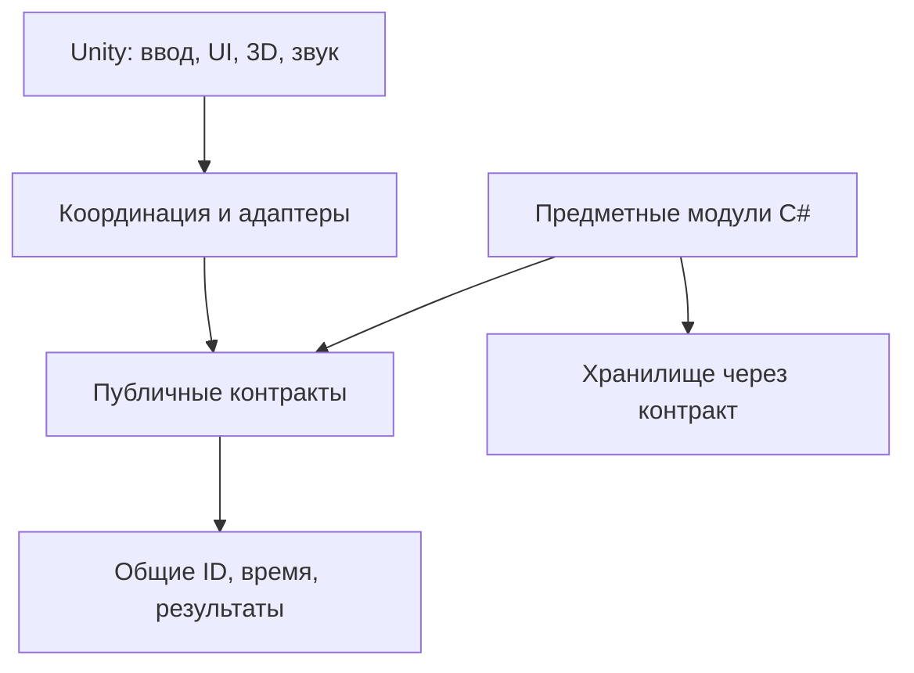

# Согласованная архитектура

## 1. Канонические решения

Модульный монолит, один локальный процесс и одна авторитетная сессия. Чистая C#-логика отделена от Unity-представления. Изоляция модулей на уровне Assembly Definitions (.asmdef); один composition root связывает реализации. Не вводить микросервисы, общую серверную БД или глобальный Service Locator. Контракты создаются по мере появления реально нужных функций, а не заранее для каждого из десятков будущих механизмов.

Граф зависимостей направлен от адаптеров и координации к публичным контрактам; ядро не зависит от Unity API и конкретных плагинов.

Внутренние реализации модулей не получают прямого доступа к состоянию других. Запрос возвращает DTO/неизменяемое представление; команда сообщает успех/отказ и результат; событие — уже подтверждённый факт. Межмодульный сценарий (например, покупка) имеет явного координатора, а не скрытую цепочку обработчиков. Не делать Event Bus универсальным механизмом транзакций.

## 2. Владение состоянием

| Область | Авторитетные данные | Внешние взаимодействия |
|---|---|---|
| Kernel / Simulation | ID, время, порядок тика, очередь фактов, общие типы | Не владеет предметами, деньгами или персонажами |
| Geo / World | географическая база, CellKey, слой изменений, пространственный индекс, базовые объекты | Предоставляет логические места и источники генерации |
| Buildings | здания, этажи, комнаты, проёмы, состояния доступа | Инвентарь хранит содержимое, имущество — владение |
| Actors | постоянная личность, физиология, характеристики, потребности, состав персонажа | Population запрашивает/изменяет через команды |
| Population / Social | расписание, планы, деятельность, отношения, память | Actors, Mobility, Jobs через контракты |
| Mobility | логические положения, маршруты, поездки, транспорт, посадка | Локальная физика и NavMesh — адаптеры |
| Inventory | экземпляры предметов, количество, размещение, контейнеры, экипировка | Единственная точка атомарного перемещения |
| Ownership | права владения, аренды и использования | Economy координирует обмен правами |
| Economy | деньги, счета, торговля, цены | Покупка координирует деньги и предметы |
| Jobs / Craft | профессии, задания, производство, рецепты, занятость станции | Инвентарь, экономика, навыки через команды |
| Skills | опыт, уровень, очки, специализации | Abilities запрашивает разрешения |
| Abilities / Effects | активные/пассивные способности, источники модификаторов, длительность, cooldown | Реальные игровые изменения применяют владельцы данных |
| Interaction | definitions действий, проверка условий и диспетчеризация | Не присваивает себе состояние предметных модулей |
| Weather | региональное состояние погоды, прогноз игровых переходов | Влияет на другие подсистемы через правила и факты |
| Presentation | камера, рендер, анимация, UI, локальный звук, загрузка представлений | Никакой авторитетности игровых данных |
| Persistence | согласованный снимок/дельты, публикация сохранения, миграции | Владелец каждого раздела формирует свои DTO |

Таблица — целевые границы, не задача создать все пустые сборки сразу. Population и Social, Jobs и Craft, Skills и Abilities могут сначала размещаться в одной сборке, если логические владельцы ясны. World и Buildings должны договориться о том, где хранится состояние конкретного объекта, до реализации совместной функции.

## 3. Идентичность и данные

- DefinitionId: стабильная строка формата namespace:category.name. Не локализованное имя и не индекс ресурса.
- EntityId: типизированный стабильный идентификатор мира; динамические экземпляры получают монотонно выделенный ID, счётчик сохраняется. Разные виды ссылок (PersonId, ContainerId и т.п.) не смешиваются. Числовые ID при экспорте в JSON представлены без потери точности.
- Для базовых процедурных объектов — канонический стабильный ключ из версии схемы, исходного FeatureId или родительского ключа и локального слота. Коллизии обнаруживаются; связь с игровым ID сохраняется при индивидуализации. Не использовать Unity InstanceID, временную позицию Transform или индекс списка как долговременный ID.
- Контент: неизменяемые типизированные определения, компактное runtime-представление, изменяемое состояние и вычисляемые данные разделены. JSON — канонический переносимый формат игровых определений; ScriptableObject/Prefab — редакторские и графические ресурсы либо авторинг с явной компиляцией в каталог. У одной семантической записи нет двух независимых источников истины.
- Локализация отделена от ID. Ссылки и схемы контента валидируются автоматически.

## 4. Время, команды и транзакции

Единое игровое время с отдельными шкалами симуляции, визуального кадра и физики. Планировщик запускает логические действия по событиям, срокам и пакетам; массовые потребности могут вычисляться аналитически. Рендер не определяет скорость жизни NPC.

Команды применяются на контролируемой фазе тика, с валидацией и атомарным подтверждением. Параллельные вычисления работают со снимком входов и выдают результаты; подтверждение авторитетных изменений происходит предсказуемо. При временном отказе операции никакая половина инвентарной или денежной транзакции не остаётся подтверждённой. События публикуются после commit. Пауза игрового времени не останавливает интерфейс.

На старте обычный C# и простые очереди/коллекции. Jobs/Burst/Collections и ECS подключаются точечно только по реальному профилю нагрузки; публичные контракты от этого не меняются.

## 5. Модель мира и представление

Глобальное положение хранится в WGS84/double ECEF, Unity использует локальный float в касательном базисе. Канонический `CellKey(GridVersion, Face, Level, X, Y)` версии 1 использует cube-sphere/quadtree на осях ECEF. Первый пакет использует уровень 16, дочерний относительно уровня 13. Правила граней, деления и привязки высот зафиксированы в [GEODATA.md](GEODATA.md). Сохранения, NPC и предметы независимы от положения текущего Unity-origin.

Семантика, навигация, физическая готовность, видимые меши и ресурсы имеют отдельные состояния загрузки. Операции с Unity-объектами и перемена origin выполняются на согласованной границе. У игрока не должно исчезать коллизии под ногами/колёсами при обычной подгрузке в подготовленной области. Не обещать отсутствие любых пауз до реального измерения.

Объекты, графика, карта и логика создаются из общего описания географии. База мира детерминирована и версионируется; изменение генератора не перетирает уже установленную основу сохранения.

## 6. Население

NPC — индивидуальные записи, не GameObject. Генерировать правдоподобные домохозяйства, места работы, потребности, планы и отношения. Начать с расписаний, Utility AI и ограниченных сценариев действий; GOAP и сложное планирование подключать для конкретных задач.

Несколько уровней Simulation LOD: подробные активные NPC с локальной навигацией; логические поездки/действия в соседних чанках; событийное или аналитическое продвижение удалённых жителей; агрегированные ещё неиндивидуализированные регионы. Уже известные индивидуумы, особенно значимые для игрока, сохраняют идентичность, историю и причинность. Визуальный LOD и Simulation LOD независимы. Материализация/дематериализация передаёт положение и действие, а не создаёт нового NPC.

Навигация двухуровневая: семантические места и граф дорог/маршрутов, затем локальный NavMesh для активной физической сцены. Транспорт — собственные сущности, пассажиры и поездки. Детально моделируются ближайшие машины, удалённые перемещения — логически. Известный NPC возвращается в актуальном состоянии.

## 7. Универсальные действия и способности

Общий исполнитель для игрока и NPC. Определение действия включает цели, условия, предусловия, стоимость/резервы, длительность, эффекты, правила отмены и результат; новый тип эффекта реализуется владельцем состояния, а не хардкодом конкретной способности. Типизированные условия/операции и ограниченный декларативный язык данных; не встраивать произвольный исполняемый код.

Первоначальные примитивы создаются только для реально работающих действий: подобрать, положить, открыть, использовать, изменить игровой ресурс. Затем добавляются крафт, торговля, работа, прогрессия, магия и пользовательские Rule Profiles. Например, вымышленная световая аура добавляется определением и VFX поверх уже существующей длительности/расхода ресурса. Новые принципиальные механики могут требовать новых типизированных обработчиков.

Контейнеры имеют уникальное размещение предмета, проверку вместимости и отсутствие циклов вложенности. Опыт и очки хранятся отдельно от эффективных параметров. Пассивные модификаторы имеют источник и удаляются вместе с ним. Настройки баланса могут применяться к игроку/миру/группе и сохраняются в профиле; технические пределы предотвращают переполнение и зацикливание, а не навязывают стандартный баланс.

## 8. Сохранения

Три физически и логически отдельных слоя:
1. Версионированная неизменяемая основа региональных данных.
2. Пересоздаваемый кэш (меши, декодированные данные, LOD, навигация).
3. Сохранение игрока/мира: ID, время, изменения базы, постоянные сущности, состояние модулей, profiles, версии.

Начать с версионированных DTO и локальных поколений файлов: согласованный snapshot на границе тика, фоновая запись, опубликованный manifest только после успеха, предыдущее поколение сохраняется. Не сериализовать Unity-сцену. Отдельный контракт хранилища; SQLite — зрелый кандидат для больших регионов, индексов, выборочных чтений и транзакций, а не обязательный шаг до первого запуска. Проверить конкретный Windows-провайдер и перенести один раз тогда, когда пользу оправдывают данные. Миграции на копии, старые форматы не терять. Тестовые save-root отдельно от пользовательского.

## 9. Как устранены расхождения исследований

| Вопрос | Согласованное решение |
|---|---|
| Сначала Земля или двор | Сразу глобальный координатный контракт и маленький играбельный двор; настоящий выбор Земли и реальный район — следующий крупный выпуск. Не ждать целой планеты. |
| Cesium или собственный мир | Собственный логический мир и простой глобус; Cesium только заменяемый визуальный адаптер. |
| ScriptableObject или JSON | JSON семантики, SO/Prefab для Unity-авторинга и представления; явная компиляция, без дублирования. |
| SQLite сейчас или затем | Файловый backend для маленького мира, стабильный storage contract, переход на SQLite при необходимости масштабирования. |
| Addressables сразу или позже | Абстракция каталога/загрузки сразу; официальные локальные Addressables при первом реальном асинхронном стриминге и росте ресурсов. |
| ECS или managed | Managed C# по умолчанию; Jobs/Burst/Entities после измерения, не переделка всего проекта. |
| Сначала NPC или инвентарь | Рано — одна общая операция и сохранение; потом небольшой живой район с NPC, затем глубокие бытовые и экономические механики. |
| Масштаб тестов | Короткая фактическая проверка затронутых инвариантов и автоматический игровой smoke; длинные прогоны только при оправданной нагрузке/риске. |

Основания: исследования 01 (§§1, 3–12, 17–19), 02 (§§2–16), 03 (§§4–15), 04 (§§4–19), 05 (§§3–17), 06 (§15–18), 07 (§§3–14). Все ссылки находятся в оригинальных документах.
