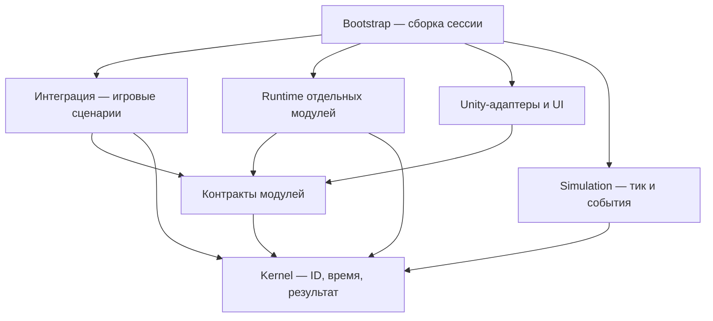
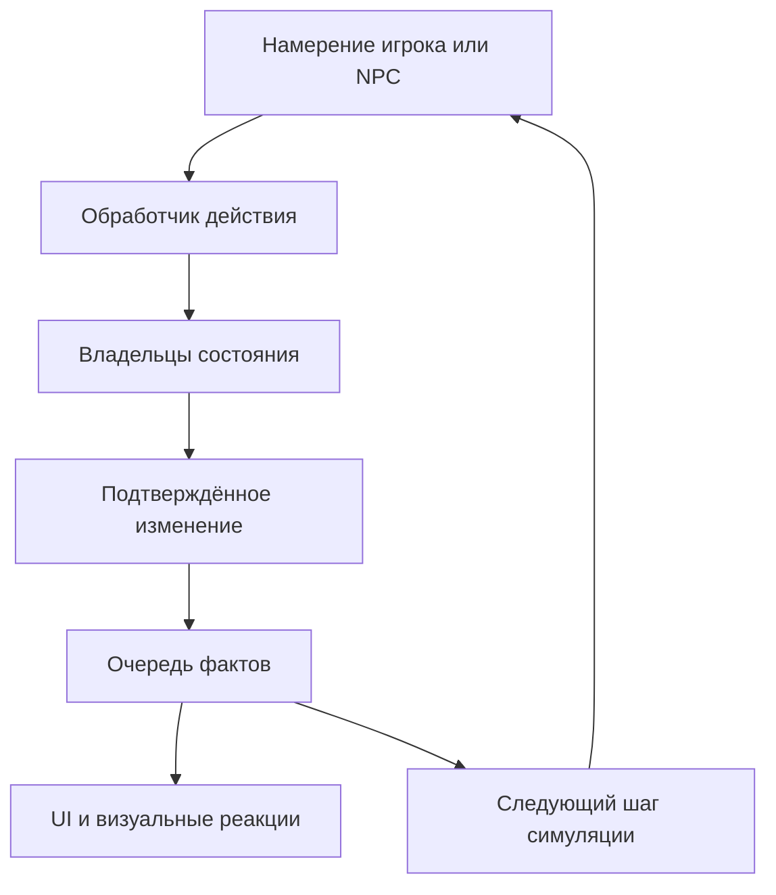

# 01. Архитектура одиночного симулятора жизни с открытым миром

**Техническое исследование и рекомендуемый архитектурный контракт проекта**

Дата: **25 ноября 2026 года**  
Платформа: Unity, C#, первоначально Windows PC  
Статус: рекомендуемая базовая архитектура для разработки Codex; проект ещё не реализован.

> Главная цель — получить игру, в которую можно играть уже после первых этапов разработки, а затем постепенно добавлять механики без систематического переписывания работающего мира. Глубина симуляции важнее буквального моделирования каждой мелочи на каждом кадре.

## 1. Краткое решение

Рекомендую **модульный монолит с независимой C#-симуляцией и Unity-адаптерами**:

- Одно приложение, один процесс, одна игровая сессия, единое игровое время. Офлайн, без обязательных серверов, облака и сетевой архитектуры.
- Игровые подсистемы разделены по предметным областям: мир, персонажи, население, мобильность и транспорт, инвентарь, экономика, навыки, способности, профессии и взаимодействия.
- Владелец каждого вида состояния только один. Другие подсистемы используют публичные контракты, а не получают доступ к внутренним объектам владельца.
- Assembly Definition (.asmdef) физически ограничивает зависимости C# на этапе компиляции. Публичные контракты отделены от реализаций.
- Критические операции выполняются через явные команды с результатом. События уведомляют о фактах, которые уже произошли. Межмодульные сценарии координируются отдельным слоем, а не скрытыми цепочками событий.
- GameObject, MonoBehaviour, физика, UI, Terrain, NavMesh и загрузка ресурсов — адаптеры представления мира. Уничтожение GameObject не означает исчезновение персонажа, предмета или транспорта из мира.
- ScriptableObject применяется для авторинга игровых определений; изменяемое состояние сессии живёт отдельно, в C#.
- Массовая симуляция работает с разной степенью детализации: подробно возле игрока, упрощённо на удалении, агрегированно для действительно фоновых процессов.
- ECS/DOTS **не является фундаментом всего проекта**. Начать с обычных C#-моделей, компактных коллекций и централизованного планировщика. Jobs/Burst и Entities добавлять к конкретным измеренным узким местам, сохраняя контракты.
- Сохранения версионируются отдельно от сцен, ассетов и исполняемого кода. Используются стабильные идентификаторы.
- Автоматические проверки архитектурных границ, сохранений и жизненно важных игровых сценариев выполняет Codex. Пользователь не должен после каждой задачи повторять длинную ручную проверку.

Это не архитектура микросервисов, не универсальный движок на все случаи жизни, не попытка перенести всю ERP-архитектуру в игру. Это сравнительно лёгкий способ сделать большой набор механик независимыми на уровне исходного кода, хранения состояния и исполнения.

### 1.1. Что считается успешным результатом архитектуры

| Изменение в игре | Ожидаемая область изменения |
|---|---|
| Новая рыночная формула | Модуль Economy, его настройки и собственные тесты |
| Новый автомобиль и его параметры | Контент Mobility; при общем типе транспорта — без изменения инвентаря и NPC |
| Новое заклинание из существующих операций | Одно определение способности и визуальный контент, без изменения кода |
| Новый тип воздействия способности | Один новый обработчик в Integration или модуле-владельце и соответствующая декларация |
| NPC начинает выбирать другой магазин | Population; существующие контракты экономики, навигации и времени остаются прежними |
| Новый тип профессии | Определение Jobs + обработчики реально новых действий, если они требуются |
| Замена алгоритма навигации пешком | Unity-адаптер Mobility или его внутренняя реализация, не правила торговли |
| Выгрузка района | Меняется визуальный стриминг; логические сущности продолжают существовать |
| Ускорение массового подсчёта потребностей через Burst | Внутренние вычисления Actors; стабильный внешний API |
| Новый UI инвентаря | Presentation; модель предметов и правила их передачи прежние |

Не следует обещать, что любое изменение затронет ровно один файл. Например, добавление полноценной школы магии с новой механикой влияния на транспорт действительно потребует работы в нескольких модулях. Требование — **минимальный, осмысленный и явный радиус изменений**, а не искусственное отсутствие связей в живом мире.

### 1.2. Допущения и границы исследования

Рассматривается оригинальная одиночная 3D-игра, размер мира, вид камеры, точное число NPC, графический стиль и механика смерти пока не зафиксированы. В качестве первого практически полезного масштаба предлагается один район небольшого города и его окрестности, который является частью расширяемого процедурного мира.

Конкретные частоты тиков, размеры чанков и числа NPC ниже — **настраиваемые стартовые гипотезы**, не обещания производительности. Проверить их можно только в настоящем проекте на целевой машине. Сетевой мультиплеер, открытый моддинг со сторонним исполняемым кодом и экстремальные масштабы вроде миллионов полноценных NPC не являются требованиями первого этапа.

---

## 2. Что даёт официальная документация на дату исследования

### 2.1. Версия Unity

По состоянию на дату исследования Unity 6.3 LTS имеет заявленную поддержку до декабря 2027 года; поддерживаемый промежуточный релиз Unity 6.6 уже опубликован. Unity отдельно рекомендует Update-релизы для новых и продолжающихся проектов, LTS — для проектов, которым важна зафиксированная производственная база. [S1], [S2]

**Решение:** начать на последнем доступном патче **Unity 6.3 LTS**, если при фактической установке не вышел и не проверен более новый LTS. Причина выбора — минимизация затрат на миграцию проекта и совместимость готовых компонентов, а не утверждение, что 6.6 хуже. При старте после появления 6.7 LTS Codex должен единожды проверить наличие стабильного релиза, совместимость пакетов и принять отдельное решение. Не переносить проект на другую ветку Unity в середине игровой задачи.

Точная версия фиксируется в ProjectSettings/ProjectVersion.txt, версии пакетов — в Packages/manifest.json и Packages/packages-lock.json. Lock-файл следует хранить в системе контроля версий. [S3]

Для Unity 6.3 официальный справочник указывает C# 9.0 с ограничениями реализации и доступные профили .NET, включая .NET Standard 2.1. [S4], [S5] Поэтому нельзя без проверки переносить современные возможности привычного .NET 10 в Unity: библиотека, успешно собирающаяся в обычном .NET, может не собраться или не работать в Unity Player. В примерах кода ниже применяются простые классы, структуры и интерфейсы, без зависимости от новых возможностей языка.

### 2.2. Начальный стек

| Технология | Выбор | Обоснование и условие |
|---|---|---|
| Рендеринг | Universal Render Pipeline (URP) | Практичная база для большой 3D-сцены на PC; не требует HDRP по умолчанию. Выбор URP — рекомендация, не утверждение, что HDRP непригоден. [S6] |
| Управление | Unity Input System | Действия игрока, переназначение клавиш, общий слой ввода; не вводить Input System в C#-ядро. [S7] |
| Навигация | AI Navigation | Локальная пешая навигация, NavMesh, переходы и препятствия; собственный стратегический граф для удалённых NPC. [S8] |
| Контент | ScriptableObject, Prefabs | Первоначальный авторинг определений и представлений; компиляция в данные сессии. [S9], [S10] |
| Загрузка | SceneManager + асинхронная загрузка | Одна постоянная сцена, добавочные сцены по мере необходимости; абстракция загрузчика контента. [S11] |
| Управление ресурсами | Addressables, когда появляется необходимость в стриминге и больших каталогах | Локальные группы без обязательного CDN; явное владение операциями загрузки. [S12], [S13] |
| Тесты | Unity Test Framework, NUnit | Edit Mode — правила и контракты; компактные Play Mode-проверки сцен и адаптеров. [S14] |
| Профилирование | Unity Profiler, ProfilerMarker | Измерение CPU, памяти, рендера и узких мест в Player. [S15] |
| Ускорение | Unity Jobs + Burst + Collections | Подключать тогда, когда появились массовые вычисления. [S16], [S17] |
| ECS | Entities (опционально, не на старте) | Перенос конкретной массовой симуляции или представления после измерения. [S18], [S19] |

На дату исследования официальные страницы совместимости Unity 6000.3 указывают AI Navigation 2.0.16, Addressables 2.10.3 и Entities 1.5.0 как выпущенные для этой ветки редактора. [S8], [S12], [S18] Это ориентир, а не требование устанавливать все три пакета или принудительно обновлять их: при фактическом старте использовать совместимую выпущенную конфигурацию Package Manager и зафиксировать её.

Для базовой архитектуры не требуется покупка плагинов Asset Store. Не нужны сторонние DI-контейнеры, платный визуальный граф поведения, платный генератор мира, ORM или база данных. Встроенные возможности и официальные пакеты достаточны для начальной реализации. Сторонний бесплатный пакет допускается, если он действительно экономит время, совместим с выбранной Unity и его можно изолировать за адаптером. Условия лицензии конкретного пакета и редакции Unity проверяются отдельно перед использованием; бесплатность не означает произвольное право распространения.

---

## 3. Сравнение архитектурных альтернатив

Оценки ниже относительные, применительно к этому одиночному симулятору, а не универсальный рейтинг технологий.

| Подход | Скорость старта | Изоляция механизмов | Массовая симуляция | Сложность для Codex | Вывод |
|---|---|---|---|---|---|
| Набор MonoBehaviour с общими менеджерами | Высокая | Низкая при росте проекта | Средняя или низкая | Сперва низкая, потом высокая | Допустим для разового прототипа, не для основного проекта |
| Модульный монолит, всё на Unity-компонентах | Высокая | Средняя/высокая при дисциплине | Средняя | Средняя | Можно применять в представлении, но не для всей симуляции |
| Чистая многослойная архитектура на каждую мелочь | Низкая | Высокая | Зависит от реализации | Высокая | Избыточна: не создавать отдельные проекты для каждого слоя каждого механизма |
| Модульный монолит + C#-ядро + Unity-адаптеры | Высокая после небольшого каркаса | Высокая | Высокий потенциал при LOD и оптимизации | Умеренная | **Основной выбранный вариант** |
| Полный ECS/DOTS с первого дня | Средняя/низкая | ECS сам по себе не гарантирует границ предметных модулей | Высокий потенциал | Высокая | Преждевременно: цена authoring, baking, синхронизации и отладки слишком велика |
| Модульный монолит + выборочный ECS/DOTS | Средняя | Высокая при сохранении контрактов | Высокий потенциал | Умеренная/высокая в отдельных модулях | Предпочтительный путь развития после измерений |
| Микросервисы, отдельные процессы NPC/экономики | Низкая | Формально высокая, фактически сложные связи по сети | Не гарантирована | Очень высокая | Не нужны для одного пользователя и одного процесса |
| Всё через глобальную шину событий | Высокая в простых примерах | Иллюзия изоляции; скрытые сценарии | Зависит от нагрузки | Быстро растёт | Использовать ограниченно, не как универсальный механизм изменения мира |

### 3.1. Почему модульный монолит

Монолит означает единый исполняемый продукт, но не обязан означать один неразборный код. Из примера Clean Architecture и инверсии зависимостей Microsoft полезно взять направление зависимостей: прикладные правила не зависят от реализации хранения и пользовательского интерфейса. [S20] Для игры переносим именно принцип, а не серверную инфраструктуру, микросервисный CQRS, брокер сообщений или сложный DDD-фреймворк.

Разделение по **игровым областям ответственности** предпочтительнее горизонтальных папок Managers, Models, Systems, Controllers на весь проект. Каждый модуль содержит свои модели, правила, контракты и тесты. Не нужно открывать папку со всеми менеджерами, чтобы найти изменения экономики.

### 3.2. Почему отделять правила от Unity

Unity прекрасно подходит для отображения, физики, анимаций, ввода и редактирования контента. Но жизнь NPC не должна прекращаться из-за выгрузки сцены. Если персонаж, его деньги, навыки и работа хранятся в одном MonoBehaviour на сцене, то стриминг мира сразу начинает ломать множество механик.

В C#-симуляции можно обработать игровой день, прогнать тысячи логических решений, сохранить мир или выполнить тест торговли без камеры и открытой игровой сцены. GameObject показывает существующую логическую сущность; в отдельных случаях физический адаптер поставляет ей подтверждённые результаты движения.

Ещё один плюс — относительно локальная поломка: изменения анимации или физического представления не должны изменять структуру сохранений профессий.

### 3.3. Компромисс с количеством сборок

Не превращать каждый класс в самостоятельную сборку. Начальный принцип — **две сборки на содержательный предметный модуль**, если он имеет потребителей: Contracts и Runtime. Unity-адаптеры выделять отдельно только там, где они реально нужны. Внутренние части Runtime могут быть обычными папками и типами internal.

Библиотека General, в которую складывают всё, на практике быстро становится новым монолитом. Общий слой ограничен стабильными примитивами и инфраструктурными интерфейсами.

---

## 4. Общая схема

Стрелки показывают разрешённое направление ссылки исходного кода: от потребителя к зависимости. Композиционный корень знает реализации всех устанавливаемых модулей; модули не знают о нём.



Sim предоставляет инфраструктурные реализации интерфейсов Kernel, а через Bootstrap получает список систем и подписчиков. Реальные зависимости каждой сборки фиксируются в матрице ниже, а не определяются диаграммой произвольно.

Отдельный поток исполнения:



Для критичных операций обработчик ждёт явного результата команды, а не события из неизвестного места. При завершении подтверждённого изменения публикуются факты для необязательных реакций.

---

## 5. Конкретная структура Unity-проекта

Названия рабочих каталогов могут измениться при выборе названия игры, но структура, направления ссылок и роли должны сохраниться.

```text
LifeSim/
  AGENTS.md
  README.md
  Docs/
    Architecture/
      01-Game-Architecture.md
      ModuleMap.md
    Decisions/
      ADR-0001-ModularMonolith.md
    Gameplay/
    Modules/
  Tools/
    Run-Tests.ps1
    Build-Game.ps1
  Assets/
    _Game/
      Kernel/
        Game.Kernel.asmdef
        Identity/
        Time/
        Results/
        Messaging/
        Simulation/
        Persistence/
      Simulation/
        Game.Simulation.asmdef
        Scheduler/
        Messaging/
        Session/
      Modules/
        World/
          Contracts/
            Game.World.Contracts.asmdef
          Runtime/
            Game.World.Runtime.asmdef
            Generation/
            Regions/
            Deltas/
          Unity/
            Game.World.Unity.asmdef
            Streaming/
            Terrain/
            Authoring/
        Actors/
          Contracts/
          Runtime/
          Unity/
        Population/
          Contracts/
          Runtime/
        Mobility/
          Contracts/
          Runtime/
          Unity/
        Inventory/
          Contracts/
          Runtime/
        Economy/
          Contracts/
          Runtime/
        Skills/
          Contracts/
          Runtime/
        Abilities/
          Contracts/
          Runtime/
          Unity/
        Jobs/
          Contracts/
          Runtime/
        Interaction/
          Contracts/
          Runtime/
          Unity/
      Gameplay/
        Contracts/
          Game.Gameplay.Contracts.asmdef
        Runtime/
          Game.Gameplay.Runtime.asmdef
          Workflows/
          InteractionHandlers/
          AbilityEffectHandlers/
          Policies/
      Persistence/
        Game.Persistence.asmdef
        SaveCoordinator/
        Serialization/
        Migrations/
      Content/
        Game.Content.Unity.asmdef
        Catalogs/
        Authoring/
        Validation/
        Definitions/
          Items/
          Abilities/
          Skills/
          Jobs/
          Vehicles/
          World/
      Presentation/
        Game.Presentation.asmdef
        UI/
        Input/
        ViewModels/
        Camera/
        Audio/
      Assets/
        Art/
        Prefabs/
        Materials/
        Audio/
      Bootstrap/
        Game.Bootstrap.asmdef
        GameSessionBehaviour.cs
        GameCompositionRoot.cs
        Scenes/
          Bootstrap.unity
          Sandbox.unity
      Editor/
        Game.Editor.asmdef
        ContentTools/
        ArchitectureChecks/
      Tests/
        EditMode/
          Game.Tests.EditMode.asmdef
          Modules/
          Workflows/
          Architecture/
          Saves/
        PlayMode/
          Game.Tests.PlayMode.asmdef
          Smoke/
    ThirdParty/
  Packages/
    manifest.json
    packages-lock.json
  ProjectSettings/
    ProjectVersion.txt
  UserSettings/                  # не хранить в Git
```

Папки с C# и префабы можно размещать иначе внутри конкретного модуля, но каждая папка с игровым исходным кодом должна относиться к намеренно выбранной сборке. Не создавать пустые модули и десятки пустых сборок заранее: каркас создаётся по мере появления вертикального игрового среза.

Assets/_Game/Assets содержит оригинальные визуальные ресурсы и префабы. Централизованный каталог контента не является владельцем игрового состояния; он обслуживает регистрацию определений и ссылки на визуальные ассеты. Editor-only скрипты идут в отдельную сборку с платформой Editor. Подкаталог с именем Editor под родительской asmdef не следует считать автоматической защитой от попадания редакторского кода в runtime: Unity описывает особенности специальной папки при наличии asmdef. [S21], [S22]

### 5.1. Assembly Definitions: правила компиляционной изоляции

Assembly Definition позволяет назначить исходный код отдельной сборке и явно задать её зависимости. Assembly Definition Reference позволяет отнести другой каталог к уже существующей сборке. У asmdef есть, в частности, настройки Auto Referenced и No Engine References. [S21], [S22], [S23]

Важное различие: Auto Referenced не определяет наличие сборки в Player. Эта настройка управляет автоматическими ссылками предопределённых сборок. No Engine References отключает автоматические ссылки на UnityEngine и UnityEditor. Ни одна настройка не решает вопрос владения данными автоматически; для этого всё равно нужны контракты и дисциплина кода. [S22]

Пример Game.Inventory.Contracts.asmdef (ссылки по имени для читаемости):

```json
{
  "name": "Game.Inventory.Contracts",
  "rootNamespace": "Game.Inventory",
  "references": ["Game.Kernel"],
  "autoReferenced": false,
  "noEngineReferences": true,
  "allowUnsafeCode": false
}
```

Пример Game.Inventory.Runtime.asmdef:

```json
{
  "name": "Game.Inventory.Runtime",
  "rootNamespace": "Game.Inventory",
  "references": [
    "Game.Kernel",
    "Game.Inventory.Contracts"
  ],
  "autoReferenced": false,
  "noEngineReferences": true,
  "allowUnsafeCode": false
}
```

Пример Game.Mobility.Unity.asmdef:

```json
{
  "name": "Game.Mobility.Unity",
  "rootNamespace": "Game.Mobility.Unity",
  "references": [
    "Game.Kernel",
    "Game.Mobility.Contracts"
  ],
  "autoReferenced": false,
  "noEngineReferences": false,
  "allowUnsafeCode": false
}
```

Если адаптер использует классы конкретного пакета Unity, добавить его фактическую сборку в references. Не угадывать имя пакета, отличающееся от имени сборки. Для постоянных ссылок Unity допускает GUID — после создания реальных asmdef и их .meta удобно выбрать GUID-ссылки, чтобы изменение имени сборки не ломало её зависимости. [S23]

**Обязательные ограничения:**

1. Contracts и обычные C# Runtime не используют UnityEngine, UnityEditor, Unity.Mathematics и Unity.Collections; при оптимизации выделяется отдельная сборка расчётного backend с конкретными ссылками.
2. Не использовать Assembly-CSharp для собственного основного игрового кода.
3. Реализации имеют internal по умолчанию. Публичной оставлять точку создания/регистрации модуля и узкие контрактные типы.
4. Никаких круговых ссылок и ссылок Runtime одного предметного модуля на Runtime другого. Bootstrap — единственное место, которое знает конкретные реализации всех модулей.
5. Unity-адаптер опирается на контракты; выдаёт запрос или принимает подтверждённый результат, не изменяет приватный словарь Runtime.
6. Внешние DLL ограничивать через настройки импорта/явные references, когда они нужны. Не допускать случайного доступа доменных сборок к SDK плагинов.
7. Тесты — отдельные сборки. Допустимо точечно открыть internal для собственных тестов посредством InternalsVisibleTo, но не для другого модуля.
8. При перемещении ассета за пределами Editor сохранять соответствующий .meta. Unity использует уникальные ID из метаданных для ссылок; потеря .meta разрывает ссылки. [S24]

### 5.2. Матрица разрешённых зависимостей

Обозначения: K = Game.Kernel, C(X) = Game.X.Contracts, R(X) = Game.X.Runtime, U(X) = Game.X.Unity. Таблица — разрешённые прямые ссылки собственного рабочего кода, а не требование использовать все перечисленные зависимости.

| Сборка | Разрешённые зависимости игрового кода | Назначение |
|---|---|---|
| K | Нет | Идентификаторы, время, тип результата, инфраструктурные контракты |
| Game.Simulation | K | Планировщик, реализация шины, жизненный цикл сессии |
| C(X), включая C(Gameplay) | K | Публичные DTO, команды, запросы и события своего модуля |
| R(World) | K, C(World) | Генератор и состояние географии |
| R(Actors) | K, C(Actors) | Идентичность, потребности, характеристики |
| R(Population) | K, C(Population), C(World), C(Actors), C(Mobility), C(Jobs), C(Interaction) | Планирование NPC, чтение доступных действий и отправка намерений |
| R(Mobility) | K, C(Mobility), C(World) | Позиции, маршруты, транспорт |
| R(Inventory) | K, C(Inventory) | Предметы и контейнеры |
| R(Economy) | K, C(Economy) | Счета, цены, рынок |
| R(Skills) | K, C(Skills) | Прогресс и разблокировки навыков |
| R(Abilities) | K, C(Abilities) | Определения и состояние способностей, активные эффекты |
| R(Jobs) | K, C(Jobs) | Профессии, трудовые задания, смены |
| R(Interaction) | K, C(Interaction) | Реестр доступных действий и исполнение согласованных обработчиков |
| Game.Gameplay.Runtime | K, C(Gameplay), необходимые C(X) | Межмодульные сценарии, обработчики действий и воздействий. Без R(X) |
| U(X) | K, C(X), при необходимости C(Gameplay), C(Interaction) | Адаптация к Unity APIs, локальное представление и входные команды |
| Game.Content.Unity | K, необходимые C(X) | Авторинг и трансляция определений, визуальный каталог |
| Game.Persistence | K (плюс Unity API, если выбран JsonUtility/persistentDataPath) | Сериализация конверта, координатор сохранения; адаптеры разделов поставляют владельцы |
| Game.Presentation | K, необходимые C(X), C(Gameplay), C(Interaction) | UI, ввод, визуальные реакции через интерфейсы |
| Game.Bootstrap | Остальные реально устанавливаемые сборки | Явная композиция всех зависимостей |
| Game.Editor | Контракты, необходимые editor/authoring-адаптеры, Content.Unity | Служебные инструменты Unity Editor |
| Тестовые сборки | Целевые тестируемые сборки | Проверки изоляции, правил, интеграции |

Если правила взаимодействия требуют иных зависимостей, сначала определить, должен ли сценарий принадлежать Game.Gameplay.Runtime. Не добавлять ссылку на R(Y) ради удобства. Ссылка на C(Y) допустима лишь при реальной устойчивой потребности, должна быть отражена в карте. Взаимная связь через Contracts технически может быть без цикла сборок, но семантическая рекурсия операций всё равно запрещена.

Контракты конкретного модуля не ссылаются на контракты всех остальных. Межмодульный DTO строится из общих ID-значений Kernel и принадлежащих этому контракту типов, а не из объектов реализаций. При необходимости отдельный контракт рабочего сценария определяет Game.Gameplay.Contracts.

---

## 6. Владение состоянием: наиболее важное правило симулятора

### 6.1. Что принадлежит каждому модулю

| Владелец | Авторитетное состояние | Что не принадлежит владельцу |
|---|---|---|
| World | Seed, version генератора, регионы, география, здания/участки, точки интереса, логические изменения окружения и якоря мест | Деньги NPC, содержимое сундуков, позы мобильных сущностей |
| Actors | ActorId, существование/жизненный статус персонажа, личность, физиология, базовые и вычисляемые характеристики, потребности/отношения (в первом варианте) | Деньги, сумки, опыт, транспорт, текущий план AI |
| Population | Автономные намерения, расписания, текущие планы, история принятия решений, выбор локации/цели | Физиологическое состояние, зарплата, владение предметами |
| Mobility | Логические позиции мобильных сущностей, режим движения, маршрут, состояние транспорта, места в салоне, посадка, доступ к транспортным средствам | Баланс, содержимое багажника, визуальный Transform как уникальное хранилище |
| Inventory | Экземпляры предметов, стеки, контейнеры, экипировка и местоположение предмета в контейнере | Валюта, рыночная цена, изменение характеристики персонажа |
| Economy | Денежные счета, транзакции/остатки, предложения рынка, цены и резервы денежных операций | Фактическое количество товара, хранящегося в Inventory; профессия NPC |
| Skills | Опыт, уровни, изученные навыки, правила роста | Прямое изменение чужих потребностей и валюты |
| Abilities | Разблокированные/назначенные способности, ресурсы самой подсистемы (например мана), активные эффекты, перезарядки, источники модификаторов | Базовые характеристики, инвентарь и местоположение цели |
| Jobs | Профессии, смены, трудовые договорённости, рабочие задания и выполненность | Баланс денег, физическое положение, экземпляры изготовленного предмета |
| Interaction | Зарегистрированные возможности действия, при необходимости состояние сессии действия и её прогресс | Данные, которые действие меняет: оно делегирует изменение владельцам |
| Simulation | Глобальный игровой тик, фаза, порядок систем, очереди команд/событий | Доменное содержимое персонажа, рынка или мира |
| Persistence | Формат слота, заголовок, версии разделов, резервная копия, процесс записи | Не является вторым владельцем состояния всех модулей |
| Presentation / Unity-адаптеры | Визуальные объекты, анимации, окна, временные эффекты, распределение объектов из пулов | Источник истины для логического существования и постоянного прогресса |

При расширении проекта отношения и социальная история могут выделиться из Actors в отдельный модуль Social, потребности — в Health/Needs, дорожное движение — из Mobility. Выделение имеет смысл при появлении самостоятельных правил и устойчивого API, а не только из-за большого числа строк.

### 6.2. Идентичность и поиск

Использовать логические типы идентификаторов: ActorId, VehicleId, ItemInstanceId, ItemDefinitionId, ContainerId, RegionId, LocationId, DefinitionId. Концептуально ID — стабильный ключ, а не ссылка на MonoBehaviour, Transform, Unity Entity, экземпляр prefab или порядковый индекс массива.

Kernel может содержать простую общую идентичность сущности EntityId и небольшие типы-обёртки над числом либо стабильной строкой. Для генерируемых объектов практичны воспроизводимые ключи из устойчивых пространственных идентификаторов плюс локальный ключ; для созданных в процессе игры — новые ID из сохранённого генератора/счётчика с областью уникальности. Коллизии проверяются. Не применять string.GetHashCode или хеш объекта Unity для долговременных ID.

Стабильный ключ определения, например item.food.apple, записывается явно и не меняется при переименовании файла, локализованного названия или перемещении ассета. Unity GUID ассета полезен в редакторском каталоге, но внешние сохранения должны иметь управляемый игровой ключ.

Владельцы реализуют поиск своих записей и публичные проекции. Не создавать общий изменяемый словарь EntityId -> объект Player, который все системы могут записывать. Если нужен пространственный индекс или каталог существования сущностей, он реализуется как узкая проекция/сервис с определённым владельцем и обновлением после подтверждённых операций.

### 6.3. Примеры инвариантов

- Один экземпляр предмета не может находиться одновременно в двух контейнерах.
- Сумка, сундук, багажник, магазин и предметы на земле — контейнеры Inventory, при этом их принадлежность/внешний якорь могут ссылаться на другие модули посредством ID.
- У персонажа нет отдельного изменяемого поля Gold, если валютой владеет Economy.
- Пассажир имеет ровно одно подтверждённое размещение: пеший режим, место в автомобиле или другой определённый способ перемещения. Mobility владеет и посадкой, и привязкой позиции; позиция пассажира во время поездки вычисляется из состояния транспорта.
- Профессия не изменяет деньги напрямую, покупка не добавляет предмет через UI, а способность не изменяет приватный список навыков.
- Мана принадлежит Abilities, голод — Actors. Если в будущем появится универсальный ресурсный модуль, это будет явная миграция владельца, а не второе поле маны.
- Derived-данные можно кэшировать, но они имеют источник, версию или условие инвалидирования. Кэш не сохраняется как конкурирующий источник истины.

### 6.4. Публичный API модуля

Два направления, обычно в виде раздельных интерфейсов:

- Queries — получение неизменяемого снимка, списка доступных действий, вычисленной цены, маршрута или проверки доступности. По возможности без побочных эффектов.
- Commands — намеренно изменяют состояние и возвращают результат: успех, причина отказа, новая версия/необходимые данные.

Не отдавать наружу внутренние List, Dictionary, mutable object или IEnumerable поверх изменяемой коллекции. ReadOnlySpan и оптимизированные представления допустимы внутри измеренных горячих путей, но за публичной границей API нужно гарантировать срок жизни и невозможность несанкционированной записи. Read-only interface сам по себе не делает содержащийся объект неизменяемым.

Практический принцип: публичный API должен выражать действия предметной области, а не CRUD над всеми полями. TransferItem лучше, чем SetItemOwner; CompleteWork лучше, чем SetJobProgress(100). Команда передаёт контекст намерения (кто, что, когда, какой ID операции), владелец проверяет предусловия.

---

## 7. Контракты, событийная шина и межмодульные операции

### 7.1. Пример контракта

Ниже проектный пример, а не уже скомпилированная библиотека. Типы ActorId, ItemId (здесь идентификатор переносимой записи/экземпляра), ContainerId, CommandResult, OperationId относятся к Game.Kernel; GameTick — игровое время. Реальные типы будут созданы только при реализации.

```csharp
// Game.Inventory.Contracts
public interface IInventoryQueries
{
    InventorySnapshot Read(ContainerId container);
    bool HasSpace(ContainerId destination, ItemId item, int quantity);
}

public interface IInventoryCommands
{
    CommandResult Transfer(TransferItem command);
}

public readonly struct TransferItem
{
    public readonly OperationId Operation;
    public readonly ActorId Actor;
    public readonly ContainerId From;
    public readonly ContainerId To;
    public readonly ItemId Item;
    public readonly int Quantity;

    public TransferItem(
        OperationId operation, ActorId actor,
        ContainerId from, ContainerId to,
        ItemId item, int quantity)
    {
        Operation = operation;
        Actor = actor;
        From = from;
        To = to;
        Item = item;
        Quantity = quantity;
    }
}

public readonly struct ItemTransferred : IGameEvent
{
    public readonly OperationId Operation;
    public readonly GameTick Tick;
    public readonly ContainerId From;
    public readonly ContainerId To;
    public readonly ItemId Item;
    public readonly int Quantity;

    public ItemTransferred(
        OperationId operation, GameTick tick,
        ContainerId from, ContainerId to, ItemId item, int quantity)
    {
        Operation = operation;
        Tick = tick;
        From = from;
        To = to;
        Item = item;
        Quantity = quantity;
    }
}
```

Реализация Transfer обязана самостоятельно проверить наличие предмета, количество, допустимость контейнеров и права действия, за которые отвечает Inventory. Вызов HasSpace перед командой удобен для UI, но не является гарантией последующего успеха. Правила внешних сценариев, например разрешение владельца автомобиля, проверяются координатором через соответствующий контракт; Inventory не обязан ссылаться на Mobility.Runtime.

### 7.2. Когда использовать команду, запрос и событие

| Механизм | Когда | Пример |
|---|---|---|
| Запрос через интерфейс | Нужен ответ сейчас, не меняющий состояние | Вернуть цену яблока, уровень навыка, положение автомобиля |
| Синхронная команда | Изменение обязательно для результата текущего сценария | Переместить предмет между контейнерами |
| Очередь команд | Намерение поступило асинхронно с кадра ввода или должно исполниться в определённой фазе тика | NPC выбрал работу, игрок нажал Interact |
| Доменное событие | Уведомить об уже подтверждённом факте, на который могут реагировать независимые подписчики | ItemTransferred, WorkCompleted, AbilityActivated |
| Внутренний C# event | Локальное уведомление с понятным временем жизни, например в UI | Изменение выбранной вкладки |
| Через координатор сценария | Действие затрагивает несколько владельцев или требует проверок нескольких контрактов | Купить предмет, получить зарплату, создать изделие |

C# events основаны на делегатах; обычная публикация вызывает подписчиков синхронно. [S25] Поэтому проектная игровая шина должна явно определить собственную семантику доставки, а не считать, что любой event автоматически исполнится безопасно в будущем.

### 7.3. Рекомендуемая реализация шины

Небольшая типизированная шина внутри Game.Simulation без динамического поиска обработчиков в каждом кадре, внешнего брокера и обязательной DI-библиотеки:

```csharp
// Game.Kernel (эскиз публичного контракта)
public interface IGameEvent { }

public interface IEventPublisher
{
    void Enqueue<T>(T value) where T : IGameEvent;
}

public interface IEventSubscriptions
{
    IDisposable Subscribe<T>(Action<T> handler)
        where T : IGameEvent;
}
```

Тип события принадлежит Contracts модуля, который его публикует. Например передача предмета — событие Inventory, завершение трудовой смены — Jobs. Все события имеют фактическое содержание; для важных цепочек добавляются OperationId, GameTick, монотонный номер события и при необходимости идентификатор причины.

**Семантика:**

1. Шина имеет время жизни игровой сессии, не является статическим Singleton.
2. Enqueue помещает неизменяемое сообщение в текущую накопительную очередь. Публикация не вызывает мгновенно другой модуль.
3. После завершения фазы изменений планировщик доставляет фиксированный пакет событий в порядке, установленном сессией (FIFO по номеру постановки; при слиянии результатов работ — стабильный порядок).
4. События, поставленные во время обработки пакета, относятся к следующей предусмотренной фазе или следующему тику. Не допускать рекурсивной синхронной публикации.
5. Один обязательный результат операции не зависит от порядка подписчиков. Если порядок является существенным правилом игры, он описывается явно в workflow или планировщике.
6. Подписчик не изменяет чужое состояние; он может обновить собственную проекцию или поставить следующую команду. Ошибка некритического UI-обработчика изолируется и регистрируется. Ошибка необходимой симуляционной реакции — диагностируемый сбой сессии/тика, не бесшумный пропуск.
7. Подписки освобождаются при остановке сессии и при выгрузке слоя представления. Bootstrap отвечает за время жизни.
8. Шина в ядре работает на одном авторитетном потоке. Jobs/фоновые операции возвращают результаты планировщику через специально определённый канал, а не меняют очереди непосредственно.
9. Не публиковать событие на изменение каждого Transform или каждое колебание float. Высокочастотные данные движения и потребностей передаются плотными снимками/очередями специализированных систем.
10. Встроить ограниченный диагностический журнал событий и длины очереди. Не переполнять лог постоянными событиями, не строить постоянный event sourcing для всего мира.

Microsoft рекомендует отделять доменную логику от обработчиков доменных событий, чтобы добавлять новые реакции с меньшей связностью. [S26] В нашем случае события служат реакциям на факты, а не заменяют обязательную транзакционную работу.

### 7.4. Почему ScriptableObject event channels не являются основной шиной

Unity показывает подход, где каналы событий на ScriptableObject связывают компоненты через Inspector; это полезно для авторинга, звука, VFX и отдельных UI-сигналов. [S27] Но если все правила покупки, магии и жизни NPC зависят от цепочки привязок ассетов, Codex трудно определить полный путь исполнения, тесты зависят от редактора, а отсутствующий listener может молча нарушить инвариант.

Решение: ядро использует типизированные C#-контракты, а ScriptableObject-каналы, UnityEvent и Inspector допускаются только как локальная связь представления с понятными владельцем и временем жизни.

### 7.5. Межмодульная операция: покупка товара

Нельзя сначала списать деньги, опубликовать MoneySpent, а затем надеяться, что обработчик Inventory добавит товар. У игрока могут исчезнуть деньги, если сумка заполнена или товар уже купил NPC.

Координатор PurchaseWorkflow в Game.Gameplay.Runtime:

1. Получает PurchaseRequest с покупателем, продавцом, ID предложения, количеством, ожидаемой версией или рассчитанной котировкой.
2. Запрашивает Economy: предложение, цена, возможность оплаты. Запрашивает Inventory: наличие фактического товара и возможность передачи.
3. Готовит изменения обоих владельцев. Обработка происходит на авторитетном потоке без yield/await, посторонних callbacks и сохранения между фазами.
4. Подтверждает изменения в единой прикладной границе. Для операций, которые могут отказать после подготовки, хранит локальные обратимые планы/предыдущие значения и откатывает изменения. Для простого обмена начальная реализация может использовать узкий составной метод с подготовкой и гарантированным применением подготовленных записей; технические исключения должны приводить к контролируемому откату, а не оставлять половину операции.
5. Только после успешного завершения публикует ItemTransferred, MoneyTransferred и PurchaseCompleted; в случае отказа возвращает конкретный код и не публикует успешные факты.
6. UI обновляет представление; Population может пересчитать намерение NPC; Skills получает очки торговли только по явно заданному правилу.

Практический способ обеспечить публикацию только после общего подтверждения — выделить в Contracts владельцев узкие подготовительные операции для данного workflow. Например, PrepareTransfer возвращает неизменяемый план с ожидаемой версией контейнера, PreparePayment — план со счетами. Применение подготовленного плана не вызывает внешние обработчики и возвращает подготовленные факты в локальный буфер операции; если оба владельца подтвердили изменение, координатор передаёт этот буфер шине, иначе отбрасывает его и откатывает применённые записи. Обычная самостоятельная команда может использовать тот же внутренний механизм и сразу подтверждать собственный буфер. Это важно: очередь публикации сама по себе не даёт атомарности состояния.

Не копировать весь мир для каждой покупки. Достаточно подготовить затронутые контейнеры, счета и версии. То же правило применяется к продаже, оплате транспорта, изготовлению изделия и завершению оплачиваемой смены. В начальном проекте не нужен универсальный транзакционный движок, распределённые транзакции или Saga-фреймворк.

Пример кода результата: Success, InvalidTarget, InsufficientFunds, ItemMissing, ContainerFull, NotAllowed, StaleQuote. Возвращать типизированную причину для UI и AI; не обрабатывать нормальный отказ только через исключение.

При повторной доставке одной значимой команды OperationId позволяет обнаружить уже завершённую операцию, если она может повториться (например, восстановление после загрузки сохранённого рабочего действия). Не требуется вечный реестр для каждого клика: достаточно контрактно определённого времени хранения либо состояния выполняемого задания.

## 8. Игровое время, планировщик и уровни симуляции

### 8.1. Разделение трёх временных шкал

У Unity есть время кадров и фиксированные шаги физики. [S28] Но жизнь мира должна иметь собственный счётчик времени, не зависящий от количества FPS или количества активных компонентов.

- **Render time** — Update/LateUpdate, UI, камера, интерполяция, анимация.
- **Physics time** — FixedUpdate и физические взаимодействия активной области.
- **Game simulation time** — целочисленный GameTick с фиксированным шагом, например 200 мс при скорости мира ×1. Этот шаг используется как единица планирования, а календарное время выводится из настроенного коэффициента игрового времени.

Реальное время на компьютере не должно определять зарплату NPC, перезарядку способности или наступление ночи. Для каждой длительности определить, какая шкала применяется: анимационный эффект может длиться в реальных секундах, смена — в игровых часах, способность — в игровых тиках. Сохранение фиксирует игровой календарь и прогресс.

Один GameSessionBehaviour из Bootstrap получает Unity deltaTime/unscaledDeltaTime, передаёт время чистому планировщику и читает снапшоты для представления. Не размножать Update на каждый NPC для голода, торговых решений и навыков. Самостоятельные Update/FixedUpdate оставлять там, где это оправдано Unity-представлением и физикой.

### 8.2. Начальное расписание

| Система | Стартовый интервал при ×1 | Замечание |
|---|---:|---|
| Ввод/визуальное движение | Каждый кадр | Поставка намерения, не авторитетный экономический апдейт |
| Физика ближайших объектов | Unity fixed timestep (исходно 0,02 с, уточнить) | Отдельный бюджет, лишь для активной области |
| Очередь команд, активные способности, воздействие | 0,2 с / базовый тик или явный TTL по тику | Анимация может стартовать быстрее, игровые правила имеют определённую фазу |
| Выбор действия ближайшего NPC | 0,4–1 с, фазы распределены | Срочный пересчёт при потере достижимости/действия |
| Потребности и эффекты | 1–5 с либо отсроченное вычисление по прошедшим тикам | Длительности вычисляются относительно времени, а не числа вызовов |
| Удалённое перемещение | 2–10 с, либо событие о прибытии | Стратегический граф |
| Экономика: цены/спрос | Раз в несколько игровых минут или событийно | Остатки меняются немедленно при операции, цены обновляются независимо |
| Смены, расписания и фоновые процессы | 1 игровая минута / переход календарной границы | Не проверять каждый объект каждый кадр |

Конкретные интервалы зависят от дизайна ускорения времени. При ×8 число логических шагов может расти, но не должно автоматически увеличивать число физических шагов в восемь раз. Для сна, длительного ожидания и перескока времени применять безопасный fast-forward, где системы могут вычислять изменения по интервалу, а важные события обрабатываются в календарном порядке. Первоначально fast-forward может быть ограничен нахождением персонажа в безопасном состоянии/отсутствием незавершённых активных действий.

### 8.3. Фазы одного логического тика

1. Зафиксировать пакет входных команд игрока, NPC и результатов адаптеров.
2. Обновить календарь и запланированные истечения ресурсов/эффектов.
3. Применить готовые команды в стабильном порядке; обработать внутренние инварианты.
4. Запустить системы, наступившие по расписанию: потребности, экономика, рабочие смены, движение вне активной зоны и прочее, с явно заданным порядком чтения/записи.
5. Распространить пакет событий; реакции, изменяющие состояние, ставят команды на следующую разрешённую фазу. AI строит планы из целостного снимка.
6. Опубликовать снапшоты для представления. Разрешить точку снятия сохранения, если нет открытой операции.

Система реализует узкий IGameSystem (или набор систем), регистрируемый в Bootstrap. Планировщик знает интервал, фазу, стабильный порядок и бюджет работы. Он не знает, как растёт уровень кузнеца. Не использовать порядок вызова Awake/Start разных компонентов для зависимости игровых правил.

Пример протокола:

```csharp
public interface IGameSystem
{
    void Tick(in TickContext context);
}
```

TickContext содержит текущий тик и календарное время, но не общий IServiceProvider, Unity Scene, ссылку на всех менеджеров или изменяемые данные всех модулей. Реальные зависимости заведены в конструктор конкретной системы.

Ограничить догоняющие тики за кадр, например максимум 4 на нормальной скорости. При превышении бюджета зафиксировать отставание, сдвинуть необязательную работу или явно замедлить симуляцию. Нельзя молча выбрасывать важные тики и тем самым терять события рынка, завершение задания или платёж. При длинном ожидании применять корректное агрегированное обновление, предусмотренное модулем.

### 8.4. Simulation LOD — население действительно существует за пределами камеры

| Уровень | Модель NPC | Движение | Применение |
|---|---|---|---|
| L0: Active | Полный актуальный персонаж и действия | 3D-представление, локальная навигация, физика при необходимости | Видимые персонажи, активная область, персонажи, непосредственно взаимодействующие с игроком |
| L1: Nearby logical | Тот же ActorId, те же ресурсы, цель, актуальный план | Упрощённые позиции, локальный/региональный граф | Объекты рядом или скоро появляющиеся, но пока не требующие полномерного представления |
| L2: Regional logical | Персональные характеристики, расписание, обязательные экономические последствия | Маршрут по графу и время прибытия | Большая часть далёкого населения |
| L3: Aggregate (позднее) | Агрегаты только для действительно фоновых, ещё не индивидуализированных процессов | Статистика районов/потоков | Большие отдалённые производства, поток спроса без обязательных персональных историй |

Не создавать NPC заново каждый раз, когда игрок приближается к дому. Существующий ActorId, имущество, семья/отношения, навыки, долгосрочная работа и важная история сохраняются. При L2 NPC может успеть сходить в магазин, заплатить деньги и прийти на работу, даже если игрок не присутствовал. При L0 игрок видит результат этого же процесса, а не другого персонажа со случайно подобранным состоянием.

Для персональных NPC не применять L3 как способ молча удалить их имущество и память. L3 допустим только там, где модель игры не обещает индивидуальную непрерывность, и не должен дублировать продажу, которую уже совершил конкретный L2-персонаж.

Переходы L0/L1/L2:

- Гистерезис расстояния и ограничение количества материализаций за кадр, чтобы не возникало дрожание при пересечении границы.
- Промоция создаёт представление из логического состояния; выбирает безопасную достижимую позу в рамках текущего пути.
- Демотирование фиксирует последнее нужное положение/прогресс движения и освобождает визуальный объект; не списывает ресурсы второй раз.
- Незавершённые взаимодействия имеют ясные правила перехода: завершить, безопасно отменить, заморозить до возобновления или перейти в эквивалентный логический режим. Нельзя тупо уничтожить исполнительный компонент с незавершённой сделкой.
- Пока NPC материализован, физический адаптер может задавать результаты перемещения (позиция, столкновение, факт прибытия), но Mobility единственная подтверждает новое логическое состояние. Одновременно активной модели и удалённой модели перемещения у одной сущности быть не должно.
- NPC, с которым взаимодействует игрок, может временно удерживаться на более высоком уровне детализации независимо от простого расстояния.

Отличие Simulation LOD от графического LOD: даже полностью невидимый NPC может требовать подробного состояния, а далёкому видимому силуэту не обязательно иметь полноценную физику и частый AI.

### 8.5. Производительность и повторяемость

На первом этапе — один поток мутаций игрового состояния. Это упрощает инварианты, тестирование, сохранение и дебаг. Переносим на рабочие потоки только чистые вычисления: подготовку чанков, поиск путей по снимку графа, скоринг целей, массовые расчёты. Возвращаем результаты с версиями исходных данных; если объект исчез или граф изменился, устаревший результат отбрасывается.

Не нуждаться в строгом побитовом детерминизме всей физики Unity. Детерминизм необходим там, где он практичен: генерация мира, сортировка решений в симуляции, воспроизводимые тестовые сценарии. Перемещение через физику, плавание и анимация могут зависеть от платформы и кадров; сохранение должно фиксировать результаты, а не рассчитывать, что физический повтор полностью совпадёт.

---

## 9. Проектирование предметных модулей

### 9.1. World — процедурная генерация и открытый мир

**Главный принцип:** мир — не одна огромная сцена с тысячами объектов. Он описан логическими данными, разбит на регионы и загружается визуально частями.

Предлагаемый pipeline:

1. WorldManifest сохраняет seed, версию алгоритмов и выбранный профиль мира.
2. Генератор макромира строит координатную сетку/регионы, высотные и климатические поля, основные водоёмы, поселения и транспортные связи. Для небольшого первого мира допускается хранить граф целиком; дальние регионы генерируются лениво.
3. Генератор региона вычисляет дороги, участки, здания, точки ресурсов и интереса, правила доступности, параметры локальной геометрии.
4. Генератор чанка создаёт подробный логический описатель ChunkBlueprint: высоты, размещения, границы, логические ID объектов, точки входа, навигационные представления/источники. Чистые расчёты не используют Unity API.
5. World применяет сохранённые RegionDelta: изменённые/разрушенные логические объекты, возведённые постройки, исчерпанные ресурсы, модификации ландшафта по правилам дизайна.
6. World.Unity материализует Terrain/mesh, дороги и префабы; передаёт источники локальной навигации адаптеру Mobility.Unity через предусмотренный контракт или интеграционный адаптер.
7. Bootstrap/Gameplay координирует создание предусмотренного начального населения, торговых точек и контейнеров. Сам генератор не раздаёт зарплаты и не создаёт инвентарь через чужие приватные поля.

**Seed и независимые потоки случайности.** Использовать воспроизводимый хеш от worldSeed, координат региона и явного идентификатора этапа генерации. Например генерация леса и квартир получает отдельные стабильные потоки. Нельзя использовать один глобальный UnityEngine.Random: добавление одного случайного вызова для травы не должно сдвигать все дома и личности NPC.

Границы чанков должны согласовывать высоты, дороги и реку независимо от порядка загрузки. Вычислять образцы в мировых координатах, общие граничные элементы через один договорённый ключ/граф. Для процедурных точек интереса зафиксировать tie-break при равной стоимости. RegionId и ChunkCoord остаются целочисленными; локальный float используется адаптером Unity.

Для первого района разумно испытать размер чанка 128–256 метров как конфигурацию, а не архитектурный константный контракт. Если весь мир небольшой, перенос начала координат (floating origin) не нужен. Для действительно больших расстояний ввести глобальную логическую координату (регион + локальная позиция или double), а Unity-представление размещать относительно активного origin. Переход origin — задача стриминга/представления, не экономика и не сохранение координат в виде локальных Transform.

**Стриминг.** Состояния жизненного цикла чанка: NotLoaded → Preparing → Applying → Active → Unloading. Загрузка геометрии и ресурсов возможна асинхронно, создание и разрушение Unity-объектов — в корректном контексте Unity. Не активировать просроченный чанк, если игрок сменил направление и запрос был отменён; проверять версию/поколение запроса. Предусмотреть раздельные радиусы загрузки/выгрузки, лимит активных запросов и кадровый бюджет. Частичные ошибки подготовки не должны удалять логическое состояние района.

Одна постоянная Bootstrap-сцена содержит игровой хост, локальные визуальные сцены добавляются через LoadSceneMode.Additive, а полностью процедурные части могут создаваться под runtime-контейнерами без отдельных файлов сцен. Addressables предоставляет асинхронную загрузку сцен и управление ресурсами; операция загрузки имеет соответствующее освобождение, а asset и scene handles должен владеть один стриминг-компонент. [S11]–[S13]

**Нельзя:** хранить географию единственно в TerrainData, создавать всё население на сцене, сохранять весь сгенерированный мир как массив сериализованных GameObject, повторно создавать уже существующие предметы при входе в регион.

Изменение версии генератора — отдельное решение о совместимости сохранений. Варианты: сохранять старый генератор для старых слотов; мигрировать при наличии алгоритма соответствия; сохранять необходимые старые base-blueprints для уже посещённых регионов; либо явно поддерживать новый мир только для новых слотов. Нельзя молча применить новый алгоритм к старым данным, если stable ID или расположение изменились.

### 9.2. Actors — персонажи, характеристики и потребности

Персонаж — логическая запись с ActorId, а не класс MonoBehaviour с сотнями полей зависимых менеджеров.

Предлагаемые внутренние группы:

- Identity: имя, возраст в игре, внешность через DefinitionId, базовые признаки.
- Vitals/Needs: здоровье в терминах игры, энергия, голод, отдых, другие потребности по дизайну.
- Attributes: сила, ловкость, интеллект или иная выбранная система; базовые и вычисляемые значения.
- Social: отношения и репутационные свойства, пока не требуется выделение самостоятельного модуля.
- Lifecycle: активность, существование и завершение жизненного цикла.

Вычисляемые характеристики: base + управляемый список модификаторов, порядок применения и ограничения определены формулой. Actors отвечает за конечное значение, модификатор приходит через типизированную команду, а не через публичный setter. Изменение модификатора по ключу SourceId идемпотентно: повторное применение того же бонуса обновляет запись, а не добавляет дубликат.

Abilities хранит жизненный цикл магического эффекта (источник, цель, время истечения) и посылает через Gameplay команду на установку/снятие модификатора Actors; Actors хранит материализованную характеристическую проекцию источников. Для устранения двойного владения постоянный модификатор, принадлежащий эффекту, выводится/восстанавливается из сохранённого Abilities, а **источником оставшихся тиков является только Abilities**. То же для экипировки: Inventory владеет фактом Equip, Integration сообщает Actors соответствующий источник, а повторное обновление не удваивает бонус.

Игрок и NPC используют общие правила ресурсов, инвентаря и навыков. Различается источник намерений (Input vs AI), а не набор правил. AI не должен торговать по привилегированному пути, обходя проверки игрока, кроме явно описанных абстрактных LOD-механизмов, сохраняющих существенные последствия.

### 9.3. Population — самостоятельная жизнь, AI и расписания

Стартовая система принятия решений: **расписание + Utility AI + небольшой автомат выполнения действия**.

| Метод | Плюсы | Минусы | Выбор |
|---|---|---|---|
| Простая FSM (конечный автомат) | Быстро, легко наблюдать | Сложно вручную описать все комбинации целей и потребностей | Хорош для выполнения отдельного действия |
| Расписание | Доступный реалистичный ритм жизни | Не реагирует само по себе на события | Базовые обязанности и привычки |
| Utility AI | Оценка нескольких конкурирующих намерений; понятные настройки | Нужны нормализация, устойчивость и дебаг | **Основной выбор цели** |
| Behavior Tree | Удобен для сложного исполнения с ветвлениями | Растёт дерево и tooling, дублирование общих условий | Опционально для отдельного сложного типа NPC |
| GOAP/HTN | Поиск комбинации действий к цели | Усложняет планирование, особенно десятков механик и тысяч агентов | Позднее для задач с реальной потребностью в многошаговом планировании |
| LLM как мозг NPC | Естественный текст и гибкость языка | Зависимость от ресурса, времени и недетерминированных ответов | Не нужна для логики жизни; возможный будущий отдельный адаптер диалогов |

AI получает через контракт ограниченное представление мира, доступные работы, потребности, места и действия. Планирование не должно каждый раз перебирать все магазины и всех NPC; использовать индекс ближайших ресурсов, районные графы, расписания и кэши с правильной инвалидизацией.

Для человека, у которого заканчивается энергия, возможные намерения:

- соблюсти обязательную смену;
- поесть за счёт доступной еды или приобрести её;
- вернуться домой;
- продолжить отдых;
- выполнить личную цель.

Score учитывает потребности, обязательства, цену перехода, доступность ресурса, личность, риск неуспеха и удержание текущей цели. Это не одна универсальная формула для всех событий: каждое семейство целей предоставляет оценки в согласованном диапазоне, а конфигурация задаёт веса.

Оставлять гистерезис и минимальное время удержания намерения, чтобы NPC не менял цель десять раз между магазином и домом. Срочные события могут прервать текущее действие с явным протоколом отмены. Для некоторых действий нужны резервирования/очереди у места работы или места транспорта; источник истины резерва — модуль, который владеет ресурсом.

**Исполнение:** Goal → конкретный Intent → Action → Running/Succeeded/Failed/Cancelled. Например, для покупки: выбрать предложение, попросить Mobility идти к магазину, подтвердить прибытие, попросить Interaction исполнять Buy. Никаких мгновенных покупок из другой точки мира в подробном режиме.

Каждый план имеет deadline/условие невозможности и разумный fallback. Если путь неожиданно перекрыт, AI меняет маршрут, откладывает намерение или выбирает доступную альтернативу; не стоит бесконечно в одном месте из-за failed path. В фоне должен применяться эквивалентный результат по времени и доступности.

Отладка: открыть карточку NPC и видеть текущее намерение, причину выбора, ожидаемую длительность, последний отказ, следующий запланированный пересчёт, район и уровень симуляции. Такой инструмент полезнее сотен файлов с логами.

### 9.4. Mobility — человек, транспорт и навигация

Разделить три аспекта:

1. Логический граф мира: районы, дороги, узлы, остановки, маршруты, входы в здания. Географию поставляет World.
2. Стратегическая логика перемещения Mobility: маршрут, время прибытия, поиск доступного средства и режим (пешком, в автомобиле, общественный транспорт, иные способности).
3. Подробное представление Mobility.Unity: NavMeshAgent для пеших, физическое или кинематическое управление транспортом, анимация посадки, препятствия и локальное движение.

Unity AI Navigation предоставляет компоненты построения и использования NavMesh, переходы и динамические препятствия; NavMeshBuilder имеет асинхронное инкрементальное обновление данных. [S8], [S29] Это полезный инструмент пешеходной навигации, но не замена логическому графу удалённых районов и дорожной модели транспорта.

Не перестраивать весь NavMesh огромного мира при изменении одного участка. Поддерживать локальные поверхности, согласованные связи между областью навигации, очередь пересчёта и проверку версии результатов. Маршрут L2 не должен означать непрерывный NavMeshAgent в невидимой части мира. Машины используют дорожный граф и простое движение по сегментам, ближайшие машины получают более подробную физику.

Транспортная модель:

- VehicleDefinitionId: тип, максимальные места, масса/скорость, вместимость багажника через шаблон, ограничения.
- VehicleId: конкретный экземпляр, состояние, подтверждённое размещение, топливо/заряд, транспортный режим, место владельца по игровым правилам.
- SeatAssignment: единственная запись о размещении пассажира, owned by Mobility.
- TrunkContainerId: ссылка на контейнер Inventory; его содержимое не сериализуется второй раз в Vehicle.

Посадка — команда, проверяющая существование автомобиля, свободное место и возможность взаимодействия. Высадка выбирает допустимую точку и подтверждает переход состояния. При выгрузке автомобиля водитель и пассажиры остаются связаны в логической записи, не теряя маршрута.

Сервисы маршрутизации скрыты за интерфейсом IMobilityQueries / маршрутным портом, конкретный AI, навигационный плагин или алгоритм A* не становится зависимостью всех остальных модулей.

### 9.5. Inventory — предметы, хранение, экипировка

Различать:

- ItemDefinition — неизменяемый тип предмета: ключ, категория, масса, правила стека, базовая ценность/теги, визуальный ключ.
- ItemInstance — конкретный индивидуальный предмет, долговечность и уникальные свойства; стеки однотипных взаимозаменяемых предметов могут быть компактной записью количества.
- Container — сумка, слот экипировки, сундук, склад, витрина, багажник, контейнер на земле.
- Transfer — единственная логическая операция перемещения/разделения/слияния с проверкой вместимости, количества и правил.

Не следует делать отдельный GameObject для каждого яблока в сумке. Представление физически видимого предмета существует только при необходимости; его ID связывается с логической записью. При выбрасывании предмета World предоставляет якорь местности, Inventory переносит запись в GroundContainer, а Unity показывает предмет там, где это требуется.

Экипировка — состояние слотов Inventory. Эффекты экипировки поставляются как производная проекция через Gameplay. Правила передачи между владельцами, выдачи награды и крафта должны проходить через команды Inventory. Любой новый предмет использует общую систему, а не отдельный hardcoded класс с собственной сумкой.

### 9.6. Economy — деньги, цены и рынок

Экономика имеет минимум два слоя:

1. **Транзакционный:** остатки денежных счетов, переводы, продажи, оплаты, резервы.
2. **Модель рынка:** предложения, спрос и предложение, локальные цены, доступность товара и механизм пересчёта.

Для денег использовать целочисленные минимальные денежные единицы (long) либо другой явно выбранный безопасный денежный тип; не float. Если все цены могут быть представлены в целых сотых монеты, long упрощает проверку инвариантов. Конвертировать формат отображения только в UI.

Предложение рынка содержит SellerId, InventoryContainerId, ItemDefinitionId, цену/правило котировки и ограничения. Фактический остаток читается из Inventory, а не из независимого второго изменяемого поля Stock. Допустим кэш доступности со стабильной версией.

На старте — локальные рынки, фиксируемые заявки, базовая цена и ограниченная реакция на изменение запасов. Наличие автономных покупок, производства и расходования денег важнее сложной макроэкономической модели в முதல் релизе.

Экономические источники и стоки явно описаны. Зарплата перечисляется из предусмотренного бюджета работодателя или другого указанного источника; покупки переводят средства продавцу; игровые исключения (создание денег системой, налог, удаление) должны быть явно помечены правилом. Торговля через LOD сохраняет те же существенные денежные и материальные последствия.

Контракты: IEconomyQueries (остатки, котировки, предложения), IEconomyCommands (перевод, резерв, подготовка торговой операции). Межмодульный сценарий покупки принадлежит Gameplay.

**Не начинать с:** полноценной финансовой системы, банковского кредитного контура, бирж, обязательной исторической записи каждой операции за десятилетия. Расширять только там, где это обеспечивает интересный игровой цикл.

### 9.7. Skills — опыт, развитие и специализация

Skills хранит прогресс по SkillDefinitionId для ActorId:

- уровень/опыт;
- правила перехода и предел;
- разблокированные зависимости;
- эффективность либо доступный диапазон действий;
- модификаторы прогресса, если это реально влияет на дизайн.

Навыки растут по факту содержательного действия, а не по нажатию клавиши: WorkCompleted, CraftSucceeded, TravelCompleted, AbilityPracticeCompleted и т. п. Политика Gameplay может явно преобразовать событие в GrantExperience, контролируя повторную обработку и условия. Skills самостоятельно проверяет допустимость опыта и уровней.

Изменение формулы роста не должно менять структуру Inventory или логику Mobility. Профессия может требовать навык кузнечества, однако определение профессии содержит ключ навыка, а проверка выполняется через контракт Skills в Gameplay.

### 9.8. Abilities — сверхспособности, магия и эффекты

Не создавать независимые движки для магии, активных сверхспособностей и пассивных бонусов. Они различаются данными, условиями активации и конкретными операциями, но могут использовать один pipeline.

```text
AbilityDefinition
  Id / DisplayKey / Tags
  Activation: Manual | Triggered | Passive
  TargetRule / Requirements
  Cost / Cooldown / CastDuration
  Effects[]
  PresentationKey
```

```text
EffectDefinition
  EffectId / EffectType
  Parameters
  TargetRule
  Duration / TickInterval
  StackingPolicy
  RemovalPolicy
```

Примеры игровых операций: изменение ресурса персонажа, добавление или снятие модификатора, перемещение через штатную Mobility-команду, временное освещение, изменение скорости, создание допустимого игрового объекта через World или выдача предмета через Inventory. Не давать AbilityDefinition прямой доступ ко всем данным мира.

**Активные:** проверить состояние, параметры цели, ресурсы, время перезарядки и другие требования; подтвердить действие через согласованный обработчик; установить расходы/перезарядку по определённой политике успеха; создать исполненный факт.

**Пассивные:** устанавливаются по условиям/источнику, например изученная способность, экипировка, статус. Обновляются при изменении соответствующего факта либо истечении TTL. Для постоянной прибавки к скорости не следует каждый кадр заново повышать значение характеристики. SourceId, stacking rules и removal rules обязательны.

**Магия:** отдельные школы, мана, условия и визуальное представление, использующие общую систему. Вид магии или школы задаётся контентом, если не требует совершенно нового механизма.

Порядок исполнения нескольких эффектов описывается определением. Если они должны либо все сработать, либо не сработать ни один, Gameplay применяет составной workflow; если допустим частичный эффект, это явное правило. Чтобы сократить первоначальную сложность, не поддерживать произвольные скрипты в контенте, вложенные циклы и неограниченные каскады триггеров.

**Расширение:** зарегистрировать обработчик нового EffectType в таблице разрешённых обработчиков. Определения с неизвестным типом не должны успешно загружаться без эффекта. Обработчики межмодульных действий располагаются в Gameplay и работают с контрактами владельцев. Визуальная часть реагирует на подтверждённое событие и не решает, прошла ли стоимость способности.

### 9.9. Jobs — профессии, работа и производство

JobDefinition/ProfessionDefinition задаёт требования к навыкам, расписание, рабочее место, типы заданий, оплату и правила переходов.

JobState хранит текущий тип профессии/соглашение, смену, прогресс и выполненные задания. Работа — набор доступных действий, а не абсолютно отдельная логика для каждого типа профессии.

Пример: NPC-фермер имеет смену, намерение прийти на участок и выполнить операцию Harvest; Gameplay проверяет место, запрос к World на игровой ресурс и применяет результат в Inventory. Jobs фиксирует прогресс, Economy проводит установленную оплату, Skills начисляет прогресс по соответствующим фактам. Результат изготовления — тот же предмет в общем Inventory.

Координатор завершения работы определяет, что считается завершением: часть действий, полный объём, смена или произведённый результат. Если результат подразумевает материальную операцию и оплату, они не должны рассыпаться на несогласованные неявные обработчики. В дальней зоне работа может исполняться укрупнённо при соблюдении расписания, доступных ресурсов и тех же итоговых инвариантов.

Профессия не создаёт собственные валюты, инвентарь, AI и навыки. Она связывает существующие возможности через определения и сценарии.

### 9.10. Interaction — произвольные игровые взаимодействия

Это система действий между субъектом и целью, общая для игрока и NPC. Произвольность должна означать расширяемый набор операций, а не возможность вызвать любой метод любой системы.

Общая схема:

```text
InteractionRequest
  ActorId
  TargetRef (тип/ID)
  ActionId
  Parameters (типизированные для конкретного действия)
  OperationId
```

Interaction хранит реестр IInteractionHandler, полученный при композиции. Каждая возможность определяет обнаружение/доступность, отображаемое имя/причину отказа, начало, исполнение, отмену и финальный результат при необходимости. Выбор возможных действий опирается на способности цели, теги и контракты, а не на гигантский switch по всем типам объектов.

Например:

| Цель | Видимые действия | Через какие модули |
|---|---|---|
| Дерево | Осмотреть, собрать ресурс | World, Inventory |
| NPC-продавец | Поговорить, купить, продать | Actors, Economy, Inventory |
| Дверь | Открыть, закрыть, перейти в помещение | World, Mobility |
| Машина | Осмотреть, сесть, открыть багажник | Mobility, Inventory |
| Рабочий станок | Начать смену, выполнить работу, создать предмет | Jobs, Inventory, Skills |
| Магический объект | Активировать, изучить, применить разрешённое воздействие | Abilities, Actors, World, Skills по сценарию |

Discovery/UI могут показывать, что действие доступно, но Execute повторно проверяет условия. Например, между обнаружением автомобиля и посадкой место мог занять NPC.

Не регистрировать все обработчики в глобальном перечислении Kernel. Локальные стабильные ключи контента и явный реестр в Bootstrap позволяют добавить действие без изменения всех остальных обработчиков. Реестр ограничивает допустимые типы параметров. Реальные комбинации действий предоставляют Game.Gameplay.Runtime и контракты соответствующих владельцев.

Для продолжительных действий, например поездки или смены, Interaction/Population хранит статус исполнения и устойчивую ссылку на рабочую операцию; авторитетное транспортное/трудовое состояние всё равно принадлежит Mobility/Jobs. Если временное взаимодействие не переживает сохранение, оно должно быть безопасно завершено/отменено по определённому правилу, а не забыто с уже списанными деньгами.

---

## 10. Data-driven архитектура и создание контента

### 10.1. Три вида данных, которые нельзя смешивать

| Вид | Пример | Где хранится |
|---|---|---|
| Definition — определение | Тип предмета, профессия, параметры способности, автомобиль, биом | Авторинг: ScriptableObject/другой источник; runtime: неизменяемый каталог DTO |
| State — изменяемое состояние | Количество предметов, остаток денег, профессия персонажа, остаток маны, маршрут | Владелец в C#-симуляции, отдельная запись сохранения |
| Presentation — оформление | Модель, звук, локализованный текст, иконка, VFX | Unity-ассеты, префабы, каталоги ресурсов |

ScriptableObject удобен как общий ассет со значениями, на который могут ссылаться другие Unity-объекты. Unity описывает его как способ отделять данные от логики и использовать общие данные. Но ассет ScriptableObject не является механизмом записи сохраняемого прогресса Player. [S9], [S30]

Рекомендуемый процесс:

1. Создаваемый в Unity Editor ItemDefinitionAsset содержит простой стабильный ID, параметры и ссылки на оформление.
2. Game.Content.Unity валидирует и переводит ассет в ItemDefinition, объявленный в Game.Inventory.Contracts.
3. При создании игровой сессии Inventory получает IReadOnlyCatalog соответствующего типа или неизменяемую копию определений, а Presentation — отдельный визуальный каталог.
4. Предмет хранит ссылку на DefinitionId и изменяемые поля экземпляра.
5. Сохранение пишет DefinitionId и состояние экземпляра, а не весь ScriptableObject и не адрес GameObject.

ScriptableObject позволяет делать авторинг без написания больших JSON вручную. Для массовой генерации сотен определений Codex может создать небольшой редакторский импортёр из CSV/JSON, который генерирует или обновляет ассеты по ключу, сохраняя их .meta. Не создавать второй равноправный источник определений: формат импорта является исходником контента или одноразовым инструментом, после чего источник истины фиксируется в документации.

JsonUtility подчиняется правилам сериализации Unity; в Unity 6.3 нельзя предполагать поддержку произвольных полиморфных графов, словарей и всех .NET-типов. [S10], [S31] Для runtime-определений и save DTO использовать структуры данных, явно соответствующие выбранному сериализатору. Полиморфизм в Inspector через SerializeReference возможен при соблюдении правил Unity, но усложняет миграции типов; для первой системы эффектов обычно достаточно типизированных записей параметров с явным ключом обработчика.

### 10.2. Пример добавления сущности без нового механизма

Ниже концептуальное содержимое определения, которое может стать полями ScriptableObject или форматом импорта:

```yaml
id: ability.wind_step
displayKey: ability.wind_step.name
activation: Manual
target: Self
cost:
  mana: 12
cooldownTicks: 150
effects:
  - type: actor.stat_modifier
    stat: move_speed
    mode: Multiply
    value: 1.35
    durationTicks: 50
    stacking: RefreshSameSource
presentationKey: vfx.wind_step
```

Если модификатор характеристики, мана и перезарядка уже поддерживаются, для новой способности нужны только данные и оформление. Обратный эффект по истечении срока использует SourceId и общий обработчик. Mobility читает итоговую скорость через согласованный механизм обновления характеристик; ему не нужно знать, что конкретное заклинание называется Wind Step.

Аналогично новая профессия мастера-керамиста задаёт рабочее место, требуемый навык, время и типы производственных действий. Новый автомобиль использует существующий механизм VehicleDefinition. Новый предмет с другим названием не требует нового класса.

Если появляется способность остановки времени, превращения предметов или иное действительно новое правило, это не content-only изменение. Реализовать новую операцию в ответственном модуле/сценарии, а затем позволить повторное использование её определений. Не пытаться заранее создать язык программирования внутри JSON, который будет выполнять любые незнакомые операции.

### 10.3. Валидация контента

Недорогой Editor-инструмент и тест каталога проверяют:

- уникальность стабильных ID;
- существование ссылок между определениями;
- допустимые диапазоны и единицы измерения;
- наличие обработчиков каждого EffectType/ActionId;
- корректность рецептов, цен и вместимости;
- отсутствие запрещённых циклов прогрессии там, где они бессмысленны;
- визуальные ключи и необходимые ссылки на prefab;
- стабильность разрешения ключа старого контента или явный redirect при миграции.

Валидация выполняется при импорте/перед сборкой и при создании runtime-каталога. Контент с неизвестным шаблоном эффекта не должен тихо превращаться в пустышку. При этом отсутствие необязательного VFX не должно ломать валидное игровое действие: допустим резервный визуальный ресурс.

### 10.4. Расширение проекта без переделки ядра

Использовать композицию и Strategy/Registry:

- новый тип взаимодействия — зарегистрированный обработчик;
- новый транспортный алгоритм — реализация маршрутизатора за портом Mobility;
- новый тип цены — стратегия Economy;
- новый источник профессий — поставщик определений Jobs;
- новый способ сохранения — реализация ISaveCodec/ISaveStorage;
- новый визуальный пайплайн — Unity-адаптер, не доменный код;
- новый тип NPC — комбинация определения, потребностей и поведения; отдельная стратегия только при существенной разнице.

Не создавать интерфейс для каждого класса. Интерфейсы оправданы на межмодульных границах, для входа/выхода из runtime, ресурсов и заменяемых алгоритмов; внутри модуля обычные конкретные классы часто проще.

---

## 11. ECS/DOTS: сравнение и план внедрения

### 11.1. Что именно означает DOTS

DOTS — набор подходов и технологий ориентированной на данные обработки. Unity Entities предоставляет ECS; типично сущности идентифицируются значением Entity, данные хранятся в компонентах, а системы выполняют запросы и операции над наборами сущностей. Архетипы группируют совместимые наборы компонентов, данные размещаются в чанках. Baking переводит авторские Unity-объекты и компоненты в ECS-представление, а порядок систем необходимо явно организовывать. [S18], [S19], [S32], [S33]

Burst компилирует поддерживаемое подмножество C# в оптимизированный нативный код и не заменяет основной scripting backend. Это важное ограничение: Burst не поддерживает произвольные managed-объекты. Unity Jobs использует определённые правила зависимостей и контейнеры для совместного использования данных между рабочими потоками. [S16], [S17]

ECS и модульность решают разные задачи:

| Вопрос | Модульный монолит | ECS/DOTS |
|---|---|---|
| Кто имеет право изменить баланс персонажа? | Контракт и владелец Economy | Сам по себе не определяет предметное владение |
| Как массово вычислить движение тысячи объектов? | Граница и алгоритм Mobility | Плотные компоненты, системные запросы, jobs |
| Можно ли поменять цены без изменения магии? | Изоляция предметных модулей | Зависит от организации доступов систем к компонентам |
| Что происходит при выгрузке представления? | Правила сессии и владения логическим состоянием | Возможна отдельная ECS-модель, но правило непрерывности нужно проектировать |
| Как хранить совместимое сохранение? | Версии DTO и стабильные игровые ID | Не следует делать временный Entity handle форматом долговременного сохранения |

Полный ECS с произвольными системами, читающими и записывающими всё подряд, может получиться столь же связанным, как набор глобальных MonoBehaviour-менеджеров.

### 11.2. Практические уровни внедрения

| Уровень | Что делаем | Где применимо |
|---|---|---|
| 0 — базовый | Managed C# Runtime, списки, словари, специализированные коллекции, централизованный тик | Деньги, инвентарь, профессии, эффекты, небольшое население |
| 1 — data-oriented C# | Компактные структуры массивов, структуры/массивы вместо множества временных объектов, индексирование, разреженные обновления | Массовые потребности, скоринг NPC, движение по дорожным графам |
| 2 — Jobs/Burst | Вычисления пакетами по снимкам данных через NativeArray/другие совместимые контейнеры; явные JobHandle и владение памятью | Генерация высот, подготовка маршрутов, массовые расчёты потенциалов |
| 3 — Entities для конкретного модуля | Локальный ECS storage/backend за контрактом или ECS-представление толпы, явная синхронизация | Только после подтверждённого bottleneck и теста эквивалентности |
| 4 — полный ECS | Изменение основного архитектурного выбора | Только если измерения и требования будущего масштаба действительно этого требуют |

Начать с уровня 0, применяя здравый смысл уровня 1. В первом рабочем районе не устанавливать Entities только ради будущей «серьёзности». Unity Jobs/Burst можно использовать без переноса всей игры в ECS.

### 11.3. Выборочный ECS без конфликтов состояния

Пример оптимизации массового перемещения удалённого населения:

- контракт IMobilityCommands/Queries остаётся неизменным;
- Mobility передаёт снимок положений, маршрутов и допустимых скоростей внутреннему backend;
- backend массово рассчитывает следующий шаг;
- после проверки версии и актуальности Mobility подтверждает результат в своей авторитетной модели;
- представление получает только подтверждённые результаты.

Если измерение впоследствии показывает, что managed storage нужно полностью заменить внутри модуля, Mobility может стать владельцем ECS-backed состояния. Тогда не хранить параллельно независимые изменяемые C#- и ECS-версии позиции. Сериализация считывает состояние через его стабильный контракт и использует игровые ID.

Создать дополнительную сборку Game.Mobility.Compute или Game.Mobility.Entities только при внедрении; она реализует узкий вычислительный порт из C(Mobility) и не становится зависимостью остальных модулей. Bootstrap выбирает backend. При наличии сборки Unity-пакета добавить точные ссылки; чистый Contracts не должен включать Unity Entity или NativeArray.

Проверять стоимость копирования, переходов managed/native и синхронизации. Запуск Job и немедленный Complete в каждой мелкой операции может свести на нет пользу параллельной работы. Не использовать Burst для процедур, которые неизбежно манипулируют managed-объектами, UI или сценами.

### 11.4. Что измерять до решения о DOTS

- CPU: время каждого логического тика и системы, p50/p95/p99.
- Пиковая нагрузка на кадр при загрузке чанка и материализации NPC.
- Количество активных и удалённых NPC, запросов пути, длину очереди и возраст ожидающего запроса.
- Выделения памяти на кадр/тик, GC, накопление Unity-объектов и handles ресурсов.
- Время генерации региона, сохранения и загрузки.
- Стабильность исходов торговых операций и поведения после переходов LOD.

Первый целевой профиль — Windows PC, 1080p, ориентир 60 FPS для активной сцены (кадр 16,67 мс), с возможностью снизить графику. Указанные ниже бюджеты — цели для профилирования, не результаты бенчмарка:

| Метрика | Начальный ориентир |
|---|---:|
| CPU игрового логического цикла | В среднем 1–3 мс на отображаемый кадр при базовой нагрузке, без регулярных длинных блокировок |
| L0-персонажи | Начать с 16–32, затем стресс-проверка 64 |
| L1/L2-персонажи | Начать со 100–300, затем сценарии 1 000+ |
| Стриминг | Бюджет операций применения к Unity на кадр; измерить пики, не делать всё в одном Update |
| GC | Избегать устойчивых лишних аллокаций в горячих циклах, не запрещать все managed-объекты |
| Быстрый прогон мира без графики | Проверять несколько игровых суток и большие пачки операций за разумное время |

На эталонном ноутбуке (HP ZBook Fury 17 G8, i7-11850H, RTX A5000 16 ГБ, 128 ГБ RAM) памяти достаточно для разработки, но даже на этой машине большое число NavMeshAgent и Unity-компонентов может ограничиваться CPU. Не оценивать достижимый размер населения по объёму VRAM. Сравнивать одинаковые сценарии в Development Player, а не исключительно Editor. Unity Profiler предназначен именно для проверки работы на целевой платформе. [S15]

---

## 12. Сохранения, восстановление и совместимость

Это критическая часть для игры, в которую предполагается реально играть в процессе разработки. Новая механика не должна заставлять начинать сохранение заново без технической необходимости.

### 12.1. Формат сохранения

Для начала один файл на слот (или один каталог с атомарно обновляемым manifest, если объём вырастет). Простой читаемый формат JSON с версионированными секциями, при необходимости позднее компрессия и/или бинарный codec за интерфейсом хранения.

```text
SaveEnvelope
  FormatVersion
  GameBuild
  ContentVersion
  WorldSeed
  GeneratorVersion
  SessionId
  GameTick
  NextOperationCounter
  Sections[]
    Name
    Version
    Payload
```

Секции: world, actors, population, mobility, inventory, economy, skills, abilities, jobs, interaction, simulation (в зависимости от реально активных подсистем). Под именем секции — данные соответствующего владельца, а не общий объект GameState с отсылками на внутренние словари.

Persistence предоставляет координатор и реализацию хранилища. Kernel содержит минимальный контракт ISaveSection/ISaveCodec. Например:

```csharp
public interface ISaveSection
{
    string Key { get; }
    int CurrentVersion { get; }
    byte[] Capture(ISaveCodec codec);
    void Restore(
        int storedVersion, byte[] payload, ISaveCodec codec);
}
```

Это упрощённая форма. Реальные владельцы предоставляют адаптеры секций из своих Runtime: преобразуют внутреннее состояние в собственные DTO, мигрируют версии, проверяют данные и восстанавливают их. Persistence не знает ActorState, ItemState или JobState. Bootstrap регистрирует секции и codec.

JsonUtility может быть первой реализацией codec в инфраструктурной сборке, использующей Unity API, с сериализуемыми DTO-полями/массивами и преобразованием словарей в список записей. [S31] Если формат становится неудобным, выбрать совместимый сериализатор через поздний ADR, проверить его работу в Player/IL2CPP, если этот backend нужен. Не переносить зависимость Unity или стороннего сериализатора в Contracts. Рабочее хранилище размещается по пути Application.persistentDataPath, доступному в Unity Player. [S34]

### 12.2. Что сохранять

- Мир: seed, версия генератора, постоянные RegionDelta, созданные логические объекты, существенные изменения локаций.
- Персонажи: ID, личность, жизненный статус, базовые характеристики и основные потребности.
- AI: стабильные намерения и длительные планы, если нужны для непрерывности. Кэши скоринга и ссылки на исполнительные Unity-компоненты можно опустить.
- Mobility: в частности, положение, режим размещения, транспорт, прогресс пути и важные места пассажиров.
- Инвентарь и экономика: все предметы/стеки/контейнеры, денежные счета и значимые резервы/предложения.
- Навыки, изученное, истечения активных эффектов и их источники, работа и её прогресс.
- Состояние генераторов ID и значимых потоков RNG либо информация, позволяющая воспроизвести их будущее поведение.
- Незавершённые действия, важные для инвариантов, и отложенные существенные команды, если они должны пережить сохранение.

Не сохранять временные объекты, prefab instances, ParticleSystem, handles Addressables, подписки делегатов и пути к произвольным объектам сцены. Не сохранять глобальную шину событий как единственный носитель обязательных изменений. На безопасной границе тика очереди некритичных уведомлений очищены или восстановимы из состояния, а необходимые отложенные действия входят в секцию владельца.

### 12.3. Безопасная запись

1. Запросить снимок на целостной границе тика вне составной операции.
2. Собрать непротиворечивые payload секций; при необходимости сериализовать их в фоновом потоке только из неизменяемой копии и с codec, допускающим такую работу.
3. Записать временный файл рядом с целевым, закрыть потоки, проверить формат/целостность. Не считать обычное завершение записи гарантией сохранения при внезапном отключении питания.
4. Использовать поддерживаемый на целевой ОС механизм безопасной замены файла в пределах файловой системы. Хранить предыдущую исправную копию. Если замена неподдерживаема, применять проверенный протокол записи/rename с резервной копией.
5. При ошибке не оставлять уничтоженный основной слот; показать понятное состояние записи.

Нужны минимум ручные слоты и автосохранение по настраиваемому интервалу. Автосохранение не блокирует кадр длинной сериализацией живой модели и не пытается сохранить мир каждую секунду.

### 12.4. Загрузка

Загрузка создаёт отдельную сессию/подготовительное состояние, не дописывает новое состояние в старые живые синглтоны.

- Прочитать envelope, проверить наличие и версии необходимых секций.
- Мигрировать DTO каждого владельца. Более новый неподдерживаемый формат отвергать с понятным сообщением, не обнулять неизвестные данные.
- Восстановить географию и идентичности, затем зависимые записи и ссылки, проверив все связи после восстановления.
- Собрать вычисляемые проекции: характеристики от эффектов, поиск контейнеров, индекс мест, подписки, планировщик, кэши и видимость.
- После проверки переключить активную сессию и материализовать район игрока.
- При ошибке сохранять исходный пользовательский слот; использовать резервную копию при необходимости с понятным сообщением.

Секция нового модуля может отсутствовать в старом слоте. Допустимо добавить начальное состояние, если это явно предусмотрено миграцией, например пустой набор изученных способностей. Для значимого переноса состояния документировать преобразование и проверять восстановление ссылок.

Рекомендуется сохранить небольшие fixture старых форматов и тестировать их при изменении схемы. Миграции необязательно создавать на каждый внутренний рефакторинг — только если меняется публичный формат/семантика данных.

---

## 13. Bootstrap, жизненный цикл и интеграция с Unity

### 13.1. Один композиционный корень

GameCompositionRoot создаёт:

1. Контекст сессии, время, event bus и планировщик.
2. Каталоги определений.
3. Модули-владельцы и их контрактные сервисы.
4. Game.Gameplay.Runtime — координаторы, обработчики Interaction и AbilityEffects, явные связи.
5. Системы тика, обработчики событий и секции сохранения.
6. Адаптеры Unity, UI, ввод, камеры, стриминг; привязывает игрока к существующему ActorId.

Использовать constructor injection и обычные вызовы new в композиционном корне. Для MonoBehaviour, создаваемых Unity, допускаются явный Initialize/Bind или адаптер-фабрика. Не нужна зависимость от платного или сложного DI-контейнера. Если позже появится необходимость в контейнере, он останется в Bootstrap, а не станет доступным всему runtime через service locator.

Псевдокод композиции:

```csharp
// Проектный пример, не готовые классы API.
var bus = new QueuedGameEventBus();
var clock = new GameClock();
var inventory = InventoryModule.Create(itemCatalog, bus, clock);
var economy = EconomyModule.Create(economyRules, bus, clock);
var purchase = new PurchaseWorkflow(
    inventory.Queries, inventory.Commands,
    economy.Queries, economy.Commands, bus);

// Другие модули создаются аналогично.
// Регистрируем обработчики, сохранения, системы и адаптеры.
```

Именно Bootstrap получает внутренние точки фабрик модулей. Game.Gameplay.Runtime в этом примере знает только контракты Queries/Commands, а не InventoryModule.Create. Сессия освобождает подписки, native-контейнеры, асинхронные операции и Unity-адаптеры в определённом порядке.

### 13.2. Unity-связи и представление

- PlayerInput и UI превращают вход в команды. Целевой объект может обнаруживаться через raycast/trigger, но переход в ядро происходит по логическому ID.
- ViewRegistry связывает логический ID с текущим GameObject. Запись view может отсутствовать.
- UI читает snapshots/view models и реагирует на события, не хранит второй игровой баланс.
- Анимация может быть необходимой частью исполнения подробного действия; окончательное игровое подтверждение поступает через явный результат адаптера, а не через случайный event в анимации без fallback.
- VFX, звук и popup — необязательные реакции. Ошибка звука не отменяет уже совершённую покупку.
- Prefab предназначен для представления и конфигурации адаптеров; он не должен быть «базой данных предметов игрока».

В Unity при отключении Domain Reload статические переменные и некоторые регистрации не обязательно сбрасываются автоматически между игровыми сессиями. [S35] Поэтому прекратить зависимость сессии от глобальных статиков; обеспечить корректную остановку и повторный запуск, проверить запуск Play Mode дважды. Полезно сразу следовать этому правилу, даже если в выбранной настройке домен перезагружается.

---

## 14. Какие паттерны применять, а какие отложить

| Паттерн | Применение | Как не переборщить |
|---|---|---|
| Composition Root / DI | Сборка игры и её зависимостей | Ручная композиция, без глобального контейнера |
| Ports & Adapters | Изоляция Unity API, файлов, навигации, вычислителя | Порты на реальных границах, не интерфейс на каждый helper |
| Command / Query | Согласованные операции и снимки | Без отдельного CQRS-хранилища и брокера |
| Observer / Domain Events | Факты и независимые уведомления | Никаких обязательных транзакций через цепочки подписчиков |
| Strategy | Формулы цен, планирование, маршрутизация, эффекты | Одна реализация по умолчанию, дополнительные при необходимости |
| State | Жизнь чанка, план NPC и длительное взаимодействие | Небольшой FSM вместо общего визуального интерпретатора |
| Factory | Создание персонажа, предмета, транспорта и визуального представления | Фабрика владельца гарантирует инварианты; не «factory для всего» |
| Registry | Data-driven обработчики | Явная регистрация, диагностика дублей/неизвестных ключей |
| Object Pool | Часто создаваемые визуальные объекты | Прежде всего измерить необходимость; не держать огромный пул на всякий случай |
| Projection / Cache | UI, индексы, производные характеристики | Назначить источник истины и условия обновления |
| Snapshot / Memento | Сохранение, откат небольших составных операций | Не копировать целый мир при каждом действии |

Unity публикует официальное руководство по игровым паттернам и SOLID. [S36] Эта архитектура использует выборку полезных принципов, а не навязывает применение всех паттернов из руководства.

**Не применять до появления реальной потребности:** event sourcing всей игры, DDD-фреймворк, DI-фреймворк, базы данных и ORM, рефлексию для автоматического поиска всей логики при запуске, универсальные плагины скриптового исполнения, общий визуальный редактор AI, многоуровневые generic-абстракции, адаптеры под гипотетические платформы, тяжёлый собственный движок поверх Unity.

---

## 15. Правила для Codex: готовая основа AGENTS.md

Этот раздел адаптирован к предпочтению пользователя: постепенно получать играбельную версию, не тратить своё время на постоянные ручные тесты. OpenAI описывает AGENTS.md как механизм устойчивых инструкций репозитория, которые Codex читает при работе. [S37] При начале разработки правила ниже следует включить в корневой AGENTS.md и поддерживать карту модулей.

```markdown
# LifeSim — правила разработки

## Цель
Развивать оригинальную одиночную игру на Unity/C# короткими
играбельными вертикальными срезами.
Минимизировать радиус изменений и время до рабочей сборки.

## Архитектура
- Базовый контракт: Docs/Architecture/01-Game-Architecture.md.
- Карта сборок и владельцев: Docs/Architecture/ModuleMap.md.
- Один источник истины для каждого вида состояния.
- Новую игровую логику помещать в её предметный модуль.
- Между модулями использовать публичные Contracts, а не Runtime.
- Не создавать обратные и циклические ссылки asmdef.
- Kernel не содержит предметных игровых механизмов.
- Contracts и обычное C#-ядро не зависят от UnityEngine/UnityEditor.
- Unity API и сторонние зависимости изолировать в адаптерах.
- Bootstrap является композиционным корнем.
- Не создавать глобальные статические менеджеры и ServiceLocator.
- Команда проверяет инварианты и возвращает результат.
- События описывают произошедший факт; обязательные
  межмодульные изменения координируются явно.
- Игрок и NPC используют общий путь исполнения игровых действий.
- Выгрузка сцены не удаляет данные логической сущности.
- Изменяемое авторитетное состояние сессии не хранить в ScriptableObject-ассетах.
- Определения контента имеют стабильные ID; состояние экземпляров отдельно.
- Сохранения имеют версии секций; не ломать старые слоты молча.
- Не переписывать рабочий модуль без необходимости для текущей задачи.
- ECS/Burst/новые плагины подключать для измеренной потребности
  и только через оговорённую границу.

## Unity и Git
- Использовать выбранную версию редактора и проверенные пакеты.
- Пакеты, ProjectSettings, Assets и .meta хранить в Git.
- Не коммитить Library, Temp, Obj, Logs, UserSettings, TestResults,
  локальные сборки, временные файлы и пользовательские сохранения.
- Не регенерировать существующие .meta и GUID без причины.
- Сцены и префабы менять редакторскими средствами/инструментами,
  когда прямое изменение YAML нецелесообразно; не портить ссылки.
- Editor-only код — в Editor-only asmdef.
- Не добавлять платный пакет или новый внешний сервис без согласования.
- Не полагаться на непроверенный API из более новой Unity/.NET.

## Порядок выполнения задачи
1. Изучить нужный модуль, его Contracts и имеющиеся тесты.
2. Определить владельца состояния и допустимый радиус изменений.
3. Реализовать минимальное законченное решение, включая игровой путь.
4. Обновить определения/документацию только если они изменились.
5. Выполнить автоматическую проверку затронутой логики и компиляции.
6. Если меняется контракт, сохранение или общий сценарий,
   запустить интеграционные проверки соответствующей границы.
7. Исправить обнаруженные регрессии, не скрывать их отключением тестов.
8. Сообщить кратко: что работает, что изменено, что реально запущено,
   какие ограничения остались и как воспользоваться новой механикой.

Не предлагать пользователю выполнять рутинные тесты,
которые Codex способен запустить самостоятельно.
Не усложнять архитектуру ради гипотетического будущего.
Не заявлять об успешной сборке или тестах, если они не выполнены.
```

### 15.1. Границы задания Codex

Вместо задания «реализовать весь мир, экономику, магию, работу и транспорт» использовать задачу с проверяемым игровым результатом:

```text
TASK: NPC может покупать еду в магазине

Игровой результат:
NPC с недостатком еды самостоятельно выбирает ближайший доступный
магазин, идёт к нему, покупает товар и использует его по правилам игры.
Игрок пользуется тем же механизмом покупки.

Владелец данных:
Inventory — товар и контейнеры;
Economy — деньги;
Population — решение;
Mobility — маршрут;
Actors — потребность.

Разрешённые изменения:
Population, Gameplay, необходимые совместимые расширения Contracts,
определения контента, тесты соответствующего сценария.
Не менять UI и генератор мира без необходимости для результата.

Приёмка:
- у покупателя уменьшается баланс и появляется товар;
- магазин получает деньги, а его фактический товар уменьшается;
- при нехватке денег или товара состояние не повреждается;
- при сохранении и загрузке результат не удваивается;
- сценарий автоматически проходит на тестовом игровом времени;
- игра запускается, сохраняется текущая работа системы.
```

В ходе реализации Codex может выявить настоящий дефект чужого контракта. В этом случае нужно внести минимальное совместимое изменение и обновить карту/тест. Не скрывать такой дефект искусственным ограничением на количество изменённых файлов. При серьёзном изменении владельца состояния, схемы сохранения или версии Unity — короткий ADR с причиной и последствиями.

---

## 16. Проверки, которые снимают нагрузку с пользователя

### 16.1. Небольшая и полезная система автоматизации

| Уровень | Что проверять | Когда запускать |
|---|---|---|
| Быстрая компиляция/архитектурная проверка | Корректность asmdef, references, отсутствующие сборки и циклы, нарушения запрещённых зависимостей, Editor-код | После изменения кода/зависимостей |
| Edit Mode: правила модуля | Инварианты и граничные условия без сцены | После изменения соответствующего модуля |
| Edit Mode: интеграционные сценарии | Покупки, переходы LOD, завершение работы, эффекты, сохранения | После изменения соответствующей границы |
| Play Mode: компактный smoke | Загрузка Bootstrap, материализация актёров, взаимодействие, выгрузка/возврат в зону, UI на базовом уровне | При изменении сцены, адаптеров, композиции; перед выдачей очередной версии |
| Development Player / профилирование | Реальные проблемы кадра, памяти и сборки | На рубежах масштаба и при подозрении на регрессию производительности |
| Длительный прогон экономики | Несколько игровых суток без графики с фиксированным seed | При существенном изменении AI/экономики/времени |

Unity Test Framework поддерживает Edit Mode и Play Mode проверки и параметры запуска из командной строки. [S14], [S38] Не писать тест, который просто подтверждает, что мок вызван. Проверять полученное состояние, инварианты и отсутствие частичных изменений.

### 16.2. Минимальные обязательные сценарии по мере появления механик

1. **World:** одинаковый seed и версия дают одинаковый логический базовый результат; соседние чанки согласованы; изменённая точка сохраняется после выгрузки/возврата.
2. **Population:** NPC без игрока выполняет простое расписание и реагирует на недоступность ресурса; не зависает навсегда в недостижимом маршруте.
3. **Mobility:** одно место не назначается двум пассажирам; поездка и размещение переживают выгрузку зоны и сохранение.
4. **Inventory:** предмет не дублируется; отказ при переполненной сумке не изменяет источник; корректно разделяются и объединяются стеки.
5. **Economy:** успешная покупка меняет обе стороны и предмет; отказ не меняет ни одну; повтор значимой завершённой операции не платит дважды.
6. **Skills:** одно фактическое действие начисляет положенный опыт, повторная загрузка не повторяет награду.
7. **Abilities:** активная способность корректно ограничена ресурсами и cooldown; пассивный эффект не накапливается повторно; снятие возвращает корректную характеристику.
8. **Jobs:** работа даёт согласованный результат — продукт, оплату и прогресс без частичного результата.
9. **Interaction:** доступность действия при запросе и повторная проверка при исполнении; отказ по актуальному состоянию цели.
10. **Simulation:** повторные прогоны логических правил с одинаковым seed и входами дают согласованный результат; запуск второй сессии не наследует подписчиков первой.
11. **Persistence:** save/load round trip, старый формат с миграцией, отсутствие неизвестных ссылок, повреждённый слот не уничтожает исправную копию.

Тесты вводятся вместе с механиками, не нужно в первый день писать все проверки ещё не существующего мира.

### 16.3. Архитектурный предохранитель

Небольшой анализатор (Editor test или локальный скрипт) читает все собственные asmdef в Assets/_Game:

- сравнивает фактические references с разрешённой матрицей;
- разрешает GUID-ссылки по .meta, а не сравнивает только строки;
- строит направленный граф и обнаруживает цикл;
- проверяет noEngineReferences для чистых сборок;
- выявляет игровые скрипты вне намеренных asmdef и ссылки на UnityEditor из player-сборок;
- учитывает тестовые сборки как отдельную область разрешённых зависимостей.

Это дешёвая проверка, которая предотвращает постепенное превращение проекта в «все знают всех». Простейшая версия может работать ещё до запуска Unity. Более точную проверку фактического графа Unity Editor обеспечивает через CompilationPipeline; не следует делать только поиск строк единственным доказательством корректности C#.

### 16.4. Windows: пример запуска автоматических проверок

Будущий Tools/Run-Tests.ps1 принимает фактический путь Unity.exe и корень проекта. Иллюстративные команды для запуска по очереди, в совместимом редакторе с активной лицензией и закрытым экземпляром того же проекта:

```powershell
$UnityExe = 'C:\Program Files\Unity\Hub\Editor\<version>\Editor\Unity.exe'
$ProjectDir = 'D:\LifeSim'
$ResultsDir = Join-Path $ProjectDir 'TestResults'
New-Item -ItemType Directory -Force $ResultsDir | Out-Null

$EditArgs = @(
  '-batchmode', '-nographics', '-runTests',
  '-projectPath', $ProjectDir,
  '-testPlatform', 'EditMode',
  '-testResults', (Join-Path $ResultsDir 'editmode.xml'),
  '-logFile', (Join-Path $ResultsDir 'editmode.log')
)
$Edit = Start-Process -FilePath $UnityExe -ArgumentList (
  ($EditArgs | ForEach-Object { '"' + $_ + '"' }) -join ' '
) -Wait -PassThru
if ($Edit.ExitCode -ne 0) { throw "EditMode failed: $($Edit.ExitCode)" }

$PlayArgs = @(
  '-batchmode', '-runTests',
  '-projectPath', $ProjectDir,
  '-testPlatform', 'PlayMode',
  '-testResults', (Join-Path $ResultsDir 'playmode.xml'),
  '-logFile', (Join-Path $ResultsDir 'playmode.log')
)
$Play = Start-Process -FilePath $UnityExe -ArgumentList (
  ($PlayArgs | ForEach-Object { '"' + $_ + '"' }) -join ' '
) -Wait -PassThru
if ($Play.ExitCode -ne 0) { throw "PlayMode failed: $($Play.ExitCode)" }
```

Это шаблон, а не проверенный на конкретной установленной конфигурации скрипт. В реальном Tools/Run-Tests.ps1 необходимо проверять, что XML создан именно текущим запуском, содержит ожидаемые тесты, нет ошибок/неуспешных тестов, а Unity не завершилась с ошибками импорта. Для графических Play Mode-сцен не применять автоматически -nographics. Сверить параметры с фактической версией Test Framework; Unity CLI имеет отдельную документацию. [S38], [S39]

Codex должен запускать подходящий набор автоматически. Пользователь проверяет **удовольствие от игры, визуальное качество и направление дизайна**, а не десять раз вручную убеждается, что деньги не ушли в минус.

---

## 17. План разработки: быстро прийти к игре, а не строить бесконечный каркас

Порядок ниже намеренно отличается от реализации «сначала полностью экономика, потом полностью NPC». Каждый этап — играбельный горизонтальный результат. Не требовать реализовать все будущие абстракции перед первым запуском.

| Этап | Игровой результат | Техническое содержание |
|---|---|---|
| 0. Каркас и мини-сцена | Игрок запускает игру, ходит, видит простые объекты, создаёт/загружает слот | Bootstrap, Kernel, Simulation, World/Actors/Mobility минимум, asmdef, обычный ввод, простое сохранение, проверки границ |
| 1. Первый живой район | Есть несколько NPC с домами, снабжением и перемещением; они продолжают жить, когда игрок отошёл | Небольшой seed-based генератор района, стриминг, Population, логическое движение и LOD, базовые потребности |
| 2. Повседневная экономика | Можно открыть сумку, подобрать вещь, купить/продать; NPC тоже покупают ресурсы | Inventory, Economy, Interaction, PurchaseWorkflow, несколько определений вещей/рынка |
| 3. Работа и развитие | Можно устроиться на работу, выполнить задание, получить деньги и опыт; NPC ходят на смены | Jobs, Skills, производство простого предмета, календарь, развитие навыков |
| 4. Транспорт | Можно сесть в машину/поездку, использовать багажник, добраться до другого района; NPC пользуются транспортом | Mobility, дорожный граф, посадка, транспортный LOD, интеграция Inventory |
| 5. Сверхспособности и магия | Игрок и NPC могут применять несколько активных и пассивных способностей; эффекты переживают загрузку | Abilities, эффекты, стоимость, cooldown, данные, единые команды |
| 6. Расширение | Больше районов, населения, профессий, объектов и взаимодействий | Расширение каталогов и мира, улучшение AI, баланс, профилирование |
| 7. Точечная оптимизация | Больше NPC и мира при приемлемом FPS, без ухудшения игровой непрерывности | Измеренные compute backend, Jobs/Burst, при доказанной необходимости ECS |

На этапе 0 достаточно одного-двух демонстрационных объектов и малого числа записей. На этапе 1 достаточно простого района и 10–30 персонажей. Не подменять играбельный результат десятью месяцами разработки идеального генератора мегаполиса. После каждого среза можно сохранить рабочую игру и расширять новые механики отдельно.

Заложить часть архитектурных рамок сразу, но создавать конкретные сборки/интерфейсы по мере появления механики. Не нужно до начала разработки предсказывать все будущие профессии и способности.

### 17.1. Стоит ли покупать готовые плагины

Начинать без покупок. Пригодятся бесплатные/официальные средства Unity для навигации, ввода, профилирования, рендера и тестирования. Бесплатный пакет мира, транспорта, анимаций либо моделей может быть полезен, но главные риски:

- зависимость игрового состояния от конкретного prefab;
- несовместимость с выбранным релизом Unity;
- отсутствие исходников или ограниченная лицензия;
- обязательная архитектура стороннего пакета;
- сложное удаление или замена.

Если сторонний пакет существенно ускоряет визуальную/техническую задачу, принять его только после небольшой проверки совместимости и стоимости интеграции, обернуть адаптером. Не внедрять набор asset-store frameworks в доменное ядро. Этот документ не утверждает, что конкретный сторонний asset доступен бесплатно: это отдельное исследование контента.

---

## 18. Основные риски и способы борьбы

| Риск | Наблюдаемый симптом | Решение |
|---|---|---|
| Глобальный Manager | Изменение инвентаря требует редактировать десяток менеджеров | Контракты и владельцы, явный composition root |
| Глобальный Event Bus как RPC | Куплено что-то, но неясно, какой подписчик изменил состояние | Команды/queries для обязательной логики, события для фактов |
| Два источника истины | UI показывает одни деньги, NPC — другие; экипировка даёт повторный бонус | Единственный владелец, производные проекции |
| NPC = GameObject | После отхода от деревни население «выключается» | Логический ActorId и Simulation LOD |
| Генератор зависит от порядка вызовов | При загрузке старого мира дома смещаются | Раздельный RNG, стабильный хеш, версия генератора и deltas |
| Транзакция через цепочку | Деньги списаны, товар потерян | Составной workflow и согласованный commit/rollback |
| Хранение в SO | Сохранения не работают в Player или ассет меняется между сессиями | SO для определения, runtime-state отдельно |
| Вся логика в FixedUpdate/Update | Нагрузка растёт с каждым NPC и проседает FPS | Планировщик, интервалы, пакетная обработка |
| Преждевременный DOTS | Месяцы первичной разработки без игровой механики | Managed C# → измерение → точечная оптимизация |
| Неуправляемые зависимости | Codex добавляет references в любую asmdef, пока компилируется | Автоматическая проверка графа и карта модулей |
| Много абстракций заранее | Перед одним действием приходится создавать 20 интерфейсов | Простые вертикальные срезы и реальная потребность |
| Невозможность продолжать старую игру | После добавления способности старый слот не загружается | Версионированные секции, stable ID, миграции |
| Постоянные ручные тесты | Пользователь устаёт от разработки и теряет интерес | Автоматический smoke и проверка инвариантов, ручная оценка только игрового опыта |

---

## 19. Итоговые архитектурные решения (ADR-кандидаты)

| ID | Решение | Пересмотр, только если |
|---|---|---|
| A-001 | Один процесс, модульный монолит | Появится отдельное доказанное требование внешнего сервиса или мультиплеера |
| A-002 | C#-ядро логического мира отдельно от Unity-представления | Не пересматривать из-за появления нового prefab |
| A-003 | Contract/Runtime asmdef и явная композиция | Появится необходимость изменить границу владельца предметной области |
| A-004 | Однопоточное подтверждение состояния и централизованный игровой тик | Измерения выявят необходимость безопасной параллельной мутации |
| A-005 | Commands/Queries + очередь фактов + workflows | Изменится модель согласованности сессии |
| A-006 | Data-driven definitions, отдельное instance state | Появится новый контролируемый способ авторинга; принцип разделения остаётся |
| A-007 | Simulation LOD и identity независимо от GameObject | Требования мира потребуют иной стратегии абстракции, а не отказа от непрерывности |
| A-008 | ECS/DOTS по необходимости, не глобальная обязательная база | Профилирование демонстрирует, что архитектурно локальная оптимизация недостаточна |
| A-009 | Версионированные snapshot-сохранения, разделы по владельцам | Размер/время сохранения потребуют другого storage, не смены источника истины |
| A-010 | Короткие играбельные срезы, автоматические проверки Codex | Не заменять процессом бесконечных отчётов и ручных доказательств |

**Окончательная рекомендация:** строить не «игру на одном глобальном ECS» и не набор скриптов, приклеенных к сцене, а небольшое независимое ядро логического мира с предметными модулями и заменяемыми Unity-адаптерами. В первую очередь сделать живой игровой район, сохранить его прогресс и позволить экономике, профессиям, транспорту и способностям появляться последовательно, через устойчивые контракты.

Это позволяет начать с работающей игры, не отказываясь от большого мира и автономной жизни. Все реальные ограничения по FPS, объёму мира и размеру населения нужно будет измерить после реализации. Документ не утверждает, что какой-либо бенчмарк уже проведён на Unity.

---

## 20. Официальные источники и область их применения

Источники проверены 25.11.2026. Перечислены первичные страницы Unity, Microsoft и OpenAI. Архитектурные решения, конкретные частоты тиков, ограничения asmdef-матрицы, модель владения, выбор Utility AI, планы LOD и транзакционные протоколы — синтез для этого проекта, а не готовая универсальная рекомендация производителя. Документация по пакетам может обновляться; при реализации ориентироваться на точную установленную версию.

| ID | Официальный источник | Что подтверждает |
|---|---|---|
| S1 | [Unity 6 Releases & Support](https://unity.com/releases/unity-6/support) | Модель поддержки LTS и Update, сроки 6.3 LTS |
| S2 | [Unity 6.6 is now available — официальный анонс Unity](https://discussions.unity.com/t/unity-6-6-is-now-available/1735357) | Наличие поддерживаемой ветки Unity 6.6 и различия её релизной модели |
| S3 | [Unity 6.3: Lock files](https://docs.unity.com/en-us/engine/6000.3/manual/packages-list/dependencies-lp/upm-conflicts-auto) | Воспроизводимость разрешения зависимостей и packages-lock.json |
| S4 | [Unity 6.3: C# compiler and language version](https://docs.unity.com/en-us/engine/6000.3/manual/programming-environment/overview-of-dot-net-in-unity/csharp-compiler) | Версия C#, ограничения компилятора |
| S5 | [Unity 6.3: API compatibility levels for .NET](https://docs.unity.com/en-us/engine/6000.3/manual/programming-environment/overview-of-dot-net-in-unity/dotnet-profile-support) | Доступные .NET API-профили |
| S6 | [Unity 6.3: Universal RP](https://docs.unity.com/en-us/engine/6000.3/manual/packages-list/packages-all/pack-core/com-unity-render-pipelines-universal) | Официальный пакет URP |
| S7 | [Unity 6.3: Input System](https://docs.unity.com/en-us/engine/6000.3/manual/packages-list/packages-all/pack-safe/com-unity-inputsystem) | Официальная система ввода |
| S8 | [Unity 6.3: AI Navigation](https://docs.unity.com/en-us/engine/6000.3/manual/packages-list/packages-all/pack-safe/com-unity-ai-navigation) | NavMesh, компоненты и выпущенная версия пакета |
| S9 | [Unity 6.3: ScriptableObject](https://docs.unity.com/en-us/engine/6000.3/manual/scripting/get-started/fundamental-unity-types/class-scriptable-object) | Данные в ScriptableObject, отличие от MonoBehaviour |
| S10 | [Unity 6.3: Serialization rules](https://docs.unity.com/en-us/engine/6000.3/manual/programming-environment/code-reload-serialization/script-serialization/rules) | Правила сериализации Unity |
| S11 | [Unity 6.3: SceneManager.LoadSceneAsync](https://docs.unity.com/en-us/engine/6000.3/script-reference/unityengine/scenemanagement/scenemanager/loadsceneasync) и [LoadSceneMode.Additive](https://docs.unity.com/en-us/engine/6000.3/script-reference/unityengine/scenemanagement/loadscenemode/additive) | Асинхронная загрузка и добавочный режим сцен |
| S12 | [Unity 6.3: Addressables](https://docs.unity.com/en-us/engine/6000.3/manual/packages-list/packages-all/pack-safe/com-unity-addressables) | Менеджмент ресурсов и совместимая ветка пакета |
| S13 | [Addressables 2.10: Loading scenes](https://docs.unity3d.com/Packages/com.unity.addressables@2.10/manual/LoadingScenes.html), [Memory management](https://docs.unity3d.com/Packages/com.unity.addressables@2.10/manual/MemoryManagement.html) | Загрузка, выгрузка и управление ресурсами |
| S14 | [Unity 6.3: Test Framework](https://docs.unity.com/en-us/engine/6000.3/manual/packages-list/packages-all/pack-core/com-unity-test-framework) | Edit Mode и Play Mode тесты |
| S15 | [Unity 6.3: Profiler](https://docs.unity.com/en-us/engine/6000.3/manual/analysis/profiler) | Официальный профилировщик движка |
| S16 | [Unity 6.3: Job system overview](https://docs.unity.com/en-us/engine/6000.3/manual/scripting/programming-distribute-work-threads/job-system/overview), [NativeContainer](https://docs.unity.com/en-us/engine/6000.3/manual/scripting/programming-distribute-work-threads/job-system/thread-safe-types/native-container) | Потоки, job-зависимости и контейнеры |
| S17 | [Unity 6.3: Burst compilation](https://docs.unity.com/en-us/engine/6000.3/manual/programming-environment/script-compilation/burst) | Особенности Burst и ограничения managed-объектов |
| S18 | [Unity 6.3: Entities](https://docs.unity.com/en-us/engine/6000.3/manual/packages-list/packages-all/pack-safe/com-unity-entities) | Официальная ECS-реализация, выпущенная версия |
| S19 | [Entities 1.5: ECS concepts](https://docs.unity3d.com/Packages/com.unity.entities@1.5/manual/concepts-intro.html), [Archetypes](https://docs.unity3d.com/Packages/com.unity.entities@1.5/manual/concepts-archetypes.html) | Основы ECS, группы компонентов и чанки |
| S20 | [Microsoft: Common application architectures](https://learn.microsoft.com/en-us/dotnet/standard/modern-web-apps-azure-architecture/common-web-application-architectures) | Инверсия зависимостей и Clean Architecture; адаптировано для игровой среды |
| S21 | [Unity 6.3: Introduction to assemblies](https://docs.unity.com/en-us/engine/6000.3/manual/programming-environment/script-compilation/assembly-definition-files/assembly-definitions-intro), [Creating assembly assets](https://docs.unity.com/en-us/engine/6000.3/manual/programming-environment/script-compilation/assembly-definition-files/assembly-definitions-creating) | Назначение asmdef и asmref, организация исходников |
| S22 | [Unity 6.3: Assembly Definition Inspector](https://docs.unity.com/en-us/engine/6000.3/manual/programming-environment/script-compilation/assembly-definition-files/class-assembly-definition-importer) | Auto Referenced, No Engine References, явные ссылки |
| S23 | [Unity 6.3: Assembly Definition file format](https://docs.unity.com/en-us/engine/6000.3/manual/programming-environment/script-compilation/assembly-definition-files/file-format) | JSON-поля asmdef, ссылки по имени/GUID |
| S24 | [Unity 6.3: Asset metadata](https://docs.unity.com/en-us/engine/6000.3/manual/assets-and-media/import-assets/asset-metadata) | .meta и устойчивость ссылок при перемещении Unity-ассетов |
| S25 | [Microsoft: Events in C#](https://learn.microsoft.com/en-us/dotnet/csharp/programming-guide/events/) | Делегаты, публикация и подписчики; обычное синхронное выполнение |
| S26 | [Microsoft: Domain events — design and implementation](https://learn.microsoft.com/en-us/dotnet/architecture/microservices/microservice-ddd-cqrs-patterns/domain-events-design-implementation) | Разделение доменной логики и прикладных обработчиков фактов |
| S27 | [Unity: Use ScriptableObjects as event channels](https://unity.com/how-to/scriptableobjects-event-channels-game-code) | Альтернатива для редакторски связываемых событий |
| S28 | [Unity 6.3: Time.fixedDeltaTime](https://docs.unity.com/en-us/engine/6000.3/script-reference/unityengine/time/fixeddeltatime) | Фиксированное время физики |
| S29 | [Unity 6.3: NavMeshBuilder](https://docs.unity.com/en-us/engine/6000.3/script-reference/unityengine/ai/navmeshbuilder) | В том числе асинхронное инкрементальное обновление NavMesh |
| S30 | [Unity: Separate game data and logic with ScriptableObjects](https://unity.com/how-to/separate-game-data-logic-scriptable-objects) | Авторинг и отделение определения от логики |
| S31 | [Unity 6.3: JSON serialization](https://docs.unity.com/en-us/engine/6000.3/manual/programming-environment/code-reload-serialization/script-serialization/json-serialization) | JsonUtility, структурированные данные и ограничения |
| S32 | [Entities 1.5: Baking overview](https://docs.unity3d.com/Packages/com.unity.entities@1.5/manual/baking-overview.html) | Преобразование authoring-данных в ECS |
| S33 | [Entities 1.5: System update order](https://docs.unity3d.com/Packages/com.unity.entities@1.5/manual/systems-update-order.html) | Порядок групп и систем |
| S34 | [Unity 6.3: Application.persistentDataPath](https://docs.unity.com/en-us/engine/6000.3/script-reference/unityengine/application/persistentdatapath) | Путь постоянного хранения данных приложения |
| S35 | [Unity 6.3: Domain reload disabled](https://docs.unity.com/en-us/engine/6000.3/manual/programming-environment/code-reload-serialization/code-reloading-editor/domain-reloading) | Жизненный цикл статического состояния и подписок при входе в Play Mode |
| S36 | [Unity: Game programming patterns with Unity 6](https://unity.com/blog/game-programming-patterns-update-ebook), [Design patterns and SOLID](https://unity.com/resources/level-up-your-code-with-game-programming-patterns) | Практические паттерны Unity |
| S37 | [OpenAI: AGENTS.md](https://developers.openai.com/codex/guides/agents-md), [Iterating development workflows with Codex](https://developers.openai.com/cookbook/examples/codex/iterating-development-workflows-with-codex) | Постоянные инструкции репозитория и организация работы Codex |
| S38 | [Unity Test Framework: command-line arguments](https://docs.unity3d.com/Packages/com.unity.test-framework@1.4/manual/reference-command-line.html) | Примеры -runTests, -testPlatform, -testResults; сверить с установленной версией |
| S39 | [Unity 6.3: Editor command-line arguments](https://docs.unity.com/en-us/engine/6000.3/manual/unity-editor/command-line-arguments/editor) | Batch mode и параметры запуска редактора |

---

**Назначение файла:** сохранить в Docs/Architecture/01-Game-Architecture.md будущего Unity-репозитория и использовать как архитектурный контекст при задании Codex на создание игры. Конкретные правила первого игрового прототипа, визуальный стиль и требования к симуляции следует уточнять в отдельных проектных документах, не разрушая принятые границы модулей.

