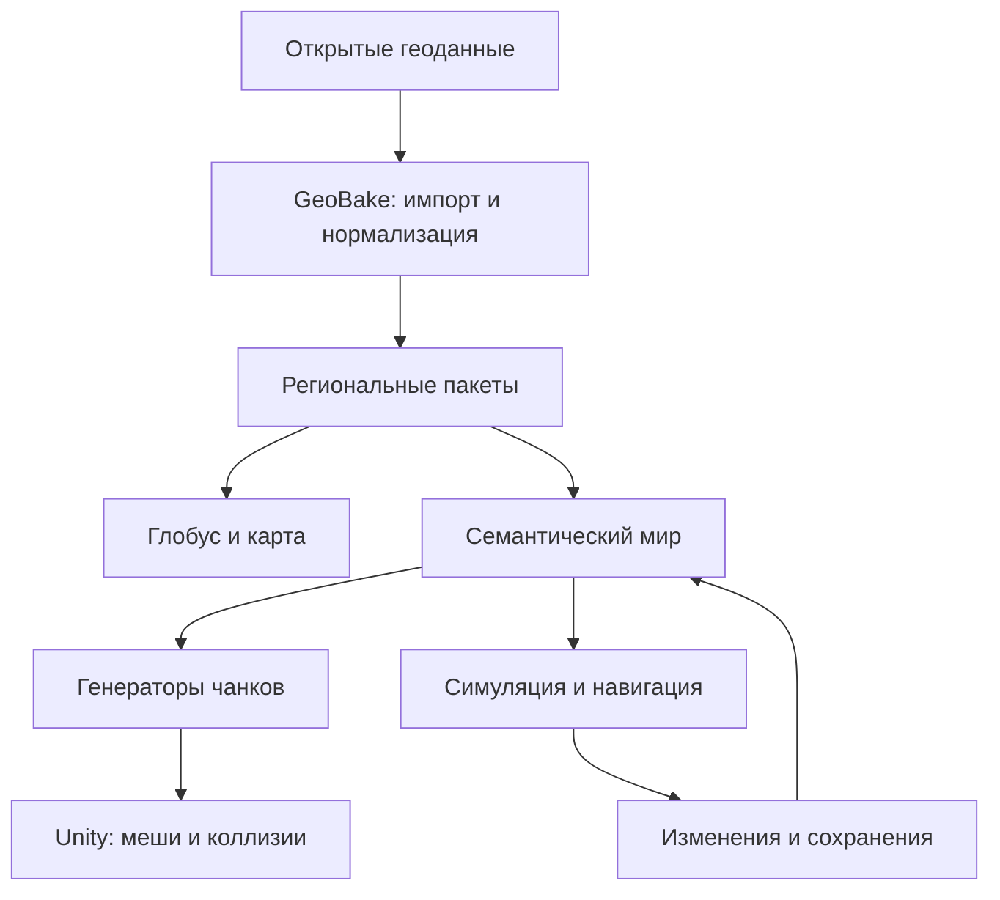
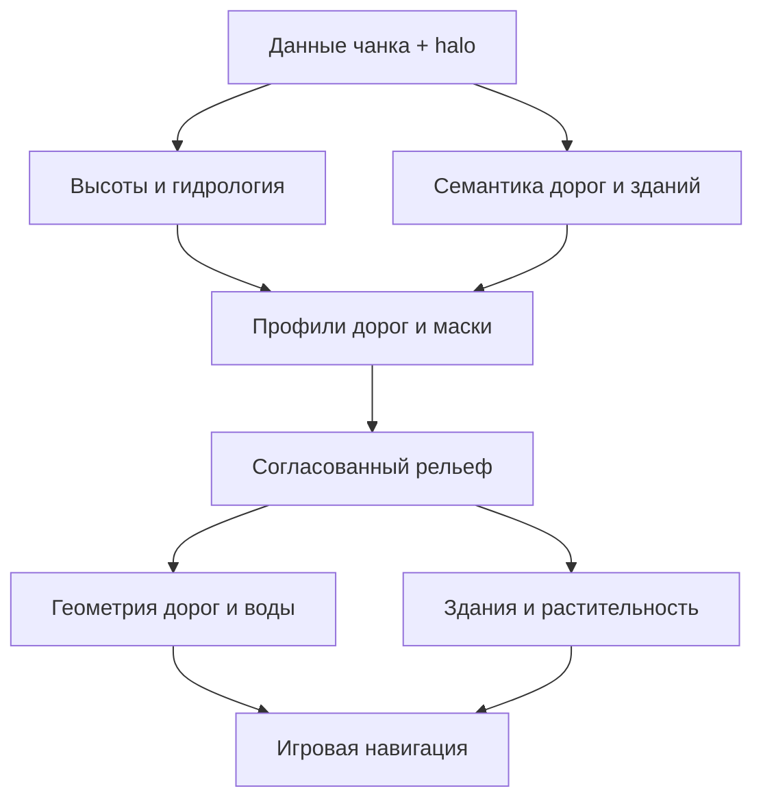
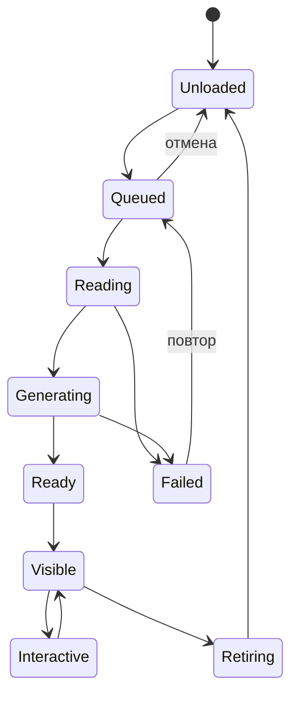

# 02. Планетарный игровой мир на основе географических данных Земли

**Техническое исследование и архитектурное решение для одиночного симулятора жизни на Unity / C#**  
Дата проверки источников: 25 ноября 2026 г.  
Статус: рекомендации для проектирования; измерения производительности и интеграционные испытания ещё не проводились.

## 1. Итоговое решение

Задача технически выполнима без обязательных подписок на геосервисы. Однако «бесплатный глобус», «реальные географические данные» и «полноценная игровая Земля» — три совершенно разных задачи. Ни Cesium, ни OpenStreetMap не предоставляют готовую планету, по которой персонаж может ходить, ездить, жить в домах, менять окружающий мир и взаимодействовать с автономными NPC.

**Рекомендация: собственный игровой мир, построенный из локальных геоданных, с отдельным представлением планеты и карты.** Cesium for Unity — необязательный адаптер для визуализации и геопривязки, а не обязательное ядро игрового мира.

| Компонент | Рекомендуемая технология |
|---|---|
| Игровой движок | Unity 6 LTS (конкретный патч закрепить после проверки пакетов), C#, URP |
| Вращающийся глобус | Собственная WGS84-сфера/эллипсоид с текстурой Natural Earth и низкодетальными слоями; Cesium — альтернатива или расширение |
| 2D-карта | Локальные векторные данные и собственный стиль; при необходимости заранее подготовленные тайлы |
| География | OpenStreetMap `.osm.pbf`, региональные выгрузки Geofabrik |
| Высоты | Copernicus DEM GLO-30 Public, GLO-90; альтернативно NASADEM и грубый GEBCO/ETOPO |
| Покрытие земли | ESA WorldCover; уточнение по OSM и процедурным правилам |
| Подготовка геоданных | Отдельная утилита .NET CLI + GDAL/PROJ и Osmium; форматы GIS не нужны самому игровому циклу |
| Индекс планеты | Шесть граней куба, иерархия quadtree (cube-sphere); фиксированный уровень для игровых чанков |
| Положение объектов | WGS84, глобально `double` ECEF; локально Unity `float` в подвижной касательной системе координат |
| Поверхность и геометрия | Собственные Mesh-чанки, независимые LOD, Jobs/Burst по мере необходимости |
| Хранение | Неизменяемые региональные пакеты, локальный пересоздаваемый кэш, отдельная SQLite-база изменений и состояния |
| NPC и транспорт | Собственные семантические графы; физические объекты только рядом с игроком |

### Что реально получить

1. Игрок вращает Землю, выбирает точку или территорию, видит подробную карту и начинает игру в этом месте.
2. Улицы, реки, озёра, береговая линия и контуры многих домов соответствуют реальным данным. Архитектура домов, интерьеры, мелкие детали, растительность и игровые объекты достраиваются процедурно.
3. В пределах подготовленных регионов игрок свободно ходит и ездит, не встречая экранов загрузки на границе чанков. По мере роста сети пакетов возможны длинные непрерывные маршруты между городами и странами.
4. После первоначального получения геоданных игра работает без интернета. Новые реальные регионы можно устанавливать отдельно. Вне установленных данных используется явно обозначенный грубый/синтетический режим либо предлагается установить пакет — подробности не появляются из ничего.
5. Уничтоженное дерево, построенный дом, припаркованная машина, содержимое контейнера и проживающие в регионе NPC не исчезают после выгрузки местности.

**Не обещаем:** фотографическую копию всей Земли, точные интерьеры, актуальность каждой улицы, физическую симуляцию миллиардов жителей одновременно, 30-сантиметровый реальный рельеф по DEM с шагом 30 м или полный высокодетальный офлайн-мир размером с несколько гигабайт.

Главный критерий качества платформы — менять генератор зданий, транспорт, экономику, растительность или графику без переписывания остальных механизмов и без непреднамеренного повреждения уже созданного мира.

---

## 2. Как разделить глобус, карту и игровой мир



### 2.1. Глобус — интерфейс, а не физическая сцена

Низкодетальный эллипсоид WGS84 (для визуальной модели допустима сфера с корректным преобразованием геодезических координат) отображается в отдельной сцене/камере. Его визуальный масштаб произвольный: например, радиус 10 Unity units. На него накладывается карта Natural Earth, государства, населённые пункты, области установленных пакетов. Для выбора точки луч камеры пересекает именно математическую поверхность; из точки пересечения вычисляются долгота и широта. Если нужна эллипсоидальная модель, не путать геоцентрическую широту с геодезической.

Вращение камеры вокруг глобуса, панорамирование, зум, полёт к выбранной точке, поиск населённого пункта из локального индекса. Не вращать при этом физические объекты игрового мира. Вращение Земли в UI не требует симуляции её вращения в физике. Дата, часовой пояс, солнце и погода могут рассчитываться отдельным модулем.

Режимы: планета → страна/регион → город → место появления. Область интереса (AOI) задаётся полигоном или точкой с радиусом в километрах, а не квадратом Unity Transform. Показать объём пакета, наличие слоёв и границы покрытия. Для перехода в игру выбирается безопасная игровая точка на суше или подходящем объекте (дорожный узел, поселение, пристань); это не обязательно точный пиксель выбранного на глобусе места.

Natural Earth предоставляет обзорную векторную и растровую картографию в масштабах 1:10 млн, 1:50 млн и 1:110 млн; данные общественного достояния [S01]. Они подходят для глобуса, а не для определения положения конкретного здания. Для увеличения детализации глобуса можно позже добавить иерархические тайлы рельефа и геометрии.

### 2.2. 2D-карта

Отрисовка из тех же нормализованных объектов, из которых строится 3D-мир. Профили стилей: обзорный, топографический, дорожный, городской, игровой. Слои: контуры суши, водоёмы, дороги, здания, поселения, метки сохранённых объектов, транспортные линии. На больших масштабах использовать обобщение и скрывать малозначимые элементы (мелкие дороги, отдельные строения). Метки и динамические объекты берутся из игрового состояния, а не перепекаются в статические изображения.

Для MVP удобно хранить векторные фрагменты по чанкам и строить карту Unity (UI/меши + текст), либо запекать обзорные растровые тайлы собственным импортёром. Для отдельного профессионального картографического рендерера в будущем подойдут MVT/MBTiles/PMTiles как форматы хранения/доставки, но не требуется включать веб-движок только ради карты. Если используются XYZ-тайлы Web Mercator, хранить их исключительно как визуальный слой: проекция EPSG:3857 искажает длины и не покрывает полюса (около ±85,05°).

Карта и 3D-мир имеют общий `FeatureId` для реальных объектов; объект из сохранения имеет `WorldObjectId`. Игровая метка дороги должна указывать на тот же сегмент графа, по которому строится маршрут. Карта не является источником маршрутов, коллизий или владельцев зданий.

### 2.3. Игровой мир

В отличие от глобуса и карты, игровая сцена требует стабильного рельефа, коллизий, проходимости, навигации, объектов с идентификаторами, физики, правил и персистентности. Генерировать их из семантики, а не пытаться сделать игровым объектом каждый пиксель спутникового изображения или треугольник фотограмметрии. Непосредственно перед отображением выбрать один точный локальный базис; удалённые объекты не обязаны иметь `GameObject`.

---

## 3. Cesium for Unity: возможности, ограничения и решение

### 3.1. Что даёт бесплатно

Cesium for Unity — открытый плагин Apache-2.0, не требующий оплаты самого плагина для коммерческого и некоммерческого применения [S02]. Он поддерживает глобальную геопривязку, интеграцию с Unity, выбор детализации и потоковую загрузку данных по стандарту 3D Tiles. 3D Tiles — открытый стандарт представления пространственно иерархизированной визуальной геометрии [S03].

| API | Назначение |
|---|---|
| `CesiumGeoreference` | Согласование WGS84/ECEF с локальной сценой |
| `CesiumGlobeAnchor` | Точная глобальная привязка и ориентация объекта даже после смены origin |
| `CesiumOriginShift` | Поддержание локального начала координат вблизи камеры |
| `Cesium3DTileset` | Загрузка и отображение иерархии тайлов; настройка ошибки экрана, загрузок, кэша, создания физической геометрии |

Проверены официальные инструкции [S04–S06]. В частности, документация описывает источник `From URL`, загрузку `tileset.json` с диска, локального сервера, локальных terrain/imagery. Можно работать полностью офлайн с собственными данными. Нельзя из этого делать вывод о праве выгружать содержимое Cesium ion.

### 3.2. Cesium ion — отдельный продукт

Cesium ion — облачный сервис получения/преобразования/доставки данных, а не лицензия плагина. Наборы Cesium World Terrain, спутниковая подложка и фотограмметрия от внешних провайдеров могут иметь отдельные ограничения на хранение, производные работы, распространение и срок доступа. Бесплатный тариф, если доступен для конкретного применения, не гарантирует неограниченный объём или постоянную автономную работу. Условия ion и атрибуция источников проверяются отдельно [S07].

**Для базового проекта: никакого обязательного токена ion, никакой фоновой выгрузки сторонних облачных тайлов в офлайн-архив.** Если нужен Cesium, загружать только собственные законно подготовленные наборы. Unity-редактор и активация Unity имеют собственные условия; автономность относится к готовому игровому приложению, а не к обещанию офлайн-установки SDK и лицензирования редактора.

### 3.3. Почему не строить всю игровую архитектуру вокруг Cesium3DTileset

- Визуальная детализация определяется камерой: тайл может измениться/выгрузиться даже при наличии на нём игровых объектов. Игровой коллайдер под колесом не должен зависеть от экранной ошибки визуализатора.
- 3D Tiles не содержат обязательного для симулятора контракта дорог, этажей, помещений, фермерских участков, доступности NPC, модификаций поверхности и связей навигации.
- Cesium умеет создавать физические меши, но это не является гарантией отсутствия провалов при смене LOD, бесшовного NavMesh или работы всех видов Unity-physics при ребазировании.
- Документация Cesium прямо отмечает несовместимость части систем Unity с изменяемым origin, включая системы, кэширующие мировые позиции [S05]. Гравитация Unity по одной глобальной оси не означает правильного направления «вниз» на всей Земле.
- Фотограмметрический дом обычно представляет визуальную оболочку: неизвестно, где дверь, какие помещения доступны и как изменять интерьер.
- Подготовка собственных 3D Tiles требует ещё одного конвейера. Экспорт мешей и `tileset.json` не заменяет обработку исходных OSM и DEM.

### 3.4. Сравнение вариантов

| Вариант | Первый результат | Автономность | Контроль физики, объектов и сохранений | Сложность в долгосрочной перспективе |
|---|---|---|---|---|
| Cesium + облачный набор | Быстрое реалистичное визуальное демо | Зависит от услуг и условий данных | Низкий без собственного слоя | Высокая из-за адаптации данных и лицензий |
| Cesium + собственные локальные 3D Tiles | Хороший глобус и крупный рельеф | Да, при наличии локальных разрешённых данных | Средний; нужна собственная семантика | Средняя/высокая: отдельная цепочка тайлинга |
| Unity Terrain по плоским региональным квадратам | Быстрый региональный прототип | Да | Высокий в пределах фиксированной плоскости | Высокая при переходе к реальной планете |
| Собственные криволинейные Mesh-чанки | Умеренные стартовые затраты | Да | Высокий | Средняя при строгом разделении индексов и данных |
| Собственный мир + опциональный Cesium-адаптер | Умеренные | Да | Высокий | **Оптимальный компромисс** |

**Выбор:** начать с собственного простого глобуса и игровых Mesh-чанков; Cesium проверить ограниченным техническим прототипом только тогда, когда понадобится детализированный обзор из космоса/воздуха. Если он действительно экономит время, подключить `World.Presentation.Cesium` к тем же глобальным координатам. Одновременно может существовать только один владелец floating origin; при использовании Cesium его геопривязка управляется нашим координатным сервисом или наоборот через единый адаптер. Два независимых rebasing-механизма запрещены.

---

## 4. Реальные данные и право на офлайн-работу

### 4.1. Рекомендуемые источники

| Источник | Детализация и содержание | Доступ / лицензия | Как использовать |
|---|---|---|---|
| [Natural Earth](https://www.naturalearthdata.com/downloads/) | Глобальный обзор, берега, государства, населённые пункты, растр | Public domain [S01] | В комплект игры; обзорный глобус и карта |
| [Geofabrik](https://download.geofabrik.de/) / [OSM Planet](https://planet.openstreetmap.org/) | Дороги, здания, вода, землепользование, POI; данные векторные | ODbL; бесплатные выгрузки [S08–S11] | Скачивать `.osm.pbf` по регионам, самостоятельно индексировать и преобразовывать |
| [Copernicus DEM](https://registry.opendata.aws/copernicus-dem/) | GLO-30 Public (~30 м), GLO-90 (~90 м); DSM, суша | Свободный доступ к публичным наборам по специальной лицензии, обязательные уведомления при распространении [S12–S14] | Основной источник высот; скачивать необходимые исходные GeoTIFF |
| [NASADEM](https://doi.org/10.5067/MEaSUREs/NASADEM/NASADEM_HGT.001) | ~1 угловая секунда, улучшение SRTM; не полярное глобальное покрытие | Открытый набор NASA; доступ Earthdata может потребовать бесплатной учётной записи [S15] | Резервный источник для области покрытия; согласовать высоты и качество |
| [GEBCO](https://www.gebco.net/data-products/gridded-bathymetry-data) | Глобальная сетка суши и океана, 15 угловых секунд (~460 м на экваторе) | Public domain с требованиями указания источника и условиями GEBCO [S16] | Общий фон, океанское дно, грубый глобальный fallback; не навигация реальных судов |
| [NOAA ETOPO 2022](https://www.ncei.noaa.gov/products/etopo-global-relief-model) | Глобальная модель рельефа и батиметрии, 15″, дополнительно более грубые сетки | Открытая публикация NOAA, проверить метаданные и атрибуцию выбранного набора [S17] | Альтернатива GEBCO для грубого покрытия |
| [ESA WorldCover](https://esa-worldcover.org/en/data-access) 2021 v200 | 10 м, 11 классов земного покрова | CC BY 4.0, доступны исходные файлы COG [S18] | Лес, пашня, застройка, травы, болота, вода; основа биомов, а не список отдельных деревьев |
| [OSM land/water polygons](https://osmdata.openstreetmap.de/) | Предобработанные полигоны суши и океана из береговой линии | ODbL [S19] | Устойчивый масочный слой моря, особенно для прибрежных регионов |
| [Overture Maps](https://docs.overturemaps.org/) | Нормализованные дороги, контуры зданий, POI, другие слои; GeoParquet | Лицензия зависит от темы и источника, в том числе ODbL и CDLA Permissive 2.0 [S20] | Опциональный дополнительный импорт при недостаточности OSM; не смешивать автоматически |

**Важное изменение 2026 года:** Copernicus Data Space сообщил 25.08.2026 об ограничении доступа именно к GLO-30 View Service авторизованными категориями пользователей и об изменении DEM по умолчанию на GLO-90. Это не доказывает закрытие всех ранее опубликованных наборов GLO-30 Public. На момент проверки официальный AWS Registry по-прежнему указывает открытые бакеты GLO-30 Public и GLO-90 без AWS-аккаунта. У GLO-30 Public могут отсутствовать отдельные геоклетки. Использовать доступные публичные исходные файлы, не строить игру на обязательном View Service; проверять покрытие выбранной территории и фиксировать лицензию конкретного релиза [S12–S14].

### 4.2. Что нельзя считать бесплатным офлайн-источником

- OSM — открытая база данных, но стандартный растровый сервер `tile.openstreetmap.org` не разрешает офлайн-сбор тайлов и массовую предзагрузку. Аналогичное ограничение на массовую выгрузку есть у векторного сервиса OSMF [S09]. Правильный путь: официальные bulk-выгрузки OSM, собственная карта и локальные векторные/растровые тайлы.
- Overpass — полезен для маленьких исследовательских запросов; публичные инстансы не являются хранилищем всей Земли для игры. PBF нужен именно для объёмной локальной обработки.
- Google Maps, Google Earth, Google Photorealistic 3D Tiles, Bing и сторонние карты по одной доступности в браузере не становятся легальным офлайн-архивом. Это не рекомендуемая база проекта.
- Не использовать «free for personal use» ассеты, если неясны условия последующей публикации; игра должна отделять происхождение карты, библиотеки, текстуры, модели и звук.

### 4.3. Организация лицензий

В каждом пакете `manifest.json`: список источников, версия/дата снимка, URL, хэши, разрешения использования, требуемые уведомления, CRS и вертикальная система, область покрытия. Добавить `LICENSES/` и экран «Источники геоданных»; для карты показывать атрибуцию OSM, в частности `© OpenStreetMap contributors` и ссылку на [copyright](https://www.openstreetmap.org/copyright).

ODbL различает базу, производную базу и произведение, созданное на её основе. Для личного внутреннего использования и публичного распространения последствия различаются. При передаче третьим лицам OSM-производных наборов и произведений необходимо проверить требования ODbL (атрибуция, предоставление соответствующей производной базы или изменений при применимости), а не объявлять любые файлы с координатами собственностью игры. Геоданные, независимо созданные ресурсы и состояние игрока хранить в логически отдельных слоях; это удобно и технически, хотя само разделение файлов не гарантирует правового разграничения [S10–S11]. Для Copernicus использовать именно актуальное требуемое уведомление для адаптированных данных со страницы источника; для ESA, GEBCO и Overture — их официальные правила. Эти рекомендации не заменяют анализ лицензии конкретного распространяемого набора.

Плагин Cesium (Apache-2.0), GDAL (MIT-стиль), Unity, импортёр OSM, библиотеки и наборы данных имеют разные лицензии. Osmium Tool имеет GPL-3.0: используем внешнюю CLI-утилиту на стадии подготовки, не встраиваем её исходники в игровой рантайм. При распространении самой утилиты выполнить её лицензионные условия [S21–S22]. Unity Personal на момент исследования доступна бесплатно при соблюдении финансовых критериев (порядка $200 тыс. за последние 12 месяцев, определить применимый критерий по официальным условиям) [S23]. Для одиночного личного проекта платных технологий из предложенного стека не требуется.

---

## 5. Координаты, кривизна и floating origin

### 5.1. Единый договор о координатах

Никогда не хранить долговечное положение персонажа исключительно в `Vector3 transform.position`. Unity использует `float` для обычных Transform/физики; вблизи радиуса Земли (~6,4 млн м) шаг представимого значения float составляет около 0,5 м. Для персонажа, автомобиля и интерьеров это неприемлемо. В пределах 2 км ошибка представления порядка долей миллиметра; фактические погрешности физики сравниваются отдельно.

| Система | Тип | Для чего |
|---|---|---|
| WGS84 | `double longitudeDeg, latitudeDeg, ellipsoidHeightM` | Интерфейсы данных, карта, выбор точки |
| ECEF (EPSG:4978) | `double X,Y,Z` в метрах | Постоянное положение, расстояния и геопривязка |
| ENU | `double East, North, Up` | Касательная система вокруг origin |
| Unity local | `float x=East, y=Up, z=North` | Рендеринг и локальная физика |
| Chunk-local | `float` или квантованные целые | Долговечная геометрия относительного якоря чанка плюс ECEF-якорь |

Конверсию ECEF ↔ ENU описывает PROJ [S24]. Не путать координаты осей в правой математической системе и Unity; при изменении базиса преобразуются и ориентация, winding треугольников (где необходимо), нормали, векторы скоростей. Ввести именованные структуры, а не передавать три `double` без указания их значения.

Формулы WGS84 (углы в радианах; `a = 6378137 м`, `f = 1 / 298.257223563`, `e² = f(2-f)`):

```
N = a / sqrt(1 - e² sin²(latitude))
X = (N + h) cos(latitude) cos(longitude)
Y = (N + h) cos(latitude) sin(longitude)
Z = (N(1-e²) + h) sin(latitude)
```

Для origin с долготой λ и широтой φ:

```
east  = (-sin λ, cos λ, 0)
north = (-sin φ cos λ, -sin φ sin λ, cos φ)
up    = ( cos φ cos λ,  cos φ sin λ, sin φ)
delta = ecef - originEcef
unity = (dot(delta,east), dot(delta,up), dot(delta,north))
```

Преобразование в `float` только после вычитания ECEF-origin и скалярных произведений в double. Обратное преобразование через тот же ортонормальный базис. Пограничные случаи — нулевая/отрицательная высота, ±180° долготы, ±90° широты. Обратную геодезическую конверсию сверять с эталоном PROJ, а не полагаться на наивную сферическую формулу.

### 5.2. Высоты: обязательная нормализация вертикального датума

Copernicus DEM — DSM (поверхность включает деревья/крыши), не идеальная модель голой земли. Горизонтальная система WGS84, вертикальные исходные привязки уточняются по паспорту продукта (в частности EGM2008 для Copernicus DEM). SRTM/NASADEM традиционно используют ортометрические высоты EGM96; сверить конкретный продукт. Высота `h` в геодезическом преобразовании WGS84 — над эллипсоидом, не над средним уровнем моря. Обычно `h = H + N_geo`, где `H` — ортометрическая высота, `N_geo` — высота геоида над эллипсоидом. PROJ умеет преобразовывать вертикальные системы с сетками поправок [S25]. Сетки также должны быть доступны локально.

Запрещено смешивать разные датумы без преобразования: прибрежные города могут оказаться под водой, разновысотные DEM образуют ступеньки. На импорте указать CRS, вертикальную модель, NoData, единицы, реализацию преобразования и версию сетки. Если исходный вертикальный датум не установлен, пометить данные как приближённые и не смешивать их незаметно с точным слоем. Не считать абсолютную нулевую высоту ECEF автоматически поверхностью океана: уровень моря строится в выбранной согласованной системе.

### 5.3. Ребазирование

Создать `World.Coordinates` с `OriginFrame { OriginEcef, East, Up, North, Revision }`. Обновлять origin, например, при удалении игрока/главной камеры симуляции на 1–2 км или при телепортации; порог — стартовая гипотеза. Изменение basis включает поворот локальных вертикалей вслед за поверхностью. Кривизна существенна: на расстоянии 5 км отклонение от касательной плоскости около 2 м (`d²/(2R)`), на 10 км — около 7,8 м. Поэтому бесконечная плоская региональная сцена с одним неизменным ENU не подходит для планеты.

Порядок смены origin, исполняемый на границе физического тика:

1. Закончить текущий шаг физики, запретить внешние запросы к половинчатой сцене.
2. Зафиксировать глобальные позиции/ориентации активных тел и скорости в старой системе. Земные объекты без симуляции уже имеют сохранённые ECEF-якоря.
3. Вычислить новый origin и базис; пересчитать якоря чанков и активные тела, камеру, коллайдеры, NavMesh-данные/связи, при необходимости мировые буферы VFX.
4. Преобразовать линейные и угловые скорости, согласовать направления локальной гравитации и контактные состояния; для rigidbody использовать подходящий API с контролем интерполяции. Не просто сдвигать `Transform` родителя и ожидать корректной физики.
5. Синхронизировать физические transforms, если требуется; восстановить согласованные регистрации навигации и опубликовать `OriginChanged(oldFrame,newFrame)` после завершения.

При асинхронной генерации мешей хранить геометрию относительно неизменяемого ECEF-якоря чанка. Результат загрузки, созданный при старом `OriginRevision`, пересчитать на новом базисе перед применением; не выбрасывать весь результат лишь из-за сдвига origin. Кэш и сохранения вообще не зависят от текущего origin.

Гравитация: для небольшого активного пузыря локальный `Physics.gravity` вниз по Y допустим на первом этапе. Для полётов/длинных высоких маршрутов или очень широкой активной сцены — отдельный `IGravityModel`, локальное направление нормали WGS84 для каждой позиции, при необходимости отключение глобальной гравитации у соответствующих тел. Управление автомобилем, игроком и водой использует этот контракт. Смена региона не создаёт новую систему абсолютных координат.

---

## 6. Пространственное разбиение всей Земли

### 6.1. Сравнение индексов

| Схема | Плюсы | Недостатки |
|---|---|---|
| Плоская равномерная сетка ENU/UTM | Очень просто в одном городе | UTM-зоны и полюса, несовместимые границы и базисы |
| Широта-долгота (EPSG:4326) | Простое соответствие GeoTIFF | Ячейки сжимаются у полюсов, разрыв на 180°, размеры в метрах неодинаковы |
| XYZ / Web Mercator | Отлично для картографического UI | Искажения и отсутствующие полюса; не использовать для физического мира |
| H3 / S2 | Иерархия и геозапросы, глобальная индексация | H3-ячейки неудобны как регулярные квадратные heightfield-патчи; S2 лучше, но нужна надёжная реализация/порт |
| Cube-sphere + quadtree | Глобальное покрытие, 4 дочерних ячейки, квадратная параметрическая сетка, естественный LOD | Обработка стыков 6 граней, площадь чанка немного меняется по планете |

Иерархия S2 показывает практический подход с шестью гранями куба, проекцией на сферу и иерархией ячеек [S26]. Не обязательно копировать алгоритм Hilbert S2. Выбираем собственный **пространственный контракт cube-sphere** с явно заданным порядком граней и ориентацией осей; если используем проверенную S2-библиотеку, закрепляем её конкретные правила вместо собственного формата. Нельзя называть наш кастомный ключ S2CellId, если это не совместимый S2.

### 6.2. Идентификатор чанка и геометрия

```
CellKey = (GridVersion, Face:0..5, Level, X, Y)
X,Y in [0, 2^Level)
```

Хранить канонический `CellKey` всю жизнь мира, не вычислять его из локального Unity X/Z. Для MVP достаточно B-tree по `(face,level,x,y)` и простых функций parent/children/neighbors. Для глобуса и отображения — переменный `Level` в зависимости от масштаба, для симуляции и постоянных объектов — фиксированный базовый уровень. Начальный уровень 13 даёт в среднем около 1,27 км² на ячейку (~1,13 км по стороне); уровень 14 — 0,317 км² (~563 м по стороне). Это средние оценки из площади Земли, реальные ячейки не равновеликие. Выбрать 13 для первого прототипа; уровень 14 возможен после профилирования, но изменение канонического уровня существующего мира требует миграции, а не простой смены настроек. Мелкие подчанки рендеринга можно вводить без миграции, сохраняя прежний `CellKey` состояния.

Одна из простых реализаций: для каждой грани закрепить нормаль и оси U,V целочисленной таблицей; параметрическая координата на кубе `p = faceNormal + u*axisU + v*axisV`, `u,v` от -1 до 1. Луч из центра пересекает эллипсоид WGS84 с полуосями a,b; геодезическая нормаль эллипсоида задаёт высоты. Для точки мира обратным преобразованием найти доминирующую грань у направления на поверхность без высоты, затем UV и ячейку. Равенство на границе решать фиксированным порядком граней. Для LOD строить геометрию по общим рациональным координатам на границах, включая переходы между гранями; canonical edge ID не зависит от того, какой чанк вычислил вершину. Не считать, что сосед с `x=-1` всегда принадлежит той же грани: соседство и направление общей границы задаются таблицей переходов.

Вокруг установки региона готовить halo (область имитации соседства) и импортировать объекты, пересекая точную сферическую область, а не только её bounding box. Части линий и полигонов раскладываются в пересекаемые ячейки. Длинные геометрические линии денсифицировать/обрабатывать в подходящей проекции, иначе пересечение с криволинейными границами неточно. Для запроса международной линии перемены дат bbox разбивается на два интервала; полюса покрыты кубом без потери площади.

### 6.3. Индекс объектов

Три различных индекса решают различные задачи:

- Иерархия ячеек — какие чанки нужны/есть на диске, обход видимого глобуса, поиск соседей.
- SQLite R*Tree в import/index DB — быстрый broad-phase запрос контуров и линий на прямоугольной области. `rtree` использует 32-битные координаты; можно хранить `rtree_i32` с нормализованными геодезическими или локальными квантованными метрами, явно контролируя диапазоны и округление. Проводить точную проверку найденной геометрии, разделять объекты через antimeridian [S27].
- Runtime spatial hash / простой грид внутри активных чанков — NPC, транспорт, interactables, близкие соседи. Никаких SQL-запросов для каждого кадра каждого NPC и никакого поиска всех `GameObject` в сцене.

Каноническое владение: у здания один ID и owner-чанк (определённый репрезентативной точкой, фиксированным правилом); для пересекаемых чанков — ссылки/фрагменты рендеринга. Если игрок рядом с не-владеющей частью объекта, загрузчик подтягивает владельца/общее состояние, а не создаёт второе здание. Для линий — стабильные сегменты и общие junction IDs. Для объектов-планет большой площади (океаны, огромные лесные зоны) — мозаика представления, без единственного гигантского GameObject.

---

## 7. Подготовка данных: GeoBake CLI

Не обрабатывать весь PBF, GeoTIFF, сложные OSM relations и перепроецирование прямо во время ходьбы игрока. Всё тяжёлое — отдельная стадия, запускаемая при создании регионального пакета. Код преобразований — вне Unity, чтобы не замедлять сборку игры, переиспользовать данные и писать обычные .NET-тесты. GDAL выполняет мозаики, reprojection, resampling [S22, S28]; Osmium хорошо режет PBF [S21].

### 7.1. Рекомендуемый процесс

1. Игрок/разработчик выбирает AOI и параметры пакета: детализацию, слои, требуемый охват. Импортёр вычисляет запас за границами (сначала 1–2 чанка, для длинных features — по их полному контуру и сетевому графу; размера halo недостаточно для всех отношений).
2. Получение данных из разрешённых источников, возобновляемые скачивания, верификация контрольных сумм, лицензий, наличие всех обязательных слоёв. Offline import допускает заранее скачанные файлы.
3. Извлечение OSM: `osmium extract` в режиме `complete_ways` или `smart` с настройками нужных типов relations. `complete_ways` дополняет линии отсутствующими узлами, но не гарантирует полный multipolygon/все отношения; контролировать полноту и отдельно подтягивать необходимые relation members из исходной выгрузки [S21]. Не резать геометрию до сборки полигонов и дорог.
4. GDAL/PROJ: объединить/выбрать DEM, заполнить разрешённые NoData с явным источником или маской качества, преобразовать datum, привести растры на каноническую выборочную сетку. Для высот — bilinear/appropriate interpolation, для категориальных WorldCover — nearest или mode, чтобы коды классов не смешивались. Субпиксельная детализация — только процедурная.
5. Нормализовать OSM объекты: POI, полигоны, линии, мультиполигоны, атрибуты высоты, дорожные слои, ограничения. Обработка некорректных геометрий с журналом; например NetTopologySuite для GIS-геометрии, Clipper2 для полигональных операций и offset в локальной плоскости. Не писать собственный ненадёжный клиппер [S29].
6. Собрать маски суши/воды, семантический граф дорог, упрощённые данные карты и метки источника/качества. Построить cell coverage для геометрии и refs на владельцев.
7. Экспортировать компактные неизменяемые блоки (height tiles, feature records, transport graph, coverage). Пока не хранить все Unity Mesh: чаще дешевле хранить исходные нормализованные samples и генерировать меши рядом с игроком.
8. Проверить версии, хэши, покрытие halo, стыки, целостность графа; публиковать пакет атомарно после завершения. Недописанный пакет не считается установленным.

Концептуальный CLI (имена команд — проектируемый контракт, не существующая программа):

```text
GeoBake plan --aoi stauceni.geojson --profile regional
GeoBake fetch --plan plan.json --data-root D:\EarthData\raw
GeoBake build --plan plan.json --snapshot 2026-11 --out D:\EarthData\packages
GeoBake verify --package D:\EarthData\packages\MD-example
```

Рекомендуется первый реальный участок вокруг Кишинёва и Стэучен: региональная выгрузка [Молдовы](https://download.geofabrik.de/europe/moldova.html), пересекающиеся тайлы DEM, WorldCover выбранной области. Для первых проверок, например, квадрат 10×10 км, расширить до 20×20 км и дальше по потребности. Важно включить город, дорогу на окраину, сельскую местность, хотя бы один водный объект и несколько границ чанков. Затем тестировать другой пакет с горным рельефом и береговой линией, а не считать молдавский участок универсальной проверкой планеты.

### 7.2. Формат пакета

```text
EarthData/
  raw/                 # PBF, COG, документы лицензий; повторное использование
  packages/
    planet-base-v1/
      manifest.json
      overview/        # глобус; обзорные карты/DEM
      coverage.bin
    MD-example-v1/
      manifest.json
      tiles/           # группированные бинарные блоки по родительским ячейкам
      graph/           # стабильный глобальный граф дорог и порталы чанков
      map/             # обзорные векторные/растровые слои
      features.sqlite  # индекс; неизменяемая семантика и точные геометрии
      LICENSES/
  cache/               # разрешено удалять и восстанавливать
  saves/               # НЕ очищать вместе с cache
```

Манифест: `PackageId`, `ContentHash`, `GridVersion`, `SchemaVersion`, `DataSnapshot`, `Coverage`, `HaloCoverage`, `CRS`, `VerticalDatum`, `Sources[]`, `MissingLayerPolicy`, `LicenseNotices[]`, `Dependencies[]`. `DataSnapshot` связывает версии источников, а не только дату импорта. Стабильная привязка миров к пакетам по content hash. Смежные пакеты, созданные из разных снимков, нельзя молча считать одной базой. При пересечении определить канонический источник каждой ячейки/feature, версию и приоритет, предотвратить дублирование. На первом этапе брать один согласованный снимок OSM для соседних территорий.

Использовать обычный файловый доступ и бинарные форматы с версией/длиной/CRC. На диске не создавать миллионы отдельных маленьких файлов: группировать записи в региональные контейнеры или блоки родительских ячеек с таблицей offsets. GeoPackage/GeoTIFF удобны как вход/промежуточные материалы, SQLite и простые бинарные блоки — как игровой формат. Addressables хороши для prefabs, материалов, текстур и других Unity-ассетов, включая локальные каталоги [S30], но не обязательны для географических блоков. Не добавлять отдельный сервер PostgreSQL/PostGIS для одиночной игры.

---

## 8. Генерация содержимого чанка

Избегать универсального `WorldGenerator`, который напрямую знает про транспорт, строительство, магию, NPC и сохранения. Генераторы работают с неизменяемыми входными слоями и возвращают результаты по контрактам. Планировщик задаёт реальные зависимости, но независимые вычисления могут выполняться параллельно. Например, озеро и рельеф образуют поверхность; дорожная сеть влияет на локальную коррекцию грунта; здания и растительность используют уже согласованные маски. Это небольшая ориентированная цепочка стадий, а не произвольный порядок подписчиков на события.



Долговечная семантика строится из полного feature до разделения представления по чанкам. Terrain corrections имеют определённый приоритет, не изменяют сырые DEM. Изменения игрока накладываются отдельным слоем на общие правила; инвалидируются лишь затронутые результаты (например, уничтожение дерева не требует заново строить граф дорог).

### 8.1. Рельеф

Рекомендация — собственная регулярная сетка по UV соответствующей грани куба, высоты по географическим координатам вершин, глобальное положение вершин в ECEF, mesh хранится относительно якоря. Доступ из любых мест через `IHeightSampler`, который использует тот же канонический источник, что генератор рельефа. Для игровых запросов вычислять высоту именно финальной поверхности/коллайдера (интерполяция по той же триангуляции), а не просто сырое значение DEM; мосты, полы, пещеры и многослойные поверхности дополнительно через `ISurfaceQuery`, так как одной высоты на точку там недостаточно.

Начальные параметры на уровне 13 (~1 км): визуальный сеточный чанк 129×129 вершин (128×128 квадратов), грубые LOD 65×65, 33×33, 17×17; более мелкие сэмплы/подчанки для улиц в зоне игрока при необходимости. 129×129 на 1,13 км — около 8,8 м между вершинами, т.е. визуально чаще исходного DEM GLO-30, но это интерполяция, не реальные измерения на 9 м. Для пешеходной симуляции локальная коррекция улиц/площадок зданий и процедурные микродетали обязательны. Использовать один высотный профиль для визуальной сетки и физической коллизии в активной зоне; дальний LOD — только визуализация.

Методика:

- базовая крупная форма из реального DEM; пространственно непрерывное сэмплирование, маска качества, плавное, но контролируемое согласование разных источников;
- устранение DSM-артефактов под зданиями и лесом: устойчивые фильтры/интерполяция по окружению, оценка площадок; при наличии легального более качественного DTM импортировать его с более высоким приоритетом;
- детерминированный шум малых амплитуд, зависящий от абсолютной позиции и типа местности; подавлять его на воде, дорогах и фундаментах;
- единый solver поправок дорожного полотна, береговых зон и строительных площадок. Не определять высоту дороги независимо в каждом чанке;
- текстуры: материалы по land-cover, высоте, уклону и влажности, world-aligned UV для отсутствия повторяющихся швов; не нужны спутниковые снимки как обязательный слой.

Для первого прототипа плоские Unity Terrain tiles привлекательны быстротой: `Terrain.SetNeighbors` согласует LOD соседей, при этом связь нужно установить для каждого тайла [S31]. Но соседство не решит погрешности исходных высот и кривизну планеты. Заменить Terrain-контрактом `ITerrainRenderer` возможно, однако не считать прямоугольный Terrain в неизменных мировых X/Z финальным глобальным представлением. Собственный mesh позволяет строить произвольную форму и точные boundary rings. Использовать `Mesh.AllocateWritableMeshData`/`ApplyAndDisposeWritableMeshData` и Jobs/Burst для тяжёлых вычислений там, где это измеримо полезно [S32].

### 8.2. Дороги и транспортная сеть

OSM `highway`, `lanes`, `width`, `oneway`, `maxspeed`, `surface`, `access`, `bridge`, `tunnel`, `layer`, `junction`, дорожные ограничения/relations — входные данные. Не везде они заполнены, поэтому значения нормализуются в `RoadClassDefinition` и дефолты по стране/типу дороги. Не каждую OSM-дорогу можно использовать автомобилем, не все дороги имеют тротуар, не каждое пересечение линий является перекрёстком.

Разделить:

1. **Граф:** узлы перекрёстков, directed edges, режимы пешеход/авто/велосипед и другие по мере разработки, ограничения поворота, вес и расстояние, признаки мостов/туннелей, ID порталов на границе. Связность на основе общей семантики OSM, а не случайного совпадения координат. Одна дорога может иметь несколько полос — они могут моделироваться доп. lane graph, не обязательно на старте.
2. **Геометрия:** сглаженная центральная линия (polyline/spline), ширина профиля, асфальт, обочины, тротуары, разметка, упрощённые перекрёстки. Формировать стыковку профиля, подход и высоту по полной линии либо устойчивым контрольным сегментам с shared endpoints. Полигональные union/offset для узлов и примыканий; избегать Z-fighting путём единого решения поверхности и декалей.
3. **Физика:** коллайдеры только рядом, полотно, съезды, мостовые настилы; плавный продольный профиль с ограничением уклона согласно игровому классу дороги. Не прижимать все дороги к DEM: мосты, эстакады и тоннели требуют отдельного уровня поверхности; тоннели можно генерировать как проходы с входом и отдельным мешем, а на первом этапе явно ограничить качество редких сложных случаев.
4. **Симуляция:** транспорт запрашивает `IRoutePlanner` и `ISurfaceQuery`, не повышает/понижает уровень детализации визуальной карты самостоятельно. На дальнем маршруте хранить `EdgeId + distanceAlong`, скорость/ETA и состояние груза/рейса. При приближении перевести в физическую машину в допустимой точке полосы; при удалении — снять визуальный proxy, сохранив положение и состояние.

Маршрутизация: A* по дороге/режиму для региона; затем иерархический граф (магистрали, регионы, порталы) и локальная детализация, если размеры графа этого потребуют. Нет необходимости запускать OSRM или внешние Directions API в рантайме. Overture может позже помочь нормализованным транспортным слоем, но сопоставление дублей/провенанса необходимо [S20]. Для парковок, светофоров, остановок сначала дефолтные процедурные правила, затем настоящие теги и игровые сценарии.

### 8.3. Здания, помещения и недвижимость

OSM Simple 3D Buildings задаёт контуры `building`, части `building:part`, `height`, `min_height`, `building:levels`, `roof:shape`, `roof:height` и другие теги [S33]. Правильный импорт должен уметь собирать мультиполигоны с отверстиями, исправлять/отбраковывать дефекты, учитывать части здания, не создавая одновременно сплошную оболочку и перекрывающие её отдельные части.

- Положение, footprint, этажность и высота — настоящие при наличии достоверных тегов. Например, для отсутствующей высоты выбрать этажность по классу (частный дом, многоэтажный, промышленный объект) и типовой высотный профиль. Источник каждой характеристики помечается `Measured/Derived/Procedural`.
- Вычислить единую площадку/фундамент с учётом уклона и условий земли; отступы дороги/входа. Не экструзировать дом на высоту DSM крыши плюс реальная высота дома — это типичная ошибка.
- Наружные стены по контуру, крыши с несколькими шаблонами, окна/двери из повторно используемых модульных ассетов, разные материалы по региону и типу здания, детерминированный выбор фасада. LOD: грубая коробка вдали; простая форма ближе; отделка, двери и локальные коллизии рядом.
- Интерьеры: базовые планировки процедурны и не изображают реальные частные помещения. Семантика `BuildingId`, `FloorId`, `RoomId`, `DoorId`, адрес, назначение, вместимость/условия доступа, слоты мебели. Генерация интерьера только при приближении/входе; отдельная подгрузка через doorway transition либо локально в том же ECEF-якоре. Дом не перестраивается при изменении имущества жильцов.
- Места работы, жилые помещения, магазины, школы, гаражи и прочие POI — выбор по данным и правилам симулятора. Распределение NPC и собственности — отдельная подсистема. Она обращается к семантическому каталогу, а не ищет объекты с материалом кирпича.

Альтернатива для ускорения визуального прототипа — [OSM2World](https://github.com/tordanik/OSM2World) (внешний открытый конвертер; экспорт glTF/GLB, OBJ, 3D Tiles) [S34]. Можно сравнить его результат с нашими простыми мешами и пользоваться как отдельным конвертером/референсом, но не заменять им граф дорог, устойчивые ID и интерьеры. Лицензии стилей, текстур и моделей проверяются отдельно от программы. Не импортировать весь регион одной гигантской моделью.

### 8.4. Море, реки, озёра и подводный мир

Море задаётся глобальной маской суши/воды и уровнем выбранной вертикальной системы. Береговые полигоны Natural Earth подходят на расстоянии, для чёткой береговой линии использовать OSM land/water polygons [S19]. У прибрежных тайлов: единая граница, сухопутная и водная маска, плавное согласование высот (не затапливать город из-за неверного датума). В океане крупные визуальные patches, лоды и при необходимости батиметрия GEBCO/ETOPO; в активной зоне — физика плавучести от аналитической поверхности/поля волн.

Река: OSM `waterway`, линейное русло и доступные полигоны; ширина из тегов или правил. Глобальный профиль течения строить по связному графу рек/локальному уклону (корректировать шум/небольшие обратные наклоны); мосты проходят поверх. Озеро: единая высота водной поверхности на весь объект, береговая маска и глубина от источника или детерминированной игровой модели. Нельзя назначать каждому фрагменту озера свою усреднённую высоту. Топология, гидрология и визуальные волны разделены; один игровой `IWaterQuery` определяет глубину, течение и нахождение персонажа в воде.

На первом этапе реализовать спокойную воду, реки без сложной гидродинамики, море с типовыми волнами и лодку по `WaterQuery`; не нужен дорогой физический solver объёмной воды. Реальные банные/морские глубины и судоходные проходы не гарантируются наборами высот; это игровой мир, не навигационный продукт.

### 8.5. Растительность, местность, ресурсы

ESA WorldCover даёт классификацию поверхности, не положение каждого дерева. Уточнить класс OSM `natural=wood`, `landuse=forest`, `landuse=farmland`, `natural=tree`, зданиями, водой и дорогами; задать приоритет достоверного детального полигона над грубой растровой категорией [S18, S33]. Сезонность и переходы биомов — отдельные параметры, не часть исходной геометрии.

Создание деревьев/кустов через детерминированную пространственную сетку кандидатов или jittered lattice: для каждого глобального sample ID вычислить положение, возможность размещения, вид, возраст, масштаб, поворот. Исключить проезжую часть, внутренность здания, озеро, слишком крутой склон, отступы. Для минимальной дистанции сравнивать кандидатов соседей в halo с одинаковым глобальным правилом приоритета; последовательный случайный Poisson sampling независимо по каждому чанку даёт коллизии либо пустые полосы у шва. Все кандидаты имеют owner-чанк и стабильные ID. Настоящее отмеченное OSM дерево имеет отдельный идентификатор источника и не дублируется процедурным.

Отображать деревья инстансингом/батчингом и impostors; не добавлять каждому дереву MonoBehaviour и отдельный активный коллайдер в радиусе километров. Объекты, с которыми можно взаимодействовать, материализуются по мере приближения. Рубка дерева оставляет tombstone; новый рост и ресурсы управляются симуляцией. Не пересоздавать вырубленный лес при повторной загрузке. Ковер травы может быть чисто визуальным и детально генерироваться только рядом с игроком.

---

## 9. Бесшовность чанков: геометрическая, логическая и временная

Три разных проблемы: видимые трещины; несогласованная физика/связность; заметная задержка загрузки. Нужны контракт границ и управление жизненным циклом, а не только одинаковые размеры квадратов.

| Слой | Правило |
|---|---|
| Высоты | Граница семплируется по каноническим глобальным координатам. Не нормализовать высоты отдельно относительно min/max каждого чанка без одинаковой деквантизации. |
| Нормали, материалы | Сэмплировать окрестность за краем, те же алгоритмы и координаты; текстуры world-aligned. |
| LOD | Соседи отличаются максимум на один разрешённый уровень детализации в выбранном представлении; общие граничные точки совпадают; fine→coarse stitching индексами/transition mesh; skirts как визуальная страховка, не исправление физики. |
| Физическая поверхность | Фиксированная согласованная детализация активного кольца, корректное переключение коллайдеров вне занятой зоны. Не выгружать коллайдер до готовности замены. |
| Дороги | Общий профиль, стабильные точки разреза/junction ID, длина вдоль полной линии, непрерывная текстурная координата; порталы связываются по ID и уровню. |
| Здания | Один ID; рендеринг на границе отдельными фрагментами или общим объектом с несколько chunk refs. Один владелец помещения. |
| Вода | Полный водный объект имеет общий уровень; у реки непрерывный профиль и маска. |
| Растительность | Общая сетка кандидатов, halo и стабильный tie-break. |
| Изменения | Поверх неизменяемых базовых данных одна каноническая запись правки; если затрагивает границу, инвалидировать все пересекаемые производные чанки. |

Для базового образца 129×129 вершины край 128 разбивается на 128 интервалов. Соседний LOD 65 содержит 64 интервала; каждую вторую fine-вершину совместить с coarse-вершиной, остальные включить в переходную триангуляцию (или морф к coarse-краю). Стыки на гранях куба требуют таблицы ориентации и иногда инверсии порядка вершин. Общую вершину лучше создавать из одного канонического целочисленного параметра и общего `HeightSampler`; независимые формулы, разные округления и случайность от локального номера создают ошибки. При накоплении данных рельефа записывать edge samples либо их контрольные суммы/проверку с допустимой погрешностью в метрах.

**Правило жизненного цикла:** новый LOD/новый чанк сначала подготовлен и проверен, получает необходимые связи и данные, далее активируется на безопасной границе кадра/тика, затем старый вариант освобождается. Если новый тайл не готов, сохраняется предыдущий родительский LOD/старый сосед. Не оставлять дырку между готовыми участками и не позволять персонажу или колёсам провалиться в неподготовленную физическую область.

---

## 10. Динамический стриминг при ходьбе и езде

### 10.1. Чанки имеют несколько независимых состояний



На практике физика, графика и симуляция могут иметь разную резидентность; автомат выше описывает упрощённый жизненный цикл. Состояния по компонентам: `DataLoaded`, `VisualReady`, `CollisionReady`, `NavReady`, `ResidentsBound`. Чанк становится проходимым только при готовности критических слоёв. Планировщик владеет порядком загрузки, но не содержимым объектов.

Начальный профиль (подбирается профилированием; наземный режим):

| Зона, от игрока | Что держим |
|---|---|
| Близкая 150–400 м | Интерактивные объекты, подробные коллизии, NPC, двери, локальная навигация; по фактическим препятствиям и чанкам |
| Активная физика примерно 0,5–2 км | Рельеф/дороги и критические корпуса, локальные NavMesh-патчи; радиус динамический и зависит от скорости |
| Средняя 2–6 км | Визуальные чанки, простые здания и растительность, без тысяч физических объектов |
| Дальняя до горизонта | Quadtree LOD, грубый рельеф, имитация видимости, океан, силуэты |
| Вне видимости | Только семантика, графы и агрегированная симуляция; никакого GameObject на каждого удалённого жителя |

Не делать кольца как жёсткие фиксированные квадраты: на cube-sphere отбирать клетки по пересечению области видимости/радиуса в метрах. Не строить детальные чанки до горизонта: геометрический горизонт приблизительно `sqrt(2Rh)`, при высоте камеры 2 м — ~5 км, 100 м — ~36 км, 10 км — ~357 км; зависит от рельефа. Использовать экранную ошибку/дистанцию, frustum и horizon culling для визуализации, не для гарантии доступности дороги под игроком.

### 10.2. Скорость влияет на горизонт предзагрузки

```
lookAheadMeters >= speedMetersPerSecond * worstExpectedLoadSeconds + safetyMargin
```

Если 100 км/ч = 27,8 м/с, то при 3 с задержки нужна область дальше 83 м плюс запас, при 300 км/ч — около 250 м плюс запас. Для реального стриминга лучше измерять p95/p99 time-to-ready на конкретных данных и учитывать тормозной путь, скорость телепорта/смены курса, плотность города и запас производительности. Не считать среднее время загрузки достаточным. Для транспортных средств prefetch по маршруту/вектору движения, расширенный look-ahead, гарантировать безопасную область впереди. При скоростном полёте — широкий дальний визуальный LOD плюс детальные тайлы в зоне предполагаемой посадки. Телепортация — отдельный переход: сначала критические тайлы назначения, затем перемещение. Скачивание отсутствующего регионального пакета не выполняется в критическом цикле движения.

### 10.3. Планировщик и ресурсы

- Приоритет по ожидаемому времени до входа игрока/ТС, необходимости физики, видимости и ошибке LOD. Отдельный budget для физической доступности, чтобы красивый дальний город не задержал коллайдер мостовой.
- Дисковое чтение, декомпрессия и тяжёлые вычисления — в фоновых задачах/Jobs, cancellation token и `RequestGenerationId`. Нельзя создавать/уничтожать Unity GameObject в произвольном фоновом потоке. Готовые меши, материалы, коллайдеры, события активации — в основном потоке порциями, с лимитом времени на кадр.
- Пулы runtime objects/mesh buffers, контроль числа одновременных загрузок; кэш LRU раздельно для декодированных данных и Unity assets. Ссылки/пины не позволяют выгрузке уничтожать объекты игрока, occupied vehicles, открытые двери, используемые интерьеры, переходящие через границу NPC.
- Hysteresis: чанки выгружаются на большей дистанции, чем загружаются; удержание недавно посещённых 5–15 секунд как стартовая настройка, не обязательная для всех профилей. При разворотах не создавать лавину постоянно отменяемых задач.
- Если пользователь опережает загрузку, увеличить прогноз/ограничить скорость входа в неподготовленную физическую область безопасным игровым поведением; аварийный переход до готовности только как последнее средство. Не продолжать идти в пустоту. В пределах установленного пакета цель — отсутствие экранов загрузки и незаметное переключение чанков, включая границы согласованных регионов.
- При повреждении блока — проверка хэша, quarantined cache entry и пересоздание из исходного пакета. Если повреждён сам пакет, показать область недоступной и дать восстановить/переустановить; не затирать save.

Пример первого бюджетного профиля Unity: target 60 FPS (16,7 мс на кадр); 1–3 мс/кадр на активацию/выгрузку, 2–4 параллельных CPU jobs по типу работы, не более нескольких тяжёлых mesh collider cooking одновременно. Это ориентиры, а не измеренные гарантии. Собирать телеметрию времени чтения, генерации, активации, физики, памяти, числа видимых/интерактивных объектов, p95/p99 задержек и backlog. После профилирования выбирать чанки и LOD, а не заранее переносить всё на ECS.

### 10.4. Навигация NPC и транспорта

Дороги глобально сохраняют граф. Для людей: маршрут по graph/portal уровня региона → локальный pedestrian graph/NavMesh. Unity AI Navigation поддерживает построение NavMesh в редакторе и runtime, препятствия и связи [S35]. Не строить один NavMesh на всю планету. На активных чанках генерировать NavMesh/локальные патчи с совпадающими agent-настройками, граничными portal IDs, отдельными NavMeshLink для специальных переходов. Отсутствующий сосед не даёт ложного проходимого ребра. При ребазировании обеспечить корректные позиции/ориентацию NavMeshData в новом базисе и пересохранение актуальных путей при необходимости. Транспорт — маршрут по дорожному/lane graph, а не NavMesh людей.

Автономная жизнь продолжается и вдали от игрока: постоянные профили NPC (`PersonId`, работа, жильё, потребности), расписания/события с игровым временем; крупные перемещения по графу; упрощённая экономика поселений. При активировании materializer восстанавливает конкретного агента из состояния в корректной точке, при деактивации сохраняет состояние. Время симуляции не привязано к кадрам загрузки чанков. Для дальнего населения не вычислять постоянный pathfinding и столкновения каждого жителя. Масштаб детализации симуляции — отдельный модуль от визуального LOD.

---

## 11. Детерминированная генерация

Детерминизм нужен для сохранения, кеширования, воспроизводимых дефектов и независимых генераторов, а не для обещания побитово одинаковой Unity-physics на всех устройствах. Чанк должен восстанавливаться одинаковым при той же версии входов независимо от порядка обхода, числа потоков и соседей, которые были загружены раньше.

### 11.1. Стабильные входы и seed

```
WorldIdentity = (WorldId, WorldSeed, GridVersion, DataSnapshot, GenerationProfile)
GenerationKey = SHA256(
  canonicalEncode(WorldSeed, GridVersion, CellKey,
                  GeneratorId, GeneratorVersion, inputLayerHashes,
                  settingsHash))
```

Использовать каноническую бинарную сериализацию (явный порядок полей, endian, культура и единицы), фиксированный PRNG/хэш-алгоритм с задокументированными параметрами. Хэш не `GetHashCode()` строки/объекта .NET, не глобальный `UnityEngine.Random`, не случайность на основе часов. Для стабильных IDs взять 128 бит фиксированного хэша со схемой namespaces и проверкой конфликтов. Для `PCG`/другого PRNG закрепить реализацию, версию и тест-векторы. Генераторы имеют независимые потоки, например `Building.Facade`, `Tree.Placement`, `Tree.Appearance`, `Interior.Layout`. Привязка random к устойчивой сущности предпочтительнее номера в случайном цикле: изменение генератора крыш не меняет расположение всех деревьев.

### 11.2. Географические и игровые идентификаторы

| Вид сущности | Идентификатор |
|---|---|
| OSM feature | `(source=OSM, elementType=node/way/relation, osmId)`; отдельно source version, не использовать голый числовой ID |
| Overture | Namespace источника + ID/GERS при наличии, отдельная версия набора |
| Сегмент дороги | Стабильная схема из FeatureId и junction/привязок сегмента; определить миграцию при изменении геометрии |
| Здание из OSM | `BuildingId` из namespace мира + FeatureId + каноническая роль/часть |
| Процедурное дерево | Из WorldId, stable placement zone/global sample key и типа объекта; не из позиции Unity |
| Новый объект игрока/NPC | Постоянный случайный UUID или иной allocator, сохраняемый транзакционно |

Идентичность и версия генерации — разные поля. `GeneratorVersion` входит в кэш-ключ, но не должна автоматически менять ID существующего дома/дерева, если изменение совместимо. При несовместимой смене (другая схема кандидатов деревьев, разрез дороги, изменение исходного контура) необходима явная карта соответствия, заморозка затронутых чанков или миграция мира с отчётом. Не терять права собственности на здание из-за изменения внешней текстуры.

Сортировать исходные геометрии по устойчивым ID; детерминированно разрешать дубли и конфликты масок; задать квантование ключевых координат, фиксировать допуски. Вычисления double/float могут отличаться между архитектурами, версиями Burst и алгоритмами тригонометрии. Для семантики и сохраняемой геометрии требовать равенства канонических квантованных данных, для визуальных мешей и физики — проверять допуск/инварианты, не обещать битового совпадения всех вершин. Для одного сохранения хранить исходную версию пакетов и версии генераторов; обновление исходных данных — действие пользователя/отдельный мигратор.

---

## 12. Автономность, локальное хранение и сохранения

### 12.1. Три разных слоя хранения

| Слой | Назначение | Можно ли удалить? |
|---|---|---|
| `raw/`, `packages/` | Снимки оригинальных данных и построенные региональные базовые данные | Raw — после корректного архива/при возможности повторно получить ту же версию; пакет, на который ссылается save, — нельзя без миграции/резервной копии |
| `cache/` | Производные меши, декомпрессированные height tiles, визуальные LOD, NavMesh bake (если совместим) | Да, с возможностью повторного построения из зафиксированной базы |
| `saves/WorldId/` | Состояние людей, транспорта, объектов, изменения поверхности, инвентари, время | Нет; резервное копирование независимо от кэша |

**Кеширование собственных данных ≠ копирование чужих online-тайлов.** В игровой сборке не должно быть обязательной сети; сеть нужна только утилите получения новых реальных регионов/обновлений по явному действию. Пакет можно загрузить на другом ПК и перенести как обычный архив с manifest/hashes. Источники иногда требуют бесплатную регистрацию для приобретения данных; это не подписка и не зависимость момента игры от интернет-сервисов.

### 12.2. Тонкие изменения мира вместо сохранения Unity-сцен

Хранить «база + delta + постоянные сущности», а не `SerializeScene` каждого чанка. Для каждого сохранения — SQLite с единственным контролируемым writer и транзакциями; у каждого модуля собственные таблицы и операции через его API. Возможная схема:

```sql
-- логическая схема, без привязки к конкретному SQLite-провайдеру Unity
WorldMeta(WorldId, WorldSeed, GridVersion, SnapshotHash, SchemaVersion, GameTime)
WorldPackages(WorldId, PackageId, ContentHash)
WorldObject(ObjectId, Kind, CellKey, EcefX, EcefY, EcefZ, StateBlob, Revision)
WorldOverride(ObjectId, OverrideType, Payload, Revision)
TerrainEdit(EditId, CellKey, GeometryRef, DeltaOrAbsoluteHeight, Revision)
TerrainEditCoverage(EditId, CellKey)
FeatureOverride(FeatureId, OverrideKind, Payload, Revision)
ChunkState(CellKey, SemanticRevision, LastSimulatedAt)
-- Population, Inventory, Economy, Transport и другие модули владеют своими данными
```

Отдельное tombstone для удалённого базового объекта; изменённые двери/интерьеры/контейнеры по ID; новые здания и техника как постоянные сущности с координатами double. Земля может быть изменена кистью или строительством: записывать устойчивые патчи высоты/маски/материалов с покрытием клеток; определённый порядок композиций и право изменения принадлежит соответствующему модулю. При правке рельефа на границе сохранить одну каноническую правку, ссылки во всех затронутых ячейках. Перестройка одной дороги инвалидирует её геометрию, необходимые навигационные/коллизионные результаты и связанные граф-сегменты в зоне изменений, но не весь мир.

Пример: игрок рубит дерево. `Vegetation` находит stable TreeId, транзакционно записывает tombstone, сообщает о подтверждённом изменении inventory/resource system по согласованной операции/событию. После выгрузки и повторного входа базовый генератор строит то же дерево, overlay исключает его из модифицированного набора. Визуальный кэш не является доказательством, что дерево существует; применять overlay и к фигурам из кэша. При изменении генератора или base snapshot не удалять tombstone.

### 12.3. Целостность и переходы

- `Persistence` — единый контролируемый commit coordinator для операций, затрагивающих несколько модулей. Например, покупка недвижимости не должна сохранить оплату без передачи собственности. Модули остаются владельцами своих агрегатов, а транзакция согласует изменения. Domain events публиковать только после commit; для надёжной отложенной обработки — версии/operation ID или журнал (outbox) при реальной необходимости. Не нужен обязательный полный event sourcing.
- Выгрузка runtime proxy не удаляет данные. Мобильный объект, переходящий между ячейками, обновляет ECEF и индекс резидентов транзакционно; один владелец, один ID. Не хранить его только в сцене чанка, где он появился.
- Сохранение периодически и по игровому событию/выходу; SQLite WAL поддерживает параллельное чтение и последовательного writer [S36]. Выбирать актуальную версию SQLite с известными исправлениями, настроить busy handling, checkpoint и crash recovery. Для важных долговечных коммитов использовать подходящий synchronous (предпочтительно FULL для надежности, проверить скорость). Не копировать один `.sqlite` файл во время активного WAL: использовать штатный backup API или корректно закрыть/завершить checkpoint.
- Не обновлять географию автоматически посреди сохранённого прохождения. Явно выбирать freeze (даёт постоянство), миграцию с резервной копией и remap, либо новый мир. Привязка к базе по ContentHash позволит отличить «тот же мир» от «последней карты». Сохранять версию схемы каждого модуля и поддерживать последовательные миграции.

### 12.4. Режимы загрузки территорий

1. **Base Planet**: глобус, упрощённая глобальная суша/океан, грубые высоты, основные поселения/линии. Работает сразу офлайн.
2. **Installed Real Region**: полноценная игра на основе установленных OSM/DEM/WorldCover и процедурной детализации. Доступные смежные пакеты образуют бесшовный мир при совместимости.
3. **Uninstalled Region**: выбор — поставить пакет до путешествия или разрешить явный грубый процедурный fallback. Если важна непрерывность полёта/плавания/сухопутной поездки, fallback должен поддерживать безопасную поверхность и базовую автономную симуляцию, но не обещать реальную улицу. Сохранение, начатое в синтетической зоне, нельзя молча «пересоздать как настоящую» после установки данных: нужен freeze или явная миграция.

Для долгих поездок по настоящим дорогам заранее подготовить коридор пакетов вдоль маршрута и буфер, чтобы маршрут оставался на установленном покрытии. Глобальную детализацию можно устанавливать целиком при наличии места; архитектура не должна технически ограничиваться одной страной. Разница между «игра офлайн» и «первоначальное получение всей реальной географии» явна.

---

## 13. Объём данных, память и производительность

### 13.1. Почему нельзя запечь всю Землю в Unity-сцены

Площадь Земли около 510 млн км², площадь суши около 149 млн км². Даже без растительности, зданий и объектов объём квадратично растёт с уменьшением шага. Оценка несжатого массива по площади (условная равномерная метрическая выборка, суша; 2 байта на sample):

| Шаг сетки | Сэмплов на 100 км² | Несжатые высоты на 100 км² | Несжатые высоты всей суши |
|---:|---:|---:|---:|
| 90 м | ~12,3 тыс. | ~25 КБ | ~36,8 ГБ |
| 30 м | ~111 тыс. | ~0,22 МБ | ~331 ГБ |
| 10 м | 1 млн | 2 МБ | ~2,98 ТБ |
| 1 м | 100 млн | 200 МБ | ~298 ТБ |

Это математические порядки величин, не размеры реальных архивов. Представление 16 бит требует корректной шкалы/offset или сохранения абсолютной точности; исходные GeoTIFF могут быть float32, включать маски, океан, padding, отличаться шагом по широте; сжатие и тайлинг существенно меняют итог. Для глобального 15″ GEBCO регулярная угловая сетка порядка 86400×43200 точек; 16-битный плотно упакованный массив — около 7,46 ГБ до сжатия (без других слоёв). На глобусе достаточно грубого downsample, например 60″ или 120″; детальные наборы — по региону.

OSM Planet на дату опубликованной статистики 01.11.2026 — около 89 ГБ PBF; распакованный XML — свыше 2 ТБ [S37]. ESA WorldCover сообщает около 117 ГБ для слоя Map (глобальный набор) [S18]. Реальный локальный индекс/обработка и производные меши могут занять существенно больше исходных файлов; с одной копией проекта нельзя обещать 100 ГБ на весь мир. Считать свободное место до импорта, учитывать временные файлы, кэш и несколько снимков.

### 13.2. Региональные пакеты и хранение на ПК

Сценарий «первые 10×10 км» и начальный бюджет — грубо от сотен МБ до нескольких ГБ с исходными файлами, готовой географией и ассетами; «100×100 км» — от нескольких ГБ и выше в зависимости от источников, плотности города, точности и запекаемых слоёв. Не брать эти числа как гарантию размера пакета. OSM-файлы часто покрывают административный регион целиком; исходные DEM и land-cover тайлы загружаются с широкими географическими границами. Планировщик должен использовать реальные метаданные/суммарный размер доступных файлов + временные версии и предоставить результат измерения после первого импорта.

Для твоего ZBook (128 ГБ RAM, RTX A5000 16 ГБ VRAM, SSD) локальная региональная обработка и игра вполне разумная цель; производительность больших городов пока не измерена. Рекомендуется хранить `EarthData` на дополнительном SSD с достаточным запасом, держать на старте десятки гигабайт свободными для региональной работы; для массового расширения могут понадобиться сотни ГБ—ТБ. Оставить настраиваемый общий дисковый бюджет для очищаемого кэша, например 20–100 ГБ, без удаления установленных пакетов и saves. Никогда автоматически не удалять оригинальный снимок, если мир зависит от него и нет воспроизводимой копии.

### 13.3. Нагрузка от активной области

Сетка 129²: 16641 вершина, 32768 треугольников. 25 тайлов такого LOD — ~416 тыс. вершин и 819 тыс. треугольников одной только земли до переходных мешей. При 32 байтах/вершину и 16-битных индексах базовый меш ~0,73 МБ на тайл без накладных расходов и копий CPU/GPU. Реальные главные затраты часто здания, деревья, тени, NPC, physics, GC и cooking, а не поверхность сама по себе. Не загружать все виды слоёв с одинаковым LOD. Использовать меши материалов по чанку/блокам, instancing, LODGroup/собственную систему LOD, отдельные коллайдеры, отключение лишних симуляций на дальних объектах. Не создавать объекты на каждый полигон. Коллайдеры в активной зоне профилировать отдельно.

Unity Jobs/Burst — первый способ ускорить повторяемые высотные и геометрические вычисления. Полный переход на DOTS/ECS на первом этапе не нужен: процедурная геометрия и дорожный граф оптимизируются независимо. Для больших групп визуальных сущностей и NPC использовать плотные структуры данных/пулы; ECS возможно добавить в `Population` или `World.Presentation` после профилирования, не меняя API координат, карты и сохранения. Приоритет — играбельная система, а не демонстрация технологий.

---

## 14. Модульная архитектура Unity/C#

Встраиваем мир в модульный монолит одиночного симулятора. Минимальный набор сборок с чёткими границами, без отдельной микросервисной архитектуры и без asmdef на каждый класс. Операции анализа GIS — в `Tools`, ядро игрового мира тестируется отдельно от Unity. Внутри больших модулей делить по папкам; выделять отдельную сборку только там, где реально нужна изоляция зависимости.

```text
Project/
  Assets/Game/
    Core/
      Contracts/               # Game.Core.Contracts.asmdef
      Bootstrap/               # Game.Bootstrap.asmdef (composition root)
    World/
      Contracts/               # Game.World.Contracts.asmdef
      Coordinates/             # Game.World.Coordinates.asmdef
      Data/                    # Game.World.Data.asmdef
      Generation/
        Terrain/
        Roads/
        Buildings/
        Water/
        Vegetation/            # Game.World.Generation.asmdef
      Streaming/               # Game.World.Streaming.asmdef
      Presentation/
        Globe/
        Map2D/
        RuntimeChunks/         # Game.World.Presentation.Unity.asmdef
        Cesium/                # опциональный Game.World.Presentation.Cesium.asmdef
      Persistence/             # Game.World.Persistence.asmdef
    Gameplay/
      Navigation/
      Population/
      Transport/
      Economy/
      Inventory/
      Construction/
      Interaction/
    Tests/
      EditMode/
      PlayMode/
    Content/
      TerrainProfiles/
      BuildingKits/
      BiomeDefinitions/
      Prefabs/
  Tools/GeoBake/               # отдельный .NET CLI, GDAL, PROJ, Osmium
  Packages/
  ProjectSettings/
  docs/
    architecture/
    data-licenses/
```

Папка `EarthData` и saves вне `Assets`: огромные PBF/GeoTIFF не импортирует AssetDatabase, Unity не следит за миллионами изменившихся файлов. В `Assets` находятся только собственные ресурсы/профили и адаптеры. Данные большие и внешние, в Git — код импорта, манифесты/схемы, маленькие фикстуры, настройки и лицензии, но не весь OSM Planet.

### 14.1. Владение и зависимости

| Модуль | Владелец | Что нельзя делать |
|---|---|---|
| `Core.Contracts` | ID базовых доменных сущностей, игровые часы, минимальные общие контракты | Включать зависимости от Unity/Cesium/SQLite и предметные классы всех подсистем |
| `World.Contracts` | Координатные value types, CellKey, данные по контракту, query/interfaces | Зависеть от реализации генератора или рендерера |
| `World.Coordinates` | WGS84/ECEF/ENU, индекс планеты, origin frames | Создавать здания, читать PBF, управлять NPC |
| `World.Data` | Снимки, региональные пакеты, исходная нормализованная семантика, каталог покрытия | Хранить деньги, здоровье NPC, изменяемый runtime Transform |
| `World.Generation` | Производные шаблоны поверхности, дорог, строительных объектов, воды, растительности; граф зависимостей стадий | Напрямую инстанцировать GameObject или менять состояние игрока |
| `World.Streaming` | Потребность в чанках, приоритеты, residency, leases, бюджеты | Решать, кому принадлежит дом и кто в нём живёт |
| `World.Presentation.Unity` | Визуальные и физические proxy, UI глобуса/карты, активация Unity-компонентов | Назначать постоянные ID по instance ID, считать сцену сохранением |
| `World.Persistence` | Реализация доступа к world save, overlays, снимки/миграции, commit coordinator в общей persistence infrastructure | Незаметно изменять исходный пакет или сериализовать Unity-сцену как основной источник истины |
| `Gameplay.Navigation` / `Transport` | Граф маршрутизации, пути; состояние и движение ТС соответственно | Зависеть от визуального LOD или наличия дальних Unity-объектов |
| `Population`, `Economy`, `Inventory`, `Construction` | Свои доменные агрегаты, жизненные циклы NPC, экономика, предметы и строительство | Прямо изменять чужие таблицы/массивы, обращаться к чужим runtime-классам |
| `Bootstrap` | Сборка реализаций, выбор профилей, единый origin controller | Превращаться в монолитный предметный сервис |

Зависимости `Core.Contracts` ← `World.Contracts` ← реализации мира. `World.Generation` использует `World.Contracts` и абстракции координат/данных; `World.Streaming` зависит от портов данных, build pipeline, host activation и chunk leases, не от конкретного генератора. `World.Presentation.Unity` реализует порты активации/вида; `World.Presentation.Cesium` зависит от Cesium только внутри этой сборки. Gameplay использует query/command-порты мира, а не GIS-адаптеры и не конкретные Unity-классы. Bootstrap может ссылаться на реализации для wiring. Нет циклов asmdef. В pure C# сборках по возможности `noEngineReferences=true`, Jobs Unity.Mathematics/Burst и Unity-типам отвести отдельный адаптер либо допустимую специализированную сборку. `GeoBake` использует общий сериализационный формат/координатные контракты, а не импортирует Unity проект.

### 14.2. Пример контрактов

Ниже концептуальные сигнатуры: DTO, версии, ошибки, leases, cancellation и thread-safety уточняются при реализации. Важен смысл, а не создание десятков interfaces заранее.

```csharp
public readonly struct GeoPoint { /* longitudeDeg, latitudeDeg, ellipsoidHeightM */ }
public readonly struct EcefPoint { /* double X, Y, Z */ }
public readonly struct CellKey { /* GridVersion, Face, Level, X, Y */ }

public interface IWorldCoordinates
{
    EcefPoint ToEcef(GeoPoint p);
    GeoPoint ToGeo(EcefPoint p);
    CellKey GetCell(GeoPoint p, int level);
    IReadOnlyList<CellKey> GetNeighbors(CellKey cell);
}

public interface IRegionCatalog
{
    CoverageResult QueryCoverage(CellKey cell, DataSnapshot snapshot);
}

public interface IChunkSource
{
    Task<ChunkInput> ReadAsync(CellKey cell, DataSnapshot snapshot,
                               CancellationToken ct);
}

public interface IChunkBuilder
{
    Task<ChunkBuildResult> BuildAsync(ChunkInput input, GenerationContext ctx,
                                      CancellationToken ct);
}

public interface ISurfaceQuery
{
    bool TrySample(SurfaceRequest request, out SurfaceHit hit);
}

public interface IWorldFeatureQuery
{
    IReadOnlyList<FeatureRef> Find(GeoBounds bounds, FeatureFilter filter);
}

public interface IChunkLeaseService
{
    IChunkLease Pin(CellKey cell, ChunkRequirement requirement);
}

public interface IWorldChangeCommands
{
    Task<ChangeResult> ApplyAsync(WorldChangeCommand command,
                                  CancellationToken ct);
}
```

`ChunkInput` — immutable DTO/буферы с явным lifetime; `ChunkBuildResult` — данные с ECEF-якорем/ID, не GameObject. `DataSnapshot` — неизменяемый выбранный снимок пакетов. Query отсутствующего слоя возвращает понятные `Missing/NotReady`, не тихий `0` или Vector3.zero. `ISurfaceQuery` различает сушу/воду/мост/пол/слой, mode и проходимость, а не просто выдаёт высоту. `WorldChangeCommands` маршрутизирует изменение к владельцу агрегата; извне нельзя править чужую память. Не использовать `Task.Run` бездумно для Unity API; генераторы pure data могут работать в фоновых потоках.

### 14.3. События и взаимодействия

Типизированные события о уже свершившихся фактах: `ChunkCollisionReady`, `ChunkActivated`, `ChunkDeactivated`, `OriginChanged`, `WorldObjectCreated`, `WorldObjectRemoved`, `TerrainChanged`, `RoadGraphChanged`, `RegionPackageInstalled`. У событий: CellKey или ObjectId, revision, scope, operation ID по необходимости. Данные immutable, события по основному потоку для Unity или через явный диспетчер очереди. Подписки освобождаются на disposal.

Команды и запросы — прямой вызов порта; публикация event не служит неявным RPC либо способом построить весь граф зависимостей. Порядок генерационных стадий — явный pipeline. При правке земли event несёт область и revision, streaming ставит в очередь только зависимые rebuild; карта/граф обновляют релевантный слой. Инвентарь, навыки, магия и профессии не знают, Cesium ли отобразил дом: они работают с ID места/объекта и доменными контрактами.

---

## 15. Системные ограничения и способы их устранения

| Ограничение | Практический ответ |
|---|---|
| Неполный OSM или ошибочные объекты | Маски качества, нормализованные дефолты, fallback/игровое дополнение, отдельный слой правок и источник атрибута; не выдавать предположения за реальность |
| DEM слишком грубый для пешехода; DSM включает крыши/лес | Процедурный микрорельеф, согласование рельефа с дорогами и фундаментами, локально более точный открытый DTM при наличии |
| Нет данных о настоящих интерьерах | Игровые шаблоны и процедурные планировки, стабильные помещения и слоты |
| Стыки разных DEM и регионов | Один datum, глобальное сэмплирование, общий seam/halo, согласованные снимки и coverage priorities |
| Миллиарды объектов, размеры диска | Региональные пакеты, тот же глобальный индекс, иерархический LOD, кэш, активный физический пузырь, агрегированная симуляция |
| Скорость транспорта больше скорости стриминга | Прогноз по маршруту, async pipeline, резерв критического бюджета, измерение времени до готовности, старый LOD до нового; пины коллизий |
| Floating origin ломает constraints/NavMesh | Единственный владелец basis, атомарная смена на физическом тике, адаптер навигации и преобразование скоростей; playmode-проверка с движущимся объектом |
| Переход через 180° или полюс | Cube-sphere topology; устойчивое преобразование и тест на стыки граней, не EPSG:3857 как физический ключ |
| Зависимость Cesium/SDK от будущих версий | Адаптер и закреплённые версии; собственный формат данных и доменное состояние независимо от плагина |
| Исходные снимки обновились или генератор изменился | Зафиксированные версии в save, разделение ID и cache key, миграции, отсутствие автоматической перегенерации правок |
| Бесплатные источники меняют доступ | Официальные пакетные выгрузки, наличие резервных источников; лицензия и снимки сохранены локально; сеть только при импорте |
| Фотоуровень без платных данных | Реалистичная стилизованная графика (материалы, фасады, дорожные профили, погодное освещение), а не обещание точной фотокопии |
| Слишком большой масштаб разработки | Один маленький настоящий участок с полноценным игровым циклом; масштабировать по рабочему алгоритму и измерениям, а не по числу написанных подсистем |

---

## 16. Порядок реализации: быстро получить возможность играть

Не заказывать Codex сразу «сгенерировать всю Землю, всю экономику, транспорт и всех людей». Требуется короткий вертикальный срез, который сохраняет правильные архитектурные решения. Следующие этапы — порядок зависимостей и критерии готовности, а не договорённость о сроках или обязательство строить громоздкую доказательную систему.

| Этап | Результат для игрока | Минимум технической готовности |
|---|---|---|
| 0. Координаты и локальный пакет | Глобус вращается, выбирается регион | WGS84↔ECEF↔local; CellKey/neighbor; собственный глобус Natural Earth; один формат пакета |
| 1. Реальный участок | Выбираем Кишинёв/Стэучены и попадаем в карту и рельеф | GeoBake импортирует OSM и DEM, 10×10 км; вывод карты, несколько соседних чанков, отсутствие критических швов |
| 2. Пеший мир | Можно ходить через границы чанков | Коллизии, базовые дороги/здания/вода/деревья, асинхронный стриминг, смена origin без скачка состояния |
| 3. Транспорт | Можно сесть в машину и ехать через участок | Связный дорожный граф, prefetch на скорости движения, отсутствие провалов коллизий, выгрузка/возврат |
| 4. Персистентность и первые игровые взаимодействия | Дом, вещи и мир не пропадают; дерево можно изменить и вернуться | Стабильные ID, overlay delta, save/load, активные/дальние NPC через контракты (игровые модули добавляются независимо) |
| 5. Расширение пакетов | Поездка в соседний регион, новая территория по выбору | Совместимость снимков/halo, измеренные бюджеты и реальные соседние пакеты, переход между регионами без экрана загрузки в подготовленной зоне |
| 6. Планетарный масштаб | Полёт/длинные маршруты, глобальный обзор высокого LOD | Физика кривизны, дополнительные виды транспорта, покрытие вне регионов, при необходимости Cesium как опциональный вид |

Детерминизм, глобальные координаты, ID и разделение base/cache/save закладываются на этапах 0–1, хотя полный интерфейс сохранения появится позже. Если нужны первые игровые механики быстрее, этапы 3 и 4 могут выполняться после общего вертикального среза независимо, с совместимыми контрактами. Не откладывать запуск игры до завершения всех формальных доказательств.

### 16.1. Минимальные автоматические проверки (запускать на затронутых модулях)

- Координаты: эталонные позиции на экваторе, у полюсов, отрицательная высота, долготы около ±180°, round-trip с PROJ, переход между origin frames; тесты соседей across six faces и границы level.
- Генерация: маленькие искусственные фикстуры — дорога пересекает чанк, дом с отверстием, мост над другим уровнем, озеро в нескольких ячейках, лес на шве. Проверить общие границы/ID; получить одинаковый канонический hash при изменении порядка и параллельности.
- Состояние: разрушение/создание объекта и правка поверхности → unload/reload → перезапуск → очистка только кэша → тот же результат. Транзакционная операция с двумя модулями; отказ записи не оставляет половину операции.
- Стриминг: быстрый маршрут, разворот, смена уровня детализации и origin во время движения, телепорт, длительное перемещение с ограниченной памятью. Проверить отсутствие провалов collision, дублирования, неготовой области под игроком. Состояние машины/скорость сохраняются при shift. Один автоматизированный PlayMode smoke-сценарий с фиксированной трассой лучше серии бессистемных ручных ритуалов.
- Offline: запустить собранный player без сети с готовым пакетом; глобус, карта, выбор, ходьба, езда, сохранение, возврат; никаких запросов токена облачного сервиса. Отдельно случай недостающего/повреждённого пакета.
- Интеграция: проверка compile/asmdef зависимостей, отсутствия циклов и запрещённых Unity/Cesium ссылок в ядре; измерение кадров, активных объектов, памяти и времени готовности чанка на реальном участке. Позже — горный/прибрежный участок.

Метрики успешного прототипа согласуются по фактическому железу: пешеход и машина проходят швы без заметного скачка, локальная точность позволяет взаимодействовать с дверями/предметами, p95/p99 готовности критических тайлов укладывается в прогноз, память не растёт без ограничения при длительном маршруте, а изменения переживают перезапуск. Начальные числовые бюджеты выше — ориентиры для настройки. Не устраивать ручную проверку сотен чанков: компактные фикстуры плюс один короткий игровой запуск на рубеж.

### 16.2. Правила постановки задач Codex

1. Перед изменением назвать модуль-владелец, его входные/выходные контракты, какие действительно зависимые слои инвалидируются. Не менять публичные DTO/идентификаторы/формат save попутно без миграции.
2. Не добавлять глобальный mutable Singleton WorldManager; не хранить живые сущности как побочный эффект визуального LOD; не загружать OSM из интернета на каждом шаге.
3. Не использовать Unity float как источник глобальной истины; никогда не смешивать градусы и метры и не игнорировать вертикальную систему. Не создавать второй floating-origin controller.
4. Все географические данные фиксируются в manifest; не устанавливать платный сервис, cloud key или неизвестный по лицензии ассет как обязательную зависимость. `Packages/manifest.json` и lock-файл закрепить. Технологии обновлять только по причине, а не в каждой задаче.
5. Независимый генератор получает read-only данные, заданный seed и устойчивые keys; не обращаться к глобальному Random. Не генерировать один и тот же объект дважды в соседних чанках.
6. Runtime state и его persistence принадлежат предметным модулям; все Unity proxies временные. Очищаемый кэш не содержит единственной копии состояния.
7. На задачу — короткая реализация, адресные автоматические проверки и прохождение сборки; один содержательный игровой результат. Измерять производительность там, где меняется стриминг/геометрия, не превращать каждую правку материала в многочасовой цикл ручных тестов.
8. Сохранять обратную совместимость региональных пакетов и миров; при несовместимой правке явно запланировать версию/миграцию. Документация архитектуры отражает реально работающие контракты, а не только желаемую структуру.

### 16.3. Чего не делать на старте

- Не строить собственный GIS, полный аналог QGIS или Cesium, если достаточно нормализовать данные GDAL и сделать простой глобус.
- Не запекать каждый квадратный километр Земли в Unity-scene/Prefab; не пытаться хранить все здания как GameObject.
- Не делать сложную GPU-driven систему, полноценные DOTS SubScenes, распределённую базу, сервер экономики, свою гидродинамику и физику всей планеты до измерений реально работающей зоны.
- Не использовать каждую бесплатную доступную библиотеку одновременно. Один основной источник каждого слоя и один проверенный fallback.
- Не обещать глобальный высокодетальный мир без установленных исходников. Автономность достигается локальными разрешёнными данными и ясной политикой покрытия, а не обходом API сервисов.

---

## 17. Источники (официальная документация и первичные публикации)

Проверено 25.11.2026. Ссылки приводятся для прямого использования Codex/разработчиком. Возможности и ограничения внешних продуктов подтверждены документацией, а размеры активной зоны, LOD, бюджеты и архитектурные контракты настоящего проекта — инженерные предложения, требующие обычного профилирования. Не скачивались сами региональные наборы, не запускался Unity и не проверялась совместимость конкретных patch-версий всех пакетов на целевом ПК.

| ID | Источник | Что подтверждает |
|---|---|---|
| S01 | Natural Earth: [Downloads](https://www.naturalearthdata.com/downloads/), [Terms of Use](https://www.naturalearthdata.com/about/terms-of-use/) | Глобальные картографические слои и public domain |
| S02 | CesiumGS: [Cesium for Unity — репозиторий](https://github.com/CesiumGS/cesium-unity), [страница продукта](https://cesium.com/platform/cesium-for-unity) | Apache-2.0, открытый плагин, геопривязка/стриминг, ion отдельно |
| S03 | OGC: [3D Tiles standard](https://www.ogc.org/standards/3DTiles/), [3D Tiles 1.1](https://docs.ogc.org/cs/22-025r4/22-025r4.html) | Стандарт потоковой пространственно индексированной визуальной геометрии |
| S04 | Cesium: [Adding Datasets](https://cesium.com/learn/unity/unity-datasets/) | Локальный tileset с диска, From URL, локальный сервер и офлайн |
| S05 | Cesium: [Placing Objects on the Globe](https://cesium.com/learn/unity/unity-placing-objects/), [Georeferenced Sub-scenes](https://cesium.com/learn/unity/unity-subscenes/) | Globe anchors, origin shifting, ограничения Unity physics |
| S06 | Cesium API: [CesiumGeoreference](https://cesium.com/learn/cesium-unity/ref-doc/classCesiumForUnity_1_1CesiumGeoreference.html), [CesiumGlobeAnchor](https://cesium.com/learn/cesium-unity/ref-doc/classCesiumForUnity_1_1CesiumGlobeAnchor.html), [Cesium3DTileset](https://cesium.com/learn/cesium-unity/ref-doc/classCesiumForUnity_1_1Cesium3DTileset.html) | Конкретные точки интеграции, параметры загрузки/кэша |
| S07 | Cesium: [ion Terms of Service](https://cesium.com/legal/terms-of-service/), [Content Usage and Attribution Guide](https://cesium.com/learn/ion/content-usage-and-attribution-guide/) | Отдельное лицензирование облачных данных и ограничения кэша |
| S08 | Geofabrik: [download server](https://download.geofabrik.de/), [Moldova](https://download.geofabrik.de/europe/moldova.html); [OSM Planet](https://planet.openstreetmap.org/) | Официально предлагаемые пакетные загрузки OSM/регионов |
| S09 | OSMF Operations: [Tile Usage Policy](https://operations.osmfoundation.org/policies/tiles/), [Vector Tile Usage Policy](https://operations.osmfoundation.org/policies/vector/) | Запрет массового скачивания публичных тайлов, офлайн-проекты на своих данных |
| S10 | OSMF: [Attribution Guidelines](https://osmfoundation.org/wiki/Licence/Attribution_Guidelines), [OSM Copyright](https://www.openstreetmap.org/copyright) | ODbL, правила указания источника |
| S11 | OSMF: [Licence and Legal FAQ](https://osmfoundation.org/wiki/Licence/Licence_and_Legal_FAQ), [Produced Work guideline](https://osmfoundation.org/wiki/Licence/Community_Guidelines/Produced_Work_-_Guideline) | Различие произведения и производной базы, внутреннее и публичное использование |
| S12 | Copernicus Data Space: [COP-DEM](https://dataspace.copernicus.eu/explore-data/data-collections/copernicus-contributing-missions/collections-description/COP-DEM), [DEM licenses](https://dataspace.copernicus.eu/sites/default/files/media/files/2025-06/copernicus_contributing_mission_data_access_v2_cop_dem_licenses.pdf) | Разрешения GLO-30/GLO-90, покрытие и требования к атрибуции |
| S13 | AWS Registry of Open Data: [Copernicus DEM](https://registry.opendata.aws/copernicus-dem/) | Публичные S3-бакеты GLO-30 Public (с неполным покрытием) и GLO-90 |
| S14 | Copernicus Data Space: [обновление доступа GLO-30 View Service, 25.08.2026](https://dataspace.copernicus.eu/news/2026-8-25-copernicus-dem-30m-view-service-update), [Product Handbook i5.0](https://dataspace.copernicus.eu/sites/default/files/media/files/2024-06/geo1988-copernicusdem-spe-002_producthandbook_i5.0.pdf) | Изменение условий View Service, DSM и вертикальная привязка EGM2008 |
| S15 | NASA: [NASADEM — Open Data Portal](https://data.nasa.gov/dataset/nasadem-merged-dem-global-1-arc-second-v001), [DOI](https://doi.org/10.5067/MEaSUREs/NASADEM/NASADEM_HGT.001) | Сетка 1 arc-second, происхождение из SRTM; не заменяет высокоточные местные DTM |
| S16 | GEBCO: [Gridded bathymetry](https://www.gebco.net/data-products/gridded-bathymetry-data), [Terms of use](https://www.gebco.net/data-products/gridded-bathymetry/terms-of-use) | 15″ глобальное покрытие, открытое использование с атрибуцией и ограничениями |
| S17 | NOAA NCEI: [ETOPO Global Relief Model](https://www.ncei.noaa.gov/products/etopo-global-relief-model) | Альтернативный глобальный рельеф и батиметрия |
| S18 | ESA WorldCover: [Data Access & License](https://esa-worldcover.org/en/data-access) | 10 м, 11 классов, 2021 v200, CC BY 4.0, COG и размеры |
| S19 | OSM Data: [Land Polygons](https://osmdata.openstreetmap.de/data/land-polygons.html), [Water Polygons](https://osmdata.openstreetmap.de/data/water-polygons.html) | Производные полигоны береговой линии, ODbL |
| S20 | Overture: [Attribution and Licensing](https://docs.overturemaps.org/attribution/), [Transportation](https://docs.overturemaps.org/guides/transportation/), [Documentation](https://docs.overturemaps.org/) | Темы, происхождение, лицензии, GeoParquet и нормализация дорог |
| S21 | Osmium: [osmium-extract](https://docs.osmcode.org/osmium/latest/osmium-extract.html), [исходники и лицензия](https://github.com/osmcode/osmium-tool) | Extract strategies и полнота ссылок/relations, GPL-3.0 |
| S22 | GDAL: [официальная документация](https://gdal.org/), [License](https://gdal.org/en/stable/license.html) | GIS-конвертация, лицензия |
| S23 | Unity: [Unity Personal](https://unity.com/products/unity-personal), [Editor Software Terms](https://unity.com/legal/editor-terms-of-service/software), [Unity 6 release support](https://unity.com/releases/unity-6/support) | Бесплатный тариф и критерии, поддержка LTS |
| S24 | PROJ: [Geocentric to topocentric conversion](https://proj.org/en/stable/operations/conversions/topocentric.html) | ECEF→ENU/топоцентрическая система |
| S25 | PROJ: [Vertical grid shift](https://proj.org/en/stable/operations/transformations/vgridshift.html) | Преобразования вертикального datum по сетке |
| S26 | S2 Geometry: [S2 Cells](https://s2geometry.io/devguide/s2cell_hierarchy.html), [S2 Coverings](https://s2geometry.io/devguide/examples/coverings.html) | Иерархические сферические ячейки и покрытие |
| S27 | SQLite: [R*Tree](https://www.sqlite.org/rtree.html), [матрица требований](https://www2.sqlite.org/matrix/matrix_drtree.html) | Пространственные индексы и 32-битные координаты |
| S28 | GDAL: [gdalwarp](https://gdal.org/en/stable/programs/gdalwarp.html) | Мозаики, reprojection, resampling |
| S29 | [NetTopologySuite](https://github.com/NetTopologySuite/NetTopologySuite), [Clipper2](https://github.com/AngusJohnson/Clipper2) | Открытые библиотеки нормализации GIS-геометрии и полигональных операций |
| S30 | Unity: [Addressables](https://docs.unity3d.com/Manual/com.unity.addressables.html) | Асинхронные Unity-ассеты, локальные/удалённые каталоги |
| S31 | Unity: [Terrain.SetNeighbors](https://docs.unity3d.com/6000.0/Documentation/ScriptReference/Terrain.SetNeighbors.html) | Сопряжение соседних Terrain-LOD |
| S32 | Unity: [Mesh.AllocateWritableMeshData](https://docs.unity3d.com/6000.0/Documentation/ScriptReference/Mesh.AllocateWritableMeshData.html), [Mesh.ApplyAndDisposeWritableMeshData](https://docs.unity3d.com/6000.0/Documentation/ScriptReference/Mesh.ApplyAndDisposeWritableMeshData.html), [Burst](https://docs.unity3d.com/6000.0/Documentation/Manual/com.unity.burst.html) | Создание мешей с Jobs/Burst |
| S33 | OpenStreetMap Wiki: [Simple 3D Buildings](https://wiki.openstreetmap.org/wiki/Simple_3D_Buildings), [Map Features](https://wiki.openstreetmap.org/wiki/Map_features) | Теги зданий, высот, улиц и других объектов |
| S34 | OSM2World: [репозиторий и README](https://github.com/tordanik/OSM2World) | Открытый конвертер OSM в 3D |
| S35 | Unity: [AI Navigation](https://docs.unity3d.com/6000.0/Documentation/Manual/com.unity.ai.navigation.html) | Runtime NavMesh, связи и препятствия |
| S36 | SQLite: [Write-Ahead Logging](https://www.sqlite.org/wal.html) | Локальные транзакции, ограничения и checkpoint/backup |
| S37 | OpenStreetMap Wiki: [Planet.osm](https://wiki.openstreetmap.org/wiki/Planet.osm) | Размер глобальной OSM-выгрузки на дату опубликованной статистики |

---

## Окончательная рекомендация для проекта

Строить настоящую планетарную основу сразу — глобальный WGS84/ECEF, cube-sphere и независимые региональные пакеты, — но первый игровой результат ограничить небольшой реальной территорией. **Собственная детерминированная семантика и стриминг игры важнее красивого облачного глобуса.** На таком фундаменте дороги, профессии, здания, население, владение, транспорт и магические взаимодействия развиваются независимо. Масштабирование достигается установкой новых данных и увеличением LOD/радиусов, а не переписыванием абсолютных координат или созданием монолитной сцены на каждую страну.

Не покупать плагины и не оплачивать геосервис ради обязательной функции. Использовать проверенные открытые данные и библиотеки, собственный локальный конвейер, простые игровые прототипы и только измеримые оптимизации. Cesium оставляем хорошим опциональным инструментом визуализации, а не условием запуска игры. Это наиболее практичный путь к тому, чтобы начать играть на реальной местности как можно раньше, а не годами доказывать работоспособность красивой, но неиграбельной карты.
