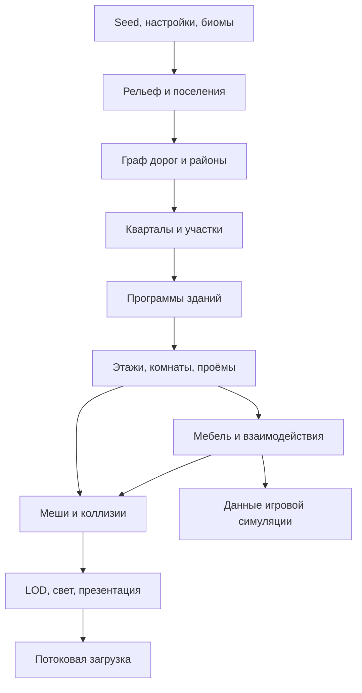
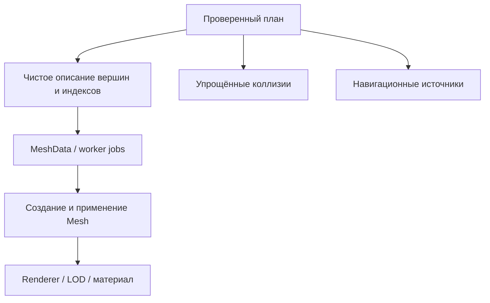

# 03. Процедурная 3D-графика открытого мира

**Техническое исследование и рекомендуемая архитектура для одиночного симулятора жизни на Unity/C#**  
Дата исследования: 25 ноября 2026 г.  
Целевая платформа: Windows, HP ZBook Fury 17 G8 — NVIDIA RTX A5000 Laptop GPU (16 ГБ VRAM), Intel Core i7-11850H, 128 ГБ RAM.  
Базовый движок: Unity 6.3 LTS (6000.3.x), Universal Render Pipeline (URP).  
Статус: проектное решение на основании документации и научных публикаций; не отчёт о проведённом на этом ноутбуке бенчмарке.

---

## 1. Резюме и главный вывод

Игру с полноценным процедурным городом, деревнями и доступными для посещения многоэтажными зданиями можно построить без покупки генераторов, дорогостоящих ассетов и внешних AI-сервисов. Но подход «случайно расставить префабы» качественного результата не даст. Не следует также пытаться генерировать абсолютно каждый стул, человеческую скульптуру, дерево или текстуру на лету.

**Рекомендуемый подход — гибридная, семантическая, иерархическая процедурная генерация.**

- Мир, улицы, земельные участки, здания и помещения существуют в виде устойчивых структур данных. У каждого значимого объекта есть идентификатор.
- Город строится от географии и транспортного графа к кварталам и участкам, а не наоборот.
- У зданий сначала определяется конструктивная схема, входы, этажи, лестницы, помещения и проёмы. Фасад и интерьер строятся из одной согласованной модели.
- Стены, полы, крыши, дороги и перекрёстки преимущественно создаются генераторами мешей; двери, окна, сантехника, бытовая техника, мебель и растительность используют библиотеку многократно применяемых 3D-модулей.
- Планировки рождаются из небольших грамматик, ограничений и пространственного поиска, а не из одного шума или неконтролируемой модели WFC.
- Мебель расставляется по назначению комнаты, свободному пространству, маршрутам персонажей и точкам взаимодействия.
- Логический мир не зависит от того, загружены ли его 3D-объекты. Дальние квартиры имеют сохранённые планы и содержимое, но не занимают видеопамять полноценными интерьерами.
- Используются Unity 6.3 LTS, URP Forward+, встроенные Terrain, Shader Graph, Particle System, AI Navigation и при необходимости Splines, Addressables, Burst/Jobs. Внешние пакеты применяются выборочно.
- Основной инструмент изготовления собственных ассетов — Blender с Python и Geometry Nodes; бесплатные текстуры и модели — прежде всего ambientCG и Poly Haven, с проверкой лицензий конкретных дополнительных наборов.
- Кодекс автоматизирует изготовление, импорт, валидацию, генерацию и проверку графики. Вручную желательно утверждать художественное направление и играть в очередной готовый вертикальный срез, а не пересматривать сотни тестов.

| Решение | Выбор |
|---|---|
| Рендеринг | URP Forward+; HDRP — только если отдельный прототип докажет необходимость |
| Художественный стиль | Стилизованный реализм: узнаваемые пропорции, правдоподобные материалы, упрощённые формы и согласованная палитра |
| Модель мира | Детерминированная структура данных с версионированием и сохранением изменений |
| Дороги | Граф + сплайны + процедурная геометрия |
| Участки | Полигоны кварталов + геометрическое разбиение |
| Здания | Типологии + конструктивные шаблоны + параметрические фасады и стены |
| Планировки | Граф требований + шаблоны + ограниченный пространственный поиск |
| Интерьеры | Семантическая композиция «обязательные предметы → функциональные группы → декор» |
| Масштабирование | Чанки, LOD/HLOD, отсечение по помещениям, инстансинг, потоковая загрузка |
| Свет | Динамический свет в произвольных мирах; запекание только для заранее подготовленной неизменной геометрии |
| Платные плагины | Не требуются для выбранной архитектуры |
| Начальная цель производительности | 60 FPS при 1920×1080 на целевом оборудовании; подтверждается отдельными измерениями |

### 1.1. Что именно считать качеством

Качество состоит из трёх независимых компонентов:

1. **Правдоподобие пространства.** У дома реальные проходы, подъезд, соответствующие интерьеру окна; магазин отличается от квартиры; на дороге возможен проезд; мебель не перекрывает дверь.
2. **Художественная целостность.** Все материалы и объекты выглядят частью одного мира, а не набором случайных бесплатных моделей.
3. **Достаточная производительность.** Визуальное качество удерживается при наличии жителей, транспорта, физики, экономики и прочей игровой симуляции.

Фотореализм, максимальная плотность полигонов и рейтрейсинг не являются обязательными составляющими этих трёх требований. Напротив, грамотно выполненный художественный стиль обычно выгоднее для одиночной разработки, чем стремление к визуальному уровню AAA-игр.

**Граница исследования:** предлагаются оригинальные игровые пространственные схемы и вымышленные типологии, а не инженерные проекты реальных зданий. Приведённые размеры являются стартовыми игровыми параметрами, а не строительными нормами.

---

## 2. Научные и технологические основания

Процедурная генерация городов, зданий и обстановки исследуется несколько десятилетий. Наиболее полезны не готовые обещания «сгенерировать всё», а методы, которые можно реализовать и контролировать в C#.

| Метод | Что даёт | Ограничения | Решение для проекта |
|---|---|---|---|
| L-системы, грамматики роста | Иерархия улиц, рост города, деревья | Нужна коррекция пересечений, рельефа и связности | Упрощённые правила роста дорог, ограниченные транспортным графом |
| Shape grammar / CGA-подобная грамматика | Закономерные фасады, этажи, окна, детали | Типичная грамматика оболочки сама по себе не создаёт пригодный интерьер | Небольшой собственный набор операций над фасадами и объёмами |
| Voronoi / Poisson disk | Районы, природное распределение точек | Слепое применение даёт нереалистичные улицы/участки | Использовать для центров поселений и растительности |
| BSP (бинарное пространственное разбиение) | Быстрые прямоугольные помещения и участки | Без дополнительных правил похожи на подземелья, неудобная смежность комнат | Ограниченное разбиение внутри типологий |
| Графы смежности + constraints | Согласование функций, размеров, доступов | Нужен ограниченный поиск и обработка невозможных случаев | Основной алгоритм планировок |
| Стохастическая оптимизация | Улучшение формы и композиции | Время расчёта трудно прогнозировать | Небольшой фиксированный бюджет кандидатов |
| Wave Function Collapse (WFC) | Локально согласованные тайлы и паттерны | Противоречия; локальная совместимость не обеспечивает глобальную связность | Декоративные плитки, мотивы, второстепенные узоры |
| CP-SAT / полноценный constraint solver | Сложные дискретные ограничения | Нативные зависимости, сложнее отлаживать и интегрировать в Unity | Резерв для редких сложных случаев, предпочтительно offline |
| Генеративные нейросети | Идеи визуального стиля, отдельные текстуры/модели | Нет гарантии геометрии, UV, лицензий, одинаковости стиля, логической структуры и стабильных ID | Не использовать как обязательную часть игры |

### 2.1. Что взять из первичных исследований

**Parish & Müller (2001), Procedural Modeling of Cities.** Авторы строят город иерархически: сеть дорог с глобальными целями и локальными ограничениями, затем участки, затем архитектурные объёмы. Это полезная основа разделения на независимые стадии [R1].

**Müller и соавт. (2006), Procedural Modeling of Buildings.** CGA — грамматический способ детализировать архитектуру посредством преобразований геометрических форм. В данной игре достаточно реализовать подмножество: разбиение фасада, повторение секций, вставку модулей; проектирование помещений оставить другому компоненту [R2].

**Merrell, Schkufza, Koltun (2010), Computer-Generated Residential Building Layouts.** Работа разделяет архитектурную программу (назначения, площади и связи помещений), вычисляемую планировку и 3D-представление. Для нашей задачи важнее этот принцип, чем воспроизведение статистической модели авторов: архитектурные программы для начала можно задать в JSON [R3].

**Merrell и соавт. (2011), Interactive Furniture Layout Using Interior Design Guidelines.** Композиция мебели может оцениваться совокупностью функций качества: свободой движения, близостью связанных предметов и пространственной организацией. Применяем этот принцип с простым детерминированным поиском вместо дорогостоящего Монте-Карло [R4].

**Bridson (2007), Fast Poisson Disk Sampling in Arbitrary Dimensions.** Полезен для естественного размещения деревьев, кустов, камней, если дополнить масками окружающей среды [R5].

**Вывод:** в игре должны сочетаться алгоритмы с явной постановкой задачи. Универсального генератора, который одновременно выдаёт правдоподобную схему города, обстановку и качественный свет, не требуется.

---

## 3. Выбор Unity и графического конвейера

### 3.1. Версия редактора

На момент исследования официальный ресурс Unity указывает Unity 6.3 LTS как доступную LTS-ветку с поддержкой до декабря 2027 года [U1]. Для нового долгосрочного проекта предпочтительна последняя стабильная исправительная версия 6000.3.x, а не альфа/бета будущего движка. Точное значение редактора и всех пакетов фиксировать при создании проекта в `ProjectSettings/ProjectVersion.txt`, `Packages/manifest.json`, `Packages/packages-lock.json`.

Документация некоторых пакетов привязана к Unity 6000.0 или собственным версиям; окончательную совместимость проверять через Package Manager выбранного редактора. Не составлять manifest из случайно найденных «самых новых» версий.

### 3.2. URP против HDRP

Сравнение на основании таблицы возможностей Unity 6.3, документации рендер-путей и GPU Resident Drawer [U2–U5]. Стоимость в кадре зависит от сцены и настроек, а не только от названия конвейера.

| Возможность | URP | HDRP | Значение для открытого мира |
|---|---|---|---|
| PBR-материалы, нормали, декали | Да | Да, более богатые возможности | Обоих достаточно для качественного окружения |
| Shader Graph, постобработка | Да | Да | Отличный инструмент управляемого стиля |
| Много источников освещения | Forward+, Deferred/другие пути | Продвинутые tiled/clustered пути | Обе системы способны показывать ночные улицы; тени остаются дорогими |
| Запечённое GI и APV | Да | Да | При фиксированной геометрии; не решают произвольное изменение топологии |
| Динамическое GI экранного пространства | Нет штатного SSGI в рассматриваемой таблице | Есть SSGI, опциональные ray-traced эффекты | HDRP потенциально выигрывает в сложных динамических интерьерах |
| Отражения | Reflection Probes; нет штатных HDRP SSR/RT-функций | SSR, планарные и ray-traced отражения | URP требует художественных аппроксимаций |
| Объёмный туман, облака | Стандартный туман, расширения/приближения | Штатная объёмная атмосфера и облака | HDRP позволяет получить более сложную погоду без собственных шейдеров |
| Реальные площадные источники | Ограничены запекаемыми вариантами | Более мощные динамические варианты | В URP имитируем светильники spot/point + эмиссией |
| Автоматическая физически ориентированная экспозиция | Более ограниченный штатный набор | Расширенный | URP — контролируемая экспозиция через Volume и собственный переход |
| GPU Resident Drawer / GPU occlusion | Доступны при поддерживаемых путях и условиях | Доступны | Снижает стоимость большого числа визуальных объектов |
| Работа на ноутбуке | Большой запас для настройки производительности | Больше ресурсоёмких эффектов и параметров | GPU и CPU должны одновременно обслуживать город, интерьеры и симуляцию |
| Разработка ассетов | Проще обеспечить единый PBR-набор и импорт | Больше специализированных настроек | URP выгоднее для массового конвейера Codex |
| Цена перехода на другую SRP | Требуется миграция материалов, шейдеров, освещения, профилей | То же | Не поддерживать две полноценные реализации с самого начала |

**Вердикт: URP Forward+ как первоначальный и основной конвейер.**

RTX A5000 Laptop достаточно интересна для экспериментов с HDRP, но наличие RT-ядер и 16 ГБ VRAM ещё не гарантирует стабильную частоту кадров. Речь о ноутбучном GPU с зависимым от конкретной машины энергопотреблением и охлаждением, а не о настольной A5000 [H1].

Forward+ выбран в том числе потому, что инструкция Unity 6.3 по GPU Resident Drawer явно рекомендует его; сводные таблицы также упоминают другие варианты («Deferred+»). Для первой реализации не следует зависеть от расхождений в названиях и доступности альтернативных режимов: выбрать Forward+, убедиться в наличии настроек в установленной версии и профилировать [U3, U4].

### 3.3. Практические настройки URP

Базовый профиль качества, начальные величины:

- Linear color space, HDR-рендеринг с выводом в SDR, ACES или Neutral tonemapping после визуального сравнения.
- 1920×1080, render scale 1.0; в режиме высокой нагрузки — 0.85–0.95.
- TAA либо SMAA [U16] после сравнения городских тонких деталей, движущихся автомобилей и растительности. Не складывать разные методы сглаживания без причины.
- SRP Batcher; GPU Resident Drawer при совместимых мешах; GPU occlusion после измерения.
- Основная направленная лампа (солнце), 3–4 каскада теней на среднем/высоком качестве, стартовая дистанция теней 70–100 м. Настраивать атлас и распределение каскадов по профилю качества.
- SSAO умеренной интенсивности; цветокоррекция; слабый bloom для освещённых окон и вывесок. Избегать чрезмерного chromatic aberration, bloom, глубины резкости во время игры.
- Decal Renderer Feature только там, где она видимо улучшает границы поверхностей и износ; проверить цену дополнительного прохода.
- Дополнительные источники света ограничивать по видимому региону; дополнительные **тени** имеют отдельный бюджет.
- Один основной игровой рендерер/камера. Не строить отдельную камеру с полным рендерингом на каждый подъезд, зеркало или окно.

**Когда пересмотреть HDRP:** только после готовой тестовой сцены с улицей, интерьером, ночным освещением и нагрузкой NPC, если в URP не удаётся получить нужный художественный результат разумными способами. Сравнить одинаковые сцену, разрешение и ограничения теней; затем принять одно решение. Не выполнять постоянную миграцию проекта ради экспериментов.

---

## 4. Архитектура генерации: сначала смысл, затем геометрия

### 4.1. Общий граф стадий



Главный архитектурный принцип: **данные задают мир, Unity GameObjects лишь отображают активное подмножество**.

Например, экономика знает, что квартира A сдана персонажу N, содержит холодильник F и шкаф S. Графика не владеет этими записями. Попытка перенести мебель вызывает игровую команду; состояние изменяет соответствующая подсистема, визуальный объект лишь отражает новую позицию. Удаление объекта из видимой сцены при стриминге не означает его уничтожение в симуляции.

### 4.2. Выходные модели генераторов

| Контракт | Ключевые поля | Кто использует |
|---|---|---|
| WorldManifest | Seed, версия генерации, карты высот/климата, ограничение области, индексы поселений и чанков | Все стадии |
| RoadGraph | Узлы, рёбра, категории, контрольные точки, полосы, пешеходные связи, уровни высот | Дорожный меш, транспорт, навигация, участки |
| ParcelPlan | ID, полигон границ, подъезд, зона назначения, параметры застройки | Генератор здания, экономика |
| BuildingPlan | Контур, типология, архитектурный стиль, уровень входа, этажи, вертикальное ядро | Интерьер, оболочка, навигация |
| FloorPlan | Высота этажа, контуры комнат, стены, отверстия под лестницу, межкомнатные связи | Меши, коллизии, освещение |
| OpeningSpec | ID стены, тип двери/окна, положение на сегменте, размеры, соединяемые зоны | Фасад и интерьер, двери, порталы |
| FurnishingPlan | ID предмета, AssetId, поза, категория, владелец/назначение, точки использования | Инвентарь, взаимодействия, визуализация |
| ChunkVisualPlan | Списки мешей, материалов, экземпляров, LOD, разделов коллизий, границы | Streamer |
| PersistentWorldDelta | Состояние дверей, перемещённая мебель, исчезнувшие предметы, пользовательские изменения | Сохранения, все игровые владельцы состояния |

Использовать собственные сериализуемые простые контракты: числа, целочисленные координаты, ID и массивы записей. Не хранить ссылки на `GameObject`, `Transform`, `MeshRenderer`, случайные индексы объектов сцены как часть постоянных данных.

### 4.3. Seed, идентификаторы и воспроизводимость

- Seed верхнего уровня: например `ulong WorldSeed`.
- Независимые под-потоки PRNG на стадии и на сущности: `Hash64(WorldSeed, StageId, EntityId, LayoutVersion)`.
- Не использовать порядок выполнения потоков или глобальный `UnityEngine.Random` как источник стабильного мира. Выбрать собственный явно определённый генератор либо фиксированную версию проверенной реализации.
- Идентификаторы объектов создавать от устойчивых родительских ID и стабильных ключей (участок → здание → этаж → помещение → слот мебели), а не от количества ранее сгенерированных объектов. У каждой стадии — своя версия схемы.
- Геометрические вычисления, на которые опираются ID и разбиение участков, выполнять с устойчивым порядком обхода и дискретизацией координат; не рассчитывать на побитовую детерминированность float между платформами.
- Генерация нового мира и пересборка визуального представления существующего — разные операции.
- Генератор может обновиться, но старый мир обязан использовать зафиксированный план/версию или явную миграцию; нельзя пересоздать населённый дом «по улучшенному seed» и потерять квартиры, предметы или владельцев.
- Сохранять итоговые значимые планы (особенно помещения, проёмы, ID постоянной мебели) и дельты изменений. Меши — кэш, а не авторитетное сохранение. Версию ассет-каталога фиксировать отдельно.

### 4.4. Генерация заранее и на лету

| Подход | Плюсы | Минусы |
|---|---|---|
| Вся сцена в Editor | Можно точно запечь свет/видимость; быстро загружается готовый контент | Большие данные, медленная пересборка, гибкость мира ниже |
| Весь мир только в runtime | Максимальная вариативность | Непредсказуемые задержки, сложнее свет, больше рисков геометрии |
| Гибрид | Стабильный базовый план и кэшируемые чанки, детали создаются по необходимости | Нужно ясно разделить генератор, хранение и визуализацию |

Рекомендован гибрид. При начале новой игры сначала создать и проверить глобальный план, сохранить его. Статические общие 3D-модули изготовить offline. Дальние визуальные объекты создавать из лёгкого описания, а подробную геометрию подготавливать асинхронно по приближению. Если мир фиксируется заранее и нужен особенно богатый свет, отдельные неизменяемые ключевые районы можно генерировать в Editor с запеканием.

Не следует экономить вычисления на топологии ценой непостоянства: план подъезда и идентификаторы квартир должны существовать до заселения NPC, даже если ни одно помещение ещё не визуализировано.

---

## 5. Рельеф, карты местности и дороги

### 5.1. Генерация ландшафта

В первой версии использовать Unity Terrain чанками. Он уже содержит оптимизированные механизмы отображения рельефа, деревьев и деталей [U17, U18]. Собственный меш применять для улиц, тротуаров, русел, набережных, мостов, подпорных стен, пещер и участков со сложной геометрией.

1. Создать макрокарту высот из нескольких масштабов шума и форм ландшафта: плато, холмы, низины, водоёмы.
2. Получить карты влажности, уклона, климата, расстояния до водоёмов и пригодности для строительства.
3. Выбрать места городов, деревень, промышленных и сельскохозяйственных зон по пригодности и связности, а не равномерному шуму.
4. Зафиксировать важные рёбра дорожной сети, линии изменения высот и границы водоёмов.
5. Скорректировать рельеф около улиц, участков и мостовых подходов. Не выравнивать всю карту под город: земля должна естественно подходить к фундаментам.
6. Сформировать несколько TerrainData с совместимыми размером, разрешением, соседями и совпадающими краевыми выборками; одинаковый глобальный алгоритм высот устраняет щели.
7. Разметить поверхности: земля, трава, камень, поле, берег, городской грунт. Граница асфальта задаётся дорожной геометрией/масками, а не только растягиванием terrain-текстуры.

Для первого мира разумно ограничить размер, например район около 1–2 км², но проектировать чанки так, чтобы его можно было расширять. Слишком большой мир без наполнения приносит мало игрового качества.

Стартовый размер визуального чанка — 128×128 м; в плотной городской части возможно разделение на меньшие ячейки, в сельской — на более крупные. Terrain-тайл может быть крупнее чанка графики, например 256 или 512 м. Не обязаны совпадать размеры всех пространственных индексов.

Для карты, которую впоследствии расширят на десятки километров, хранить глобальную позицию в виде целочисленного индекса чанка + локальной координаты (или double-координат). В Unity передавать локальное float-положение вблизи игрока. Floating origin добавлять только при измеримой проблеме точности: сдвиг визуальных, физических и навигационных объектов должен происходить согласованно; идентификаторы и глобальные планы при этом не меняются.

### 5.2. Дорожный граф

Важнейшая ошибка — генерировать дороги как независимые полосы мешей. ИИ транспорта и пешеходов должен работать с графом, а визуализация получать представление из этого же графа.

Предлагаемый алгоритм:

1. Общемировые соединения поселений образуют магистральную сеть. Использовать поиск пути по растровой карте стоимости (расстояние, склон, вода, препятствия) и добавлять разумные альтернативные соединения.
2. В городе выбрать центральные оси, сетку улиц или нерегулярный рисунок по типу района, затем создать боковые улицы с ограниченной длиной и углом примыкания.
3. На пересечениях в одном уровне явно разрезать рёбра и создать узлы. Мостовые и тоннельные пересечения обозначать разными уровнями графа.
4. Найти/исправить слишком близкие узлы, короткие отрезки, невозможные развороты и необоснованно резкие повороты.
5. Разместить пешеходные соединения и подходы к участкам; отдельные слои транспортного и пешеходного графа.
6. Для каждого ребра сформировать сечения дороги и сглаженную траекторию сплайном. Unity Splines пригоден для редактирования/семплирования кривых, но не заменяет расчёт перекрёстков и дорожного графа [U13].
7. Построить полосы дорожного полотна, обочины, тротуар, бордюр, разметку. Профиль высоты должен быть связан с terrain и геометрией пересечения.
8. Полосы движения, пешеходные маршруты и точки пересечения/перехода определять из того же RoadGraph; не реконструировать их по визуальной дороге.

Пример типов, размеры — регулируемые игровые значения: узкая сельская дорога 4–5 м суммарного полотна; обычная двуполосная улица 6–7 м; тротуар ~1.5–2.5 м; крупная улица шире по числу полос. Для определённого набора машин и игровой камеры нужны проверки проходов, а не имитация всех реальных дорожных нормативов.

### 5.3. Меши дорог

Для каждой кривой семплировать длину дуги и строить поперечные сечения относительно касательной. Использовать согласованный tangent/normal вдоль траектории, чтобы избежать переворотов сечения. Шаг семплирования адаптивный: крупнее на прямой, мельче на повороте.

- UV вдоль реальной длины, а не по номеру вершины: равномерная плотность текстуры.
- Перекрёсток строить как отдельный полигон соединения подходов; геометрически обрезать пересечения полос.
- Пешеходные тротуары и переходы не должны внезапно исчезать на границе чанка.
- Маски/декали: дорожная разметка, мелкие починки, лужи, трещины.
- Крупные отдельные мосты — сгенерированная конструкция + библиотечные опоры и перила.
- Коллизии: простые физические поверхности, бордюры, препятствия; не использовать высокодетализированный меш как обязательный collider.
- Одному ребру/узлу назначить владельца геометрии при разрезании по чанкам; соседи пользуются общими граничными данными.

### 5.4. Кварталы, участки и типы поселений

После построения планарного дорожного графа выявлять ограниченные области, которые образуют кварталы. В плотном городе полезно разбиение полигонов с учётом отступов от улиц.

- Найти циклы граней графа (например, через направленные half-edge и упорядочивание рёбер по углу).
- Сместить границы квартала внутрь с учётом ширины дорог и боковых зон.
- Разделить доступный полигон на участки. Предпочитать куски с контактом с улицей, минимальной площадью, приемлемым аспектным отношением и достаточной глубиной.
- Для клиновидных/сложных участков применять простые типологии — сквер, парковка, отдельно стоящий киоск, двор, а не пытаться запихнуть дом в любую фигуру.
- Выделить назначение: жилое, смешанное, торговое, офисное, промышленное, рекреация. Параметры района управляют этажностью, плотностью, состоянием зданий и архитектурной палитрой.
- Деревни: основная улица, вытянутые участки, дворы, хозяйственные постройки, переход к полям. Не переносить городские прямоугольные кварталы в каждую деревню.
- Промзона: несколько крупных участков, склады и дороги для грузового транспорта, а не сетка тесных жилищ.

Для robust-операций объединения, пересечения, offset и разности полигонов подходит Clipper2 на C# (Boost Software License 1.0) [L1]. Использовать целочисленный масштаб геометрии (например, миллиметры), очищать повторяющиеся вершины и проверять самопересечения. Не следует писать собственный универсальный полигональный boolean-движок лишь ради экономии одной зависимости.

---

## 6. Здания: конструкция, типологии и фасады

### 6.1. Модель типологии

Не нужно генерировать каждое здание уникальным алгоритмом. Нужен каталог параметризованных типологий, которые используют общую геометрию и правила.

| Типология | Основные параметры | Обязательные структуры |
|---|---|---|
| Деревенский дом | 1–2 этажа, ширина, глубина, крыша, двор | Вход, жилые комнаты, кухня/санузел, окна |
| Частный городской дом | 1–3 этажа, участок, пристройки | Вход, вертикальная связь при этажности >1, помещения |
| Многоквартирный дом | Число секций, 3–12 этажей как стартовый диапазон, число квартир на этаже | Подъезды, лестничное ядро, лифты по типологии, площадки, квартиры, входы |
| Смешанный дом | Торговля на первом этаже, квартиры выше | Отдельные входы, служебные/торговые зоны, жилой доступ |
| Магазин | Площадь торгового зала, витрина, склад, касса | Обслуживание покупателей, двери, прилавки, полки |
| Склад | Пролёты, высота, зоны хранения | Ворота, стеллажи, проходы, рабочие позиции |
| Офис | Секции рабочих помещений, кабинеты, open space | Вход, коридоры, переговорные, санузел, места работы |
| Кафе/мастерская/служебное помещение | Профиль деятельности, площадь, посетители | Функциональные зоны и необходимые объекты взаимодействия |

Начать с простых прямоугольных и L-образных контуров. Сложные крыши и нерегулярные архитектурные формы добавлять после качества базовых типов.

### 6.2. Последовательность генерации здания

1. На входе — участок, его назначение, диапазон размеров, стиль, направление главного фасада.
2. Построить footprint (контур), проверить нахождение внутри границ участка и свободную связь с улицей/двором.
3. Определить этажность и уровни высоты. Согласовать вертикальные шахты, лестницы, их проёмы и наружные входы.
4. Разделить этажи на публичные (подъезд, коридор, торговый зал), частные (квартиры/офисы) и служебные зоны.
5. Для каждого помещения решить назначение и границы. Сформировать единственный набор стен и проёмов.
6. Из этого набора составить фасад. Окна привязаны к конкретным наружным сегментам и допустимым комнатам. Балконы и эркеры допустимы только там, где связаны с соответствующим этажом и помещением.
7. Получить конструктивные меши, установить модули окон, дверей, карнизов, лестниц, крыши и детали.
8. Выпустить черновой навигационный/коллизионный граф и ссылку на план меблировки. Геометрия и доступы валидируются до включения здания в активный игровой мир.

### 6.3. Подъезды и многоэтажность

Подъезд — постоянная пространственная зона, а не декоративная дверь, ведущая в несвязанный интерьер.

- У каждого подъезда собственные ID входа, лестничного ядра и площадок по этажам.
- Лестничные зоны резервируются раньше квартир; лестница соединяет точно совпадающие уровни этажей. Высота подъёма, число ступеней и площадки рассчитываются согласованно.
- Лифтовая система (когда будет добавлена) использует отдельные шахту, кабину и посадочные точки. Gameplay-логика лифта независима от генерации меша.
- На каждом этаже план должен содержать пути от площадки до входных дверей квартир.
- Подвал, чердак, технические этажи — отдельные опциональные типы.
- Фасад, наружная лестничная сетка, перекрытия, оконные ниши и двери вычисляются из совместимых габаритов. Нельзя делать непрерывный потолок над лестничным проёмом.
- Закрытое окно отражает состояние внешней оболочки; открываемое окно/дверь имеет собственный модуль взаимодействия, но проём не меняется в зависимости от наличия visual prefab.

### 6.4. Грамматика фасадов

Предлагаемая небольшая грамматика, не отдельный универсальный DSL на первых этапах:

| Операция | Результат |
|---|---|
| ExtrudeFootprint | Основной объём |
| SplitByFloors | Полосы этажей |
| ReserveOpenings | Места окон, входов, витрин из FloorPlan |
| RepeatBay | Повторяемые фасадные секции в допустимом пространстве |
| SelectModule | Подбор окна, двери, декоративной панели по стилю и размеру |
| AddRoof | Плоская, двускатная, вальмовая или позднее сложная крыша |
| AddDetails | Карниз, базовый цоколь, водосток, балкон, вывеска, кондиционер |
| MakeProxy | Упрощённая дальняя оболочка |

Базовые правила задаются данными. Например, фасад современного дома: бетонные колонны/вставки, крупные светлые окна, плоская крыша; старый дом: штукатурка, кирпичный цоколь, более узкие окна, декоративные наличники. Палитра связана с районом и назначением здания.

Избегать ситуации, когда на каждом этаже выпало своё случайное окно и ничто больше не повторяется. Архитектуре нужна иерархия повторений: единый этажный ритм, вариации секций, ограниченное количество акцентных элементов.

### 6.5. Реальная геометрия вместо декоративного обмана

Стена внутри и снаружи должна описываться одним сегментом с толщиной. Для каждой стороны можно выбрать разную отделку. Проём вырезается на стадии построения стен: вместо произвольного 3D Boolean разбить стену на части слева/справа, над и под проёмом; потайные поверхности не создавать без необходимости.

- Пол и потолок: полигоны с отверстиями под шахты/лестницы.
- У каждой комнаты чистые границы и высота. Внутренние и наружные поверхности согласованы.
- Дверные полотна отдельны от стены, петля/pivot и направление открывания определены.
- Оконные рамы остаются отдельными модулями; стекло с материалом и соответствующим режимом отображения.
- Простые крыши строить через подъём контура/разделение на скаты; сложные крыши — шаблоны либо offline-модули. Не начинать с универсального straight skeleton для любых полигонов.
- Скруглять кромки видимых модулей небольшим bevel в Blender, чтобы появились правдоподобные блики. Не добавлять одинаковый bevel к каждой внутренней невидимой поверхности.

---

## 7. Алгоритм планировок помещений

### 7.1. Архитектурная программа — данные, а не сгенерированный меш

Каждый тип здания/помещения задаёт:

- required room roles, допустимые количественные диапазоны;
- минимальную/целевую площадь, соотношение сторон, требования к наружной стене;
- обязательные и предпочтительные соседи;
- роли проходов: общие, частные, служебные;
- фиксированные подключения к ядру и наружному входу;
- набор обязательных предметов по назначению комнаты;
- типы допустимых проёмов, стиль, бюджет декора.

Пример оригинальной игровой программы квартиры (параметры проекта, не нормы):

| Роль комнаты | Площадь, стартовый диапазон | Ограничения |
|---|---:|---|
| Прихожая | 3–8 м² | Вход из лестничной площадки или коридора |
| Гостиная | 15–28 м² | Желательно наружное окно; связь с прихожей/кухней |
| Кухня | 6–15 м² | Связь с гостиной или прихожей, рабочая стена |
| Спальня | 9–18 м² | Наружное окно; не проходная для чужих комнат |
| Санузел | 3–7 м² | Доступ из прихожей/коридора, допускается без окна |
| Кладовая | 1.5–4 м² | Опционально, без обязательного окна |

За пределами квартиры: лестничная площадка, общий общественный проход, лифтовой холл. Комнаты могут объединяться при разрешённом варианте (студия, кухня-гостиная), но нельзя просто исключать обязательный санузел ради красивой формы.

### 7.2. Сравнение алгоритмов

| Алгоритм | Скорость разработки и работы | Контроль | Рекомендация |
|---|---|---|---|
| Библиотека полных планов | Высокая скорость работы | Очень высокий, но мало изменчивости | Использовать как надёжный начальный базис и fallback |
| BSP | Простая реализация, быстрый расчёт | Хорош для ортогональных форм, слаб для сложных связей | Разбиение внутри предварительно определённой секции |
| Граф требований + размещение на сетке | Средняя трудоёмкость | Хорошо обеспечивает связи и размеры | Основной вариант |
| WFC | Хорош для локальной согласованности | Без глобальных ограничений не гарантирует доступность | Узор пола, декоративные паттерны, второстепенные модули |
| CP-SAT | Может эффективно решать строгие дискретные системы | Высокий при корректной формулировке | Только если простой подход не делает нужные типологии |
| MCMC / simulated annealing | Гибкий поиск сложной композиции | Зависит от функций стоимости, нет гарантии времени | Опциональная локальная оптимизация |

Достаточно обычного набора типологических шаблонов, параметрического преобразования и поиска, который выдаёт проверенное решение. Не нужно реализовывать научный универсальный solver для первого подъезда.

### 7.3. Рекомендуемый алгоритм по шагам

**A. Конструктивное ядро.** Зарезервировать наружные стены, лестничную клетку, лифт, шахты, коридор, входы и возможные оконные оси. Для многоэтажки копировать базовое ядро по этажам.

**B. Граф желаемых смежностей.** Вершины — помещения, рёбра — обязательная/желательная непосредственная связь или связь через коридор. Сначала выбрать разумный вариант программы (например 2-комнатная, 3-комнатная квартира).

**C. Быстрое разбиение.** Выбрать шаблон «два помещения вдоль фасада», «коридор + комнаты», «угловые квартиры», «широкий торговый зал + задняя служебная зона» и вписать его в контур. Сетка грубой геометрии, например 0.25 м, облегчает вычисление связности и ограничений; затем непрерывно построить координаты стен.

**D. Поиск.** Если размеры и смежности неудовлетворительны, попробовать зеркалирование, изменение размера перегородки, другой порядок комнат, другой вход и заранее допустимый альтернативный шаблон. В стартовой реализации — ограничение порядка 16–64 кандидата на секцию по сложности, настраиваемое после профилирования.

**E. Точные стены и проёмы.** Найти общие границы; выбрать двери по совпадающим стенам, необходимой ширине и свободным проходам по обеим сторонам. Назначить допустимые окна на внешний контур, ведя связь с фасадом.

**F. Валидация.** Граф достижимости от входа; проверка пересечения полигонов, минимальной площади, толщины стен, проёмов, маршрутов обхода мебели и соответствия этажей.

**G. Надёжный fallback.** Если задача не решается за бюджет, сначала расширить допустимую вариацию, затем выбрать резервный заранее проверенный план. Не отдавать сломанную квартиру. Если и он не помещается, участок получает меньшую типологию либо передаётся на перепланирование до публикации и заселения. Генератор должен объяснить причину отказа в структурированном отчёте.

Пример функции качества:

```text
Score = 
    4 * areaDeviation
  + 3 * undesirableAdjacencies
  + 2 * awkwardAspectRatio
  + 2 * excessCorridorArea
  + 2 * missingPreferredWindow
  + 1 * wallAlignmentPenalty
```

Термины требуется нормировать; веса — иллюстрация, а не обученные оптимальные числа. Все **обязательные** требования проверяются отдельно. Кандидат с недоступным санузлом не выигрывает у корректного плана из-за меньшей площади коридора.

### 7.4. Строгие инварианты

Генератор обязан выпускать только пригодную к игре геометрию:

- Нет перекрытия независимых помещений; их границы находятся внутри выделенной секции.
- Все обязательные комнаты существуют и достижимы из правильного входа.
- Частная зона не открывается произвольной дверью сразу в соседнюю чужую квартиру.
- Дверь находится на стене между двумя соответствующими зонами. Вход с улицы действительно ведёт внутрь.
- Лестничные площадки связаны по высоте и имеют свободное место в плане.
- Окна соответствуют допустимой наружной границе; наружный фасад и внутренний проём согласованы.
- У мебели и дверей хватает предусмотренного игрового пространства; коллизии не образуют невидимые барьеры.
- Планы стабильно воспроизводятся при одинаковом seed и версии.

Система валидации работает сначала на чистых 2D-структурах, прежде чем тратить ресурсы на меши или NavMesh.

### 7.5. WFC и решатели — где уместно

Оригинальная реализация WFC на C# распространяется по MIT [L2]. DeBroglie добавляет ограничения и backtracking и тоже имеет MIT-лицензию [L3]. Но даже эти решения требуют определения глобальной связности, размеров и функциональных зон. WFC не должна быть ядром планировщика.

Применение по назначению: модульная плитка стены, пол, допустимые сочетания оконных вставок на декоративной секции, дворовый орнамент. Размещение функционально важных объектов (лестница, входная дверь, холодильник) управляется отдельной моделью.

OR-Tools/CP-SAT [L4] — возможный инструмент сложного offline-поиска, если выяснятся устойчивые случаи, которые не покрывают шаблоны и ограниченный поиск. В runtime-проект сразу не добавлять ни нативную зависимость, ни отдельный универсальный язык ограничений.

---

## 8. Семантическая генерация мебели и предметов

### 8.1. Каталог ассетов должен содержать смысл

Меш стола сам по себе ничего не сообщает симуляции. Каждое мебельное определение содержит метаданные:

```json
{
  "assetId": "furniture.table.dining.wood.01",
  "category": "DiningTable",
  "styleTags": ["urban.basic", "rural.warm"],
  "dimensionsMeters": [1.2, 0.76, 0.8],
  "footprint": [[-0.6,-0.4],[0.6,-0.4],[0.6,0.4],[-0.6,0.4]],
  "allowedRoomRoles": ["Kitchen", "DiningRoom", "Cafe"],
  "placement": {
    "surface": "Floor",
    "wallPreference": "Optional",
    "requiresSupport": false
  },
  "affordances": ["PlaceItem", "EatAtTable"],
  "anchors": [
    {"id":"seat.front.0","kind":"ChairSlot","position":[0,0,-0.75],"yaw":0},
    {"id":"top.center","kind":"SurfaceSlot","position":[0,0.76,0],"yaw":0}
  ],
  "clearanceProfile": "dining.table.standard",
  "renderPrefab": "furniture/table_dining_wood_01",
  "lodProfile": "furniture.medium",
  "licenseRef": "asset-manifest:original"
}
```

Координаты и поворот якорей — локальные игровые данные; форматы окончательно унифицировать в контракте контента. Для сложных форм хранить набор ориентированных прямоугольников/полигонов, а не только один bounds модели.

Семантические теговые категории: спать, сидеть, готовить, хранить, работать, покупать, продавать, мыться, ремонтировать, открывать, осматривать, размещать предметы. Модуль предметов/профессий связывает их со своими действиями. Графика объявляет возможности, но не реализует экономику или навыки.

### 8.2. Иерархия размещения

**Шаг 1 — обязательные якоря пространства.** Двери, окна, рабочие стены, подходы, точки потолочного света, зоны движения.

**Шаг 2 — крупные функциональные группы.**

- Кухня: непрерывный ряд рабочих модулей, плита, мойка, холодильник, доступная рабочая зона. Согласовать конфликты открываемых дверец.
- Спальня: кровать, шкаф, прикроватные столики; свободный подход к кровати.
- Гостиная: диван, кресло, столик, место для телевизора/книжного шкафа, ориентация связанных предметов.
- Санузел: сантехника, место доступа, дверь, необходимые поверхности.
- Торговый зал: полки по схеме обслуживания и движения, касса, витрина, вход, доступ к складу.
- Склад: стеллажные ряды, зоны хранения и подходы; декоративные ящики не должны закрывать маршруты.
- Офис: рабочие места с креслами, переговорные, доступ к шкафам, принтерам, дверям.

**Шаг 3 — вторичные предметы.** Светильники, полки, ковёр, комод, картины, шторы. Размещать на подходящей поверхности, у стен или относительно основной группы.

**Шаг 4 — жизнь в интерьере.** Посуда на столах, книги на полках, обувь в прихожей, коробки на складе, растения и бытовая мелочь. Использовать зависимые слоты (поверхность, вместимость, допустимая поза), вероятность и профиль владельца. Предметы, которые могут попасть в инвентарь, сразу получают устойчивый ID; чисто декоративные экземпляры могут оставаться дешёвыми и несимулируемыми.

### 8.3. Алгоритм размещения

1. Создать 2D-карту занимаемых зон комнаты: стену, двери, проёмы, нерушимые предметы, подходы.
2. Для каждого обязательного семейства создать кандидаты: вдоль стен, в выделенных зонах, относительно якорей других объектов, на сетке с допустимыми ориентациями.
3. Сначала размещать наиболее ограниченные/крупные предметы. Проверять пересечение footprint, зазор и соответствие опорной поверхности. Использовать пространственный индекс, а не сравнивать каждый предмет со всеми в здании.
4. Оценивать мягкое качество: композицию, отношения предметов, путь от двери, заполненность, соответствие стилю и функциональность. Предпочитать хорошие кандидаты, но семантически допустимые разные варианты выбирать детерминированно.
5. При конфликте применять ограниченный backtracking: переместить последний/конфликтующий предмет, изменить вариант группы или мебельный размер.
6. После крупных групп — декор на проверенных слотах и поверхностях.
7. Для каждого предмета с взаимодействием проверить наличие достижимой точки подхода; для комнат — связность зон движения. При отказе исключать лишний декор до отказа обязательной группы.

Упрощённая контрольная модель: игровой радиус агента около 0.3–0.4 м, ширина обычного свободного маршрута порядка 0.8–1 м как стартовая настройка. Реальные параметры выводить из капсулы персонажа, транспорта предметов, анимаций и NavMesh; не задавать одинаковые зазоры всем предметам.

### 8.4. Почему не достаточно Physics.Raycast

Collider-объект ещё не сообщает, что на нём можно поставить чашку, что кресло нужно повернуть к столу или что дверь должна открываться. Физика полезна как финальная проверка и для игровых перемещений, но при массовой генерации гораздо дешевле сначала решать задачу на footprint и семантических якорях.

Не создавать физические тела на всех предметах. Простые неподвижные экземпляры могут иметь только визуальное представление; взаимодействующие предметы получают collider, при необходимости Rigidbody, а активная физика включается при взаимодействии. Логическая запись содержимого шкафа не обязана содержать тысячу отдельных видимых GameObjects.

### 8.5. Связь с населением и профессиями

Сохранённые квартиры и рабочие помещения должны обслуживать симуляцию независимо от камеры:

- `RoomId` и `ObjectId` сохраняются между загрузками.
- Семантические affordance/interaction slots связываются с системами работы, сна, покупок, приготовления пищи.
- Изменение стиля или замена модели холодильника не должны менять его игровой инвентарь, владельца, ID или поведение.
- Установка/перемещение мебели пользователем обновляет логические данные, при необходимости локальный план проходов и навигацию; не запускает генерацию города заново.
- Объекты, существующие за пределами активной визуальной зоны, продолжают логически обслуживаться симуляцией.

---

## 9. Модульная 3D-библиотека

### 9.1. Три типа контента

| Категория | Примеры | Способ изготовления |
|---|---|---|
| Параметрическая несущая геометрия | Стены, полы, дорожное полотно, перекрытия, простые крыши, лестничные марши | C# меш-генератор / проверенные шаблоны |
| Повторяемые размерные модули | Окна, двери, рамы, козырьки, ограждения, панели, карнизы, фонари, бордюры | Blender + подготовленные Prefab/mesh и метаданные |
| Функциональные художественные объекты | Диваны, бытовая техника, компьютеры, сантехника, стеллажи, деревья, растения | Собственные модули + импортированные бесплатные модели, нормализованные под стиль |

Не надо строить каждый диван генератором примитивов. Для хорошего качества выгоднее одна узнаваемая модель дивана с правильными пропорциями, bevel, несколькими вариантами материала и LOD, чем десятки случайных бесформенных моделей.

### 9.2. Художественная спецификация (Art Bible)

В начале проекта утвердить один эталонный комплект стиля:

- Ориентир: взрослый стилизованный реализм — достоверные архитектурные пропорции и фактура, но слегка упрощённые силуэты и управляемая детализация.
- Материалы: бетон, кирпич, штукатурка, дерево, керамика, металл, ткань, асфальт, стекло.
- Не смешивать в одной сцене мультяшный low-poly с полностью фотореалистичными предметами без переработки.
- Цвет: общий приглушённый городской фон, ограниченные локальные акценты, согласованные варианты материалов по району/эпохе. У сельской местности другая насыщенность и палитра, но единая обработка.
- Расчёт масштаба к персонажу и камере: метры и естественные пропорции. Мелкие детали в интерьере читаемы, фасады остаются выразительными с улицы.
- Графическая иерархия: форма и свет в первую очередь; материалы, детали и декор после.
- Удалить случайные водяные знаки, текстуры брендов и визуальные несоответствия.
- Создать 3–4 постоянных эталона: улица днём, двор/пригород, квартира, магазин ночью. Они нужны как визуальная цель для Codex.

### 9.3. Единый стандарт ассетов

| Параметр | Стандарт проекта |
|---|---|
| Масштаб | 1 Unity unit = 1 м; проверка размеров после импорта |
| Координаты | Unity Y-up; итоговая ориентация проверяется импортёром |
| Pivot | Для мебели на опорной плоскости; для двери на оси петли; для модулей стыковочный origin |
| Transform | Нейтральная ожидаемая ориентация, применённые преобразования при экспорте; зеркалирование только контролируемо |
| Сетки | Грубая планировочная 0.25 м, мелкие архитектурные размеры задаются параметрами |
| UV | UV0 для материала/trim/atlas; дополнительный UV для lightmap, если объект запекается |
| Материалы | Минимум лишних submesh; заранее согласованные URP-материалы |
| Коллизии | Простые proxy; отдельные для опор, физики и взаимодействий |
| LOD | LOD0/1/2 либо дальний proxy по размеру и видимости; для очень мелкой вещи достаточно отключения |
| Метаданные | AssetId, source URL, лицензия, размеры, категории, якоря, clearance, версии |
| Качество | Нет вырожденных треугольников, NaN, неверного масштаба, отсутствующих ссылок/текстур |

Unity ProBuilder — бесплатный инструмент быстрого блокирования сцен и прототипирования, полезен для эталонных планировок [U14]. Не следует делать runtime-генератор зависимым от редакторской интерактивной геометрии ProBuilder.

### 9.4. Минимальный стартовый комплект

Не скачивать гигабайты несвязанных наборов. Первый набор — ориентировочно 50–80 качественных базовых моделей и типов модулей, без учёта материалов и LOD.

| Семейство | Примерный стартовый объём |
|---|---:|
| Архитектура: двери, окна, витрины, ограждения, лестничные компоненты, крыши | 15–20 |
| Жилые помещения: кровати, столы, шкафы, кухни, техника, кресла, диваны, сантехника | 18–25 |
| Магазин, склад, офис: прилавки, стеллажи, касса, терминал, рабочий стол и стул, коробки | 8–12 |
| Уличные детали: фонари, скамейки, урны, знаки, бордюры, заборы | 6–10 |
| Окружение: деревья, кусты, камни, травы | 6–10 |

Материальные вариации, разные размеры модулей, комплекты отделки и повторение секций дадут гораздо больше видимого разнообразия, чем абсолютное число уникальных моделей. В дальнейшем наращивать каталог по новым механикам и зданиям.

### 9.5. Blender и offline-производство

Blender — основной бесплатный инструмент. Использовать стабильную LTS-версию, закрепив её номер в `tools/requirements.md`, вместо бесконтрольного обновления. Geometry Nodes применяются для вариативных рам окон, модулей лестниц, заборов, листьев, деревьев, панелей, мебели с простыми параметрами [T1–T3].

Конвейер:

1. Создать/нормализовать исходник модели в Blender; хранить исходные файлы для воспроизводимости.
2. Python и Geometry Nodes выполняют параметризацию, объединение повторяемых частей, bevel, UV, генерацию вариантов и коллизий.
3. Сгенерировать LOD с контролем силуэта и UV, не полагаясь слепо на Decimate. Вдали окна могут стать частью impostor/фасадной текстуры.
4. Экспортировать устойчивый формат (первоначально FBX, который удобно импортировать штатным Unity importer; glTF/GLB возможен при необходимости и установленном Unity glTFast [T4]).
5. AssetPostprocessor нормализует import settings, сопоставляет материалы, определяет collision prefab и LODGroup. Метаданные импортируются из JSON/таблиц.
6. Создать префаб из проверенной модели. Добавить конфигурацию якорей как данные, а не ручное размещение десятков дочерних Transform.
7. Автоматический тест каталога проверяет ID, габариты, материальные ссылки, назначение, лицензии, баланс треугольников и наличие LOD.

Blender способен работать в фоновом режиме [T2]. Образец команды, которую можно адаптировать в локальном репозитории:

```powershell
& $BlenderExe -b -P tools/blender/build_catalog.py -- --catalog ContentSource/catalog.json --out Assets/Game/Art/Generated
```

Скрипт `build_catalog.py` предстоит реализовать, команда является предложенным контрактом, а не готовым существующим инструментом. Не нужно устанавливать Blender конечному игроку: он используется как инструмент производства, а не компонент runtime.

---

## 10. Генерация мешей и физической геометрии в Unity

### 10.1. Разделение ответственности



Рекомендуемый C# интерфейс (концептуально): `GenerateGeometry(Plan, Style, Lod, CancellationToken)` возвращает буферы вершин, индексов, submesh, bounds и описание материалов, а адаптер Unity создаёт реальные Mesh и Renderer.

Unity предоставляет `Mesh.AllocateWritableMeshData` / `Mesh.ApplyAndDisposeWritableMeshData` для эффективного заполнения mesh-data, пакетной обработки и работы с Job System [U8]. Burst/Jobs применять к измеренным узким местам: выборкам рельефа, построению дорожных сечений, формированию простых стен, размещению экземпляров растительности [U9]. Нуждающиеся в managed-коллекциях сложные алгоритмы сначала оставить обычным C#.

- Вычисления выполнять с контролем параллелизма.
- Большинство операций с GameObject, Renderer, Transform, материалами и Unity-состоянием выполнять в основном потоке по ограниченному кадровому бюджету.
- Не отправлять произвольные Unity API в `Task.Run`.
- Освобождать NativeArray/MeshData при успехе, отмене и исключении; учитывать жизненный цикл задач при выгрузке чанка.
- После вычислений применять геометрию партиями, а не тысячами объектов в один кадр.
- Корректно рассчитывать winding, нормали, тангенты, UV, AABB; сохранять желаемые сглаженные и жёсткие грани.
- Индекс UInt16 подходит до 65 535 индексируемых вершин; крупные меши разбивать либо явно применять UInt32. Размер меша выбирать также по границам culling, а не только по лимиту индексов.

### 10.2. Полигональная геометрия

- Простые прямоугольные стены: собственная аналитическая геометрия.
- Сложные контуры земельных участков/полов: проверенные polygon boolean и tessellation. Clipper2 подходит для операций и в актуальном репозитории также содержит триангуляцию; при необходимости отдельный тестированный tessellator, например LibTessDotNet [L1, L5].
- Проверить направление контуров, полигональные отверстия, дубликаты и вырожденность.
- CSG/mesh boolean в runtime оставить для будущей механики сложной реконструкции, если действительно нужна. Базовые здания не требуют полного универсального CSG.

### 10.3. Статические и динамические элементы

Не объединять весь город в один гигантский Mesh: это ломает пространственное отсечение, обновление, выгрузку и возможность менять отдельное помещение. Объединять неинтерактивные геометрические поверхности по чанку, зданию, этажу/комнате и общему материалу — так, чтобы геометрия соответствовала разумной единице видимости.

- Одинаковые повторяемые модули (окна, лампы, скамейки, стулья) использовать одним общим мешем и материалом.
- Уникальные стены здания объединять небольшими партиями.
- Двери, ящики, лифты, перемещаемое имущество хранить отдельно от статического меша.
- Colliders делать преимущественно BoxCollider/простых compound-коллизий; для рельефа и уникальных дорожных/стенных поверхностей — подходящие облегчённые меши, не копия всех деталей.
- Для NPC использовать AI Navigation, пакет поддерживает построение навмешей в Editor и runtime [U15]. Дорожный транспорт следует графу полос; дальняя симуляция не требует агента NavMesh в каждом невидимом помещении.
- Строить/обновлять NavMesh активных регионов только после геометрии и основных препятствий; лестницы, переходы, особые двери — проверенные связи NavMeshLink/семантического графа. Отделять закрытую дверь как состояние доступа, а не постоянно пересчитывать весь этаж.

Сложную 3D-физику не использовать как замену планированию. Одинаковые структуры данных обеспечивают геометрическую и навигационную согласованность.

---

## 11. LOD, отсечение, стриминг и загрузка интерьеров

### 11.1. Дистанционные уровни представления

Нужно разделить **LOD визуального объекта**, **уровень детализации участка мира** и **активность игровой симуляции**. Это три разные политики.

| Зона/представление | Что показывается | Стартовая дистанция на местности |
|---|---|---|
| Текущая комната / ближайшие видимые зоны | Полная геометрия, мебель, предметы, свет | По связности помещения, не просто радиус |
| Ближайшее окружение улицы | LOD0/1, двери, фасад, улица, коллизии, активные игровые сущности | Около 0–80 м |
| Средний пояс города | LOD1/2, упрощённые фасады, крупный декор, деревья, без мелких интерьеров | 80–250 м |
| Дальний пояс | HLOD-прокси здания/квартала, силуэты, почти без физических объектов | 250–600 м |
| Горизонт | Укрупнённый terrain, контуры значимых зданий/районов | 600 м и далее по дизайну |

Числа служат отправной точкой. При высокой камере, телеобъективе или открытой местности расстояния и видимость другие. Добавлять гистерезис и ограничения скорости перехода между уровнями, чтобы объекты не переключались туда-сюда на границе.

Unity `LODGroup` переключает визуальные уровни по экранному размеру объекта, а не строго по метрам [U7]. Поэтому таблица выше — политика загрузки/активации, а конкретный LODGroup управляется screen-relative transition.

### 11.2. HLOD города

HLOD (hierarchical LOD) здесь — собственная система облегчённых представлений квартала/здания, а не предположение о наличии универсального автоматического пакета:

- В ближней зоне: отдельные окна, двери, балконы.
- В средней: упрощённая сетка фасада, окна могут быть прямоугольными плоскостями, интерьер не строится.
- В дальней: меш объёма здания с запечёнными или процедурно сформированными атласами фасадов и крыши.
- В очень дальней: объединённый прокси группы зданий со стабильным силуэтом.

Все варианты создаются из одного BuildingPlan. Нельзя дать дальнему зданию другое число этажей ради простоты. Для окон снаружи использовать непрозрачный или дешёвый proxy-интерьер на расстоянии; при приближении и реальной видимости через окно подгружать корректный интерьер.

### 11.3. Видимость помещений

Обычное запечённое CPU occlusion culling Unity не подходит для произвольной геометрии, создаваемой во время игры; это прямо отмечает документация [U6]. Поэтому:

1. Всегда применять штатный frustum culling.
2. На уровне приложения знать активное здание, этаж, помещение и граф соединяющих их порталов.
3. Сохранять в описании комнаты двери, открытые проёмы, окна, лестничные пролёты и связи с улицей.
4. Консервативно определять потенциально видимые пространства: текущая комната, соседние видимые зоны через открытые порталы, наружные окна/двери при выходе.
5. Не выключать комнату только потому, что персонаж стоит вне неё: камера от третьего лица и окна могут её показывать.
6. Отсечение ограничивается визуальными группами; состояние и NPC остаются в логической симуляции.
7. На первом этапе достаточно связного консервативного фильтра этажей/помещений. Позже, если требуется, добавить ограниченное вычисление portal frustum; не строить полноценный сложный visibility-движок сразу.

При использовании GPU Resident Drawer можно включить GPU occlusion culling (зависит от поддерживаемого рендер-пути и совместимости объектов), но он уменьшает работу отрисовки, а не заменяет загрузку, коллизии и логику [U4, U5].

### 11.4. GPU Resident Drawer и инстансинг

GPU Resident Drawer Unity позволяет подходящим MeshRenderer автоматически использовать BatchRendererGroup/инстансинг. Особенно полезен, когда много объектов используют один меш и совместимые материалы [U4]. Ограничения, которые влияют на каталог [U5]:

- Не все Renderer и шейдеры совместимы.
- Нужна поддержка DOTS instancing шейдером; наличие функции не требует переводить всю игру на ECS.
- Не применять массово MaterialPropertyBlock к объектам, для которых требуется совместимость GRD; не плодить `renderer.material` для каждого окна.
- Для распространённых оттенков использовать ограниченный пул общих вариантов материалов, геометрические/вершинные данные или иной совместимый способ, проверенный в Frame Debugger.
- Настройка SRP Batcher и shader variant stripping должна соответствовать требованиям GRD.
- Измерить работу при стриминге: постоянное создание и удаление большого числа GameObjects тоже имеет цену.

Различать механизмы: SRP Batcher снижает CPU-стоимость подготовки состояний, но не сам по себе гарантирует один draw call; instancing объединяет совместимые повторения. Не включать ручное объединение, ручной instancing, GRD и другой способ рендера на один и тот же набор одновременно без измеримых оснований.

Первоначально — GameObject/MeshRenderer подход с управляемым пулом. Если в перспективе огромный массив декоративной травы или фасадных элементов станет узким местом, оценить специализированные инстанс-буферы, `Graphics.RenderMeshInstanced` / indirect rendering либо Entities Graphics. Внедрение полного DOTS до первых измерений в данном проекте избыточно.

### 11.5. Стриминг: кто и как загружает

Начальный алгоритм визуального загрузчика:

1. Определить потребности камеры и игрока по координатам, направлению/скорости, текущему BuildingId/RoomId.
2. Сформировать задачи загрузки в порядке приоритета: поверхность под игроком, следующий участок дороги, видимые окна/двери, ближайшее здание, дальние прокси.
3. Выполнить генерацию и подготовку данных в фоновых задачах. Отмена и дедупликация по ключу чанка.
4. На главном потоке создавать ограниченное число объектов и применять меши за кадр.
5. Прежде чем разрешать проход внутрь здания, обеспечить наличие входных коллизий, целевого помещения и минимальной навигации; заранее начинать подготовку при приближении.
6. Сохранить активность важных объектов с учётом камеры, физических взаимодействий, движущихся персонажей и транспорта. Выгружать только при выполнении всех условий.
7. При смене уровня детализации сначала готовить замену, затем атомарно переключать представление. Не оставлять пустой городской провал или участки без коллизий.
8. Освобождать Mesh, адресуемые ссылки, материалы/текстуры по счётчикам владения, если они динамические/не общие.

Состояния: Unloaded → Queued → Generating → Applying → Ready → Releasing; ошибки/отмена имеют явный переход и повторяемое восстановление. У каждого запроса ревизия, устаревший результат задачи не применяется.

Addressables с асинхронной загрузкой пригодны для изготовленных моделей и готовых аддитивных сцен; Unity документирует LoadSceneAsync и выгрузку [U11]. Использовать Addressables в первую очередь для крупных наборов ассетов и заранее подготовленных сцен. Runtime-сгенерированный чанк не превращается автоматически в Addressable asset и может жить собственным жизненным циклом. Для первой версии допускается корневая сцена + корневые объекты чанков; не создавать по Unity Scene на каждую комнату.

### 11.6. Кэширование

Кэшировать сгенерированные планы и при необходимости CPU-буферы/файлы геометрии по ключу `WorldId + ChunkId + GeneratorVersion + AssetCatalogVersion + Lod`. Материалы и общие меши загружать один раз и разделять.

- Хранить отдельно кэш визуальных результатов и авторитетные сохранённые данные игры.
- Изменение материалов инвалидирует только необходимую визуальную часть.
- Изменение стены/мебели инвалидирует нужную комнату/секцию и зависимую навигацию.
- Диск и 128 ГБ RAM дают хороший запас для офлайн-генерации и кэширования, но не делают возможным одновременную отрисовку всего города.
- Устранять бесконтрольное удержание старых объектов, NativeArray, мешей, texture handles после выгрузки.

## 12. Материалы, текстуры, шейдеры и художественное качество

### 12.1. Материальная система

Основой будет URP Lit и небольшой набор совместимых Shader Graph-вариантов: базовый PBR, архитектурная отделка с trim/atlas, растительность с alpha clipping и ветром, стекло, мокрые поверхности/декор. URP Lit поддерживает необходимые параметры PBR и соответствующее размещение текстур [U19].

| Канал | Что хранить | Особенности импорта |
|---|---|---|
| BaseColor | Цвет материала без уже нарисованных теней и бликов | sRGB; избегать случайной пересветки фототекстуры |
| Normal | Микрорельеф | Texture Type = Normal map; правильная ориентация |
| Metallic | Металличность | Линейные данные |
| Smoothness / Roughness | Гладкость / шероховатость | Smoothness = 1 − Roughness при одинаковом определении каналов |
| AO | Мелкая локальная окклюзия | Линейные данные, без чрезмерной черноты |
| Emission | Светящийся материал | Не полагаться на эмиссию как на автоматическое освещение комнаты |
| Height | Высота/рельеф текстуры | Необязательна; дорогие эффекты использовать ограниченно |

У внешних поставщиков текстур каналы различаются. Импортёр обязан явно преобразовывать roughness и паковать маски под выбранный шейдер. Для стандартного URP Lit проверять каналы metallic/smoothness, occlusion и normal по документации; произвольная ORM-текстура glTF не должна молча восприниматься как URP metallic map.

### 12.2. Tileable, trim sheets, атласы и массивы

| Метод | Подходит для | Риск |
|---|---|---|
| Повторяемая tileable-текстура | Асфальт, штукатурка, кирпич, дерево, керамика | Повторяемый рисунок, растягивание |
| Trim sheet | Плинтус, окно, панели, фасадные детали | Нужно соблюдать UV и стандарт модулей |
| Атлас | Мелкие предметы, набор декора, листва, дальние фасадные proxy | Mipmap bleeding; padding, согласованные UV и фильтрация |
| Texture2DArray | Набор одноформатных совместимых вариантов поверхности | Специальный шейдер, одинаковые размеры/форматы, учитывать поддержку instancing |
| Уникальные UV/текстуры | Крупный характерный предмет, особая вывеска | Рост памяти и числа материалов |

Базовые материалы — 1K или 2K, общие tileable/trim для большинства объектов; 4K только на материале крупной поверхности или специальном атласе, где это действительно заметно. У маленького чайника не должно быть беспричинного набора из трёх 4K-текстур.

Использовать согласованную texel density, например 256–512 px/м для окружения, около 512–1024 px/м для близко рассматриваемых функциональных деталей. Это ориентиры, их проверяют на фактической камере игры, а не догма.

Вариативность больших поверхностей: world position/UV based крупномасштабная маска, цветовые наборы, декали, контролируемый износ, изменение масштаба рисунка по рецепту материала. Не создавать копию уникальной текстуры каждого дома только для отличающегося оттенка штукатурки.

### 12.3. Компрессия и бюджет

Для Windows/D3D выбирать поддерживаемые GPU-форматы соответствующего назначения, например BC7/BC1 для цветовых текстур по качеству и alpha, BC5 для нормалей; конкретный формат проверять в Texture Importer [U20].

Приблизительная стоимость одной квадратной текстуры 2048×2048 с полной цепочкой mipmaps:

- RGBA32: около 21.3 MiB;
- 8 бит/пиксель блочная компрессия (например BC7/BC5): около 5.33 MiB;
- 4 бита/пиксель (например BC1): около 2.67 MiB.

Увеличение разрешения вдвое по каждой стороне увеличивает память примерно в 4 раза. Стоимость JPEG/PNG на диске не равна стоимости текстуры на GPU.

Для постоянного каталога включать mipmaps, для крупных доступных сцен — Mipmap Streaming с отдельным бюджетом, проверять UV-данные, совместимость шейдеров и фактически загруженные уровни [U10]. Mipmap Streaming не ограничивает всю VRAM (render targets, меши, тени, буферы тоже занимают память). Read/Write Enabled выключать для текстур и импортированных мешей, где CPU-копия не нужна.

### 12.4. Декали и мелкие детали

Декали добавляют трещины, дорожные отметки, загрязнения, границы материала, локальные следы эксплуатации. URP предоставляет Decal Renderer Feature [U21]. Варианты размещать детерминированно с ограничениями на размер, поверхность, плотность и дистанцию видимости.

В городе хорошее соотношение качества и затрат дают:

- небольшие фасадные ниши и реальные оконные проёмы рядом с игроком;
- окантовка дверей, плинтусы, подоконники с небольшим bevel;
- следы эксплуатации на уровне земли, разумные вариации кровли;
- фасадная нумерация и вывески из собственного оригинального набора;
- согласованная ориентация материалов у стыков и в интерьере.

Геометрия для силуэта, normals для небольшого рельефа, декали для локального износа. Не делать физическую модель каждого кирпича.

---

## 13. Освещение открытого мира и интерьеров

### 13.1. Важное ограничение runtime-генерации

APV (Adaptive Probe Volumes), Light Probes и запечённые lightmaps значительно улучшают качество непрямого света, но используют заранее рассчитанную информацию о конкретной сцене. Lighting Scenarios меняют запечённые данные непрямого освещения, а положение проб должно быть согласовано между сценариями [U12]. APV умеет стримить готовые данные большого мира, но это не автоматический расчёт GI для любого нового здания при входе в него.

Поэтому различать два режима.

| Геометрия | Освещение |
|---|---|
| Произвольный runtime-мир | Реальное солнце/луна, динамические spot/point, ambient/sky, SSAO, ограниченные reflection probes, стилизованные приближения непрямого света |
| Заранее генерируемый и неизменяемый участок | Дополнительно baked lightmaps/APV, возможны заранее рассчитанные Lighting Scenarios |
| Подвижная/перестраиваемая мебель | Динамическое прямое освещение; пробы для подходящей фиксированной сцены; без зависимости от запечённой позиции мебели |

Не запекать глобальное освещение каждого вновь открытого помещения в реальном времени. Не писать собственный универсальный GI-движок на старте.

### 13.2. Сутки

Отдельная система Presentation Environment получает из игровых часов время суток, сезон и текущую погоду. Игровое время принадлежит симуляции.

- Положение солнца и луны вычисляется из времени; цвет и интенсивность меняются по curves.
- Цвет неба/горизонта и ambient следует профилю сумерек, дня и ночи; ограничить частоту дорогих пересчётов окружения.
- Тени солнца становятся мягче/менее заметными при соответствующей погоде, а не выключаются без причины.
- Ночью фонари, окна, витрины используют комбинацию emission, небольшого числа настоящих источников и контролируемых теней. В дальних чанках достаточно эмиссионного фасада.
- Состояние окна (свет в квартире включён или выключен) может отражать реальную логическую жизнь жильцов.
- Динамическое обновление отражений ограничивать по приоритету, не рендерить шесть сторон cubemap для каждого дома в каждом кадре.

Для качественного дневного неба использовать Skybox/собственный недорогой шейдер с градиентом, солнцем и простыми облаками, ориентируясь на стиль. Изображения HDRI можно применять как материальный/световой ресурс или эталон; статичный HDRI-фон не должен противоречить вращающемуся солнцу.

### 13.3. Интерьеры и переходы

Одна из наиболее заметных проблем — чрезмерно светлая закрытая квартира ночью или проникновение света через стену.

В runtime-подходе:

- Обеспечить реальные закрытые поверхности и корректные тени.
- Использовать локальную классификацию помещения, окна, время суток, светильники. Простая стилизованная модель фонового света должна учитывать наличие наружных окон и закрытость пространства.
- URP Volume задаёт плавные настройки цветокоррекции/экспозиции при входе, а не внезапную смену картинки. Volume сам по себе не является GI и не отменяет протекание ambient через стены.
- При необходимости добавить совместимый с основным шейдером материал интерьера с контролируемым коэффициентом sky/ambient или привязанную к комнате информацию о непрямой освещённости. Не менять глобальный ambient всей сцены при входе игрока, если наружный мир виден одновременно.
- У локальных светильников — дешёвый emission + один подходящий источник; большие вытянутые светильники приблизить spot/point, не сотнями мелких источников.
- Использовать реальные оконные проёмы и ориентированные источники при художественной необходимости. Не имитировать каждое окно независимой камерой.
- SSAO добавляет контактные тени и глубину, но не является глобальным освещением; при смене камеры теряет часть информации экрана [U22].
- ReflectionProbe применять преимущественно для заметных блестящих поверхностей. В runtime — обновление по запросу, лимит обновлений и разрешения, статические кубмапы/общий fallback для неважных зон [U23].
- Для зеркал на первом этапе допустима стилизованная ограниченная имитация; полноценное планарное отражение — отдельная дорогостоящая функция для близкого зеркала, а не базовое требование каждой ванной.

Тени: приоритет солнцу и ближайшим действительно видимым важным светильникам. Начальный лимит дополнительных одновременно отбрасывающих тени источников — порядка 2–6 в зависимости от сцены; источники без теней могут быть более многочисленными, но тоже имеют цену. Point lights с тенями особенно внимательно профилировать.

### 13.4. Как добиваться впечатления качественной графики

Сначала подготовить эталонные сценки:

1. Улица ясным утром: фасады, солнце, длинные тени, цвет неба.
2. Квартира днём: согласованная яркость окна, читаемая мебель, отсутствие явных артефактов.
3. Квартира ночью: светильники, тёмные углы, отсутствие случайного дневного ambient.
4. Мокрая улица вечером: согласованные материалы, витрина, фонари, дождь.

Эти сцены должны использовать тот же каталог и правила, что генератор. Дальнейший рост качества — сравнение результатов генерации с эталонами, а не полностью независимые вручную декорированные демонстрации.

---

## 14. Растительность, вода, погодные эффекты и частицы

### 14.1. Экология и размещение растительности

Растительность зависит от климата, высоты, влажности, уклона, типа почвы, назначений участка и расстояния до инфраструктуры.

Рекомендуемый процесс:

- Макрозоны определяют допустимые виды.
- Poisson disk / blue-noise для базового размещения с минимальной дистанцией, затем кластерные правила для рощ и естественной группировки [R5].
- Маски исключают дороги, тротуары, фундаменты, дверные подходы, участки хозяйственной деятельности.
- В городе — осмысленное озеленение: аллея вдоль тротуара, дерево во дворе, клумбы, небольшие газоны.
- Для каждого вида — несколько форм, общий набор материалов, детерминированные ориентация, масштаб и оттенок.
- Деревья с LOD0–2 и дальним billboard/impostor, кустарник с оптимизированной сеткой, травы как instanced детали Terrain или специализированные дешёвые instances.
- Ветер передавать общим параметром шейдера. Вблизи хорошая анимация силуэта; далеко удешевлять движение.
- Коллизия только для значимых стволов/крупных препятствий близко к игроку. Травинки и мелкие листья не нуждаются в отдельных GameObjects и физических телах.

Unity Terrain имеет штатные механизмы деревьев и травянистых деталей [U17, U18]. Применять их для природных областей, а в городах сохранять дерево как семантический объект, когда это необходимо для игрового взаимодействия.

### 14.2. Вода

Первая версия: общий водный шейдер с масштабируемыми normal maps, окраской по глубине/береговым маскам, бликами и использованием доступного probe/sky отражения. Для крупных водоёмов добавить пульсацию волн, мелководье, береговую пену. Рельеф и навигация знают границу водоёма из общей карты.

Не требуется сразу физически точная симуляция жидкости, вычисляемая динамика каждого озера или SSR в URP. Если водоём важен игровым механикам, уровень воды и область плавания задаются данными, а шейдер лишь визуализирует их.

### 14.3. Погода

WeatherState — независимая логическая запись: облачность, осадки, температура, ветер, мокрота поверхностей, видимость. Система визуализации получает snapshot и сглаживает переход.

| Состояние | Визуальное проявление |
|---|---|
| Ясно | Светлое небо, чёткие тени, сухие материалы |
| Облачно | Мягкий свет, прохладнее оттенки, сниженная контрастность |
| Дождь | Снижение видимости, локальные частицы, мокрота асфальта, блики, лужи в подходящих местах |
| Туман | Плавная глубинная дымка; локальные недорогие дополнительные эффекты при необходимости |
| Ветер | Движение кроны/травы, частицы и направленные осадки |
| Снег (расширение) | Снежная маска по поверхности, локальные осадки, изменение палитры и поверхностей |

Глобальная мокрота задаётся параметром материала/глобальным shader параметром: регулировать smoothness, цвет, normal detail, маски луж; избегать одинакового глянца дерева, асфальта и ткани. Не менять экземпляр материала на каждом Renderer каждый кадр.

Для дождя/снега — ограниченная область вокруг камеры, с ветром и world-space поведением; проверять нахождение в открытой зоне, учитывать крыши/помещения. Не создавать систему частиц на площади всего мира.

У URP нет штатного полного аналога HDRP volumetric clouds/fog [U2]. Для стилизованной картины достаточно аналитического тумана, плоскостей/слоёв облаков и упрощённых эффектов. Дорогой сторонний volumetric shader — только после измеренного улучшения и проверки лицензии.

### 14.4. VFX и игровые сверхспособности

Встроенный Particle System подходит для большинства осадков, пыли, дыма, искр, магии, эффектов взаимодействия. Visual Effect Graph — опциональный GPU-подход для массовых визуальных частиц, если нужная SRP/платформа поддерживает конкретный эффект [U24].

- Переиспользовать системы через pool, отключать вне видимого региона.
- Число живых прозрачных частиц ограничивать не только количеством, но и занимаемой экранной площадью (overdraw).
- Продолжительность игрового эффекта и урон/иное действие не зависят от жизненного цикла VFX.
- Эффекты, которым не нужна физика, не порождают тысячи Rigidbody.
- Создать общий `EffectId` и каталоги вариаций, чтобы магия и способности не ссылались на конкретные рендерер-реализации.
- Начать с визуальных модулей, основанных на Shader Graph, частицах, эмиссии и простых мешах; VFX Graph и сложные GPU-шейдеры добавлять по потребности.

---

## 15. Конкретный бюджет для RTX A5000 Laptop

### 15.1. Цели, а не выдуманные результаты тестов

Машина обладает большим объёмом системной памяти и 16 ГБ VRAM, но i7-11850H и ноутбучная видеокарта имеют ограниченный энергетический и тепловой бюджет. Система должна сохранять ресурс для автономного населения, навигации, транспорта и других игровых механизмов.

Первый профиль оценки — Windows-плеер, 1920×1080, без VSync в контрольном замере, после прогрева. 60 FPS соответствует 16.67 мс на кадр. CPU и GPU обычно работают частично параллельно, поэтому их измерения нельзя механически складывать как единый последовательный кадр.

| Метрика | Начальная цель/ограничение |
|---|---|
| FPS | 60 при 1080p, ориентироваться также на стабильность кадров |
| GPU frame time | Ориентир до 12–14 мс в обычной сцене; измерить в наиболее тяжёлых сценах |
| CPU frame time | Ориентир до 12–14 мс, включая симуляцию; основные и render thread смотреть отдельно |
| Main-thread применение новых чанков | Стартовый бюджет 1–2 мс/кадр, приоритет нужной игроку геометрии |
| Тяжёлые генераторы | Очередь ограниченной ёмкости, фоновые работы порциями; начать с 2–4 конкурирующих managed-задач вне Unity Job System и настроить по загрузке |
| P95 времени кадра | Ориентир ≤ 20 мс в контрольном маршруте |
| P99 времени кадра | Ориентир ≤ 33.3 мс; отдельно считать заметные единичные фризы |
| Dedicated GPU memory процесса | Обычный игровой целевой диапазон порядка 9–12 ГБ, без постоянного приближения к 16 ГБ |
| Системная память игры | Стартовый общий ориентир 8–16 ГБ в насыщенной сцене, больший кэш только с контролем |
| Генерация/стриминг | Не допускает провалов геометрии/коллизий на пути игрока; скорость должна учитывать максимальный транспорт |

Это цели для настройки, не гарантированные аппаратные результаты. Одновременно работающий LM Studio с моделью в VRAM, браузеры, редактор Unity, внешние дисплеи и драйверы уменьшают доступный запас. При контрольных измерениях отдельно фиксировать запущенные приложения, режим питания, температуру и нагрузку CPU/GPU.

### 15.2. Пример распределения видеопамяти

Иллюстративный бюджет, не утверждение о реальном потреблении Unity:

| Статья | Рабочая цель, GiB |
|---|---:|
| Текстуры и mipmaps (с бюджетом стриминга) | 4.0 |
| Меши, экземпляры, геометрические буферы | 1.5 |
| Render targets, post-processing, depth, motion vectors, shadow maps | 1.8 |
| Environment cubemaps, probes и световые данные | 0.7 |
| Другие буферы, частицы, шейдеры и временные данные | 1.0 |
| Запас внутри бюджета игры на переходы и пики | 2.0 |
| Всего целевой резерв игры | 11.0 |

Отдельно останется запас физической VRAM, который может использовать ОС и другие процессы. Фактическая разбивка критериев зависит от сцены; Memory Profiler и системные показатели видеопамяти могут считать reserved/allocated/resident память по-разному. Не выдавать сумму из таблицы за измеренное использование VRAM.

### 15.3. Полигональный бюджет и профили качества

Треугольники и draw calls — вторичные диагностические метрики, а не гарантии FPS. Стоимость сильно зависит от размера на экране, числа проходов, теней, прозрачности и материалов.

Стартовые ориентиры исходных моделей:

| Модель | LOD0, треугольников | Средний/дальний LOD |
|---|---:|---|
| Небольшая бытовая вещь | 100–1 000 | 30–300, затем отключение |
| Простой стул/стол/шкаф | 500–3 000 | 100–900 |
| Сложный заметный предмет/мебель | 2 000–12 000 | 500–3 000 |
| Окно/дверь | 100–1 500 | Очень простая плоскость/рама |
| Дерево | 3 000–15 000 | 500–3 000, затем proxy |
| Простая часть архитектурной оболочки | По фактическим видимым граням; минимально необходимая геометрия | Укрупнённый фасад |

В начале стремиться к сцене с порядка 0.5–2 млн видимых треугольников основного прохода как экспериментальному диапазону и уменьшать/увеличивать бюджет по измерениям. Дополнительные passes (тени и прочее) учитывать отдельно. Оптимизировать прежде всего самые дорогие объекты, а не насильно доводить все модели до одинакового числа полигонов.

| Профиль | Performance | Balanced (основной) | High / Photo |
|---|---|---|---|
| Render scale | 0.75–0.9 | 0.9–1.0 | 1.0 и выше только по желанию |
| Тени солнца | 2 каскада, ближе | 3–4, средняя дистанция | Дальше/выше качество |
| Локальные тени | Минимум | Ограниченный список | Повышенный лимит |
| SSAO | Low/Off | Medium | High при бюджете |
| Растительность | Уменьшенная плотность | Нормальная | Повышенная |
| LOD/HLOD | Более ранний переход | Средний | Более поздний |
| Лужи/частицы/декали | Ограничены | Основные | Детализированы |

Привязывать визуальные настройки к Quality/URP assets и профилю стриминга, не изменяя мир, экономику или планировку. Переход качества не должен уничтожать предметы, жителей и интерактивные объекты.

### 15.4. Профилирование и реальные тяжёлые сцены

Unity Profiler, Frame Debugger, Rendering Debugger, Memory Profiler (совместимый пакет при необходимости) и системные средства GPU [U25] использовать на воспроизводимых маршрутах в собранном Windows-плеере:

1. Плотная улица в масштабе центра города, с транспортом и жителями.
2. Двор, вид через окна и двери, вход в подъезд, лестница, посещение квартиры.
3. Магазин/склад с большим количеством полок и предметов.
4. Ночная улица с многочисленными локальными источниками.
5. Дождь, прозрачные частицы, мокрые материалы.
6. Поездка на транспорте через несколько чанков подряд.
7. Длительная сессия со сменой областей с целью выявить постоянно растущую память.

Сохранять seed, настройки профиля, маршрут/положение камеры, build ID, характеристики GPU/CPU, VRAM peak, p50/p95/p99, граф времени кадра, число загруженных чанков, активных renderers и наиболее дорогие markers. Не оптимизировать по одному FPS-счётчику редактора. Не отключать симуляцию при оценке итоговой производительности игры, иначе тест проверяет лишь графическую витрину.

---

## 16. Бесплатные инструменты и ресурсы

Бесплатность скачивания не означает право на любые формы перераспространения. Для метаданных лицензий рекомендуется фиксировать URL, разрешённое использование и файл лицензии в момент получения конкретного ассета. Ниже — подборка проверенных отправных точек, а не утверждение, что любая модель на любом сайте бесплатна.

| Ресурс | Назначение | Условия и ограничения |
|---|---|---|
| [Unity Personal](https://unity.com/products/unity-personal) | Сам движок | Бесплатный тариф при соответствии критериям Unity; проверять текущие условия [U26] |
| [Unity Package Manager](https://docs.unity3d.com/6000.0/Documentation/Manual/com.unity.probuilder.html) | URP, Shader Graph, Splines, ProBuilder, AI Navigation, Burst, Addressables, пакеты тестов | Штатные пакеты без обязательной покупки сторонних инструментов; закреплять совместимые версии |
| [Blender](https://www.blender.org/) | Моделирование, Python, Geometry Nodes, UV, bake, LOD | Бесплатный open-source инструмент; проверять лицензии дополнений и импортированных ресурсов [T1–T3] |
| [Poly Haven](https://polyhaven.com/) | HDRI, PBR-текстуры, модели | Ассеты CC0; API и сайт имеют отдельные правила использования [A1] |
| [Poly Haven — Furniture](https://polyhaven.com/models/furniture) | Мебель, предметы интерьера | Выбирать модели, которые можно адаптировать под стиль и LOD |
| [ambientCG](https://ambientcg.com/) | Материалы, текстуры, некоторые модели | CC0 1.0; API для программного поиска и загрузки [A2, A3] |
| [Quaternius](https://quaternius.com/) | Стилизованные модели, прототипы, отдельные модульные наборы | CC0 либо QAL по конкретному пакету; QAL ограничивает прямую перепродажу. Проверять соответствие стилю [A4] |
| [Material Maker](https://materialmaker.org/) | Процедурное создание PBR-материалов | Open-source; удобно как offline-инструмент; лицензии сторонних материалов проверять отдельно [T5] |
| [Unity Fantasy Kingdom](https://assetstore.unity.com/packages/templates/packs/fantasy-kingdom-3d-sample-project-298128) | Официальный демонстрационный проект URP | Использовать как источник технических приёмов и эталон возможностей, не переносить весь демо-проект и стиль в игру [U27] |
| [Clipper2](https://github.com/AngusJohnson/Clipper2) | C# polygon clipping/offset/triangulation | Boost Software License 1.0; закрепить ревизию [L1] |
| [WaveFunctionCollapse](https://github.com/mxgmn/WaveFunctionCollapse) / [DeBroglie](https://github.com/BorisTheBrave/DeBroglie) | WFC и constraints | MIT; опционально для локальных паттернов [L2, L3] |
| [LibTessDotNet](https://github.com/speps/LibTessDotNet) | Альтернативная тесселяция полигонов | SGI Free Software License B 2.0; применять только при необходимости [L5] |
| [OR-Tools](https://github.com/google/or-tools) | Сложная оптимизация планировок | Open-source, C#-обёртки нативного ядра; резерв для offline [L4] |

По возможности отдавать приоритет собственным моделям и CC0. Для бесплатного Unity Asset Store контента действуют EULA/особые условия, а не автоматически CC0 [A5]. Не загружать в публичный репозиторий исходники сторонних ассетов, если лицензия не разрешает такую форму распространения. Не нужно публиковать сторонние наборы вместе с кодом генератора как самостоятельные ассеты.

В первой версии **не рекомендую**:

- Houdini/CityEngine или сторонний коммерческий универсальный PCG-generator как обязательное условие проекта;
- платные пакеты погоды, текущего GI и автоматического моделирования мебели;
- зависимость от удалённого генеративного API для каждого нового здания;
- большие «универсальные» наборы, которые импортируют собственную несовместимую структуру, pipeline и gameplay.

Дополнительно можно использовать OpenStreetMap для изучения городских структур либо специального импорта географических данных в будущем. При реальном импорте данных необходимо учитывать ODbL и требования атрибуции [A6]. Для оригинального вымышленного мира они не нужны, и в начальную версию источник не включается.

---

## 17. Архитектура Unity-проекта и границы модулей

Не следует превращать каждую стадию генерации в самостоятельное приложение. Достаточно модульного монолита с несколькими чёткими assembly boundaries.

```text
Assets/Game/
  World/
    Contracts/            # ID, immutable планы, spatial primitives
    Generation/
      Terrain/
      Settlements/
      Roads/
      Parcels/
      Buildings/
      Interiors/
      Furnishing/
      Validation/
    Runtime/
      WorldPlanStore/
      Queries/
      SpatialIndex/
  Graphics/
    AssetCatalog/
      Definitions/
      Runtime/
    MeshGeneration/
      Roads/
      Architecture/
      Terrain/
      Lod/
      Collision/
    Presentation/
      Streaming/
      BuildingView/
      InteriorView/
      InstanceRendering/
      Lighting/
      Environment/
      Vfx/
    Art/
      Materials/
      Shaders/
      Textures/
      Prefabs/
      Generated/
  Editor/
    ContentPipeline/
    WorldPreview/
    Validation/
    Capture/
  Tests/
    EditMode/
    PlayMode/
  Scenes/
    Boot.unity
    GraphicsLab.unity
    FirstDistrict.unity
tools/
  blender/
  content/
  reports/
ContentSource/
  catalog.json
  styles/
  building-types/
  room-programs/
  furniture-rules/
  sources/
  licenses/
docs/
  03-Procedural-Graphics.md
```

Это предлагаемая схема; окончательно согласовать имена и корневые директории с общим архитектурным документом проекта. Не менять общие Domain Contracts под требование конкретного шейдера.

| Assembly | Зависит от | Не должен зависеть от |
|---|---|---|
| Game.World.Contracts | Минимальные общие контракты | Rendering, Editor, конкретные prefabs |
| Game.World.Generation | Contracts, чистая геометрия | Сцен, MonoBehaviour, экономика, UI |
| Game.World.Runtime | Contracts, интерфейсы провайдеров данных | Детали рендеринга |
| Game.Graphics.AssetCatalog | Contracts и Unity asset API | Реализации населения/экономики |
| Game.Graphics.MeshGeneration | Contracts, asset metadata, Unity mesh API по адаптеру | UI, сохранения экономики |
| Game.Graphics.Presentation | Контракты планов и каталог, MeshGeneration | Внутреннее состояние других gameplay-модулей |
| Game.Editor.ContentPipeline | Runtime contracts и graphics API | Runtime не импортирует Editor |
| Game.Tests | Проверяемые сборки | Тестовые пакеты не включаются в боевую сборку |

Внутри Generation для первой версии достаточно нескольких классов и folders с явными интерфейсами, не обязательно создавать отдельную сборку на каждый алгоритм. Модули взаимодействуют через планы, запросы и небольшие уведомления (например ChunkReady, BuildingPlanChanged, EnvironmentChanged). Не использовать глобальную шину для передачи каждого треугольника или синхронного обмена буферами.

Особенно важно: World.Generation не имеет зависимости от конкретного вида URP Shader Graph. Если позже потребуется HDRP/смена art style, менять нужно адаптер материалов и презентацию, а не логику квартир.

---

## 18. Автоматизация разработки через Codex

### 18.1. Требования к рабочему процессу

Цель — не «Codex долго доказывает, что построил процедурный дом», а быстрая итерация над играбельными срезами. Автоматизировать рутинный труд и повторяемые проверки; ручное участие владельца — игра и редкие осознанные решения о стиле.

1. Все генераторы имеют программный entry point и могут работать с заданным seed без ручного щелчка по сцене.
2. Исходные шаблоны, метаданные и scripts являются редактируемыми данными в репозитории.
3. Каждая задача имеет маленький реально видимый результат (улица, дом, подъезд, интерьер).
4. Codex использует автоматическую проверку структур данных до 3D; при изменении стадии запускает только релевантные проверки и ревизию зависимых контрактов.
5. Автоматически захватывает 2–4 контрольных ракурса и сохраняет отчёт об изменениях. Для нового художественного этапа лучше один действительно качественный образец, чем десятки похожих скриншотов.
6. Не выставляет бесконечные серии ручных приёмочных тестов пользователю. Для критичного дефекта захватить seed/ID и превратить его в короткий воспроизводимый регрессионный тест.
7. Не подменяет функцию генератора статичной демо-сценой, чтобы визуальная проверка прошла.
8. Проверки производительности запускать после значимых изменений в renderer/streamer, а не после каждой правки строки JSON.

### 18.2. Командный контракт

Предлагаемые Editor entry points, которые Codex должен реализовать в проекте:

| Метод | Результат |
|---|---|
| Game.Editor.Content.BuildCatalog | Импорт ассетов, материалы, префабы, LOD, метаданные |
| Game.Editor.Content.ValidateCatalog | Список ошибок, размеры, лицензии, ссылки |
| Game.Editor.World.GeneratePreview | Генерация seed и сцены/превью участка |
| Game.Editor.World.ValidatePlans | Быстрые структурные проверки сотен вариантов без визуализации |
| Game.Editor.Capture.RenderReferenceViews | PNG с фиксированных ракурсов; GPU-режим |
| Game.Editor.Build.BuildWindowsPlayer | Воспроизводимая сборка Windows |
| Game.Editor.Bench.PrepareScenario | Подготавливает seed, маршрут и профиль измерений |

Пример Windows PowerShell (предложенные имена методов требуется реализовать):

```powershell
& $UnityExe -batchmode -nographics -quit `
  -projectPath $ProjectPath `
  -executeMethod Game.Editor.World.ValidatePlans `
  -seed 1042 -sampleCount 128 `
  -logFile "$ReportDir/validate.log"

& $UnityExe -batchmode -projectPath $ProjectPath `
  -runTests -testPlatform EditMode `
  -testResults "$ReportDir/editmode.xml" `
  -logFile "$ReportDir/tests.log"

& $UnityExe -batchmode -quit -projectPath $ProjectPath `
  -executeMethod Game.Editor.Capture.RenderReferenceViews `
  -seed 1042 -logFile "$ReportDir/capture.log"
```

Методы статические, находятся в Editor-сборке, параметры читают из командной строки. Unity описывает `-executeMethod`, коды выхода и batchmode [U28]; Test Framework документирует CLI [U29]. Для реального захвата графики и измерений GPU не использовать `-nographics`. На Windows настроить нормальный путь к Unity.exe, активированную подходящую лицензию и отдельный доступ к GPU для визуальных сценариев. Ненулевой код завершения должен отражаться в результате автоматизации.

### 18.3. Автоматизированная валидация (короткая, полезная)

| Проверка | Когда | Что считать ошибкой |
|---|---|---|
| Каталог | После изменения ассетов | Неизвестный AssetId, отсутствующий материал, невалидные размеры/якоря, дубликат ID |
| Детерминизм | После изменения генератора | Разные хэши нормализованного плана для одного seed и версии |
| Планировки | После изменения программы/правил | Пересечения комнат, недоступный вход, разрыв лестницы, окно без соответствующего проёма |
| Привязка мебели | После изменения каталога/правил | Предмет внутри стены, перекрытая дверь, отсутствующий подход |
| Геометрия | После изменения mesh builder | NaN, неверные индексы, дырки на обязательных стыках, невалидные bounds |
| Стриминг | После изменения загрузчика | Пропавшая коллизия/потерянное состояние, неосвобождённые ресурсы, устаревшая задача |
| Визуальный smoke | Новый художественный этап | Отсутствующие/розовые материалы, очевидная пустая комната, неверная геометрия |
| Производительность | Значимые изменения загрузки, света и рендеринга | Выход из целевых кадровых/ресурсных бюджетов в воспроизводимом сценарии |

Многим проверкам достаточно чистого EditMode. Прогон на нескольких сотнях seed запускается автоматически при изменении генератора; не требовать от человека открывать каждый результат. Допустимые fallback обязательно считать и классифицировать: нулевой invalid означает мало, если все планы заменились одним шаблоном. Отчёт должен содержать распределение типологий и комнат, долю fallback, время и примеры причин.

Скриншотная проверка не может достоверно подтверждать художественность сама по себе. Для стабильных эталонов допускаются проверки кадров на пропавшие материалы и существенные отличия с разумным допуском, но итоговый художественный ориентир утверждается при нормальной игре.

---

## 19. План реализации без избыточной сложности

Не обещать огромный город с десятками миллионов предметов первым же релизом. Сделать вертикальные срезы, каждый расширяет работающую игру.

| Этап | Результат, который можно открыть и посмотреть | Что не делать преждевременно |
|---|---|---|
| G0 — Graphics Lab | Одна эталонная улица, одна квартира/комната, небольшой набор материалов, URP и эталонные ракурсы | Не подключать HDRP, WFC, ECS, сложное GI |
| G1 — живой квартал | Рельеф, дорожный граф, перекрёстки, участки, несколько зданий с правильным масштабом и фасадами | Не масштабировать до бесконечного мира |
| G2 — доступный дом | Многоэтажный дом со входом, подъездом, лестницей, разными квартирами, дверями и окнами | Не генерировать все типы архитектуры сразу |
| G3 — функциональная обстановка | Квартиры, магазины, склад и офис с семантическими предметами | Не моделировать каждую бытовую мелочь |
| G4 — производительность | Стабильный стриминг нескольких кварталов, LOD/HLOD, прокси-интерьеры, профили качества | Не переделывать весь код на ECS без измерений |
| G5 — окружение | Деревня, дороги между поселениями, озеленение, день/ночь, дождь, туман | Не внедрять дорогую атмосферную симуляцию |
| G6 — расширение | Новые здания, более богатый каталог, варианты планов, объекты профессий и взаимодействий | Не смешивать графику с механикой профессий |

Принцип приёмки каждого этапа: **есть законченный играбельный артефакт** и короткая автоматическая проверка его базовых инвариантов. Следующий этап не должен рушить работающие ID, контракты и уже заселённый мир.

### 19.1. Приоритеты первой задачи Codex

Если начинать практически:

- Создать Unity 6.3 LTS URP проект (после фиксации общей архитектуры проекта).
- Настроить профиль Windows 1080p и эталонную лабораторную сцену.
- Определить `AssetDefinition`, `BuildingPlan`, `FloorPlan`, `OpeningSpec`, `FurnishingPlan` и стабильную систему ID.
- Реализовать несколько параметрических моделей: стены с окнами/дверными проёмами, пол, лестничный марш; небольшой каталог окон/дверей, мебели и материалов.
- Генерировать один двух- или трёхэтажный дом и доступную квартиру из одной логической модели; допустимые комнаты получаются ограниченным поиском.
- Создать автоматическую генерацию, быстрые проверки и визуальный preview.
- Обеспечить нормальное движение игрока по дому и ощутимое художественное качество.
- Не начинать со сложной глобальной карты, AI-моделей, полноценного WFC или системного стриминга тысяч зданий до первого интерактивного дома.

### 19.2. Что должен добавлять Codex при расширении

- Новый тип магазина = новая декларативная типология/архитектурная программа + необходимые ассеты и правила обстановки, а не новый независимый генератор города.
- Новый материал = новый MaterialRecipe и импорт, а не правка геометрии.
- Новое окно = запись каталога с размерами и якорями + соответствие существующему OpeningSpec.
- Новая мебель = определение, LOD, точки взаимодействия, профили clearance, правила подбора.
- Новая погода = визуальный профиль существующего WeatherState; её игровые последствия принадлежат соответствующей подсистеме.
- Изменение вида рендеринга = Presentation/Shader слой, не пересчёт сохранённых квартир.

---

## 20. Основные риски и решение

| Риск | Как предотвращать |
|---|---|
| Город получается однообразным | Иерархия районов и типологий, согласованные варианты фасадов, различающиеся магазины/жилые зоны |
| Интерьер не совпадает с фасадом | Один FloorPlan и набор OpeningSpec для обеих сторон |
| Двери и лестницы не работают | Геометрические графовые инварианты до создания мешей и PlayMode smoke |
| Случайные интерьеры непохожи на жилище | Архитектурные программы и функциональные группы мебели |
| Множество мелких объектов убивает CPU | Дешёвые логические записи, pooling, видимость, shared mesh/material, GRD при совместимости |
| Генерация вызывает фризы | Ограниченная очередь, worker tasks, бюджет принятия результатов, отмена и prefetch |
| VRAM заканчивается | Mip streaming, сжатие, общий каталог, LOD, правильная выгрузка, измерение реальной резидентности |
| Свет выглядит искусственно | Единый Art Bible, динамический свет + комнатные приближения, эталонные дневные/ночные сцены |
| Бесплатные ассеты визуально конфликтуют | Нормализация импорта, материалы и палитра, оригинальный модульный набор |
| Новый генератор ломает старые сохранения | Фиксация версий, сохранённые планы и ID, локальные дельты, явные миграции |
| Проект превращается в бесконечный R&D | Законченные вертикальные срезы, минимальный набор зависимостей, простые алгоритмы и измеримый мотив для усложнения |

**Окончательная рекомендация:** построить оригинальную игру с городами и помещениями из совместимых модулей, а не покупать «магический» генератор города. Реализовать прежде всего устойчивую семантическую структуру, гарантированно пригодную для NPC и игрока, затем поверх неё развивать художественную графику. Лучший результат для этого оборудования и способа разработки — URP, C#, Blender, небольшой качественный CC0/собственный каталог, прямое моделирование архитектурной геометрии, иерархический генератор и постепенное масштабирование.

---

## 21. Источники

Ссылки ниже ведут на официальную документацию, официальные проекты и первичные научные работы. Дата обращения — 25.11.2026. Для Unity преимущественно использованы документы версии 6000.3; отдельные пакеты/сведения о функциональности сверялись с документацией 6000.0 и собственными версиями пакетов. Численные бюджеты, структура модулей и выбор конкретных алгоритмов в этом исследовании являются авторскими проектными рекомендациями, а не цитатами из источников и не измеренными бенчмарками.

### Unity и целевая платформа

- **[U1]** Unity 6 release support — https://unity.com/releases/unity-6/support
- **[U2]** Unity 6.3 — Render pipeline feature comparison (URP/HDRP) — https://docs.unity3d.com/6000.3/Documentation/Manual/render-pipelines-feature-comparison.html
- **[U3]** Unity 6.3 — Render path comparison — https://docs.unity3d.com/6000.3/Documentation/Manual/urp/rendering-paths-comparison.html
- **[U4]** Unity 6.3 — Enable the GPU Resident Drawer in URP — https://docs.unity3d.com/6000.3/Documentation/Manual/urp/gpu-resident-drawer.html ; GPU occlusion culling — https://docs.unity3d.com/6000.3/Documentation/Manual/urp/gpu-culling.html
- **[U5]** Unity 6.3 — GameObject compatibility with GPU Resident Drawer — https://docs.unity3d.com/6000.3/Documentation/Manual/urp/make-object-compatible-gpu-rendering.html
- **[U6]** Unity 6.3 — Occlusion culling; limitations with runtime-generated scene geometry — https://docs.unity3d.com/6000.3/Documentation/Manual/OcclusionCulling.html
- **[U7]** Unity 6.3 — LOD Group reference — https://docs.unity3d.com/6000.3/Documentation/Manual/class-LODGroup.html
- **[U8]** Unity 6.3 Scripting API — Mesh.AllocateWritableMeshData — https://docs.unity3d.com/6000.3/Documentation/ScriptReference/Mesh.AllocateWritableMeshData.html
- **[U9]** Unity 6.3 — Burst package — https://docs.unity3d.com/6000.3/Documentation/Manual/com.unity.burst.html
- **[U10]** Unity 6.3 — Mipmap streaming — https://docs.unity3d.com/6000.3/Documentation/Manual/TextureStreaming.html
- **[U11]** Unity Addressables 2.7 — Loading scenes — https://docs.unity3d.com/Packages/com.unity.addressables@2.7/manual/LoadingScenes.html
- **[U12]** Unity 6.3 — Adaptive Probe Volumes — https://docs.unity3d.com/6000.3/Documentation/Manual/urp/probevolumes.html ; Lighting Scenarios — https://docs.unity3d.com/6000.3/Documentation/Manual/urp/probevolumes-bakedifferentlightingsetups.html
- **[U13]** Unity 6.0 — Splines — https://docs.unity3d.com/6000.0/Documentation/Manual/com.unity.splines.html
- **[U14]** Unity 6.0 — ProBuilder — https://docs.unity3d.com/6000.0/Documentation/Manual/com.unity.probuilder.html
- **[U15]** Unity 6.0 — AI Navigation — https://docs.unity3d.com/6000.0/Documentation/Manual/com.unity.ai.navigation.html
- **[U16]** Unity 6.3 — Add anti-aliasing in URP — https://docs.unity3d.com/6000.3/Documentation/Manual/urp/anti-aliasing.html
- **[U17]** Unity Terrain — Neighbor terrains — https://docs.unity3d.com/6000.3/Documentation/Manual/terrain-CreateNeighborTerrains.html ; grass/details — https://docs.unity3d.com/6000.0/Documentation/Manual/terrain-Grass.html
- **[U18]** Unity 6.3 — Terrain trees — https://docs.unity3d.com/6000.3/Documentation/Manual/terrain-Trees.html
- **[U19]** Unity 6.3 — URP Lit shader — https://docs.unity3d.com/6000.3/Documentation/Manual/urp/lit-shader.html
- **[U20]** Unity 6.3 — Texture formats in memory — https://docs.unity3d.com/6000.3/Documentation/Manual/texture-compression-formats.html
- **[U21]** Unity 6.0 — Decals in URP — https://docs.unity3d.com/6000.0/Documentation/Manual/urp/renderer-feature-decal.html
- **[U22]** Unity 6.0 — SSAO — https://docs.unity3d.com/6000.0/Documentation/Manual/urp/post-processing-ssao.html
- **[U23]** Unity 6.0 — Reflection Probes in URP — https://docs.unity.com/en-us/engine/6000.0/manual/lighting-overview/lighting/reflection-probes/introduction
- **[U24]** Unity 6.3 — Choosing your particle system — https://docs.unity3d.com/6000.3/Documentation/Manual/ChoosingYourParticleSystem.html
- **[U25]** Unity 6.0 — Unity Profiler — https://docs.unity3d.com/6000.0/Documentation/Manual/Profiler.html
- **[U26]** Unity Personal — https://unity.com/products/unity-personal
- **[U27]** Unity — Fantasy Kingdom 3D Sample Project — https://assetstore.unity.com/packages/templates/packs/fantasy-kingdom-3d-sample-project-298128
- **[U28]** Unity 6.3 — Editor command line arguments — https://docs.unity3d.com/6000.3/Documentation/Manual/EditorCommandLineArguments.html
- **[U29]** Unity Test Framework 1.4 — Command line reference — https://docs.unity3d.com/Packages/com.unity.test-framework@1.4/manual/reference-command-line.html
- **[H1]** NVIDIA Professional Graphics Solutions, Mobile Line Card — RTX A5000 Laptop GPU — https://www.nvidia.com/content/dam/en-zz/Solutions/design-visualization/documents/quadro-line-card-for-mobile-workstation.pdf

### Исследовательские работы

- **[R1]** Parish, Y. I. H.; Müller, P. (2001). *Procedural Modeling of Cities.* SIGGRAPH. DOI: 10.1145/383259.383292. PDF: https://people.eecs.berkeley.edu/~sequin/CS285/PAPERS/Parish_Muller01.pdf
- **[R2]** Müller, P.; Wonka, P.; Haegler, S.; Ulmer, A.; Van Gool, L. (2006). *Procedural Modeling of Buildings.* SIGGRAPH. DOI: https://doi.org/10.1145/1179352.1141931
- **[R3]** Merrell, P.; Schkufza, E.; Koltun, V. (2010). *Computer-Generated Residential Building Layouts.* SIGGRAPH Asia. PDF: https://www.cs.princeton.edu/courses/archive/spring11/cos598A/pdfs/Merrell10a.pdf
- **[R4]** Merrell, P.; Schkufza, E.; Li, Z.; Agrawala, M.; Koltun, V. (2011). *Interactive Furniture Layout Using Interior Design Guidelines.* SIGGRAPH. PDF: https://cs.stanford.edu/people/eschkufz/docs/siggraph_11.pdf
- **[R5]** Bridson, R. (2007). *Fast Poisson Disk Sampling in Arbitrary Dimensions.* SIGGRAPH sketches. PDF: https://www.cs.ubc.ca/~rbridson/docs/bridson-siggraph07-poissondisk.pdf

### Инструменты и библиотеки

- **[T1]** Blender — Geometry Nodes Manual — https://docs.blender.org/manual/en/latest/modeling/geometry_nodes/introduction.html
- **[T2]** Blender — Rendering from the command line — https://docs.blender.org/manual/en/latest/advanced/command_line/render.html
- **[T3]** Blender Python API — Export Scene Operators — https://docs.blender.org/api/current/bpy.ops.export_scene.html
- **[T4]** Unity glTFast — https://github.com/Unity-Technologies/com.unity.cloud.gltfast
- **[T5]** Material Maker — https://materialmaker.org/
- **[L1]** Clipper2 — https://github.com/AngusJohnson/Clipper2 ; License — https://github.com/AngusJohnson/Clipper2/blob/main/CSharp/NuGet/License.txt
- **[L2]** Maxim Gumin — WaveFunctionCollapse — https://github.com/mxgmn/WaveFunctionCollapse ; MIT license — https://github.com/mxgmn/WaveFunctionCollapse/blob/master/LICENSE
- **[L3]** DeBroglie — https://github.com/BorisTheBrave/DeBroglie
- **[L4]** Google OR-Tools — https://github.com/google/or-tools
- **[L5]** LibTessDotNet — https://github.com/speps/LibTessDotNet ; license — https://github.com/speps/LibTessDotNet/blob/master/LICENSE.txt

### Ассеты, данные и лицензии

- **[A1]** Poly Haven Asset License — https://polyhaven.com/license
- **[A2]** ambientCG License — https://docs.ambientcg.com/license/
- **[A3]** ambientCG API — https://docs.ambientcg.com/api/
- **[A4]** Quaternius FAQ — лицензии отдельных пакетов — https://quaternius.com/faq.html
- **[A5]** Unity Asset Store — Terms of Service and EULA FAQ — https://assetstore.unity.com/browse/eula-faq
- **[A6]** OpenStreetMap — Copyright and License — https://www.openstreetmap.org/copyright
