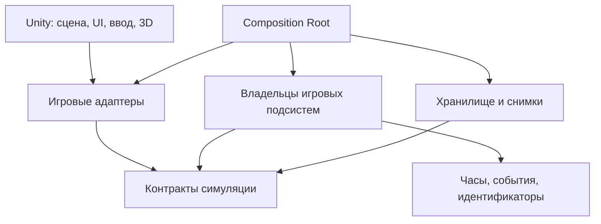
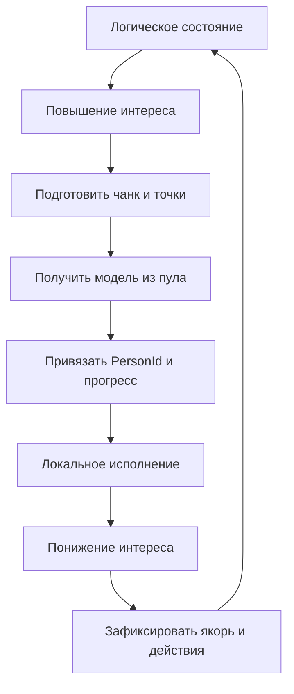
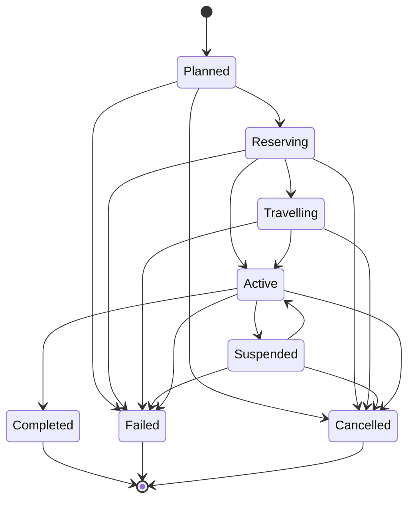
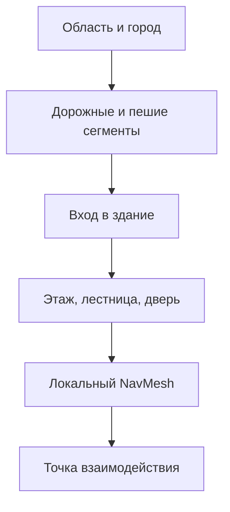
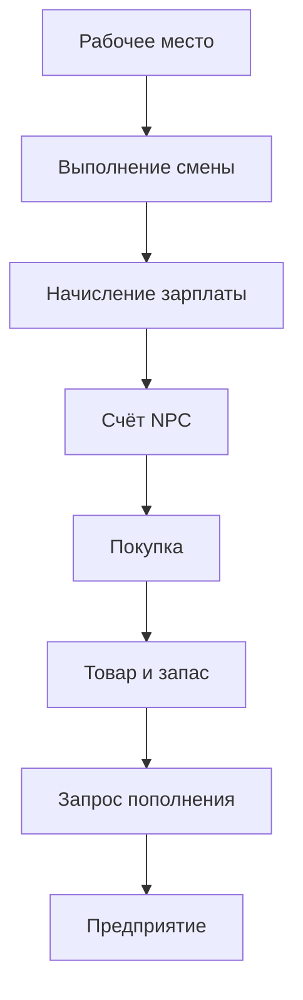

# 04 — Архитектура симуляции жизни населения в Unity

**Техническое исследование для одиночного процедурного симулятора жизни**  
**Дата:** 25 ноября 2026 г.  
**Назначение:** архитектурный ориентир и спецификация для поэтапной разработки через Codex.  
**Целевая платформа:** Windows, Unity 6, C#; Intel Core i7-11850H (8 ядер / 16 потоков), RTX A5000 16 ГБ VRAM, 128 ГБ оперативной памяти.  
**Ограничения:** автономная игра, отсутствие обязательных платных плагинов, масштабируемость, минимизация связности игровых механизмов и ручных проверок.

> Документ предлагает проектные решения и целевые показатели, а не результаты измерений готовой игры. Приведённые радиусы, частоты, бюджеты и размеры населения — начальные настройки для профилирования. Нельзя считать их подтверждённой производительностью Unity или указанного компьютера.

---

## Содержание

- **1–3.** Цель, критерии живого города, сравнение подходов.
- **4–7.** Архитектура, модель NPC, генерация населения и время.
- **8–11.** Уровни детализации, материализация, Utility AI и планирование.
- **12–16.** Навигация, транспорт, экономика, социальная система и расширяемость.
- **17–20.** Unity/DOTS, сохранения, масштабирование и технологический стек.
- **21–26.** Сквозной сценарий, реализация, автоматические проверки, правила Codex, риски и спецификация.
- **27.** Источники и основания выводов.

---

## 1. Главный вывод

Для этой игры оптимальна **гибридная агентная симуляция на C# с постоянными личностями, событийной моделью времени, несколькими уровнями детализации поведения и временно создаваемым 3D-представлением**.

Горожанин не должен быть сценовым объектом, существующим только в загруженном квартале. Он является участником мира независимо от расположения камеры: имеет семью, профессию, место проживания, денежный баланс, вещи, расписание, отношения, незавершённые действия и историю. Когда игрок приезжает в этот район, система показывает того же жителя в правдоподобном месте и состоянии.

Предлагаемое сочетание:

| Задача | Решение |
|---|---|
| Постоянная личность NPC | Компактные данные с устойчивым идентификатором; не GameObject |
| Повседневная автономия | Потребности + расписание + Utility AI |
| Сложные последовательности | Ограниченный GOAP или заранее определённые многошаговые процедуры |
| Исполнение действий | Конечный автомат состояний выполнения, общая семантика действия |
| Время | Единые игровые часы, очередь событий, редкие пакетные обновления |
| Дальние жители | Индивидуальные дискретные события, логические поездки и занятия |
| Ненаблюдаемые территории | Холодное хранение; агрегированная статистика только для неиндивидуализированного населения |
| Ближние жители | Пул 3D-представлений, локальная навигация, анимация, взаимодействия |
| Транспорт | Дорожный граф, модель потоков и поездок, локальное движение |
| Экономика | Учёт денег, активов, запасов, рабочих мест и транзакций |
| Социальная жизнь | Разреженный граф отношений + события + ограниченная память |
| Расширяемость | Модули с явным владением состоянием и контрактами возможностей |
| Оптимизация | Пакетная обработка; Jobs/Burst для измеренных узких мест, ECS при необходимости |
| Сохранение | Снимки устойчивого состояния и ожидающих событий; SQLite как рекомендуемый локальный вариант |

**Не рекомендуется начинать с чистого DOTS-проекта, универсального GOAP для каждого NPC, обязательной LLM, полного физического движения каждого автомобиля на планете или сетевых микросервисов.** Эти подходы повышают стоимость разработки раньше, чем дают заметную пользу игроку.

Проектировать необходимо сначала логическую жизнь, затем её визуализацию. Не наоборот.

---

## 2. Что именно означает «живой город»

Нужно различать три количества:

1. **Население** — количество индивидуально существующих жителей.
2. **Активное логическое население** — жители, для которых сейчас обрабатываются решения, события, поездки или изменения состояния.
3. **Видимые персонажи** — жители, чьи модели, анимации и локальное движение действительно находятся в сцене.

Условный город на 100 000 жителей не обязан иметь 100 000 объектов Unity. Его демография, домохозяйства, занятость и поездки могут храниться как данные, а в конкретном квартале отображаться десятки или сотни подходящих по времени и месту NPC.

Признаки жизнеспособной симуляции:

- работники действительно добираются до места работы, получают доход и расходуют деньги;
- семьи живут по связанным адресам, заботятся о близких и имеют общий контекст;
- магазины существуют не просто как декорации: у них есть ассортимент, сотрудники, покупатели и режим работы;
- NPC меняют планы, если место закрыто, автобус переполнен или появились более важные обстоятельства;
- знакомый игроку NPC сохраняет имя, внешность, дом, имущество и отношения;
- события наблюдаемого и ненаблюдаемого мира согласованы;
- ненаблюдаемый район не обнуляется при выгрузке;
- не все жители ведут идентичный образ жизни;
- система способна объяснить, почему NPC находится именно здесь и чем занимается.

Не требуется симулировать каждый вдох, каждую ложку еды, все микродвижения рук и внутреннюю жизнь миллионов людей ежесекундно. Детализация должна соответствовать наблюдаемости, причинному значению события и игровому интересу.

### 2.1. Объём обещания

Персонально симулировать всю реальную численность планеты непропорционально возможностям одиночной игры. Рекомендуется различать:

- уже зарегистрированных, индивидуальных жителей, к которым применяются гарантии непрерывности;
- население ещё не посещённых или не активированных территорий, которое представлено демографическими параметрами и статистическими моделями;
- персонажей сюжетной важности, членов семьи игрока, деловых партнёров, владельцев имущества и других NPC, которые остаются индивидуальными вне зависимости от расстояния.

При первом раскрытии района население генерируется детерминированно, получает идентификаторы и сохраняется. После индивидуализации нельзя незаметно заменить одного человека другим ради статистической оптимизации.

---

## 3. Исследованные подходы и выбор

### 3.1. Агентная и событийная симуляция

Агентное моделирование рассматривает индивидуальных участников с состоянием и правилами поведения. Общие свойства города возникают из их взаимодействий, а не из единственного заранее написанного сценария. MATSim показывает полезную концепцию связки дневных занятий и поездок для моделирования транспортного спроса [S12]. Mesa демонстрирует сочетание агентной модели с планированием событий [S13].

Для игры важна не академическая точность прогнозирования реального города, а причинная согласованность и воспринимаемое правдоподобие.

| Подход | Преимущества | Недостатки | Выбор |
|---|---|---|---|
| Каждый NPC обновляется каждый кадр | Наиболее очевидная реализация | CPU-нагрузка даже без наблюдателя; множество объектов | Нет |
| Tick-based ABM: фиксированные шаги по всем агентам | Просто отлаживать и воспроизводить | Много пустых обновлений, особенно вдали | Для небольших активных наборов |
| Discrete-event simulation: обработка ближайшего события | Хорошо для расписания, зарплат, прибытия транспорта | Нужны отмена событий, порядок и обработка конфликтов | Основной способ для дальних NPC |
| Аналитическое продвижение состояния | Позволяет сразу вычислить изменение за длительный интервал | Не подходит для произвольных взаимных взаимодействий | Для потребностей и других простых непрерывных величин |
| Агрегированные потоки и статистика | Дешёвая модель больших территорий | Утрата индивидуальности при чрезмерном применении | Для фоновых и пока не индивидуализированных территорий |
| Гибрид | Хороший баланс детальности и нагрузки | Требуются ясные правила перехода | **Да** |

Исследования многоуровневой симуляции толпы показывают применимость разных моделей пространственной детализации [S14]. Но переключение модели движения ещё не решает сохранение личности, обязательств или имущества. Для игры эти аспекты должны быть предусмотрены отдельно.

### 3.2. Средства выбора действий

| Технология | Для чего подходит | Ограничение |
|---|---|---|
| FSM — конечный автомат | Стадии конкретного действия: прийти, начать, завершить, отменить | В качестве глобального ИИ разрастается в большое количество переходов |
| Behavior Tree — дерево поведения | Сложные локальные реакции, состояние выполнения отдельных сценариев | Плохо подходит для оценки множества жизненных целей и планов без дополнительных средств |
| Utility AI — оценка полезности | Конкуренция еды, работы, отдыха, общения, покупок и иных желаний | Без стабильности выбора NPC могут постоянно переключаться |
| GOAP — планирование действий к цели | Найти последовательность действий из предусловий и эффектов | Поиск дорог при большом пространстве состояний |
| HTN — иерархическое разложение задач | Известные многошаговые процедуры: поездка, смена, приготовление еды | Требует описания шаблонов; не всегда находит неожиданные варианты |
| ML/RL | Экспериментальные локальные навыки и оптимизация после появления симулятора | Обучение, воспроизводимость и корректность сложны; не замена базовой жизненной логике |
| LLM | По желанию — редкие диалоги и интерпретация событий | Стоимость, задержки, нестабильность, отсутствие надёжной согласованности состояния |

Utility AI применялся и обсуждался в игровой индустрии, в частности в докладе Dave Mark и Kevin Dill [S15]. GOAP получил известность как способ планирования в F.E.A.R. [S16]. Это паттерны, а не готовая универсальная система жизни.

У Unity есть официальный пакет [Behavior](https://docs.unity3d.com/6000.0/Documentation/Manual/com.unity.behavior.html) для графов поведения, но он необязателен: авторитетная симуляция и удалённое исполнение должны работать без визуальных графов Unity.

**Решение:** расписание и Utility AI определяют цель; типовые процедуры или малый GOAP формируют путь к ней; исполнитель проходит по стадиям. В расширяемом проекте не нужно выбирать один метод для всего поведения.

---

## 4. Архитектура модульного монолита

Все системы работают в одном процессе игры. Внутри проекта они имеют раздельные данные, API и ответственность. Unity — средство отображения, загрузки сцены и исполнения входных/выходных адаптеров, а не место хранения биографии NPC.

### 4.1. Слои



Стрелка обозначает разрешённую зависимость. Адаптеры работают через интерфейсы. Composition Root явно создаёт и подключает реализации; ядро не вызывает MonoBehaviour, сцены и рендереры.

Рекомендуемый исходный принцип — один модуль на смысловую область, а не отдельная сборка на каждый класс или заведённый на будущее механизм.

### 4.2. Владение состоянием

| Модуль | Авторитетные данные | Примеры операций |
|---|---|---|
| Simulation | Время, последовательность событий, очередь, планировщик обработки | AdvanceTo, Schedule, Cancel |
| Population | Личности, даты рождения, жизненный статус, черты, внешность, демография | CreatePerson, QueryPerson |
| Household | Семьи, домохозяйства, участники семейных связей, организация общего быта | JoinHousehold, MoveHousehold |
| Physiology | Потребности, утомление, состояние здоровья и ограничения | EvaluateNeeds, ApplyRest |
| Activity | Цели, распорядок, текущая деятельность, обязательства, состояние выполнения | RequestActivity, Interrupt, Complete |
| Social | Отношения, знакомства, социальные роли, социальные события и память | RecordMeeting, ChangeRelation |
| World | Устойчивые места, помещения, адреса, семантика объектов; состояние проходимости и географические индексы | ResolvePlace, FindService |
| Mobility | Поездки, положение, маршруты, прогресс движения, транспортные средства и места пассажиров | StartTrip, ReserveSeat, Arrive |
| Economy | Счета, цены, платежи, баланс, финансовые обязательства | Transfer, ReserveFunds, Settle |
| Inventory | Владение вещами, количества, состояние предметов и контейнеров | ReserveItem, TransferItem |
| Employment/Education | Рабочие места, учебные места, смены, трудоустройство, обучение | Hire, StartShift, FinishLesson |
| Property | Право собственности, пользования и аренды объектов недвижимости | AcquireProperty, Lease |
| Interaction | Каталог взаимодействий и согласованное исполнение составных операций | Discover, Validate, Execute |
| Presentation | Только визуальные представления, пул объектов, анимации и эффекты | BindView, UnbindView |
| Persistence | Сериализация, версии, загрузка и запись состояния владельцев | Save, Load, Migrate |

Модули Employment и Education можно сначала реализовать в одной сборке, как и Population/Household, если они невелики. Логическая граница сохраняется.

Принцип: один авторитетный владелец каждой величины. Например, Activity решает поработать, Employment подтверждает смену, Economy начисляет зарплату, Mobility отвечает за факт прибытия по адресу, а Presentation показывает перемещение. Ни один из этих модулей не должен хранить вторую независимую копию всех полей NPC.

### 4.3. Структура Unity-проекта

```text
Assets/Game/
  Foundation/
    Game.Foundation.asmdef
    Ids/
    Time/
    DeterministicRandom/
    Results/
  Contracts/
    Game.Contracts.asmdef
    Population/
    World/
    Activity/
    Mobility/
    Economy/
    Social/
    Interaction/
  Simulation/
    Game.Simulation.asmdef
    Clock/
    EventQueue/
    Scheduler/
    Interest/
  Modules/
    Population/
      Game.Population.asmdef
      Domain/
      Application/
      Data/
    Household/
    Physiology/
    Activity/
      Game.Activity.asmdef
      Schedules/
      Utility/
      Planning/
      Execution/
    Social/
    Mobility/
      Game.Mobility.asmdef
      Graphs/
      Trips/
      Traffic/
      Transit/
    World/
    Economy/
    Inventory/
    Property/
    Employment/
    Interaction/
  UnityAdapters/
    Game.UnityAdapters.asmdef
    Navigation/
    Streaming/
    Content/
    Actors/
    Vehicles/
    UI/
  Persistence/
    Game.Persistence.asmdef
    Snapshots/
    Migrations/
  Composition/
    Game.Composition.asmdef
  Content/
    Definitions/
    Prefabs/
    Addressables/
  Editor/
    Validation/
    DebugTools/
  Tests/
    Domain/
    Integration/
    PlayMode/
    Performance/
docs/
  architecture/
  decisions/
  scenarios/
```

Для папок Modules, обозначенных кратко, используются те же соглашения об assembly definition, что и для Population и Activity.

Правила для Assembly Definitions:

- Foundation не имеет зависимостей от игровых модулей.
- Contracts ссылается на Foundation, содержит стабильные DTO/интерфейсы, но не хранилища и реализацию.
- Simulation и предметные модули ссылаются на Foundation и Contracts; реализация одного предметного модуля не импортируется напрямую в другой.
- Предметные сборки по возможности исключают ссылку на UnityEngine (настройка No Engine References), не используют сценовое состояние и тестируются обычным C#.
- UnityAdapters использует контракты, Unity API и специальные адаптеры пакетов.
- Composition ссылается на реализации для явной сборки приложения.
- Persistence не получает доступ к чужим полям через reflection взамен контрактов: владельцы предоставляют снимки и операции загрузки.
- Jobs/Burst и Entities допускаются в специальных вычислительных адаптерах, не в обязательных контрактах всей игры.
- Циклические зависимости сборок запрещены. Unity asmdef позволяет задавать явные ссылки между сборками [S1].

Если в будущем общий Contracts станет слишком большим, его можно разделить по смысловым областям без изменения бизнес-правил. Начинать с десятков мельчайших сборок не нужно.

### 4.4. Контракты: запрос, команда, событие

| Форма | Смысл | Пример |
|---|---|---|
| Query | Чтение ограниченного снимка | GetTripStatus(npcId) |
| Command | Запрос изменения у владельца; может быть отклонён | RequestTrip |
| Event | Уже произошедший факт | PersonArrived |
| Capability | Общий доступ к механизму через объявленные возможности | IInteractionProvider, ITripPlanner |

Пример компактных контрактов (иллюстративный C#, не готовое API):

```csharp
public readonly record struct PersonId(ulong Value);
public readonly record struct PlaceId(ulong Value);
public readonly record struct ActivityId(ulong Value);
public readonly record struct TripId(ulong Value);
public readonly record struct SimTime(long Seconds);

public readonly record struct TripRequest(
    PersonId Person,
    PlaceId Destination,
    SimTime EarliestDeparture,
    SimTime? RequiredArrival);

public interface IMobilityCommands
{
    CommandResult<TripId> RequestTrip(in TripRequest request);
    CommandResult CancelTrip(TripId trip);
}

public interface IMobilityQueries
{
    TripSnapshot GetTrip(TripId trip);
    LocationSnapshot GetLocation(PersonId person);
}

public readonly record struct PersonArrived(
    PersonId Person,
    TripId Trip,
    PlaceId Destination,
    SimTime At);
```

Синтаксис record struct приведён как формат контракта; проект обязан выбрать синтаксис, реально поддерживаемый закреплённой версией Unity/C#, либо использовать обычные readonly struct без изменения смысла.

Шина событий — внутрипроцессная, типизированная, с отложенной доставкой в определённом порядке. Команды, требующие немедленного результата, не отправляются как широковещательное событие. События не используются вместо прямого чтения.

Не нужно создавать обязательную распределённую инфраструктуру, внешний брокер или универсальную систему из тысяч строк JSON-команд. Для одного процесса достаточно интерфейсов, очередей, стабильных идентификаторов и прозрачного диспетчера.

### 4.5. Составные операции

Покупка товара затрагивает Inventory и Economy. Нельзя сначала списать деньги, затем неудачно попытаться получить товар и оставить мир в неверном состоянии.

Interaction/координатор покупки:

1. Проверяет доступность товара и возможность получения.
2. Запрашивает резервирование количества и средств с идентификатором операции.
3. Перепроверяет актуальность резервов и условий.
4. В одном контролируемом шаге симуляции фиксирует обе части либо не фиксирует ни одной; ошибки предварительной стадии освобождают резервы.
5. Только после успешной фиксации публикует PurchaseCompleted.
6. Снимок сохраняет результаты согласованного шага.

На первой версии удобно выполнять фазу фиксации одним потоком через подготовленные изменения. Не делать произвольные вызовы пользовательского кода между двумя необратимыми записями. Для параллельного исполнения затем понадобятся версии, блокировки/координация или эквивалентная проверяемая транзакционная схема.

Систему можно расширить банковским кредитованием, зарплатами, арендой, магическими ресурсами или налогами, не разрешая чужим модулям изменять balance напрямую.

---

## 5. Каноническая модель данных NPC

### 5.1. Отделение постоянных данных от изменяемого состояния

Вместо гигантского класса NPC с сотнями свойств и ссылками на все сервисы предлагаются компактные раздельные записи, соединённые PersonId.

| Группа | Поля (минимум) | Особенности |
|---|---|---|
| PersonIdentity | PersonId, имя, дата рождения, шаблон внешности, originSeed, жизненный статус | Возраст вычисляется по дате, а не увеличивается каждый кадр |
| Personality | 5–8 скалярных черт, предпочтения, культурные/бытовые шаблоны | Статические черты плюс редкое изменение |
| HouseholdMembership | HouseholdId, роль, связи родства | Может не совпадать с собственностью на жильё |
| NeedsState | Hunger, Rest, Hygiene, Social, Comfort; LastEvaluatedAt | Значения в нормализованном диапазоне |
| HealthState | Усталость, ограничения, состояния здоровья | Отдельно от базовых потребностей |
| LocationState | PlaceId или TripId, пространственный якорь, этаж, прогресс | Один авторитетный вариант местонахождения |
| Commitments | WorkShiftId, LessonId, AppointmentId, deadline | Обязательства, не вся биография |
| ActivityState | GoalId, ActivityInstanceId, фаза, start/end, nextWake | Сохраняется при выгрузке |
| HabitState | Стабильные предпочтения мест/времени, частота удачных действий | Меняется постепенно |
| SocialState | Ссылки на редкие отношения и память | Разреженное представление |
| Skills | SkillId, уровень, опыт/прогресс | Данные только реально имеющихся навыков |
| EconomicRefs | AccountId, EmploymentId, права/доступ | Баланс принадлежит Economy |
| InventoryRefs | ContainerId и права доступа | Предметы принадлежат Inventory |
| DecisionState | Предыдущая цель, время переключения, cooldown, RNG-состояние/счётчик | Для устойчивости и воспроизводимости |

Идентификаторы — неизменяемые 64-битные значения в пределах мира или другой заранее выбранный устойчивый формат с проверкой коллизий. Индекс физического массива, Unity instance ID, GUID временного prefab или координаты Transform не являются идентичностью NPC.

Строки имён, шаблоны профессий, вещи и внешность хранятся как ссылки на каталоги там, где это выгодно. Горячие данные (прогресс поездки, время следующего события) не должны требовать загрузки всей биографии.

### 5.2. Горячее, тёплое и холодное хранение

- Горячее: активные действия, нужды, положение, краткие состояния, индексы. Уплотнённые массивы структур или отдельные массивы чисел (SoA), переиспользуемые буферы.
- Тёплое: биография, постоянные характеристики, семья, активные отношения и имущество посещённых районов.
- Холодное: история, редко запрашиваемые записи, данные дальних районов, завершённые транзакции и дневные сводки; загружаются по запросу.

Рекомендуемый старт — простые типизированные хранилища с таблицей соответствия PersonId → слот. Не использовать единый Dictionary<string, object> как каноническое состояние: высокие накладные расходы, ошибки типов, трудная миграция схемы и невозможность эффективно применять Burst.

При удалении или уплотнении массивов слот может измениться; устойчивый ID сохраняется. Отложенная задача работает с ID и версией записи, а не с незащищённым индексом.

### 5.3. Характер, возраст, образование

Черты характера должны влиять на оценку действий, а не задавать одну жёсткую личность. Например:

- общительность увеличивает ценность общения;
- дисциплина увеличивает ценность выполнения обязательств;
- склонность к риску влияет на решение о выборе новых возможностей;
- бережливость увеличивает чувствительность к стоимости;
- любознательность увеличивает оценку обучения и новых занятий.

Предпочтения — отдельные данные. Два общительных человека могут любить разные места, иметь разные привычки и семьи.

Возраст определяет допустимые роли, физиологические модификаторы и стадии жизни. Переходы возраста обрабатываются календарными событиями. Образование связано с учебным заведением, программой, прогрессом и квалификацией; профессия и навык не тождественны.

Долгосрочные события (переезд, взросление, выпуск, изменение профессии, образование семьи, рождение, смерть) должны менять соответствующие модули согласованно. Смерть, например, прекращает расписание и поездки, не уничтожая исторические отношения и имущество без явно реализованной процедуры.

---

## 6. Генерация правдоподобного населения

Нельзя независимо случайно присвоить каждому NPC профессию, квартиру и семью, а затем надеяться, что город заработает. Генерация должна учитывать доступную вместимость и распределение ресурсов.

### 6.1. Входные данные

- реальные или процедурные границы населённых пунктов;
- районы и типы застройки;
- семантические здания и их помещения;
- вместимость жилья;
- предприятия, организации, магазины, школы;
- рабочие места и смены;
- транспортная доступность;
- целевое демографическое распределение и типы домохозяйств.

При использовании географических данных реальные здания не требуют реальных персональных данных их жителей. NPC должны быть вымышленными. OpenStreetMap предоставляет географические сведения, а не готовую базу виртуальных домохозяйств; условия ODbL и атрибуции описаны OSMF [S21]. Для каждого другого источника проверяется собственная лицензия.

### 6.2. Последовательность генерации

1. Рассчитать доступную площадь и количество/вместимость жилых единиц. Для неизвестных зданий вывести тип по вероятностной модели, пометив это как приближение.
2. Выделить целевые группы населения: дети, молодые, взрослые, пожилые; без требования точно воспроизвести демографию реального места.
3. Создать домохозяйства целиком: пары, одиночки, семьи с детьми и другие правдоподобные сочетания.
4. Назначить жильё с учётом вместимости, бюджета и типа района.
5. Сгенерировать жителей и устойчивые идентификаторы. Связать членов семьи, не допустив невозможных возрастных комбинаций.
6. Создать организации и рабочие/учебные места из вместимости помещений, деятельности города и необходимого обслуживания.
7. Назначить занятость и образование с учётом возраста, квалификации и стоимости поездки. Часть людей остаётся без работы или работает в другой территории.
8. Создать исходные счета и имущество, навыки, привычки, внешность, знакомых.
9. Установить календарь и распределённую начальную активность, чтобы мир не стартовал синхронно с массового пробуждения.
10. Проверить ограничения, сохранить результат и версии генераторов.

Для стартового генератора достаточно взвешенного выбора, ограничений вместимости и жадного распределения с повторными попытками. Когда появятся надежные открытые агрегированные данные, можно применить iterative proportional fitting (IPF) — итеративное согласование совместного распределения с известными маргинальными статистиками. Пример применения в синтетической популяции приведён в [S22]. IPF не решает автоматически связность семей, назначение конкретного жилья и занятость; эти ограничения нужно учитывать дополнительно.

### 6.3. Стабильность генерации

Использовать стабильный seed мира и отдельные производные потоки случайности: семья, внешность, занятость, предпочтения, локальные решения. Вывод seed должен зависеть от устойчивого ID и версии генератора, а не от количества обращений к глобальному Random.

Район A, созданный до района B или после него, должен получить согласованную демографию по определённым правилам. Проблема межрайонных браков и назначения рабочих мест решается глобальным реестром существующих идентификаторов и явной обработкой внешних связей, а не двойной генерацией человека.

Версии генераторов сохраняются. Уже индивидуализированные жители не перегенерируются при обновлении шаблонов.

---

## 7. Единое время и планировщик симуляции

### 7.1. Принцип времени

Нужны независимые понятия:

- физическое/кадровое время Unity для визуализации;
- каноническое игровое время (целое количество секунд или тиков);
- календарные представления (дата, местное время, день недели);
- скорость воспроизведения игры и пауза.

Часы Unity не являются авторитетным календарём жизни. В планетарном мире каноническая шкала едина; местное время используется при расчёте смен, расписания заведений и поездок. Переход границы часового пояса не меняет порядок событий.

Для начала целесообразно использовать 1:1 в интерактивной игре и дать возможность ускорять/пропускать время для ожидания и сна. Если потребуется сжатие суток, его влияние на длительность ходьбы, поездок, смен и потребностей должно быть явно согласовано: нельзя ускорить гражданские часы в 30 раз, сохранив в логическом слое прежние оценки длительности поездки и выдавая персонажу зарплату раньше прибытия.

При сильном ускорении приоритетно выполнять логическую симуляцию, ограничив детальную физику и визуализацию. Ускорение не должно приводить к потере важных взаимодействий.

### 7.2. Механика событий

Примеры запланированных событий:

- проснуться в 07:00;
- появление значимой потребности;
- отправиться к месту смены;
- прибыть к остановке;
- автобус прибывает и предоставляет доступные места;
- закончить завтрак;
- получить зарплату;
- открыть магазин;
- истечь резервированию ресурса;
- выполнить повторную попытку после временного отказа.

В начале достаточно min-heap (приоритетной очереди), упорядоченной по времени, фазе/приоритету и стабильному порядковому ключу события. Для очень большого числа частых далёких событий очереди можно шардировать по районам или адаптировать timing wheel, но после измерения.

Каждое событие содержит тип, ownerId, dueTime, generation/version, минимальный payload. Отмена через обновление поколения действия либо явную отмену по ID. Устаревшая запись игнорируется при извлечении; накопившиеся отменённые записи очищаются по метрике.

Не хранить в сохранении произвольные делегаты, лямбды, корутины Unity или указатели на объекты.

```text
Advance(targetTime, budget):
  while очередь содержит событие с dueTime <= targetTime:
    проверить остаток бюджета и возможность продолжения фазы
    извлечь событие в устойчивом порядке
    проверить поколение, существование владельца и идемпотентность
    продвинуть состояние до точного dueTime
    исполнить команду владельца
    согласованно зафиксировать изменения
    доставить факты следующей предусмотренной фазе
  если все обязательные события обработаны:
    подтвердить продвижение часов до targetTime
  иначе:
    сохранить подтверждённый watermark времени
    продолжить обработку со следующего кадра
```

Запрещено безусловно передвинуть часы на targetTime, если остались причинно более ранние обязательные события. При перегрузке игра может временно отстать от целевого ускорения. Перенос необязательных вычислений предпочтительнее пропуска выплат, рождений, завершения поездок или других фактов.

Нужно ограничить цепочки, генерирующие новые события в то же игровое время: установить фазовый порядок, запретить обратную запись в уже завершившуюся фазу и ограничить число повторов. Это предотвращает бесконечные циклы.

### 7.3. Аналитические потребности

Потребность не должна уменьшаться по одному пункту каждую секунду для каждого жителя.

Пример (условная шкала 0–1, где 1 — сильный голод):

```text
Hunger(t) = clamp(Hunger(t0) + rate × (t − t0), 0, 1)
```

Если при действиях меняется скорость роста потребности, перед изменением параметра вычисляется значение на текущий момент и устанавливается новый t0. Следующее пересечение порога можно запланировать как событие. Вклад еды применяется только при подтверждённом употреблении.

Похожим образом моделируются накопление усталости, срок действия эффектов, изменение редких простых ресурсов. Нелинейные зависимости разбиваются на интервалы с фиксированными параметрами или вычисляются редкими шагами. Это позволяет избежать бессмысленного перебора далёких NPC.

---

## 8. Многоуровневая детализация: Simulation LOD

Рендеринг и симуляция различаются. LODGroup Unity изменяет детали меша; CullingGroup позволяет определять дистанционные полосы и видимость [S5, S6]. Они не решают за игру, как считать зарплаты или где находится отсутствующий в сцене житель.

Для каждого жителя определяется **уровень вычисления поведения** и отдельно признак **наличия визуального представления**.

| Уровень | Смысл | Логическое движение | Стартовые настройки, не нормативы |
|---|---|---|---|
| L0 — наблюдаемый | NPC рядом, взаимодействует или виден достаточно подробно | Детальный локальный контроллер, синхронизация анимации | Обычно 0–70 м; AI 2–5 решений/с максимум, движение и визуал — по необходимости |
| L1 — локально активный | Соседние улицы и помещения, ожидаемое появление, приближение транспорта | Упрощённое движение по сегменту/графу, локальная навигация выборочно | 70–250 м; выбор действий 0.5–1.5/с при необходимости |
| L2 — районный | В том же городе, но не нуждается в 3D | Поездка с ETA и прогрессом, занятия и редкие события | Изменения по событиям; оценка незавершённой активности каждые 1–5 игровых минут при необходимости |
| L3 — удалённый индивидуальный | Зарегистрированный житель удалённого района/города | События прибытия, работы, бытовых и социальных действий без физики | Существенные события; аналитические потребности; периодическая проверка 15–60 игровых минут лишь при необходимости |
| L4 — фон территории | Пока не индивидуализированная часть населения или агрегированные процессы | Статистические объёмы поездок и занятости | Часовые/дневные обновления агрегатов |

Частоты L0/L1 являются верхними целями для обычной скорости показа, а не обязательными вызовами на каждом интервале. При ожидании окончания действия решение обычно не нужно; переоценка запускается существенным событием или сигналом прерывания.

Именованный NPC, взаимодействовавший с игроком, не превращается в безличный статистический объект L4. Он может храниться в холодном состоянии L3 с сохранёнными событиями.

### 8.1. Определение интереса

Не решать уровень только по расстоянию по прямой.

Учитывать:

- расстояние от игрока и возможный маршрут его движения;
- видимость, окна, принадлежность к внутреннему помещению и этаж;
- скорость приближения игрока;
- наблюдаемые из транспорта пути и станции;
- партнёров игрока, членов семьи, текущие важные взаимодействия;
- интерес к предметам или событиям, доступным через игровые системы;
- запас CPU, количество уже существующих представлений;
- количество кадров или времени с последнего переключения.

Интерес — не то же самое, что необходимость создавать 3D. Например, звонок NPC инициирует логическое событие, даже если сам персонаж находится в другой стране.

Порог повышения и понижения должен отличаться: например, L0 включается при 70 м, выключается при 90 м при отсутствии иных причин держать NPC активным. Это гистерезис, предотвращающий многократное появление/исчезновение на границе.

Стриминг должен предусматривать область предварительного интереса по направлению и скорости игрока: при движении на автомобиле дальность подготовки зачастую увеличивается.

### 8.2. Пространственные индексы

- Территория → регион → населённый пункт → район → ячейка.
- Для локальных запросов: равномерная сетка/пространственный хеш по координатам в локальном мире.
- Для адресных объектов: индекс PlaceId → описание → ячейка/сегмент.
- Для поездок: индекс текущего сегмента дороги или графа, отдельно от индекса проживания.
- Для интерьеров: здание → этаж → помещение → доступные смысловые позиции.

Не сканировать массив всех жителей при каждом движении игрока. Движение на соседнюю ячейку меняет лишь множество потенциально интересных ячеек. Нужны также запросы по предсказуемому будущему прибытию для незагруженных районов.

При планетарном floating origin положение в канонических данных описывается географическим/чанковым якорем и локальными координатами устойчивой системы мира. Смена начала координат Unity не меняет географическое место жителя.

### 8.3. Раздельное управление детализацией

У одного NPC могут быть:

- LOD решений;
- LOD перемещения;
- LOD анимации;
- LOD модели;
- LOD сенсоров и социальных контактов.

На первой версии достаточно единого профиля L0–L3 с отдельным флагом визуализации. Позднее можно независимо снижать анимационную детализацию, не затрагивая логические решения.

---

## 9. Переход между абстрактным и физическим существованием NPC

Это наиболее рискованная часть архитектуры. Если её реализовать неправильно, игрок увидит двойников, телепортации, исчезновение имущества, отмену работы или NPC, выходящего из дома в неподходящее время.

### 9.1. Единая модель местоположения

```text
LocationState =
    AtPlace(PlaceId, RoomSlot/Anchor, FloorId)
  | OnTrip(TripId, RouteSegmentId, SegmentProgress)
  | WaitingAtStop(StopId, TripId, queueTicket)
  | InVehicle(VehicleId, SeatOrSpaceId, TripId)
```

Это альтернативные состояния, а не независимые флаги. Нельзя одновременно быть на смене в магазине и пассажиром другого автобуса, если действие не предусматривает явно удалённую работу.

Привязка к движущемуся автобусу определяется идентификатором транспорта и пассажирским местом, а не отдельно интерполируемой позицией каждого пассажира на дороге.

### 9.2. Протокол материализации



1. Повышение уровня регистрирует запрос по PersonId с уникальным поколением привязки.
2. World проверяет готовность геометрии, необходимых навигационных данных и подходящей точки.
3. Mobility предоставляет актуальный якорь/сегмент прогресса на время фактической привязки.
4. Presentation резервирует экземпляр из пула; повторное создание для уже привязанного PersonId не допускается.
5. Представление получает внешность, предметы для отображения, фазу текущего действия и позу.
6. Локальный исполнитель начинает с актуального логического состояния, а не запускает сценарий утра заново.
7. Если попытка устарела во время загрузки или подходящая точка не готова, запрос отменяется или остаётся ожидающим; логическая жизнь продолжается.

Нельзя материализовать NPC в случайном свободном месте только потому, что его правильное место не загружено. Допустимы заранее описанные точки входа/выхода, непросматриваемые места, ближайшие допустимые позиции в том же смысловом месте. При невозможности корректной визуализации не создавать представление до разрешения условий.

### 9.3. Дематериализация

При понижении уровня:

- определяется логическое положение/прогресс и незавершённый этап;
- завершается или переносится визуальный исполнитель;
- ресурсы Gameplay (резерв места, товар, обязательство, пассажирский билет, текущая работа) не удаляются по факту исчезновения модели;
- освобождаются графические ресурсы и Unity-компоненты;
- планировщик назначает следующее значимое событие в новом режиме.

Единственный исполнитель действия в один момент времени. У каждого действия сохраняются ActivityInstanceId и версия. Если старый локальный исполнитель поздно сообщил завершение после смены режима, владелец отклоняет повторное или устаревшее завершение.

Для локального движения Mobility принимает подтверждения прогресса от адаптера с версией текущей поездки. В абстрактном режиме тот же модуль продвигает движение по маршруту. Смена LOD не является изменением владельца состояния.

Выгрузка сцены не должна вызывать игровую смерть, увольнение, отмену всех резервов или уничтожение канонической записи.

### 9.4. Исключения

Прервать смену детализации или сохранить более подробную симуляцию полезно при активном диалоге, совместном действии, незавершённом взаимодействии с игроком, посадке в транспорт и других чувствительных переходах. Зафиксированные лимиты времени и очереди всё равно нужны: нет причин пожизненно удерживать человека в L0.

При телепортации игрока в далёкий город сначала подготавливаются местные данные и выборка актуальных записей, затем ограниченное число представлений. Нельзя генерировать все разы посещения новые личности из случайной плотности толпы.

---

## 10. Повседневная автономия: Utility AI и расписание

### 10.1. Цели на разных горизонтах

| Горизонт | Пример | Частота пересмотра |
|---|---|---|
| Месяцы/годы | Получить квалификацию, найти жильё, повысить уровень навыка | Редкие события/календарь |
| Дни | Выполнить несколько смен, увидеть семью, купить вещи | Дневное планирование и значимые события |
| Часы | Работать в смену, поспать, встретить ребёнка | Календарные обязательства и конфликты |
| Минуты | Поесть, купить билет, приготовить еду | Событие или переоценка |
| Секунды | Подойти к двери, сесть, отреагировать на локальное препятствие | Локальное исполнение |

NPC не нужно составлять глобальный план жизни каждую секунду. Долгосрочные решения формируют обязательства и контекст, а краткосрочные выбираются адаптивно.

### 10.2. Расписание

ScheduleEntry включает окно начала, желаемую/минимальную длительность, важность, PlaceId или критерий выбора места, допустимые опоздания, тип обязательства и повторение.

Жёсткие и мягкие обязательства различаются. Смена на работе ограничена во времени; отдых и прогулка гибкие. Расписание — намерение, не команда телепортации.

Например:

| Время | Обычное намерение | Возможная адаптация |
|---|---|---|
| 07:00 | Подъём и завтрак | Проснуться позже в выходной; пропустить завтрак при опоздании |
| 07:40 | Поездка на работу | Выбрать автобус или пеший путь по стоимости и ETA |
| 09:00–17:00 | Смена | Перерыв, замена отсутствующего работника, досрочное завершение по событию |
| 17:30 | Покупка продуктов | Другой магазин, если первый закрыт |
| 18:00 | Возвращение домой | Встреча, дополнительное поручение, визит к знакомому |
| 23:00 | Сон | Сдвиг из-за обстоятельств и характера |

Повторение расписания не означает буквальное дублирование каждой активности. Учитываются выходные, отпуск, обучение, поездки, семья, запасы, настроение, существующие привычки и текущее состояние мира.

### 10.3. Utility AI

Цепочка выбора:

1. Сигнал необходимости решения: событие, завершение текущего действия, плановый пересмотр.
2. Собрать компактный контекст: нужды, обязательства, доступные возможности в районе, состояние средств и предметов.
3. Выбрать ограниченный набор кандидатов по типу цели. Например, еда, сон, работа, общение, лечение, покупка.
4. Отсеять кандидатов, которые заведомо невозможны.
5. Рассчитать оценку каждого оставшегося кандидата.
6. Сравнить с текущей целью, учитывая стоимость переключения.
7. Выбрать цель и способ её достижения; сохранить объяснение.

Пример проектной формулы:

```text
score(a) =
    [base(a) + Σ(weight_i × curve_i(context))]
    × availability(a)
    − travelCost(a)
    − moneyCost(a)
    − interruptionCost(a)
```

Здесь availability — результат фильтра/оценки доступности, стоимость нормализуется, потребности и предпочтения масштабируются. Весовые кривые позволяют сделать нелинейную срочность. Критическое обязательство может обрабатываться приоритетным правилом перед обычным сравнением; недоступное действие отбрасывается, а не выигрывает даже при очень высоком голоде.

Пример условных результатов:

| Действие | Оценка | Причина |
|---|---:|---|
| Пообедать в столовой | 0.84 | Сильный голод, столовая доступна близко |
| Продолжать работу | 0.61 | Значимое обязательство в пределах перерыва |
| Поехать домой | 0.33 | Высокая цена поездки по времени |
| Встреча с другом | 0.29 | Меньшая срочность и неудобное место |

Числа иллюстрируют форму решения, не баланс готовой игры.

Полезные меры от монотонности и нестабильности:

- минимальная длительность удержания цели;
- гистерезис: новая цель должна заметно превосходить текущую;
- обязательный пересмотр при существенном изменении;
- cooldown после временного отказа;
- изменяемая привычка после повторного успеха;
- небольшое детерминированное разнообразие между близкими оценками;
- запланированные ограничения ресурсов и времени.

Не использовать равновероятный случайный выбор без связи с потребностями. Не запускать дорогой поиск пути для всех кандидатов: сначала приблизительные оценки расстояния и доступности, полный маршрут лишь для лучших.

### 10.4. Привычки

Привычка — не расписание в виде жёсткого скрипта. Хранится вес предпочтения (заведение, занятие, район, тип маршрута, время) и частота успешного повторения. Удачное действие постепенно укрепляет её, неудача или смена обстоятельств ослабляет. Недавнее повторение может временно снижать полезность, чтобы избежать избыточной цикличности.

Изменение привычки не должно молча заменять дату рождения, семейное состояние, профессию и медленные черты личности.

---

## 11. Планирование и исполнение действий

### 11.1. Типовая процедура важнее универсального поиска

Для 80% повседневных действий выгоднее проверяемые многошаговые шаблоны:

```text
Поужинать дома:
  обеспечить наличие еды
  при необходимости получить продукты
  добраться домой
  зарезервировать кухонный ресурс
  приготовить или взять готовое блюдо
  употребить
  освободить ресурс
```

Шаблон обращается к общим возможностям (найти источник, переместиться, получить предмет, использовать место). При недоступности одного способа можно выбрать другой: есть дома, в кафе, на работе, купить готовую еду.

### 11.2. GOAP в ограниченной области

Goal-Oriented Action Planning моделирует цель через конечный набор релевантных фактов, предусловия и ожидаемые эффекты действий. Поиск минимизирует цену плана. Сами эффекты планировщика — предположения и не изменяют авторитетный мир.

```text
Goal: голод уменьшен
Facts:
  HasFood, CanAffordFood, AtFoodSource, CanUseKitchen, FoodReady

PossibleActions:
  TravelToShop:      pre {shop available}, effect {AtFoodSource}
  BuyFood:           pre {AtFoodSource, CanAffordFood}, effect {HasFood}
  PrepareFood:       pre {HasFood, CanUseKitchen}, effect {FoodReady}
  EatFood:           pre {FoodReady}, effect {HungerReduced}
  ObtainReadyMeal:   pre {AtFoodSource, CanAffordFood}, effect {FoodReady}
```

В реальном проекте факты и действия строятся только из релевантной цели. Не нужно передавать GOAP весь мировой баланс, граф семей, все дома и складские остатки.

Рекомендуемые стартовые пределы: до 16–32 кандидатов в локальном домене, глубина 4–8 шагов, ограничение расширений поиска и лимит вычисления на запрос. Это настройки, а не свойства GOAP. Точный набор определяется профилированием и сложностью контента.

При исчерпании лимита — выбрать доступную типовую процедуру, отложить переоценку или явно сообщить об отсутствии плана. Нельзя бесконечно повторять поиск в каждом кадре.

Для 100 000 далёких жителей не запускать GOAP каждый тик. Сначала использовать шаблон, а планировать при изменении значимых условий и при высоком интересе.

### 11.3. Канонический жизненный цикл ActivityInstance



Стадии не обязательны для абсолютно любого действия, но терминальные исходы и ответственность должны быть единообразны. Переходы, требующие освобождения резервов, выполняются через общий протокол отмены; приостановка допустима только тогда, когда действие поддерживает восстановление.

ActivityInstance содержит PersonId, ActivityTypeId, GoalId, уникальный ActivityInstanceId, фазу, цели/объекты, время начала, ожидаемое завершение, зависимости, токены резервов, поколение исполнения и результат.

Успех проверяет владелец действия. Анимация глотка, вход в триггер или истечение локальной корутины сами по себе не являются подтверждённым употреблением предмета. При завершении владелец атомарно применяет эффект, освобождает зарезервированные ресурсы и публикует факт.

Через одни и те же контракты реализуются удалённое и наблюдаемое исполнение:

- визуальное: подойти, проиграть анимацию, подтвердить допустимое завершение;
- абстрактное: начать действие с известным временем и условиями, в момент завершения повторно проверить требуемый ресурс/право/место, применить тот же логический эффект.

### 11.4. Семантические возможности мира (smart objects)

Объект или место объявляет возможности, а не навязывает NPC собственную логику жизни.

Примеры: кровать — Rest; столовая — PurchaseMeal/Eat; дверь — Enter; рабочее место — Work; автобусная остановка — Wait/Board; книжный шкаф — Read; тренировочная площадка — Train.

```csharp
public interface IInteractionProvider
{
    void Collect(in ActionContext context, CandidateBuffer results);
}

public interface IInteractionExecutor
{
    CommandResult<ReservationId> Reserve(in InteractionRequest request);
    CommandResult Start(ReservationId reservation);
    CommandResult Complete(ReservationId reservation);
    CommandResult Cancel(ReservationId reservation);
}
```

CandidateBuffer — заранее выделяемый/переиспользуемый буфер, а результаты описывают идентификаторы и оценки, не ссылки на объекты сцены.

Описание возможности включает:

- идентификатор и категорию;
- допустимого участника, предусловия, необходимые навыки/права;
- целевое место/предмет и возможные точки взаимодействия;
- вместимость и доступность по расписанию;
- длительность, цены, требуемые ресурсы;
- ожидаемый эффект для планирования;
- ссылку на локальный визуальный исполнитель (необязательный);
- способ отказа и допустимые альтернативы.

Игрок и NPC по возможности используют одинаковые контракты предметных взаимодействий: купить, взять, сесть, приготовить, оплатить. Для игрока инициатор решения — ввод и UI, для NPC — Activity/Utility, но доступность и эффекты операции проверяются одними и теми же владельцами.

Это позволяет добавить новую профессию, лавку, магическое занятие или тренировку без переписывания основных алгоритмов NPC. Новая функциональность появляется через каталог действий и зарегистрированный исполнитель.

---

## 12. Навигация людей и логическая география

### 12.1. Два уровня: логический граф и локальная навигация

Unity AI Navigation позволяет строить/использовать NavMesh в редакторе и во время выполнения, определять препятствия и связи между навигационными участками [S4]. Однако единый NavMesh для целой планеты, всех помещений и всех маршрутов не является практичной базой.

- **Глобальный граф:** населённые пункты, магистрали, маршруты транспорта.
- **Городской граф:** дорожные и пешеходные сегменты, перекрёстки, переходы, остановки, входы зданий.
- **Граф зданий:** входы, лестницы, этажи, лифты, двери, комнаты и зоны взаимодействия.
- **Локальный NavMesh:** детальная проходимая поверхность загруженного участка и интерьера.



Каждая вершина и ребро имеет устойчивый ключ, признак доступности, стоимость, разрешённые виды перемещения и версию графа. Семантические адреса доступны независимо от загрузки меша.

Вместо одной сцены на город — чанки с известными граничными порталами, связями и согласованными координатами. NavMesh-данные подключаются/отключаются вместе с подготовленными участками. Логический граф остаётся доступным. Дверь или закрытый переход меняет версию доступности маршрутов.

### 12.2. Поиск маршрута

- A* / Dijkstra по городскому графу — исходный вариант.
- Иерархический поиск: сначала путь между крупными зонами, затем точная детализация заинтересованных отрезков. Идея аналогична подходу HPA* [S18].
- Кэш востребованных маршрутов по типу передвижения, версии графа, классу ограничений и ключам начала/конца.
- Динамические изменения: TTL для изменяемой стоимости, инвалидация затронутых участков, маршрутизация по альтернативному ребру.
- Для оценки полезности использовать дешёвую оценку времени по графу или приблизительную нижнюю границу.

Кэш полного пешеходного пути не должен подменять проверку двери, доступа к зданию, доступности лифта, фактической проходимости и потребностей человека. Истечение маршрута приводит к ограниченному перепланированию, а не к бесконечному движению на одном месте.

Unity прямо отмечает синхронный характер NavMesh.CalculatePath и рекомендует ограничивать количество дорогих расчётов за кадр [S7]. Поэтому стоит сделать PathRequestQueue с приоритетом игрока и ближайших NPC. Нельзя вызывать этот API из произвольной Burst-задачи или запускать тысячами вызовов в одном кадре.

### 12.3. Пешеходное движение

В L0 можно начать со штатных NavMeshAgent, простых локальных препятствий и анимации. При плотных потоках применять раздельный локальный модуль обхода, используя spatial hash для соседей.

ORCA/RVO — одна из исследованных альтернатив локального избегания столкновений; работа van den Berg и соавторов предлагает распределение ответственности за взаимное избегание [S19]. ORCA не заменяет глобальный маршрут, очередь у кассы, проход через дверь, правила перекрёстка или социальное пространство. Поддержка узких проходов и высокой плотности требует отдельной настройки и проверок. Не следует одновременно накладывать несколько независимо управляющих одним агентом систем avoidance.

Для первого релиза:

- отдельная пешеходная сеть либо согласованная проходная часть общей сети;
- тротуары, переходы и разрешённые связи между ними;
- состояния Waiting/Walking/Crossing/Entering;
- ограниченная локальная очередь пути;
- семантические дверные и лестничные переходы;
- уступание игроку и другим NPC;
- минимальное разрешение зависаний: обнаружение отсутствия прогресса, повторный короткий маршрут, временное ожидание, альтернативный вход или корректный отказ активности.

Пешеходы дальних уровней не рассчитывают индивидуальное взаимное avoidance. Их путешествие имеет сегмент, скорость/ETA, ограничения и задержки. Если игрок приближается, включается локальная детализация; логическая позиция согласована с продвижением по маршруту.

### 12.4. Интерьеры и взаимодействия

Здание должно иметь семантическое описание до генерации графики:

- PlaceId здания, жилых и общественных помещений;
- входы, этажи, вертикальные связи;
- допустимые массивы якорей активности;
- права доступа;
- доступные места ожидания;
- связность с улицей и парковкой.

Симулятору не требуется держать модель квартиры вместе с человеком, который сейчас на работе. Для дальнего жителя место сна — например, конкретная спальня или кровать, а не произвольная точка внутри прямоугольника дома.

Если интерьер загружается лишь при входе игрока и его планировка генерируется процедурно, логические якоря должны совпадать с результатом детерминированной генерации и её версией. Недопустимо генерировать логическое рабочее место на третьем этаже, а 3D-здание — только с двумя этажами.

---

## 13. Автомобильный и общественный транспорт

### 13.1. Ключевое разделение

Перемещение состоит из спроса на поездку, выбора способа, маршрутизации и исполнения. Автомобили, водители и пассажиры имеют разные ID; транспортное средство не исчезает как сущность, когда его водитель далеко от игрока.

Научные/практические транспортные симуляторы SUMO и MATSim подтверждают полезность многоуровневых транспортных моделей и планов поездок [S12, S17]. Для игр ценны их идеи, а не обязательное встраивание стороннего симулятора с отдельным процессом и синхронизацией.

### 13.2. Выбор способа

```text
Journey:
  Walk(home → stop)
  Wait(stop)
  Ride(bus, route/trip)
  Walk(stop → work)
```

Возможные режимы: пешком, личный автомобиль, автобус; позднее велосипед, трамвай, поезд, такси и другие средства.

Utility/TripPlanner учитывает:

- доступные способы и ограничения;
- стоимость проезда и доступность денег;
- время до отправления, время в пути, пересадки;
- доступность парковки и автомобиля;
- опоздание относительно обязательства;
- предпочтения и доступность для конкретного жителя.

Материализация транспорта не должна определять, существуют ли логически пассажиры. Едущий без 3D автомобиль и его пассажиры сохраняют прогресс и назначение.

### 13.3. Модель дорожного движения

| Уровень | Данные | Поведение |
|---|---|---|
| Дальний | Рёбра дороги, скорость/пропускная способность, занятость, время входа/выхода | Очереди сегментов и ETA |
| Средний | VehicleId, полоса/ребро, дистанция вдоль него, направление, скорость | Упрощённое следование, конфликты перекрёстков и движение в очереди |
| Ближний | Те же логические параметры + представление, локальный контроллер | Детальное движение, поворот, анимация, локальные взаимодействия |

Сетка дорожных полос представляет движение направленными рёбрами с связями манёвров на перекрёстках. Возможны ограничения скорости, доступа и поворотов. Используются данные мира, при отсутствии детальных полос выбираются процедурные правила.

SUMO документирует микроскопические модели индивидуальных автомобилей и мезоскопическое моделирование [S17]. Для старта рекомендуется собственная простая мезоскопическая очередь сегментов; локальный контроллер использует безопасный интервал следования, пределы скорости и разрешения перекрёстков. Полную автомобильную динамику, модель шин и физический контакт с каждым фоновым транспортом не делать обязательными для виртуального расписания поездок.

Алгоритм не обязан симулировать каждую машину 60 раз/с: позиции и задержки рассчитываются по времени входа в сегмент, ожидаемому выходу и состоянию потоков.

Необходимо сохранить:

- количество автомобилей и пассажиров при переходе уровня;
- идентификатор машины, водителя и право пользования;
- фактическую парковку/гараж, стоимость стоянки;
- запрет на одновременную поездку одной и той же машины с разными владельцами;
- резервирование полосы/очереди или места в согласованных переходах;
- причинность задержек (дальняя модель не должна пропускать машину через перекрытую дорогу).

Модификация дороги или авария в игровой модели приводит к инвалидации нужного участка и пересчёту заинтересованных поездок. Не надо перепланировать все поездки города.

### 13.4. Общественный транспорт

Основные сущности:

- TransitRouteId — маршрут и последовательность остановок;
- TransitServiceId — календарь работы;
- TransitRunId — конкретный рейс;
- StopId — остановка и пассажирская зона;
- VehicleId — транспортное средство;
- PassengerReservation / Ticket — право или ожидание посадки;
- StopTime — план и фактическое время прибытия/отправления.

GTFS Schedule описывает данные об остановках, маршрутах, рейсах и времени остановок [S20]. Можно использовать открытые наборы там, где поставщик предоставляет правомерно доступные данные. GTFS — формат, а не гарантия открытой лицензии любого файла. Процедурные города могут генерировать собственное расписание в похожей структуре без внешней подписки.

На одном часовом поясе и небольшом числе маршрутов достаточно time-dependent Dijkstra или поиска по расписанию ближайших рейсов. При сложной сети общественного транспорта стоит исследовать RAPTOR — алгоритм маршрутизации по раундам пересадок [S23].

Посадка:

1. NPC прибывает к остановке.
2. Попадает в очередь с ожидаемым маршрутом.
3. Событие прибытия транспорта определяет доступную вместимость.
4. Согласованно изменяются билет/оплата, состояние пассажира и занятость места.
5. При отказе вместимости NPC остаётся ждать следующий рейс либо меняет план.
6. На нужной остановке высаживается, переходя к следующему этапу пути.

Абстрактный автобус обязан соблюдать поездку и остановки, даже когда игрок находится далеко. При его появлении показываются уже ожидающие и находящиеся внутри пассажиры в пределах визуального бюджета. Не требуется создавать модель каждого скрытого в интерьере пассажира.

### 13.5. Стоит ли использовать SUMO непосредственно?

| Вариант | Плюсы | Минусы |
|---|---|---|
| Собственный C#-транспорт | Единая идентичность, календарь, экономика, сохранение; простой контроль через Codex | Нужно реализовать качественную базовую модель |
| SUMO как отдельный симулятор | Богатые транспортные режимы и проверяемые модели | Интеграция процессов, синхронизация времени и состояния, избыточность для раннего MVP |
| Гибрид: SUMO для референсных офлайн-экспериментов | Сравнение потоков, тестирование сценариев | Дополнительный инструмент; не обязателен для игры |

**Выбор:** собственный C#-модуль, опирающийся на граф, ёмкость и ETA; SUMO — необязательная экспериментальная среда. Не переносить в игру все правила научного транспортного моделирования.

---

## 14. Экономика, работа и владение ресурсами

### 14.1. Экономика должна создавать смысл деятельности

Если NPC постоянно получают товары и деньги из воздуха, экономическая жизнь становится декорацией. Но стартовая экономика не обязана моделировать мировую денежную политику и все отрасли.

Для первого города:

- домохозяйства и индивидуальные счета;
- работодатели и фонд выплат;
- магазины и запасы товаров;
- покупки, зарплаты, аренда и минимальные регулярные платежи;
- простая поставка товаров как явная операция из внешнего источника или склада;
- цены и ограничения доступности.

Стабильные AccountId, ItemDefinitionId, ContainerId, InventoryItemId и PropertyId хранятся независимо от NPC-представления.

Деньги — целое число минимальных денежных единиц (long) либо другой проверенный фиксированный формат. Для финансового симулятора не использовать float. Переводы выполняются с проверкой достаточности, разрешения долга и переполнения; перевод в другой валюте требует явной операции и правил округления.

### 14.2. Механика взаимосвязи



Рабочие места создаются на основе организаций. Профессия — каталог квалификаций и обязанностей, JobPosition — конкретное место и права, Employment — договор/отношение NPC с ним.

Рабочий день состоит из смен и заданий. На ранней версии удалённые задачи дают агрегированный результат за реально отработанное время: кассир обслуживает поток покупателей, офисный работник выполняет работу по профилю. Несколько таких систем не должны одновременно учитывать один и тот же результат.

В MVP можно платить по подтверждённой смене с уникальным SettlementId. Частичная смена, отпуск и разные формы оплаты добавляются правилами Employment/Economy без переписывания поездок или Social.

### 14.3. Инварианты

- Перевод между счетами сохраняет сумму, кроме явно определённых сборов, выпуска или изъятия средств.
- Резерв уменьшает доступный остаток, но не дублирует расход.
- Покупка одновременно изменяет деньги и владение товаром.
- Складские остатки не становятся отрицательными.
- Каждая выплата имеет ID, по которому повторное событие не приводит к повторному начислению.
- Предмет, автомобиль или квартира имеют одного владельца либо явно моделируемую долевую собственность; пользование не равно владению.
- Невозможность платежа или товара даёт отказ и альтернативу, а не ошибку мира.
- Арендатор сохраняет жильё после выгрузки чанка; смена владельца — экономическое событие.

Журнал транзакций можно ограничивать или архивировать после консистентного снимка; не требуется хранить все действия NPC за всю историю мира в оперативной памяти.

### 14.4. Масштабирование экономических событий

- Цены и заказы поставок изменяются на интервалы/события, не при каждой операции каждого покупателя.
- Простые доставки дальнего магазина считаются партиями, с количествами и расписанием.
- Покупки важных индивидуальных NPC сохраняют авторитетные транзакции.
- Для только агрегированного населённого пункта допустимы статистические объёмы спроса/предложения, но при переходе к индивидуальному городу они согласованно отражаются в исходных запасах и потоках.
- Не изменять одной и той же статистической операцией запасы и после этого повторно списывать их индивидуальными агентами.

Фоновые процессы должны иметь ясные источники и получателей. Экономика без достаточного начального снабжения рискует через несколько суток остановиться, даже если технических ошибок нет. По этой причине нужны метрики экономической жизнеспособности — доля работающих, проведённые сделки, пустые склады и число голодных жителей.

---

## 15. Социальная система, семья, память и привычки

### 15.1. Семья и домохозяйство

Родство — не только общий HouseholdId. Один взрослый может жить отдельно от родителей и сохранять родственные связи; соседи могут проживать вместе без родства.

- Household: совместное проживание, бюджетные правила, семейные бытовые обязанности.
- Kinship: тип устойчивой семейной связи.
- SocialRelation: эмоциональные отношения между конкретными людьми.
- Care/Responsibility: обязательства заботы или сопровождения.
- Appointment: совместное занятие с местом, временем, партнёрами и состоянием принятия.

При принятии совместного плана все участники должны учитывать доступность. Не достаточно отправить сразу всем событие встречи и затем считать, что они пришли.

### 15.2. Разреженный граф отношений

У персонажа нет полноценной записи отношений к каждому жителю мира.

Для почти всех пар людей связь отсутствует и трактуется как незнакомство. Связь создаётся при родстве, знакомстве, значимом взаимодействии или иных основаниях.

Пример RelationshipEdge:

```text
FromPerson, ToPerson, RelationKind
Familiarity, Affinity, Trust, Respect
LastContactAt, ContactCount
ImportantFlags, Version
```

Направленность важна: доверие A к B может отличаться от доверия B к A. Родство и двусторонние соглашения хранятся отдельно там, где связь симметрична или имеет взаимно определённые роли.

Для 100 тыс. жителей полная направленная матрица имеет около 10 млрд возможных записей. Даже 16 байт на запись дали бы примерно 160 ГБ без индексов. Если же средний NPC хранит 30–40 актуальных связей, речь идёт о 3–4 млн записей. При условном размере 32–64 байт это около 96–256 МБ чистой полезной нагрузки, прежде чем добавлять индексы и накладные расходы. Это гораздо реалистичнее.

Семейные и важные связи не удаляются простым вытеснением. Для слабых знакомых допускаются уменьшение значимости, исторический архив и ограничение горячего набора.

### 15.3. Социальные взаимодействия

Потенциальные партнёры подбираются из небольших групп:

- семья;
- коллеги;
- знакомые по месту учёбы;
- соседи;
- участники общей активности;
- находящиеся рядом доступные персонажи.

Не сравнивать каждого NPC со всеми людьми города.

Процесс:

1. Инициатор получает желание общения/встречи или конкретный повод.
2. Utility оценивает тип контакта и нескольких кандидатов по доступности и отношениям.
3. Партнёр принимает, отклоняет или предлагает другое время.
4. При успехе создаётся общая ActivityInstance или связанная пара действий.
5. После завершения обновляются отношения, потребности и память.
6. Отказ или прерывание не считается успешной встречей.

Условные изменения отношений зависят от значимого события, характера и предыдущего опыта. Знакомство может увеличивать familiarity, но не обязательно доверие и симпатию.

### 15.4. Память: компактные смысловые записи

Память должна фиксировать значимые факты, а не хранить бесконечный текст о каждом кадре.

| Тип | Что хранить | Пример |
|---|---|---|
| Семантическая | Известные факты и источники | «Пользователь X — знакомый; видел его в магазине» |
| Эпизодическая | Факт события, время, участники, эмоциональная оценка | Последняя встреча, подарок, совместная поездка |
| Процедурная | Навыки и привычки | Предпочитаемый путь или ежедневное занятие |
| Долговременная | Ключевые события жизни | Выпуск, переезд, образование семьи |

MemoryRecord может состоять из EventTypeId, SubjectId, ObjectId, PlaceId, timestamp, salience, valence, confidence и ссылки на связанные факты.

Сохранять ограниченное количество недавних записей на человека (например, 32–128), выделять отдельный пул для существенных воспоминаний и объединять рутинные повторения в сводки: «встречался с коллегой 8 раз за последнюю неделю». Порог — настраиваемый.

Неинформированность NPC важна: событие мира не автоматически становится известным каждому жителю. Память формируется от наблюдения, личного участия, общения и явно моделируемого источника информации.

LLM не нужна для авторитетных фактов и не должна иметь прямых прав записи их значений. В перспективе генератор диалогов может получить ограниченный контекст (темы, отношения, подтверждённые воспоминания) и преобразовать в реплики; сами эффекты разговора рассчитывает Social.

### 15.5. Жизненный цикл

Возраст лучше вычислять по календарю. Изменения детства, образования, трудоспособности, пенсии и других жизненных стадий — тайм-события. Изменение возраста не вынуждает заменять PersonId или сценовую модель механизма жизни.

Демографические изменения можно сначала моделировать редко, на календарном интервале и с небольшим числом проверяемых правил. На этапе MVP достаточно стабильных семей и возрастов; автоматические рождения, сложная миграция, наследование и динамическое создание семьи реализуются последовательно, через те же устойчивые связи, Economy, Property и Activity.

---

## 16. Data-driven расширяемость: профессии, навыки, магия и другие механики

ScriptableObject — подходящий инструмент Unity для редактируемых определений, разделяемых между экземплярами. Unity описывает его как контейнер данных, а не как универсальное хранилище изменяемого состояния игрока в готовой сборке [S3].

Рекомендуется использовать ScriptableObject и/или импортируемый JSON/CSV для определения:

- черт характера и кривых полезности;
- типов потребностей;
- типов мест и доступных в них возможностей;
- профессий и смен;
- каталога предметов;
- навыков и квалификационных требований;
- действий, рутин, длительностей и стоимостей;
- правил маршрутизации, социальных эффектов и резервов;
- эффектов способностей, статусов и модификаторов.

При запуске контент нормализуется в типизированные неизменяемые определения. Состояние конкретного NPC находится в domain/store, а не в ScriptableObject. Сохранение ссылается на устойчивый DefinitionId.

Конфигурационный пример (упрощённый):

```yaml
id: activity.learn.cooking
category: education
goal: improve_skill
durationGameSeconds: 1800
requirements:
  - capability: cooking_station
  - item: practice_ingredients
effectsHint:
  - skill: cooking
    value: 5
reservation: exclusive_station
executor: LearnSkill
```

Это не означает, что любые произвольные скрипты запускаются из YAML. Данные описывают параметры зарегистрированных механизмов, а C#-исполнитель валидирует допустимость и применяет эффект через владельцев.

Добавление профессии повара с существующими операциями Work, Cook и Purchase должно преимущественно требовать новых данных. Добавление новой семантики, например специфического сверхъестественного способности, требует новый модуль/исполнитель и его адаптер, но не изменения всех существующих NPC, экономики и транспорта.

Сверхспособности и магия могут предоставить:

- новый способ путешествия через IMobilityProvider при соблюдении правил назначения и факта перемещения;
- дополнительные требования и эффекты потребностей, предметов или навыков;
- новую категорию цели и InteractionProvider;
- визуальные эффекты через UnityAdapters;
- явные события, которые Social может учитывать, если NPC о них узнал.

Не делать глобальную команду, позволяющую эффектам менять любое поле любого объекта по строковому пути. Это разрушает гарантии владения состоянием и делает ошибки труднообнаружимыми.

Контент проверяется до запуска: уникальность ID, существование ссылок, валидные диапазоны, доступность исполнителя, семантическая связность мест, корректность повторения.

---

## 17. Unity, ECS/DOTS, Jobs/Burst и 3D-представления

### 17.1. Сравнение технологий

Unity Entities предоставляет ECS-модель; системы обрабатывают компоненты, а Jobs/Burst могут эффективно исполнять пригодные пакетные вычисления [S8–S10]. Unity Job System предназначен для организации параллельной работы [S9]. Это инструменты исполнения, не готовая логика населения.

| Технология | Где выгодна | Где ограничена |
|---|---|---|
| GameObject + MonoBehaviour | Сцена, компоненты внешности, анимация, коллизии, ближайшее взаимодействие | Плохо масштабируется как постоянное представление каждого жителя |
| Обычный C# | Домен, контракты, расписание, сохранение, редкие события | Неэффективен при огромных количествах мелких объектов и частом выделении памяти |
| Data-oriented C# / SoA | Пакеты числовых расчётов, индексы, hot state | Нужны собственные структуры и аккуратный доступ |
| C# Jobs + Burst | Ограниченные числовые задачи, например оценки потребностей и группировка позиций | Управляемые ссылки, Unity API и сложный объектный граф не подходят для Burst-кода |
| Entities (DOTS) | Плотные динамические наборы компонентов, большие движущиеся толпы, вычислительные системы | Сложнее инструментарий, authoring, интеграция с традиционными компонентами и сохранениями |

### 17.2. Рекомендация по внедрению

1. Сделать каноническую симуляцию на обычном C# с компактными хранилищами и одним авторитетным шагом.
2. Ближние представления — GameObject с NavMeshAgent/Animator, пулом и LOD.
3. Профилировать конкретные сцены и сравнительный headless benchmark.
4. Выделить измеренные горячие вычисления в Job System и Burst: числовые преобразования потребностей, scoring однотипных кандидатов, пространственное разбиение, батчевое продвижение сегментов.
5. При необходимости использовать ECS для массового движения или представлений, сохранив PersonId связующим ключом.
6. Полная миграция ядра на Entities оправдана только при доказанном преимуществе и наличии понятного плана сохранений и инструментов отладки.

Наличие 128 ГБ оперативной памяти делает компактное хранение городов привлекательным, но не означает, что миллионы MonoBehaviour или сотни тысяч Animator не будут упираться в CPU. Видеокарта в основном важна для моделей, анимации, освещения и графики, не для последовательного выполнения сотен тысяч C#-решений.

В случае использования Entities совместимые версии пакетов надо закрепить в manifest.json/packages-lock.json и использовать руководство конкретной ветки. Не переносить примеры старых API Entities.ForEach без проверки; документация обновления Entities 1.4 указывает на переход к IJobEntity или SystemAPI.Query [S10].

### 17.3. Параллелизация без потери согласованности

- Один логический writer/координатор последовательности на этапе MVP.
- Параллельные задачи читают согласованный immutable snapshot или независимые данные.
- Результат jobs — кандидаты/предложения изменений, а не неупорядоченная запись в общий баланс и инвентарь.
- В конце пакетного этапа координатор проверяет версии, стабильно сортирует конкурирующие изменения и применяет команды.
- Для объектов Unity — соблюдение потоковых ограничений соответствующего API.
- Сохранение создаётся на границе согласованного шага, а I/O выполняется отдельно со снимком, не меняющимся под записью.

Такой подход сохраняет воспроизводимость логики при разном порядке завершения jobs. Не обещать побитовую одинаковость вычислений float, физики Unity или Burst на любом оборудовании. Если требуется строгая воспроизводимость важных результатов, использовать фиксированный порядок, целочисленные/фиксированные расчёты для критичных величин и тесты логических инвариантов.

### 17.4. Визуальные NPC

Presentation хранит реестр PersonId → ViewHandle. Компоненты 3D не являются авторитетными владельцами инвентаря и финансов.

- общий набор моделей, одежды, скелетов, анимаций с переиспользованием;
- пул объектов; Unity предоставляет ObjectPool<T> [S11];
- отдельные уровни качества модели/теней и частоты анимации;
- отключение необязательных IK, физики и детекторов в среднем уровне;
- CullingGroup для дистанционных и визуальных сигналов;
- Addressables для управляемой асинхронной загрузки контента, закреплённой версии каталога и корректного освобождения загруженных ссылок [S24];
- загрузка по приоритету в малых пакетах, без массового синхронного Instantiate при входе в город.

Не обязательно хранить персональный prefab для каждого жителя. AppearanceDefinition содержит параметры и ссылки на варианты частей тела и одежды.

Важный визуальный принцип: жители, находящиеся за стенами, в других квартирах, поездах и офисах, не обязаны иметь видимую модель только потому, что находятся в заданном радиусе игрока.

## 18. Сохранения, автономность и холодные регионы

### 18.1. Состояние сохранения

Сохранение должно быть полноценным снимком игровой симуляции, а не сериализацией объектов сцены.

Минимальный заголовок:

- WorldId и seed;
- версия схемы данных;
- версии генераторов мира и населения;
- идентификаторы/версии каталогов контента;
- подтверждённое игровое время и календарные параметры;
- счётчики/ключи детерминированной случайности;
- версия формата очередей событий и маршрутов.

Владельцы модулей сохраняют свои записи: NPC и семья, счета и транзакции, права владения, предметы, незавершённые активности, поездки и пассажиры, значимые отношения, память, календарь заведений и ожидающие события.

Временные Unity instance ID, Transform, NavMeshAgent, ViewHandle, вычисленные кэши и нативные указатели не сохраняются. При загрузке они восстанавливаются из канонических якорей и данных.

### 18.2. Практичный формат

| Формат | Плюсы | Минусы |
|---|---|---|
| JSON-файл | Читаемый, удобно отлаживать маленький мир | Дорогая полная запись, строки и объём, неудобный выборочный доступ |
| Собственные бинарные чанки | Компактность, высокая последовательная скорость | Нужны индексы, миграции схемы и восстановление после прерывания |
| SQLite | Транзакции, индексы, выборочная загрузка и обновление, известный формат | Нужно аккуратно выбрать C#-провайдер, не делать SQL-запрос на каждом игровом шаге |
| Полный event sourcing | Возможность воспроизвести историю с начала | Разрастание журнала, версионирование событий и дорогая загрузка |

**Рекомендация:** SQLite на диске для сохранений крупных миров, текущая симуляция и ускоряющие индексы — в памяти. Для самого первого прототипа допустим JSON-снимок с теми же версионированными DTO, если он реально ускоряет получение играбельного результата.

SQLite поддерживает транзакции и атомарное сохранение, а режим WAL позволяет сочетать читателей и запись с определёнными ограничениями [S25, S26]. Нативная библиотека SQLite и выбранный .NET-адаптер — разные компоненты. Необходимо проверить лицензию, сборку для Windows x64, работу в Unity Player и выбранном scripting backend (Mono/IL2CPP), а также один сценарий сохранения/восстановления. Не переносить Firebird или удалённую СУБД в эту игру без отдельной необходимости.

Рекомендуемая схема хранения:

```text
world_meta
regions(region_id, last_sim_time, population_version, ...)
persons(person_id, region_id, schema_version, ...)
households, kinship
needs_states, activities, commitments
locations, trips, vehicles, transit_runs, passenger_memberships
accounts, ledger_entries, properties, ownership, inventories
relationships, memories
scheduled_events(event_id, owner_id, due_time, kind, payload_version, ...)
generation_records
module_versions
```

Индексы: region_id, person_id, due_time, идентификаторы владельцев и нужных внешних связей. Это концептуальное представление, а не готовый DDL. Горячие структуры не обязаны повторять нормализованную SQL-схему.

Не сохранять всю базу данных каждые несколько секунд, если изменилась только малая часть записей. Ввести dirty-флаги/списки, транзакционный инкрементальный снимок, короткий журнал ещё не компактированных результатов для восстановления при необходимости.

### 18.3. Согласованность

На выбранной границе симуляции создаётся согласованный снимок S с игровой отметкой времени, после чего асинхронная запись работает только с неизменяемой копией/владением буфером S. Изменения после S относятся к следующему снимку.

При SQLite все относящиеся к S таблицы и отметка времени записываются в одну транзакцию одной базы. После сбоя допустимо вернуться к последнему подтверждённому снимку; нельзя считать время новым, а деньги и поездки старыми.

Резервное копирование SQLite с WAL выполняется согласованным механизмом (например, API резервного копирования или закрытый/подготовленный снимок), а не произвольным копированием только файла базы во время записи. Нельзя предполагать, что отдельный файл без WAL содержит последние транзакции.

После загрузки:

1. проверить версию мира и данных;
2. выполнить поддерживаемые миграции;
3. загрузить владельцев и восстановить индексы;
4. восстановить незавершённые события и их ключи;
5. принять корректное логическое время;
6. загрузить нужный район и материализовать представления;
7. продолжить симуляцию.

Одинаковые ID завершённых Activity/Transaction и состояние очереди позволяют не повторять покупку, выплату или получение опыта после восстановления. Идемпотентность операций важна и без полного event sourcing.

### 18.4. Время холодного региона

У региона есть LastSimulatedAt и состояние входящих/исходящих обязательств. Для зарегистрированных жителей поддерживаются персональные данные и значимые события, даже если их 3D-территория выгружена.

Есть два уровня оптимизации:

- Событийная симуляция этих жителей продолжает идти через лёгкий центральный планировщик, при необходимости подгружая минимальные записи.
- Для полностью изолированных простых процессов допустимо аналитическое продвижение от LastSimulatedAt до текущего времени или обработка локальной очереди пачкой.

Если между регионами есть межрайонные поездки, платежи, семейные события, сообщения или логистические связи, нельзя просто рассчитывать регион в изоляции задним числом: его внешний результат мог повлиять на уже обработанные события. Нужен глобальный порядок взаимодействующих событий, при котором внешние сообщения и обязательства извлекаются не позже их dueTime.

Рекомендуемый старт — центральная очередь для индивидуальных значимых событий и аналитические ленивые обновления для чисто локальных величин. Сложная распределённая параллельная обработка регионов не требуется.

Для ещё не индивидуализированных L4 территорий хранятся параметры статистической модели, её версия и подтверждённые сводки. Детерминированная индивидуализация затем учитывает эти сводки, включая занятость, жильё, ожидаемое население и наличие межрегиональных поездок.

По умолчанию одиночная игра **не работает в фоне после закрытия приложения**: игровое время приостановлено. Симуляция прошедшего реального времени может стать отдельной игровой опцией. Нельзя автоматически начислять или расходовать ресурсы на основании системных часов Windows.

---

## 19. Масштабирование и примерные вычислительные бюджеты

### 19.1. Почему события выгоднее полного обновления

Рассмотрим условные 100 000 жителей и 30-кратное ускорение времени для стресс-теста. Пусть минимальное значимое событие каждого NPC вызывается в среднем 12 раз за игровой день.

```text
100 000 × 12 / 86 400 × 30 ≈ 417 событий/сек реального времени
```

Если вместо этого обновлять каждого жителя раз в две игровые минуты:

```text
100 000 / 120 × 30 = 25 000 обновлений/сек
```

При 60 кадрах/с это около 417 проверок на кадр против в среднем 7 событий на кадр (события могут быть неравномерны и каждое может требовать больше работы). Полный кадровый проход по всем NPC составил бы 6 млн итераций/с.

Действительные значения выше или ниже в зависимости от числа поездок, взаимодействий и промежуточных событий. Средняя частота не гарантирует отсутствие пиковой нагрузки при массовом выходе на работу; нужно распределять нефиксированные моменты старта, обрабатывать обязательные пиковые события и учитывать задержку очереди.

### 19.2. Иллюстративный расчёт памяти

| Массив | Количество | Условная полезная нагрузка |
|---|---:|---:|
| Горячее ядро жителей | 100 000 × 192 байт | 19.2 МБ |
| Постоянные данные и ссылки | 100 000 × 160 байт | 16 МБ |
| Активные события | 200 000 × 48 байт | 9.6 МБ |
| Разреженные связи | 3 000 000 × 48 байт | 144 МБ |
| Краткая память | 6 400 000 × 32 байта | 204.8 МБ |

Итого около 394 МБ **только условных записей**, без индексов, резервов массивов, строк, managed-накладных расходов, графа мира, предметов, моделей и памяти Unity. Это не прогноз размера готового проекта. Фактические структуры измеряются по размеру и аллокациям, а холодная история может находиться на диске.

Наличие 128 ГБ RAM не повод расходовать всю память на симуляцию: операционная система, Unity Editor, ассеты, процедурный мир и другие инструменты требуют собственных ресурсов.

### 19.3. Стартовые плановые бюджеты

Для интерактивной цели 60 кадров/с каждый кадр имеет около 16.67 мс. GPU может работать параллельно CPU, поэтому бюджеты CPU и GPU оцениваются независимо, а верхние цифры отдельных частей не складываются без учёта фактического профиля.

| Подсистема | Начальная цель CPU на главном потоке |
|---|---:|
| Обработка событий и решений | ≤ 2–3 мс в типовом кадре |
| Индекс интереса и переходы LOD | ≤ 0.5–1 мс |
| Навигационные запросы | ≤ 1–2 мс, с очередью |
| Переиспользование/обновление представлений | ≤ 1–2 мс (кроме специально управляемых загрузок) |
| Фоновая запись снимка | Почти без блокирующего I/O; подготовка снимка в пределах отдельного бюджета |

Это начальные цели, не обещание FPS. Необходимо учитывать транспорт, инфраструктуру, графику и геймплей игрока. Реальный bottleneck может оказаться в skinning, тенях, Animator, загрузке чанков, NavMesh или GC, а не в Utility AI.

Начальные сценарии:

| Параметр | Прототип | Город | Стресс-тест |
|---|---:|---:|---:|
| Индивидуальных жителей | 1 000 | 25 000 | 100 000–250 000 |
| Примерный лимит локально активных логических NPC | 100 | 500 | 1 500 |
| Детальные 3D-представления L0 | 30 | 60–120 | 150–200 только как проверяемая цель |
| Упрощённые пешеходы/модели L1 | 50 | 100–300 | Настраивать по профилю |
| Ближние движущиеся машины | 10 | 20–50 | Измерять отдельно |
| Массовая визуализация всей популяции | Нет | Нет | Нет |

Лимиты отображения не должны приводить к уничтожению людей или исчезновению важных для игрока NPC. Сначала упрощать детализацию и выбирать действительно наблюдаемых. При телепортации ограничивать количество операций создания за кадр; при необходимости показать загрузку района.

Начинать с 1 000 — способ быстро проверить целую цепочку жизни, а не постоянный потолок населённости.

### 19.4. Управление нагрузкой

- Очереди и бюджеты: решения, навигация, привязка View, генерация чанков — отдельно.
- Балансировать работу между кадрами вместо всплесков в один кадр.
- Встроенная приоритизация задач по наблюдаемости и сроку.
- Обязательные операции сохраняют порядок; только необязательные расчёты могут откладываться.
- Пакетные индексы и кэши сначала, многопоточность после профилирования.
- Не считать фоновую задачу бесплатной: worker-потоки конкурируют с рендером, потоковой загрузкой мира и системой.
- Профилировать отдельно Unity Editor и standalone Windows Player. Editor имеет собственные накладные расходы.

### 19.5. Метрики

В игре должен быть технический экран или лог с метриками:

- количество NPC всего и по LOD;
- созданные/связанные View и объём пула;
- обработанные события/сек;
- количество просроченных событий и lag подтверждённого игрового времени;
- решения AI/сек, время scoring, причины отказов и прерываний;
- количество PathRequest, длительность ожидания, частота invalid/stuck/replan;
- число активных поездок, пассажиров, задержанных рейсов;
- заполненность ресурсов, количество конфликтов/просроченных резервов;
- GC allocations, CPU ms, p50/p95/p99 frame time, draw calls и VRAM;
- время снимка, объём сохранения;
- распределение занятости, потребностей, успешных рабочих смен, покупок, завершённых поездок;
- нарушения инвариантов (целевое число — ноль).

Для CPU/GPU и памяти использовать Unity Profiler, маркеры собственных стадий и ProfilerRecorder при необходимости [S27]. Не делать детальную строковую трассировку каждого NPC в рабочем режиме: она сама способна стать главным потребителем CPU и диска. Отладочный журнал для выбранных PersonId и агрегированные счётчики достаточно информативны для большей части разработки.

---

## 20. Бесплатный стек: что действительно нужно

Все обязательные игровые механики предлагается реализовать в C# без подписок на внешние AI/transport API, без сетевого сервера и без покупки плагинов.

| Средство | Роль | Когда подключать |
|---|---|---|
| Unity 6, закреплённая стабильная/LTS версия | Движок и редактор | С первого дня |
| Unity AI Navigation | Ближняя навигация | С первым играбельным кварталом |
| UnityEngine.Pool.ObjectPool | Переиспользование 3D-объектов | При визуализации |
| Unity Addressables | Каталоги и асинхронная загрузка ресурсов | Когда появится стриминг контента |
| Unity Test Framework | Edit/Play Mode тесты [S2] | С логического ядра |
| Unity Profiler | Измерение нагрузки | С первого прототипа |
| Unity Burst/Jobs | Числовые горячие вычисления | По результатам профиля |
| Unity Entities (DOTS) | Массовые data-oriented подсистемы | Опционально |
| SQLite и совместимый C#-провайдер | Локальные сохранения | Когда нужен выборочный доступ |
| SUMO | Опциональный референс транспортных потоков | Только если даст практический выигрыш |
| MATSim/Mesa | Источники архитектурных идей | Не обязательные runtime-зависимости |
| GTFS | Структура расписаний транспорта | Для реальных или процедурных маршрутов |
| OSM | Географический граф и семантика | По правилам лицензии и с процедурным дополнением |

Пакеты Unity следует выбирать по совместимости с конкретным редактором, фиксировать версии и их лицензии, не ставить экспериментальные пакеты ради моды. Условия использования самого Unity Editor зависят от актуального лицензирования Unity и обстоятельств пользователя; наличие официального пакета не само по себе даёт бессрочное право на все варианты коммерческого использования.

Для обычного utility-планировщика и ограниченного множества GOAP-действий сторонние плагины не обязательны. У небольшого своего решения выше предсказуемость интеграции, легче сохранить совместимость с LOD и системой транзакций. Если позже выбирается сторонняя реализация (например, RVO2-CS), следует проверять лицензию, поддержку, зависимости, целевую платформу, качество профиля и возможность замены через адаптер.

---

## 21. Сквозной жизненный сценарий: один NPC в двух районах

Рассмотрим жителя N-1042: 36 лет, живёт с семьёй в квартире H-31, работает в магазине W-09, имеет счёт A-1042, предпочитает общественный транспорт. Это вымышленный пример для проверки архитектуры.

| Игровое время | Событие | Какие модули действуют |
|---|---|---|
| 07:00 | Пробуждение в квартире | Activity + Physiology |
| 07:20 | Завтрак: используется имеющийся предмет | Inventory + Interaction + Physiology |
| 07:40 | Выбрана поездка на работу | Activity + Mobility |
| 07:48 | Прибыл к остановке, ожидает | Mobility |
| 07:54 | Автобус прибыл; билет оплачен, место занято | Mobility + Economy |
| 08:21 | Вышел у работы | Mobility |
| 08:30 | Начал смену | Employment |
| 13:00 | Перерыв и покупка еды | Activity + Economy + Inventory |
| 17:00 | Смена завершена, уникальное начисление | Employment + Economy |
| 17:24 | Встретил знакомого | Social + Activity |
| 18:19 | Вернулся домой | Mobility |
| 22:50 | Выбрал сон | Activity + Physiology |

Если игрок увидит N-1042 в автобусе в 08:05, система не создаёт новую поездку. Она отображает N-1042 в действующем рейсе вместе с состоянием пассажира. Если игрок уедет на другую сторону города, житель продолжит ту же поездку в абстрактном режиме. При возвращении к магазину после 13:00 персонаж окажется в правдоподобном месте по накопленной истории.

Возможный конфликт: автобус переполнен. Тогда состояние остаётся WaitingAtStop, TripPlanner оценивает следующую возможность или другой режим; Employment фиксирует возможное опоздание. Смена и зарплата не начисляются «по часам», если необходимый факт выполнения отсутствует.

Если введён новый способ перемещения (личный автомобиль, такси, волшебная способность), меняется выбор маршрута и исполнитель Mobility. Не требуется изменять формат семьи, бухгалтерию магазина или алгоритм памяти.

---

## 22. Реализация по этапам без затяжной разработки

Главная ошибка — сначала несколько месяцев создавать инфраструктуру для десяти миллионов жителей, не имея возможности зайти в город и посмотреть, живёт ли кто-нибудь.

Этапы ниже — план развития и качественные критерии, а не календарная оценка и не обязательные длительные ручные испытания. Каждая итерация должна заканчиваться полезным и уже наблюдаемым результатом.

| Этап | Реализуемое | Проверка результата |
|---|---|---|
| 0. Минимальное ядро | IDs, часы, event queue, границы модулей, тестовый район | Данные существуют без сцены; фиксированное время и seed дают одинаковый логический результат |
| 1. Жители | 100–1 000 NPC, семьи, жильё, возраст, характер, нужды, работа и простой Utility | NPC самостоятельно спят, едят, работают и отдыхают |
| 2. Первый играбельный район | Игрок, базовые 3D-модели из пула, места, навигация, L0/L2 | Житель исчезает из представления при уходе игрока и возвращается в актуальном состоянии |
| 3. Поездки | Городской граф, ходьба, автомобильная очередь, первый автобус, билеты, смены | Переполненный рейс и опоздание обрабатываются; идентичность и вместимость сохраняются |
| 4. Экономика и отношения | Счета, платежи, предметы, магазины, семьи, встречи, память | Деньги/товары не дублируются; знакомые сохраняют историю |
| 5. Большой город | 10–25 тыс. NPC, события, индексы, SQLite, сохранения, профилирование | Автономный прогон нескольких суток и быстрый живой район |
| 6. Расширение | Образование, навыки, сложные профессии, новые взаимодействия и GOAP | Новая возможность подключается без переписывания существующих владельцев |
| 7. Масштабирование выше | 100 тыс. и более индивидуальных жителей как нагрузочный сценарий; дальнейшие регионы | Профилирование, холодное хранение, подтверждение реального потолка |
| 8. Планетарность | Межрегиональные поездки, L4 и детерминированная индивидуализация | Переезд, возвращение, сохранённые связи и причинность |

Что следует **отложить**:

- полноценную физику транспорта по всей карте;
- сложную экономику производства каждой вещи;
- глобальное планирование для каждого решения каждого NPC;
- машинное обучение как обязательную основу поведения;
- отдельный сервер симуляции;
- генерирование миллионов индивидуальных NPC там, куда игрок никогда не попадал;
- сложную систему наследования и демографии до стабилизации жилья и семьи.

Что **необходимо заложить сразу**, даже при 100 NPC:

- устойчивый ID, единое время и единственного владельца данных;
- отделение персонажа от представления;
- явные статусы и завершение действий;
- логические места и маршруты;
- сохранение с версиями и предсказуемые контракты;
- измеримые бюджеты и минимальные инварианты;
- возможность добавлять новые типы взаимодействий.

---

## 23. Автоматические проверки вместо постоянной ручной приёмки

Пользователь в первую очередь хочет играть, а не месяцами выполнять ручное тестирование. Поэтому основной контроль должен быть автоматизирован, пропорционален риску и не превращаться в отдельный проект по доказательству каждой строки кода.

### 23.1. Небольшой набор обязательных инвариантов

| Код | Проверка |
|---|---|
| POP-IDENTITY | PersonId уникален; рождение/генерация не создаёт дубликатов |
| POP-HOUSEHOLD | Ссылки на людей и места валидны; соблюдается вместимость |
| SIM-TIME | Время монотонно; обязательные события не выпадают из обработанного диапазона |
| MOB-LOCATION | Одно действительное состояние местоположения на NPC |
| MOB-SEAT | Вместимость транспорта не превышена; пассажир не находится в двух рейсах |
| ACT-ONCE | Единственный исполнитель текущей активности; эффект применяется не более одного раза |
| VIEW-UNIQUE | Не более одного View на PersonId; выгрузка не удаляет личность |
| ECO-LEDGER | Согласованный учёт платежей, резервов и балансов |
| INV-OWNERSHIP | Нет отрицательных количеств и неразрешённого двойного владения |
| SOC-MEMORY | Значимый контакт оставляет устойчивую запись у правильного участника |
| SAVE-ROUNDTRIP | Сохранение/загрузка сохраняют каноническое состояние, связи и очередь |
| LOD-EQUIVALENCE | При эквивалентных условиях наблюдаемая и удалённая версии применяют одинаковые игровые эффекты |

Последний пункт не требует буквально одинакового каждого шага. Задержки локальной толпы могут привести к другому решению. Нужна эквивалентность семантики завершения: например, одна подтверждённая покупка меняет баланс и предметы одинаково в обоих режимах.

### 23.2. Набор тестов

- **Edit Mode / обычный C#:** время, состояние, генерация, Utility scoring, транзакции, очередь, отказ маршрута.
- **Интеграционный headless:** небольшой виртуальный город живёт один или несколько игровых дней без объектов сцены.
- **Play Mode:** минимальная проверка привязки и освобождения View, перехода через границы чанков, локальной навигации и сохранения.
- **Детерминированный replay:** один seed, одинаковые входные команды, сравнение важных записей/инвариантов.
- **Стресс-набор:** 1k/10k/25k/100k жителей; измерить время прогонки суток, память, lag, долю завершённых активностей.
- **Выборочное профилирование в графической сцене:** например, игрок заходит на оживлённый перекрёсток и садится в автобус.

Unity Test Framework позволяет запускать проверки в режимах Edit и Play [S2]. Не требуется делать ручную проверку каждого дома. Сложные визуальные дефекты можно обнаруживать через короткий встроенный debug-сценарий, который переносит игрока к выбранному NPC, отображает его состояние и обеспечивает наблюдение при необходимости.

Логические тесты полезно запускать без дорогой загрузки 3D-сцены. Для проверки пригодности пакетов и Unity-адаптеров всё равно нужны редкие специализированные тесты в Player/Play Mode.

### 23.3. Как проверять масштабирование честно

Фиксировать данные прогона:

- commit и версия Unity;
- версии пакетов;
- настройки сцен и уровней детализации;
- seed, численность и скорость симуляции;
- активные NPC, отображаемые модели, движущиеся автомобили;
- параметры компьютера и режим Editor/Player;
- длительность теста, объём логов, p95/p99, размеры памяти;
- фактическое число событий, завершённых смен, покупок, поездок;
- число ошибок и просроченное время.

Не считать тест успешным лишь потому, что в массиве создано 100 000 записей. Важно, чтобы они выполняли значимые действия и корректно завершали их, а не все находились в состоянии бездействия.

Не считать достигнутой цель визуального FPS по headless-тесту. И обратное: высокая частота кадров в пустой сцене ничего не говорит о способности фоновой симуляции обрабатывать сутки города.

---

## 24. Правила разработки для Codex

Эти правила можно перенести в архитектурную документацию проекта и AGENTS.md. Они должны помогать быстро развивать игру, а не создавать бюрократию.

### 24.1. Архитектурные правила

1. Работать с целостным игровым результатом небольшого этапа.
2. Не менять владельца существующего состояния без явно обоснованного архитектурного решения.
3. Взаимодействовать с другими модулями через контракты, а не через импорт внутренних хранилищ.
4. Не добавлять MonoBehaviour на каждого жителя только ради хранения данных или Update.
5. Не привязывать логическую жизнь NPC к состоянию загруженности сцены.
6. Все операции завершения и критичные экономические эффекты проверять у владельца.
7. Не дублировать вычисление результата действия между LOD.
8. Не создавать независимый случайный NPC в качестве замены отсутствующего постоянного персонажа.
9. Данные контента хранить отдельно от изменяемых записей конкретного NPC.
10. Новые механики подключать через capability/каталог и зарегистрированный исполнитель.
11. Не добавлять новые зависимости и ECS-модули, если их задача решается простым существующим механизмом.
12. Не требовать внешнего API, платного пакета или сервера для основного игрового цикла.
13. Переиспользовать публичные контракты, если они достаточны; не создавать абстракцию под каждую строку.
14. Отдельно фиксировать продолжительность действия, подтверждённое завершение и его логический результат.
15. Учитывать отмену, выгрузку, смену уровня, восстановление после сохранения и повторный вызов.

### 24.2. Формат одной задачи

- Цель: одна заметная возможность игры.
- Объём: какие модули менять и какие контракты использовать.
- Неподвижные требования: что не должно регрессировать.
- Автоматический сценарий проверки с фиксированными данными.
- Игровой результат: куда зайти и что можно увидеть, если визуальный сценарий уже существует.
- Краткий итог: что заработало, какие измерения сделаны, что остаётся ограничением.

Не требовать огромного отчёта и доказательных пакетов для простого изменения. Но нельзя декларировать готовность функции, не пройдя минимальный сценарий её причинного результата.

### 24.3. Пример первого задания (после утверждения общего каркаса)

**Population MVP: жизнь небольшого города без 3D-зависимости.**

- Создать устойчивые PersonId, PlaceId, HouseholdId и единые часы.
- Реализовать детерминированный генератор 1 000 вымышленных NPC и базовых домохозяйств.
- Добавить жильё, рабочие места, потребности, черты и простые расписания.
- Сделать событийный планировщик, компактный Utility и типовые действия Sleep, Eat, Travel, Work, Rest.
- Для первой итерации абстрактно перемещать NPC по тестовому графу, с длительностью маршрута, без NavMesh.
- Предусмотреть простое резервирование ресурса и подтверждение завершения.
- Запустить фиксированный сценарий на несколько игровых суток: агрегированное состояние жителей, завершённые смены, поездки и снабжение.
- Проверить уникальность, вместимость, непрерывность времени и отсутствие зависших активностей.
- Предоставить небольшую отладочную панель состояния выбранного NPC, подготовив точку подключения 3D-представления.

Если базовые часы, ID и контракты уже созданы по общей архитектуре проекта, использовать их, а не создавать параллельные версии. Первая итерация не должна включать все возможные занятия, социальные сценарии и транспортные режимы.

---

## 25. Технические риски и меры уменьшения

| Риск | Причина | Что делать |
|---|---|---|
| NPC появляются не там, где должны | Логическое положение не связано с визуальными якорями | Устойчивые места/сегменты, проверяемая материализация и версии |
| Дублируется эффект действия | Старый исполнитель завершает после перехода LOD | ActivityInstanceId, поколение, идемпотентное завершение |
| Толпа застревает на входах | Недостаточно семантических связей и управления вместимостью | Граф порталов, очереди, обнаружение отсутствия прогресса |
| Все делают одно и то же | Общие шаблоны без индивидуальных предпочтений | Черты, привычки, временные окна, разное окружение |
| Город останавливается | Экономические ресурсы исчерпаны, нет альтернатив | Транзакции снабжения, мониторинг устойчивости, альтернативные цели |
| AI переключается каждую секунду | Нет цены прерывания и commitment | Гистерезис, cooldown, события пересмотра |
| Навигация перегружает кадр | Полные синхронные пути для многих NPC | Очередь запроса, иерархический граф, кэш, приоритеты |
| Сцена неожиданно расходует VRAM | Слишком много уникальных моделей и материалов | Пулы, общий каталог, LOD, лимиты моделей и теней |
| Прогресс дальних регионов не согласован | Независимое продвижение без учёта межрегиональных эффектов | Единый порядок значимых событий, аналитика только для независимых процессов |
| Сохранение повреждает состояние | Снимки модулей сделаны в разное время | Согласованная граница, транзакция, миграции |
| Расширение ломает старые механики | Произвольная запись в чужое состояние | Контракты владельцев, адаптеры, локальные сценарии регрессии |
| DOTS увеличивает объём работы | Раннее переписывание всего под ECS | Гибридная архитектура, внедрение по профилю |
| Фоновые процессы занимают все ядра | Неограниченное масштабирование worker-задач | Бюджет, измерения, контроль активных задач |

---

## 26. Итоговая архитектурная спецификация

**Обязательный фундамент (принять как направление):**

- C#-ядро модульного монолита с предметными владельцами состояния.
- Устойчивый PersonId, семантический PlaceId и единая шкала игрового времени.
- Постоянные цифровые личности независимо от объектов Unity.
- Гибрид событий, аналитических изменений и редких пакетных шагов.
- Simulation LOD L0–L4, где индивидуально известные жители не обезличиваются.
- Расписание, Utility AI, ограниченные планы, конечный автомат действий.
- Иерархический граф дорог/мест плюс локальный NavMesh для активных зон.
- Абстрактные поездки, отдельная сущность транспортного средства и пассажирские состояния.
- Экономика и имущество через проверяемые операции владельцев.
- Разреженный граф отношений и структурированная ограниченная память.
- Data-driven каталог, типизированные действия и общие точки расширения.
- Сохранения, независимые от сцены, и воспроизводимая генерация.
- Автоматизированные проверки критичных инвариантов и измеряемые бюджеты.

**Опциональные технологии (решать по фактической необходимости):**

- массовые ECS/DOTS-подсистемы;
- сложный GOAP и HTN;
- более точные транспортные модели;
- ORCA/RVO и расширенная симуляция плотных толп;
- расширенные статистические модели генерации домохозяйств;
- дополнительные инструменты и локальные модели для естественного общения.

**Граница между исследованиями проекта.** Данный документ отвечает за существование и поведение населения. Исследование общей архитектуры проекта определяет единые правила модулей и общих типов; исследование планетарного мира — форматы координат, чанков и географических данных; исследование процедурной графики — создание зданий, интерьеров, предметов и 3D-ассетов. Конкретные имена сборок и форматы общих идентификаторов следует согласовать между этими документами при составлении единого проекта, а не создавать несколько конкурирующих реализаций.

Приоритет для пользователя: **получить как можно раньше небольшой город, в котором уже реально можно наблюдать самостоятельную жизнь, затем увеличивать население и разнообразие, не переписывая фундамент**.

---

## 27. Источники и основания выводов

Источники проверялись при подготовке документа 25.11.2026. Материалы использованы как техническая основа; предложенные масштабы, сценарии, API, структуры хранения и бюджетные значения являются самостоятельными проектными рекомендациями, не характеристиками из документации и не измеренными результатами.

### Unity и C#

- **[S1]** Unity Manual — [Assembly definition and packages](https://docs.unity3d.com/6000.0/Documentation/Manual/cus-asmdef.html). Явные зависимости между сборками; границы модулей.
- **[S2]** Unity 6.0 Manual — [Test Framework](https://docs.unity3d.com/6000.0/Documentation/Manual/com.unity.test-framework.html). Официальный пакет тестирования для Edit/Play Mode.
- **[S3]** Unity 6.0 Manual — [ScriptableObject](https://docs.unity3d.com/6000.0/Documentation/Manual/class-ScriptableObject.html). Разделяемые определения и данные контента.
- **[S4]** Unity 6.0 Manual — [AI Navigation](https://docs.unity3d.com/6000.0/Documentation/Manual/com.unity.ai.navigation.html). NavMesh, связи, динамические препятствия, построение в runtime и редакторе.
- **[S5]** Unity 6.0 Scripting API — [CullingGroup](https://docs.unity3d.com/6000.0/Documentation/ScriptReference/CullingGroup.html), [SetBoundingDistances](https://docs.unity3d.com/kr/6000.0/ScriptReference/CullingGroup.SetBoundingDistances.html). Определение дистанционных зон и видимости.
- **[S6]** Unity 6.0 Manual — [Mesh LOD](https://docs.unity3d.com/6000.0/Documentation/Manual/LevelOfDetail.html). Геометрические уровни детализации.
- **[S7]** Unity 6.0 Scripting API — [NavMesh.CalculatePath](https://docs.unity3d.com/6000.0/Documentation/ScriptReference/AI.NavMesh.CalculatePath.html). Синхронный расчёт и необходимость бюджетирования.
- **[S8]** Unity 6.0 Manual — [Entities](https://docs.unity3d.com/6000.0/Documentation/Manual/com.unity.entities.html), [Entities 1.4](https://docs.unity3d.com/Packages/com.unity.entities@1.4/manual/index.html). ECS и data-oriented исполнение.
- **[S9]** Unity 6.0 Manual — [Job System overview](https://docs.unity3d.com/6000.0/Documentation/Manual/JobSystemOverview.html), [Burst](https://docs.unity3d.com/6000.0/Documentation/Manual/com.unity.burst.html), [Burst 1.8](https://docs.unity3d.com/Packages/com.unity.burst@1.8/manual/index.html). Многопоточная обработка и специализированная компиляция.
- **[S10]** Unity Entities — [Upgrading to Entities 1.4](https://docs.unity.cn/Packages/com.unity.entities%401.4/manual/upgrade-guide.html), [Entities Samples: Systems](https://github.com/Unity-Technologies/EntityComponentSystemSamples/blob/master/EntitiesSamples/Docs/systems.md). Порядок систем и актуализация API в этой ветке.
- **[S11]** Unity 6.0 Scripting API — [ObjectPool<T>](https://docs.unity3d.com/6000.0/Documentation/ScriptReference/Pool.ObjectPool_1.html). Переиспользование экземпляров.

### Агентная симуляция и игровой ИИ

- **[S12]** MATSim — [Official documentation and book](https://www.matsim.org/docs/). Агентное транспортное моделирование, планы, занятия и поездки.
- **[S13]** Mesa — [Event Scheduling & Time](https://mesa.readthedocs.io/stable/tutorials/3_event_scheduling.html). Сочетание агентов и событийной шкалы.
- **[S14]** *HyPedSim: A Multi-Level Crowd-Simulation Framework—Methodology, Calibration, and Validation*. Sensors 2024, 24(5), 1639 — [статья](https://www.mdpi.com/1424-8220/24/5/1639), DOI 10.3390/s24051639. Многоуровневая симуляция пешеходов. Дополнительно: [A literature review of dense crowd simulation](https://doi.org/10.1016/j.simpat.2024.102955), Simulation Modelling Practice and Theory, 2024.
- **[S15]** Dave Mark, Kevin Dill — [Improving AI Decision Modeling Through Utility Theory](https://www.gdcvault.com/play/1012410/Improving-AI-Decision-Modeling-Through), GDC 2010. Полезность и оценка альтернатив.
- **[S16]** Jeff Orkin — [Three States and a Plan: The AI of F.E.A.R.](https://gdcvault.com/play/1013459/Three-States-and-a-Plan), GDC 2006. Применение GOAP и компактной модели исполнения.

### Навигация, транспорт и синтетическое население

- **[S17]** Eclipse SUMO — [официальная документация](https://eclipse.dev/sumo/docs/), [Meso](https://eclipse.dev/sumo/docs/Simulation/Meso.html), [Traffic Simulations](https://eclipse.dev/sumo/docs/Theory/Traffic_Simulations.html), [Pedestrians](https://eclipse.dev/sumo/docs/Simulation/Pedestrians.html). Микроскопические и мезоскопические транспортные модели.
- **[S18]** Adi Botea, Martin Müller, Jonathan Schaeffer — [Near Optimal Hierarchical Path-Finding](https://webdocs.cs.ualberta.ca/~jonathan/PREVIOUS/Grad/Papers/jogd.pdf), Journal of Game Development, 2004. Иерархическая маршрутизация.
- **[S19]** Jur van den Berg и соавторы — [Optimal Reciprocal Collision Avoidance](https://gamma-web.iacs.umd.edu/ORCA/); [RVO2](https://github.com/snape/RVO2), [RVO2-CS](https://github.com/snape/RVO2-CS). Локальное взаимное избегание столкновений.
- **[S20]** General Transit Feed Specification — [GTFS Schedule reference](https://gtfs.org/documentation/schedule/reference/). Модель маршрутов, рейсов, календарей и остановок.
- **[S21]** OpenStreetMap Foundation — [Copyright and Licence](https://www.openstreetmap.org/copyright/en?locale=en-GB), [Licence and Legal FAQ](https://osmfoundation.org/wiki/License/Licence_and_Legal_FAQ). ODbL и атрибуция географических данных.
- **[S22]** *A National Synthetic Populations Dataset for the United States* — [PubMed](https://pubmed.ncbi.nlm.nih.gov/39863626/). Пример синтетических популяций и согласования статистических распределений методом IPF.
- **[S23]** Daniel Delling, Thomas Pajor, Renato F. Werneck — [Round-Based Public Transit Routing](https://www.microsoft.com/en-us/research/publication/round-based-public-transit-routing/), Microsoft Research / ALENEX 2012. RAPTOR.

### Загрузка, сохранение и профилирование

- **[S24]** Unity — [Addressables 2.2: Asynchronous operation handles](https://docs.unity.cn/Packages/com.unity.addressables%402.2/manual/AddressableAssetsAsyncOperationHandle.html), [Unity 6.0 package](https://docs.unity3d.com/6000.0/Documentation/Manual/com.unity.addressables.html). Асинхронная загрузка и жизненный цикл ссылок на ассеты.
- **[S25]** SQLite — [Transactions](https://www.sqlite.org/lang_transaction.html), [Atomic Commit](https://www.sqlite.org/atomiccommit.html). Транзакции, согласованность и восстановление.
- **[S26]** SQLite — [Write-Ahead Logging](https://www.sqlite.org/wal.html). Режим WAL, параллельное чтение и запись, ограничения файлового формата.
- **[S27]** Unity — [Profiler introduction](https://docs.unity.com/en-us/engine/6000.0/manual/analysis/profiler/introduction). [ProfilerRecorder](https://docs.unity3d.com/6000.0/Documentation/ScriptReference/Unity.Profiling.ProfilerRecorder.html). Измерение производительности; для конкретного проекта пользоваться документацией установленной версии редактора.

