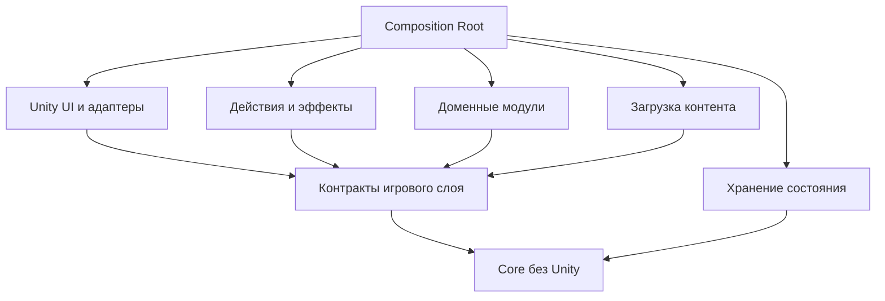
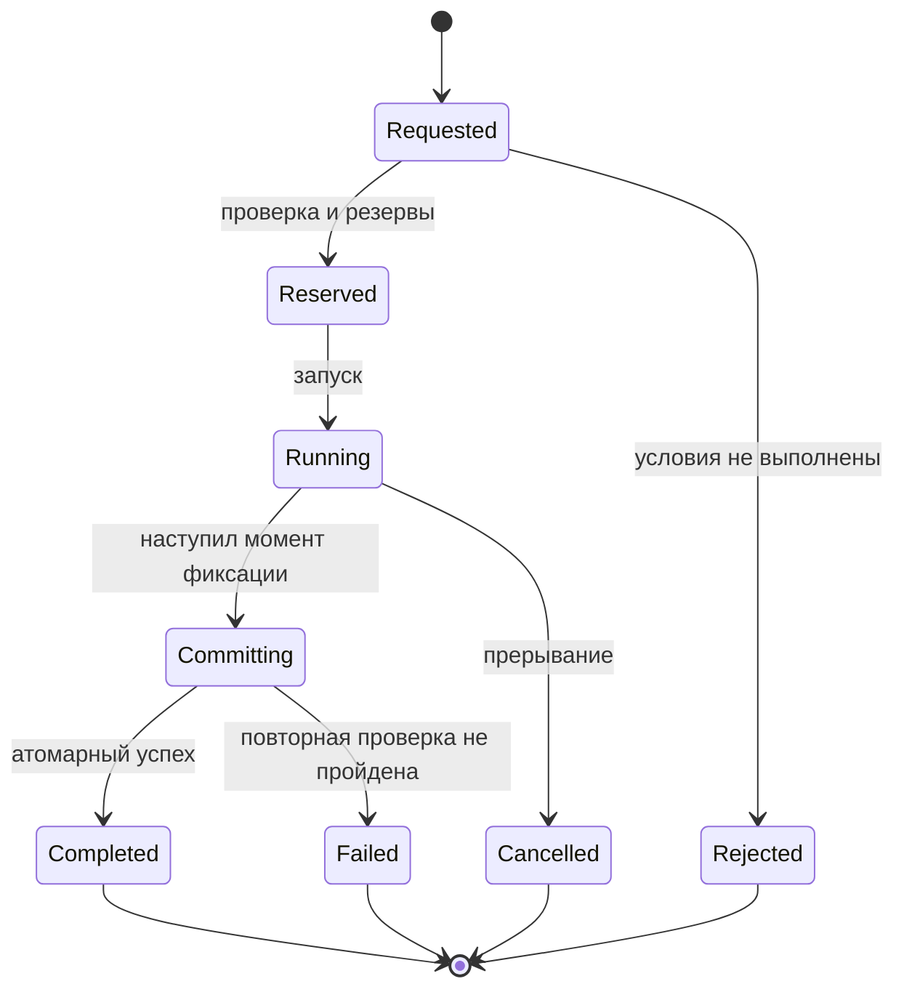
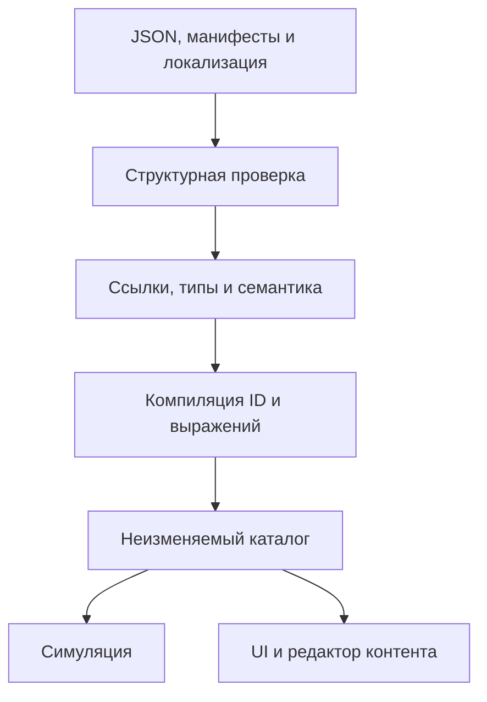
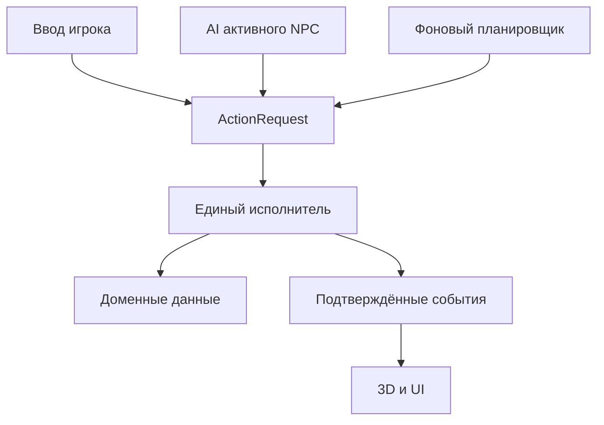

# 05. Универсальные игровые механики: data-driven архитектура

**Проект:** одиночный симулятор жизни с открытым процедурным миром на Unity и C#  
**Назначение:** техническое исследование и архитектурная спецификация для последующей реализации через Codex  
**Дата:** 25 ноября 2026 г.  
**Статус:** рекомендуемый проект архитектуры; примеры конфигурации иллюстрируют будущий контракт, а не существующий программный интерфейс.

## 1. Главный вывод

Не следует создавать отдельный программный механизм для каждого зелья, заклинания, предмета или профессии. Но и пытаться заменить весь игровой код универсальным интерпретатором команд — плохая идея.

Оптимальное решение для этого проекта — **модульный монолит на C# с декларативной системой игровых действий, эффектов, условий, свойств и модификаторов**, отделённый от Unity-представления.

Основная формула:

> Игровое содержание = определения данных + композиция проверенных примитивов.  
> Игровая логика = исполнение примитивов владельцами соответствующего состояния.

Например, питьё воды, использование предмета, медитация, приготовление фантастического эликсира, изучение навыка и активация сверхспособности должны использовать общий конвейер: определение действия → проверка условий → резервирование ресурсов → исполнение → атомарная фиксация результата → уведомления. При этом операция перемещения предмета принадлежит инвентарю, изменение баланса денег — экономике, вычисление характеристики — модулю характеристик, а навигация — миру и транспорту.

### 1.1. Ключевые архитектурные решения

| Решение | Рекомендация |
|---|---|
| Источник истины о состоянии мира | Чистые C#-модели, идентифицируемые стабильными ID; не `GameObject` и не сцена |
| Авторитетность | Один локальный симулятор, единый порядок изменения состояния; сетевой сервер не нужен |
| Игровой контент | Версионируемые JSON-пакеты, проверяемые схемами и семантическим компилятором |
| Unity-ресурсы | Prefab, модели, VFX, звук, иконки; `ScriptableObject` опционально как редакторское представление или визуальный каталог |
| Универсальный механизм | Действия, условия, адресация целей, эффекты, теги, свойства, модификаторы и выражения |
| Специализированные правила | Код доменных модулей (инвентарь, здоровье, собственность, экономика, мир) |
| Масштабирование NPC | Один и тот же механизм действий для игрока, активных NPC и фоновой симуляции |
| Настройки игрока | Версионируемый профиль правил конкретного мира, поверх стандартных значений |
| Сохранение | Снимки состояния с версиями и стабильными ссылками; атомарная фиксация контрольных точек |
| Расширения | Сначала данные; новые примитивы — отдельные зарегистрированные обработчики C# |
| Зависимости | Только необходимые бесплатные библиотеки; никаких обязательных платных RPG-фреймворков |

Не требуется сразу реализовать все перечисленные предметные механизмы. Требуется построить один игровой вертикальный срез и проверить, что через него можно добавлять содержание без переписывания существующего кода.

### 1.2. Соотношение с остальными частями проекта

Данный документ описывает слой игровых правил. Он не заменяет архитектуру всего приложения (`01-Game-Architecture.md`), пространственные данные и загрузку территории (`02-Planetary-World.md`), графический конвейер (`03-Procedural-Graphics.md`) или жизненный цикл населения (`04-Population-Simulation.md`). Названия этих документов используются как точки будущей интеграции; их конкретные интерфейсы необходимо согласовать при объединении спецификаций.

Игровой мир сообщает, где находится сущность и доступно ли взаимодействие. Население решает, зачем выполнять действие. Игровые правила определяют, разрешено ли действие и что оно меняет. Представление показывает результат. Эти четыре ответственности не должны сливаться в один класс NPC.

## 2. Исследование подходов и выбор технологий

### 2.1. Что можно перенять из существующих архитектур

Известный пример — Gameplay Ability System в Unreal Engine. Он разделяет способности, характеристики, эффекты, теги и визуальные реакции. Документация Epic описывает длительные и мгновенные эффекты, временные модификаторы и правила накопления [S1–S4]. Это удачный концептуальный образец, **не рекомендация переносить Unreal Engine в Unity**. Для одиночной игры не нужны его сложные сетевые предсказания и репликация.

У Unity есть собственные инструменты сериализации, ассетов и компонентной композиции, однако они не предоставляют готовую полную систему универсальных предметных транзакций симулятора жизни. `ScriptableObject` хорошо подходит для общих неизменных определений, поскольку несколько объектов могут ссылаться на один ресурс. В собранной игре сохранение прогресса через редактирование таких ассетов не является надёжным механизмом хранения [S5–S7].

### 2.2. Сравнение вариантов

| Подход | Преимущества | Недостатки | Решение |
|---|---|---|---|
| C#-класс на каждый предмет/способность | Быстрый старт, прямой код | Дублирование, сложные комбинации, изменение ядра при пополнении контента | Не использовать как основной способ |
| Только ScriptableObject и наследование | Удобный Inspector, ссылки на Unity-ассеты | Труднее массово генерировать и редактировать контент вне Unity; зависимость от сериализации Unity | Подходит для визуальных ресурсов и редакторских инструментов |
| JSON + строгие типизированные обработчики | Читаемые diff, пакетная генерация, модификации игрока, проверка без сцены | Нужен валидатор и внутренний каталог | **Основной подход** |
| Универсальный визуальный граф на каждый механизм | Удобен для художников и сложных последовательностей | Переусложнение, проблемы review и слияния, риск создать собственный язык программирования | Редактор графов можно добавить позднее как оболочку данных |
| Полноценные Lua/JS/C#-скрипты модов | Максимальная свобода | Произвольный код, циклы, несовместимость, недетерминизм и побочные эффекты | Не включать в первую версию |
| ECS/DOTS повсюду | Потенциально высокая производительность пакетных расчётов | Дополнительная сложность для транзакций, вложенных контейнеров и долгоживущих отношений | Применять точечно после профилирования |
| Готовый универсальный RPG-плагин | Быстрая демонстрация боя и инвентаря | Часто ориентирован на активные персонажи, свои модели сохранений и UI | Не делать владельцем игрового состояния |

### 2.3. Бесплатные инструменты, которые стоит рассмотреть

- Встроенные `.asmdef`, C#, Unity Test Framework и Profiler — базовый инструментарий. Assembly Definitions позволяют явно задавать зависимости сборок [S8–S9].
- `com.unity.nuget.newtonsoft-json` — пакет Unity для JSON [S10]. Рекомендуется для загрузки собственных DTO и JSON-деревьев с явно определёнными дискриминаторами. Закрепить конкретную совместимую версию в `Packages/manifest.json` и lock-файле. Не путать возможности современной .NET вне Unity с возможностями конкретного Unity Player.
- JSON Schema Draft 2020-12 [S11–S12] — формат контракта и структурной валидации. Выбранный валидатор должен поддерживать используемый диалект; полноценная проверка схем может выполняться на этапе авторинга/CI, а встроенный загрузчик обязан строго проверить данные и при запуске игры. Отдельно нужны семантические проверки.
- Addressables — опционально для загрузки визуальных ресурсов и контентных пакетов; локальная работа без обязательного облачного размещения [S13]. Не использовать адрес ассета в качестве ID игрового объекта.
- Открытые реализации [sjai013/unity-gameplay-ability-system](https://github.com/sjai013/unity-gameplay-ability-system) [S14] и [sajad0131/Unity-Gameplay-Ability-System](https://github.com/sajad0131/Unity-Gameplay-Ability-System) [S15] полезны как примеры реализации способностей и эффектов. Первая явно использует `MonoBehaviour` для `AbilitySystemCharacter` [S16]; это ограничивает её пригодность как непосредственного ядра для невизуализированного населения. Вторая заявляет MIT-лицензию. Перед заимствованием кода проверять LICENSE каждой зависимости и совместимость с закреплённой версией Unity. Совместимость и производительность проектов в настоящем исследовании не проверялись запуском.

**Рекомендация:** собственное небольшое ядро выгоднее, чем глубокая адаптация готового RPG-плагина под планетарную автономную симуляцию. Заимствовать идеи, а не навязывать всему симулятору чужую модель объектов. Стандартные бесплатные библиотеки нужны для инфраструктуры, а не для определения правил жизни мира.

## 3. Три слоя данных и идентичность объектов

| Категория | Пример | Изменяется при игре? |
|---|---|---|
| Определение (Definition) | `core:item.water_bottle`, максимальный размер стопки | Нет; заменяется только версией каталога |
| Экземпляр (State) | Бутылка №781, количество, износ, текущее размещение | Да |
| Эффективное состояние (Derived/View) | Суммарный вес сумки, эффективная сила, список допустимых действий | Пересчитывается, не является независимым источником истины |

Стабильные идентификаторы:

- `DefinitionId` — строка `namespace:category.name`, регистрозависимая по установленному правилу (рекомендовано только нижний регистр ASCII). Например `core:ability.light_aura`. Не использовать локализованное название как ключ.
- `EntityId`, `ItemInstanceId`, `ContainerId`, `ActionInstanceId`, `EffectInstanceId` — типизированные 64-битные идентификаторы. Для JSON обычно представлять строкой десятичного числа, чтобы избежать потери точности в сторонних редакторах. ID не переиспользуется в рамках мира. Генератор счетчиков хранится в сохранении. Предопределённые объекты мира используют согласованную с генератором мира стабильную identity (ключ территории и локальный ключ с обнаружением коллизий), а не `GetInstanceID()`.
- `DefinitionHandle` — плотный числовой индекс каталога, ускоряющий runtime-операции. При сохранении записывается стабильный ID, а не индекс, который может измениться при загрузке модов.
- `SourceRef` — структурированный источник права/эффекта: предмет, изученный навык, профессия или конкретный экземпляр действия. Понадобится для корректного удаления модификаторов и прав.

Состояние персонажа не обязано быть гигантским объектом. Владелец каждого вида данных хранит свои компактные таблицы, индексируемые `EntityId`: характеристики, инвентарь, прогресс, активные эффекты, право собственности. Объект без нужного набора данных просто не поддерживает соответствующие возможности.

Например, автомобиль не обязан иметь здоровье человека или навык чтения, но может иметь характеристики прочности и вместимости, теги, контейнер багажника и собственника. Дверь не обязана иметь полноценный инвентарь; у неё есть способность предоставлять доступ и изменяемое состояние `open/closed`. Ящик, надетый рюкзак, магазин и склад реализуют разные политики поверх контейнеров.

### 3.1. Теги, свойства и возможности

Это три разных механизма:

- **Теги** — категориальные признаки: `item.food`, `object.workbench`, `ability.magic`, `state.sleeping`. Иерархия через точку. Запрос `item.food` может явно включать потомков вроде `item.food.fruit`; проверка точного совпадения отдельна. Теги компилируются в ID и структурированный контейнер, без регулярных выражений и перебора строк в каждом кадре.
- **Свойства** — значения со схемой и единицей измерения: `mass.g`, `volume.ml`, `durability`, `quality`, `temperature.c`. Типы: `Bool`, `Int`, `Fixed`, `Enum`, `IdRef`, короткая `String` для действительно текстовых полей. У каждого ключа есть владелец, ограничения, допустимые типы сущностей, значение по умолчанию и политика изменения.
- **Возможности (capabilities)** — объявляют поддерживаемые операции, например `container`, `equipable`, `consumable`, `craft.station`, `seat`, `door`. Это разрешение на использование соответствующего механизма, а не произвольный доступ к внутренним данным.

Тег нельзя считать доказательством владения, наличия денег или разрешения на вход. Такие проверки выполняются владельцем соответствующей модели. Не хранить одновременно несколько авторитетных копий информации, например `isEquipped` у предмета и независимую запись его экипировки. Закрепить один источник и вычислять остальное.

Теги, выдаваемые эффектами, имеют учёт источников. Если два независимых источника дают `state.inspired`, снятие первого не удаляет тег, пока жив второй источник.

### 3.2. Компоненты данных против наследования

Нежелательно дерево `GameObject → Entity → LivingEntity → Human → Mage → FireMage` или классы для каждой разновидности вещи. Предпочтительна композиция:

| Объект | Наборы данных/возможности |
|---|---|
| Яблоко | `Item`, `Consumable`, теги пищи, качество, масса |
| Рюкзак | `Item`, `Equipable`, `Container`, слоты/ограничения |
| Сундук | `Container`, `PropertyAsset`, `AccessPolicy` |
| Жилой дом | `PropertyAsset`, `Location`, `AccessPolicy`, ссылки на помещения |
| Персонаж | `Attributes`, `Needs`, `Inventory`, `Equipment`, `Progression`, `Abilities` |
| Верстак | `CraftStation`, `InteractionProvider`, доступность и резервирование места |
| Транспорт | `Vehicle`, `Location`, `PropertyAsset`, `Container` (при наличии) |

Порядок хранения и методы поиска могут различаться, но идентичность объекта и предметные инварианты должны быть общими.

## 4. Модульная структура проекта

Если общий проект уже утвердил собственные названия сборок, следует адаптировать имена, сохранив направление зависимостей. Ниже минимальное логическое разделение, а не требование создать десятки проектов с первого дня.

```text
Assets/Game/
  Core/                       Game.Core.asmdef
    Ids/ Time/ Math/ Results/ Transactions/
  Gameplay/
    Contracts/                Game.Gameplay.Contracts.asmdef
    Runtime/                  Game.Gameplay.Runtime.asmdef
      Actions/ Conditions/ Effects/ Targeting/ Modifiers/ Expressions/
    Domains/
      Items/                  Game.Items.asmdef
      Characters/             Game.Characters.asmdef
      Progression/             Game.Progression.asmdef
      Crafting/                Game.Crafting.asmdef
      Ownership/               Game.Ownership.asmdef
    Content/                  Game.Content.asmdef
  World/                      Game.World...asmdef
  Population/                 Game.Population...asmdef
  Economy/                    Game.Economy...asmdef
  Persistence/                Game.Persistence.asmdef
  UnityAdapters/              Game.UnityAdapters.asmdef
  UI/                         Game.UI.asmdef
  Bootstrap/                  Game.Bootstrap.asmdef
  Editor/                     Game.Editor.asmdef
  Tests/                      отдельные тестовые сборки
ContentSource/
  schemas/
  core/
    manifest.json
    definitions/
      attributes/ needs/ items/ slots/ actions/ abilities/
      effects/ skills/ professions/ recipes/ settings/
    localization/ru.json
  samples/
```

`ContentSource` может находиться и внутри специального каталога Unity; принципиально, чтобы процесс сборки явно копировал/компилировал необходимые файлы. В билде базовый каталог доступен локально, каталоги пользовательских модификаций и сохранений размещаются под `Application.persistentDataPath` [S17] (путь получать штатным API, не хардкодить путь Windows).



Стрелки обозначают направление зависимостей кода. Runtime не должен ссылаться на конкретные реализации доменов; Bootstrap получает их и регистрирует обработчики. Доменам не нужна ссылка на Runtime: им нужны контракты операций, контекст и интерфейсы регистрации. Междоменные координации проходят через явные порты и транзакцию, не через встречные ссылки сборок.

### 4.1. Владение состоянием и контракты

| Модуль | Авторитетно владеет | Публичные операции и запросы |
|---|---|---|
| Items | Экземпляры предметов, контейнеры, размещение, экипировка | `TryMove`, `TryConsume`, `TrySplit`, `TryEquip`, `GetContents`, `CanFit` |
| Characters | Базовые/текущие ресурсы, здоровье, потребности, жизненное состояние, атрибуты | `ApplyResourceDelta`, `GetAttribute`, `GetNeed`, `ChangeState` |
| Progression | Опыт, уровень, изученные навыки и способности, источники приобретения | `GrantXp`, `Learn`, `GetEffectiveLevel`, `HasAbility` |
| Gameplay.Runtime | Запланированные действия, cooldown, жизненные циклы эффектов, активация и остановка | `Preview`, `Submit`, `Cancel`, `Tick`, `GetActionStatus` |
| Crafting | Производственный заказ, выбор рецепта, состояние процесса и зарезервированные входы | `PrepareOrder`, `CompleteOrder`, `CancelOrder` использует операции Items |
| Ownership | Титул собственности, доли, аренда, разрешение пользования | `GetOwner`, `CanUse`, `TransferTitle` |
| Economy | Деньги, платежи, договоры купли-продажи, цена | `ReserveFunds`, `TransferFunds`, `Quote` |
| World/Transport | Положение, пространственные цели, доступность, движение, вместимость места | `CheckReachability`, `ReservePlace`, `GetDistance`, `RequestTravel` |
| Population | Работа NPC, решения, потребности в действиях, расписания, планы и социальная модель | `ChooseAction`, `Schedule`, `GetRelations` через опубликованные запросы |
| Persistence | Формат снимка, упаковка, миграции, чтение/запись | `Capture`, `Restore`, `Migrate` |

Некоторые области могут физически жить в одной сборке на первом этапе (`Items` включает Equipment; `Characters` включает Needs и Attributes). Делить их следует при реальной необходимости, не ради искусственной микросервисности.

### 4.2. Принципы зависимостей

- `Core`, `Contracts` и чистые домены не используют UnityEngine (`noEngineReferences: true`, где применимо).
- Домены не ищут друг друга посредством глобального `GameManager.Instance`, service locator или `FindObjectOfType`.
- Composition Root создаёт единственный экземпляр симулятора и передаёт зависимости через конструкторы; полноценный DI-фреймворк не обязателен.
- Запросы читают снимок/представление, команды намеренно изменяют состояние. События описывают уже произошедшее. Это не означает необходимость полноценной инфраструктуры CQRS или Event Sourcing.
- UI и NPC никогда не меняют `health`, баланс, слот инвентаря или XP напрямую. Они используют тот же командный интерфейс.
- Модуль представления подписывается на подтверждённые изменения. Отказ загрузить модель или проиграть анимацию не откатывает реальную покупку или предметную транзакцию.

## 5. Универсальная модель игрового действия

### 5.1. Определения и экземпляры

`ActionDefinition` отвечает на вопрос, *что можно сделать*, а `ActionInstance` — *что именно выполняется сейчас*.

| Часть определения | Смысл |
|---|---|
| `id`, `tags`, `titleKey` | Стабильный ID, поиск и локализация |
| `target` | Тип цели, селектор, правила дальности/доступности |
| `conditions` | Чистые предикаты допуска; диагностируемые причины отказа |
| `costs` | Операции резервирования и расходования энергии, денег, предметов, времени и т. п. |
| `duration` | Длительность, фазы, временной домен |
| `claims` | Резервирование предмета, контейнера, места, эксклюзивного канала действия |
| `effects` | Декларативные изменения, выполняемые в указанной фазе |
| `cooldown` | Ограничение повторной активации, при наличии |
| `cancelPolicy` | Условия прерывания, судьба резервов и уже завершённых фаз |
| `presentation` | Ключи анимации, звука и VFX, необязательные для чистого исполнителя |
| `ai` | Семантические эффекты и полезность для планировщика, не замена фактическим проверкам |

`ActionRequest` содержит ID инициатора, действия, источник (изученная способность, предмет, взаимодействие с объектом), цель, проверенные параметры (например, размер стопки), RequestId. Диспетчер не принимает от UI произвольный список эффектов. Определение извлекается из текущего скомпилированного каталога.

`ActionInstance` хранит ID запуска, ссылки на версии контента и правил, фазу, целевой игровой момент, выбранные разрешённые цели, зарезервированные ресурсы, информацию для повторного входа после загрузки. Прогресс не зависит от времени анимации.

### 5.2. Жизненный цикл



В деталях:

1. `DiscoverActions(actor,target)` определяет возможные действия по индексированным возможностям, предметам и приобретённым способностям.
2. `Preview(request)` читает состояние, вычисляет причины недоступности и предварительную стоимость. Не расходует RNG, ничего не резервирует и не гарантирует будущий успех.
3. `Submit(request)` проверяет разрешённость источника, роли цели, применимые правила мира, состояние и конфликты. Повторно определяет стоимость по авторитетному состоянию.
4. `Reserve` создаёт резервы с владельцем `ActionInstanceId`, защищающие необходимые ресурсы до завершения. Короткие действия используют одну транзакцию без долгоживущего резерва.
5. `Running` — ожидание, перемещение или последовательность этапов по игровому времени. Для внешних операций используется сохраняемый handle, а не зависшая корутина.
6. В `Commit` проверяются критические условия повторно (предмет существует, доступ не отозван, исполнитель находится в допустимом состоянии). При проверке зарезервированного ресурса текущий экземпляр действия учитывает собственный резерв как доступный ему; иначе любой заказ мог бы заблокировать сам себя. Эффекты формируют операции владельцев состояния; запись всех операций подтверждается атомарно.
7. Освобождаются резервы, создаются cooldown и результат. После подтверждения публикуются события, например `ActionCompleted`, `InventoryChanged`, `ExperienceGained`.
8. При отказе или отмене незавершённые резервы снимаются точно один раз. Если многошаговое действие уже подтвердило предыдущую фазу, её последствия не исчезают магически: политика восстановления определена для каждой фазы.

Для начала достаточно мгновенного действия, действия с длительностью и отменой. Произвольные параллельные графы фаз и цепочки квестов — позднее. Перемещение к цели и разговор могут быть отдельными плановыми действиями AI, а не встроенной логикой каждого бытового действия.

### 5.3. Конкуренция и транзакции

Даже одна локальная игра сталкивается с логической конкуренцией: два NPC захотели одно кресло или купили последнюю единицу товара, игрок прервал своё действие, магазин закрылся, предмет был перемещён.

Рекомендуемая модель на старте — **один писатель состояния** (simulation thread/main simulation phase). Асинхронные Jobs могут вычислять кандидатов, маршруты и значения, но передают команды, а не пишут в доменные модели.

Транзакция — не просто `try/catch` вокруг изменения списка. Она должна иметь явный prepare/commit: собрать план изменений в staging/write-set, проверить версии и инварианты на согласованном снимке с учётом накопленных изменений и только затем применить результат без вызовов пользовательских обработчиков. При сбое подготовки состояние неизменно; при сбое фиксации нужен обратимый журнал или замена подготовленных сегментов состояния, чтобы исключить частичную запись. Публиковать события только после успешного commit. Не держать транзакцию открытой час игрового времени — долгие операции используют резервы и короткие фазовые commit.

Пример покупки: средства списываются, товар перемещается, титул/право владения переоформляется, а деньги поступают продавцу как части одной подтверждённой операции. Если сумка не вмещает покупку, ни один из этих результатов не должен примениться.

`RequestId` / `ActionInstanceId + PhaseIndex` дают идемпотентность: повторная доставка того же завершённого запроса не создаёт второй предмет или повторную выплату. Номер завершённой фазы сохраняется атомарно с последствиями. Удалять старые квитанции можно после согласованной контрольной точки при гарантии недоступности старых повторов.

### 5.4. Минимальные C#-контракты (эскиз)

Следующий код иллюстрирует границы ответственности, а не готовую библиотеку. Имена вспомогательных типов условны; окончательные DTO и сигнатуры фиксируются при реализации.

```csharp
public interface IActionService
{
    ActionPreview Preview(in ActionRequest request);
    ActionSubmitResult Submit(in ActionRequest request);
    ActionCancelResult Cancel(ActionInstanceId id, EntityId requester);
    ActionStatus GetStatus(ActionInstanceId id);
}

public interface IConditionHandler<T>
{
    ConditionResult Evaluate(in T definition, in ReadContext context);
}

public interface IEffectHandler<T>
{
    // Создаёт проверяемые операции, не изменяет состояние напрямую.
    PlanResult Prepare(in T definition, in EffectContext context,
                       IWorldChangeSet changes);
}

public interface IWorldChangeSet
{
    IReadSnapshot Snapshot { get; }
    // Сразу учитывает уже подготовленные операции при последующих проверках.
    PlanResult Stage<TCommand>(in TCommand command);
}

public interface IGameplayRegistrar
{
    void RegisterCondition<T>(string kind, IConditionHandler<T> handler);
    void RegisterEffect<T>(string kind, IEffectHandler<T> handler);
}
```

Владелец, принимающий типизированную команду `MoveItemCommand`, является единственным местом проверки вместимости, правил стопок, доступа и допустимости перемещения. `EffectHandler` не должен дублировать эту реализацию или передавать произвольный делегат записи. Реестр маппит дискриминатор `kind` на явно объявленный DTO, валидатор и обработчик, а не загружает тип C# по строковому имени из мода.

## 6. Набор примитивов и язык данных

### 6.1. Условия

| `kind` | Назначение |
|---|---|
| `all`, `any`, `not` | Композиция условий |
| `has_tag` | Наличие тега с явно заданным exact/subtree-сопоставлением |
| `has_capability` | Поддержка операции объектом |
| `property_compare` | Сравнение типизированного свойства |
| `resource_compare` | Сравнение доступного (с учётом резервов) ресурса |
| `has_item`, `container_can_fit` | Наличие предметов и возможность разместить результат |
| `skill_level_at_least`, `has_ability` | Изученная способность или требуемый уровень |
| `can_access`, `can_use` | Запрос прав и доступности к владельцам состояния |
| `distance_at_most`, `at_location` | Пространственные ограничения |
| `time_window` | Допустимое игровое время |
| `cooldown_ready`, `channel_free` | Готовность действия |
| `rule_enabled` | Разрешение игровых правил мира |

Условия не производят никаких изменений и возвращают структурированный `ConditionResult`: код (`inventory.not_enough`), параметры (необходимое количество) и локализуемый `messageKey` для UI. Невыполненное условие не исключение; исключение — дефект данных или реализации.

### 6.2. Эффекты и предметные операции

| `kind` | Ответственность |
|---|---|
| `change_resource` | Изменение ресурса через модуль Characters |
| `apply_effect`, `remove_effect` | Установка/снятие длительного эффекта с источником |
| `grant_tag`, `revoke_tag` | Изменение через учёт источников, в рамках разрешённой политики |
| `move_item`, `consume_item`, `produce_item` | Операции Items, не произвольное изменение массива |
| `equip_item`, `unequip_item` | Слоты и модификаторы экипировки |
| `change_property` | Изменение зарегистрированного свойства через его владельца |
| `grant_xp`, `grant_ability`, `revoke_ability` | Прогресс и выдача источников прав |
| `complete_recipe` | Завершение подтверждённого CraftOrder доменом Crafting |
| `transfer_money`, `transfer_title` | Транзакционные команды Economy / Ownership |
| `change_relation` | Доменная команда социальных отношений |
| `request_travel` | Постановка сохраняемой операции движения соответствующему модулю; не прямой `Transform.position` |
| `choose` | Ветвление по чистому условию |
| `roll_table` | Зарегистрированная игровая таблица случайного выбора с сохраняемым RNG-контекстом |

Примитивы `complete_recipe`, `transfer_title`, `request_travel` не означают, что произвольные конфигурации могут обходить предметные инварианты. Например, передача титула проверяет разрешённый контекст и текущего владельца; `complete_recipe` принимает существующий заказ с правами и резервами.

### 6.3. Адресация целей

Фиксированный словарь селекторов: `actor`, `target`, `source_item`, `reserved_item`, `station`, `targets_in_radius` (ограниченное число результатов). Новые селекторы добавляются отдельными обработчиками. Параметры цели валидируются типом, областью, доступностью и владельцем действия. Радиус и максимальное количество целей являются игровыми параметрами; технический потолок на количество обработанных целей защищает кадр от бесконечной нагрузки.

Контекст содержит только разрешённые ссылки на доменные сущности. Не разрешать JSON обращаться к произвольному полю C# по reflection (`actor.inventory.Items[0]...`). Для каждого выражения или свойства есть типизированный способ чтения.

### 6.4. Выражения и алгоритмы

В первой версии использовать константы, ссылки на параметры и несколько узлов арифметики: `add`, `sub`, `mul`, `div`, `min`, `max`, `clamp`, `curve`, `compare` и `if`. Вместо строки `eval("...")` — небольшой JSON AST, компилируемый при загрузке:

```json
{
  "op": "mul",
  "args": [
    { "op": "add", "args": [8, { "op": "mul", "args": [2, { "ref": "ability.level" }] }] },
    { "ref": "rules.magic.power_multiplier" }
  ]
}
```

При уровне 5 и множителе 1.5 результат 27 условных единиц. Разрешённые пространства ссылок: `actor.attribute.<id>`, `target.attribute.<id>`, `ability.level`, `item.quality`, `recipe.difficulty`, `rules.<key>` — валидатор сверяет конкретные ссылки и типы. Для начала достаточно подмножества; не реализовывать всё заранее.

Строгие правила компиляции: ограничение глубины AST и числа операций, проверка арности и единиц, корректная обработка деления на ноль и переполнения, запрет бесконечной рекурсии и циклов в вычисляемых свойствах. Для таблиц кривых проверять монотонность там, где она требуется (например, пороги опыта), интерполировать явно. Результат вычисления фиксируется при выбранной фазе, а не произвольно меняется после анимации.

## 7. Контентные пакеты, форматы файлов и инструменты

### 7.1. JSON как канонический формат

Для автоматизированной разработки через Codex удобнее небольшие человекочитаемые файлы: одна запись на определение, допускаются массивы однотипных записей для крупных справочников. Не дублировать одно определение как независимую правду в `.asset` и JSON. Если есть удобный редактор на `ScriptableObject`, он либо импортирует JSON в read-only представление, либо экспортирует изменения в JSON с явным действием автора.

Пример `manifest.json` (поля будущего контракта):

```json
{
  "id": "core",
  "version": "1.0.0",
  "schemaVersion": 1,
  "requiresGameApi": "1",
  "dependsOn": [],
  "definitionsRoot": "definitions",
  "localizationRoot": "localization"
}
```

Пакет мода имеет свой namespace и объявляет зависимости от конкретного API и совместимых версий контента. Каталог собирается в детерминированном порядке (топологическая сортировка зависимостей, затем стабильный ID). При совпадающем ID — ошибка, если пакет не содержит явного допустимого `override`/патча. Не разрешать тихое правило «последний файл победил». Для патчей явно указать целевой ID, версию/хэш основы и разрешённые поля; конфликтующие патчи одного поля требуют разрешения или отключения одного пакета.

Приоритет: базовые определения → дополнительные пакеты → явные патчи модов → профиль правил игрока (только объявленные регулируемые параметры). Системные инварианты ядра остаются обязательными. Каталог фиксируется для сеанса и содержит fingerprint из версий, упорядоченного содержимого и версии схемы.

### 7.2. Как загружается контент



Валидатор разделён на этапы:

1. Чтение UTF-8 и отказ при некорректном JSON, дублирующихся ключах, неизвестной версии схемы или слишком большом для заданного формата файле.
2. JSON Schema: требуемые поля, диапазоны, типы, `oneOf`/дискриминаторы `kind`, описание допустимых полей. Схемы закрытые там, где опечатка опасна.
3. Семантика: уникальность ID, существование ссылок, правильный вид определения, наличие зарегистрированных обработчиков, типы выражений и свойств, отсутствие циклических зависимостей/контейнеров/некорректных рецептов, разумные диапазоны и единицы, параметры правил.
4. Компиляция в типизированные неизменяемые определения; строковые ID преобразуются в runtime-индексы, правила и выражения подготавливаются к частому использованию.
5. Только после проверки всего набора новый каталог доступен движку. Ошибка любого обязательного пакета — понятное сообщение с путём файла, ID определения и JSON Pointer. При ошибке факультативного мода пользователь может отключить весь пакет и его зависимые пакеты с учётом сохранения, а не загрузить половину мода.

Для Unity/IL2CPP проектировать явные таблицы известных DTO и обработчиков. Managed code stripping способен удалить типы, используемые только отражением [S18]; поэтому регистрация типизированного кода, проверка player build и при необходимости точечное сохранение используемых типов предпочтительнее неограниченной рефлексии. Для JSON.NET не включать произвольное создание CLR-типов по `$type` (`TypeNameHandling.None`).

### 7.3. Минимальная схема примитива

Пример схемы одного варианта эффекта (`change_resource`); это небольшой полностью корректный структурный фрагмент, не схема всего проекта. Ключи `resource` проверяются по каталогу вторым проходом.

```json
{
  "$schema": "https://json-schema.org/draft/2020-12/schema",
  "type": "object",
  "required": ["kind", "recipient", "resource", "delta"],
  "properties": {
    "kind": { "const": "change_resource" },
    "recipient": { "enum": ["actor", "target"] },
    "resource": { "type": "string", "pattern": "^[a-z0-9_]+:[a-z0-9_.]+$" },
    "delta": { "type": "number" }
  },
  "additionalProperties": false
}
```

Расширенная схема может принимать `delta` как число или ссылку на схему выражения. Согласованная семантика определяется типом ресурса. Сам факт соответствия формату JSON не даёт операции права изменять произвольный объект.

### 7.4. Удобство для Codex и пользователя

- Единый исполняемый инструмент `content validate` (название предлагаемое), пригодный для запуска без открытия сцены Unity. В перспективе — `content list`, `content explain <id>`, `content simulate <scenario>`.
- EditorWindow с поиском определений, проверкой ссылок и переходами между предметом, рецептом, действием и эффектом. Не строить сложный визуальный редактор раньше стабильной схемы.
- Локализуемые строки (`titleKey`, `descriptionKey`, `reasonKey`), единицы и подсказки. Контент-пакет может быть полностью на русском языке при стабильных технических ASCII-ID.
- Формирование каталога UI и действий автоматически из объявлений. Для принципиально нового способа управления/визуализации понадобится адаптер, но не переработка модели предметов.

## 8. Предметы, контейнеры, инвентарь и экипировка

### 8.1. Модель предмета

Определение предмета содержит неизменяемые параметры, визуальный ключ и набор компонентов. Экземпляр хранит только отличия от определения и уникальное состояние.

```json
{
  "id": "core:item.water_bottle",
  "kind": "item",
  "titleKey": "item.water_bottle.name",
  "tags": ["item.consumable", "item.drink"],
  "massGrams": 500,
  "volumeMl": 550,
  "stack": { "max": 20, "identityFields": ["quality"] },
  "properties": { "quality": 100 },
  "actions": ["core:action.drink_water"],
  "visualKey": "items/water_bottle"
}
```

Здесь бутылка — условная единица игрового расходника. Симуляция её жидкости, тары и частичного опустошения может быть расширена отдельным компонентом позднее. Не требуется моделировать все физические детали бутылки ради первой игровой версии.

```json
{
  "instanceId": "781",
  "definitionId": "core:item.water_bottle",
  "count": 3,
  "properties": { "quality": 80 }
}
```

Место нахождения предмета авторитетно хранит индекс `ItemPlacement`, а не продублированные ссылки в каждом контейнере. Запись размещения: `ItemInstanceId → (kind, ownerId, slotOrPosition)`. Возможные `kind`: контейнер, экипировочный слот, размещение в мире, системное хранилище производства или уничтоженный экземпляр (tombstone при необходимости). Индекс `container → items` — согласованное представление.

Для простых одинаковых вещей достаточно записи стопки `(definition, count, stackKey)`. Для уникальных или изменяемых вещей — отдельный экземпляр с износом, качеством, индивидуальными свойствами. Объединение разрешается только если совпадают идентификатор определения, поля ключа стопки, политика собственности/привязки и другие объявленные ограничения. Нельзя незаметно усреднять разное качество или уничтожать уникальные данные.

**Инварианты Items:**

- Каждая существующая вещь находится ровно в одном физическом размещении. Право собственности — отдельная логическая связь.
- Количество в стопке положительное, не больше текущего разрешённого максимума; частичное перемещение создаёт новый ID, исходный остаётся при делении.
- Вес, габариты, фильтры и вместимость проверяются атомарно с учётом всех уровней вложения и существующих резервов.
- Нельзя поместить контейнер в себя или своего потомка. Ограничение вложенности является технической защитой дерева от чрезмерной нагрузки; обычное игровое ограничение глубины может быть строже.
- Резервированные предметы не могут быть повторно потрачены. Разделение/слияние стопок корректно учитывает резерв конкретного количества.
- Уничтожение предмета с содержимым требует явно выбранной доменной политики (высыпать в подходящее место, переместить, запретить). Никакого молчаливого исчезновения содержимого.

### 8.2. Контейнеры как универсальная абстракция

Персонаж имеет корневой контейнер карманов/сумок, транспорт — багажник, здание — склад. Контейнер бывает физическим и виртуальным (например, хранилище производства), но не копирует предметы при выгрузке 3D-сцены.

Общие ограничения:

- `maxMassGrams`, `maxVolumeMl`, `maxSlots` (опциональный счётчик стопок);
- разрешённые/запрещённые теги, требования размера, политика доступа;
- режим вместимости: фиксированные слоты или свободное размещение. Пространственную сетку-рюкзак добавлять позже, если она действительно нужна как игровая механика;
- собственное состояние: закрыт/открыт, занятые места, зарезервированные ёмкости для ожидаемого результата;
- суммарная масса и объём поддерживаются индексами. Масса рюкзака включает содержимое; внешний объём вложенного контейнера определяется политикой упаковки, а не всегда является суммой объёмов вложенных вещей.

Доступ к контейнеру — запрос возможности использования, владения/разрешения и фактической доступности. NPC у себя дома и игрок в магазине работают через одинаковые операции инвентаря. Приватный сундук может быть доступен членам семьи, но это не делает каждого пользователя собственником сундука.

### 8.3. Экипировка

Слоты — данные, например `core:slot.head`, `core:slot.left_hand`, `core:slot.right_hand`, `core:slot.back`. Определение слота содержит допустимые теги, группу конфликтов и правила совместимости. Анатомические схемы персонажей определяют поддерживаемые слоты.

Предмет с экипировочными свойствами может занимать несколько слотов, предоставлять новый контейнер, выдавать способности или модифицировать параметры. При надевании применяется источник `equipment:<instanceId>`, при снятии удаляются только принадлежащие ему модификаторы и права. Если та же способность изучена самим персонажем или выдана другим предметом, она сохраняется.

Надевание должно быть транзакцией: переместить предмет в слот, убрать конфликтующую экипировку в допустимый контейнер, обновить набор предоставляемых эффектов. Если места для снятого предмета нет, действие целиком не выполняется, либо пользователь сначала выбирает другое место. Нельзя уничтожать вещи ради удобства UI.

### 8.4. Имущество, аренда и использование

`Ownership` хранит не только `ownerId`, но и при необходимости доли, тип титула, действующий договор, права пользования, срок и ограничения. Сложные юридические модели добавить после базовой покупки, аренды и совместного доступа; не пытаться симулировать всё реальное право.

Для передачи вещей, недвижимого имущества и транспорта различать:

1. Физическое расположение (где находится вещь).
2. Фактическое владение/контроль (кто сейчас держит или использует).
3. Титул собственника (кому принадлежит).
4. Право использования (кто может пользоваться и на каких условиях).

Покупка домика меняет титул, но не пересоздаёт объект мира и предметы внутри. Аренда не передаёт титул, зато создаёт срочное право пользования. Наследование и коллективная собственность возможны как дополнительные доменные операции поверх этой модели.

Финансовые значения лучше хранить в целых минимальных единицах выбранной игровой валюты (`long`). Экономика обязана контролировать отрицательные остатки, резервирование, правила начислений и атомарность встречных платежей. Игровые нарушения прав — условные проверки и последствия (реакция NPC, репутация, изменение правового статуса в вымышленном мире), а не моделирование реальных способов незаконного поведения.

## 9. Характеристики, здоровье, ресурсы и потребности

### 9.1. Разделение типов параметров

| Тип | Примеры | Семантика |
|---|---|---|
| Базовая характеристика | сила, интеллект, выносливость, предрасположенности | Постоянная изменяемая база |
| Производная характеристика | эффективная скорость, максимум энергии, грузоподъёмность | Вычисляется из базы, формул и действующих модификаторов |
| Ресурс | здоровье, энергия, мана | Текущее количество и эффективная граница |
| Потребность | насыщение, гидратация, отдых, комфорт, общение | Изменяется со временем и посредством действий |
| Состояние | отдыхает, утомлён, вдохновлён | Теги и экземпляры эффектов, полученные из правил |
| Прогресс | опыт, уровни навыков | Отдельно владеет Progression |

В игровых характеристиках не следует смешивать естественное состояние персонажа (например, числовое здоровье) с графическим представлением полоски здоровья. Все числовые значения, диапазоны и единицы хранятся в определениях.

Пример определения ресурса:

```json
{
  "id": "core:resource.hydration",
  "kind": "resource",
  "unit": "points",
  "min": 0,
  "max": 100,
  "initial": 80,
  "decayPerGameHour": 3,
  "thresholds": [
    { "atOrBelow": 20, "tag": "state.thirsty" }
  ]
}
```

Здесь все значения вымышленные, предназначенные для баланса игры, а не отражения медицинских или физиологических рекомендаций. Для каждой величины заранее выбрать направление: например, насыщение падает со временем и растёт от еды. Не называть переменную `hunger`, если численно она означает сытость.

Здоровье как отдельный ресурс, его нулевая граница и переходы `active → incapacitated → ...` принадлежат модулю Characters. Эффект не выставляет `isDead` из JSON без проверки переходов домена. Сложные состояния здоровья допустимо позднее моделировать набором игровых статусов и ограничений, без привязки к реальным медицинским действиям.

### 9.2. Математика модификаторов

Необходимо детерминированно различать постоянное изменение базы, временное изменение эффективного значения и изменение текущего ресурса. Например, кольцо увеличивает максимум маны, но не обязано бесплатно восполнять ману. Истечение эффекта не отменяет фактически потраченную энергию.

Рекомендуемый порядок вычисления эффективной характеристики:

```text
raw = (base + sum(flat)) * (1 + sum(additivePercent)) * product(multiplicativeFactor)
result = clamp(applyOverride(raw, priorityOrder), min, max)
```

Это выбранная проектная семантика, а не обязательный стандарт Unity. Все проценты выражаются долями (0.2 означает +20%), множитель 1.2 означает ×1.2. Множители не должны иметь произвольные отрицательные значения, если тип атрибута не позволяет. Override применяется по максимальному приоритету с детерминированным разрешением ничьей по ID источника; правила диапазонов действуют последними. Для разных групп характеристик при необходимости задаются отдельные политики, но они должны быть явно объявлены.

Например, базовая грузоподъёмность 30 условных единиц, плоская прибавка 10, +20% и множитель 1.1 дают 52.8. Удаление одного источника вызывает повторное вычисление, а не применение приблизительной обратной операции. Сумма двух бонусов +20% и +10% равна +30%, а не ×1.2×1.1, если они относятся к одной аддитивной группе.

Граф производных характеристик должен быть ациклическим. При изменении базовой величины пересчитываются зависимые значения в топологическом порядке. Кэш эффективных атрибутов инвалидируется только при изменении исходных данных, набора модификаторов или версии применимых правил. Не пересчитывать характеристики всех жителей каждый кадр.

При изменении максимума ресурса нужно явное поведение (`keep_absolute_clamp`, `keep_ratio`, `fill_delta` и т. д.). По умолчанию — сохранить абсолютное количество и ограничить новой границей. Правило должно быть одинаковым при загрузке, снятии экипировки и смене профиля мира.

### 9.3. Активные эффекты

Длительный эффект состоит из определения и отдельного экземпляра:

- `effectDefinitionId`, `instanceId`, `source`, `target`;
- время начала, дедлайн, следующий периодический тик;
- интенсивность, количество стеков, набор рассчитанных параметров;
- политика прекращения и правила обновления эффекта;
- принадлежность тегов и модификаторов конкретному источнику.

| Политика | Пример (игровой) |
|---|---|
| `instant` | Разовое изменение воды/энергии |
| `timed` | Временное свечение на несколько игровых минут |
| `while_source_active` | Эффект действует, пока надет амулет или включена стойка |
| `periodic` | Восполнение условной маны через заданные интервалы |

Периодичность — дополнительный параметр timed/while_source_active, а не необходимость запускать `Update` или корутину на каждый эффект. Статусы в общем списке могут иметь сочетание продолжительности, периодических действий и модификаторов.

Стратегии накопления задаются данными: независимые экземпляры, обновление срока, добавление стеков до максимума, сохранение самого сильного. Ключ группы определяется как эффект+цель, либо эффект+цель+источник — выбор влияет на поведение двух применений от разных персонажей. Требуется явно устанавливать, когда срабатывает первый и последний периодический тик, наследуется ли интенсивность, что происходит с дополнительным применением на предельном количестве стеков.

При равном времени окончания и периодического тика определён единый порядок. Предлагаемая политика: время начала включительно, время окончания исключительно (`startTick <= tick < endTick`), затем истечение эффекта; входные команды при том же tick выполняются в фиксированной фазе очереди. Нельзя рассчитывать каждый раз на порядок подписок C#.

## 10. Профессии, опыт, навыки и активные/пассивные способности

### 10.1. Модель прогрессии

Рекомендуется набор независимых деревьев развития, а не единственный глобальный уровень:

- Общий уровень персонажа — опциональный агрегат или отдельный прогресс-трек.
- Навыки: кулинария, ремесло, социальные навыки, знания мира, фантастическая магия.
- Профессии: доступные роли, набор требований и связанных действий, допуски, квалификация. Профессия не является жёстким запретом на остальные способности, если правила мира этого не требуют.
- Способности: активируются явно, автоматически предоставляются, пассивно действуют либо условно реагируют на события.
- Источники приобретения: обучение, профессия, предмет, временный эффект, сюжетное достижение, пользовательский режим мира.

Различать **профессию как приобретённую квалификацию** и **конкретную работу**. Например, квалификация ремесленника допускает работу на верстаке, а трудовой договор с магазином, график, зарплата и конкретное рабочее место принадлежат экономике и населению. Смена работодателя не должна удалять изученные навыки.

```json
{
  "kind": "skill",
  "id": "core:skill.arcane_crafting",
  "titleKey": "skill.arcane_crafting.name",
  "maxLevelRule": "skills.arcane_crafting.max_level",
  "xpMultiplierRule": "progression.xp_multiplier",
  "thresholds": [0, 100, 250, 450, 700],
  "beyondTable": { "kind": "linear_increment", "lastIncrement": 250, "incrementGrowth": 50 },
  "grants": [
    { "level": 1, "ability": "core:ability.light_aura" },
    { "level": 3, "ability": "core:ability.quiet_focus" }
  ]
}
```

Семантика примера: уровень 0 соответствует 0 XP, уровень 1 — 100, уровень 2 — 250 и т. д. После уровня 4 очередной интервал равен 300 XP, затем 350 и т. д. Это явная формула продолжения таблицы: для `n = level - 4`, `threshold = 700 + 250*n + 50*n*(n+1)/2`. Поэтому повышение пользовательского максимума не приводит к отсутствию данных для следующего уровня. В реальной реализации проверять переполнение и максимально поддерживаемый технический уровень.

Хранить накопленный XP как целое число, уровень получать по неизменяемой таблице/кривой с правилами, отдельно допускается кэш уровня. XP начисляется по подтверждённым игровым событиям (`ActionCompleted`, `RecipeCompleted`), а не по попытке выполнить действие. Дубликат события не должен породить повторное начисление. Для единичного мирового события, выдающего XP, фиксировать устойчивый источник награды.

Если прогресс может быть нелинейным, использовать lookup таблицу, кусочную кривую или формулу из ограниченного DSL. Не хранить одновременно независимые авторитетные поля «текущий уровень» и «XP», кроме явно определённых смыслов, например отдельно предоставленный уровень снаряжения. Все выбранные правила должны объяснять игроку, сколько осталось до следующего уровня.

Пример профессии:

```json
{
  "kind": "profession",
  "id": "core:profession.artisan",
  "titleKey": "profession.artisan.name",
  "requirements": [
    { "kind": "skill_level_at_least", "subject": "actor", "skill": "core:skill.arcane_crafting", "level": 2 }
  ],
  "grants": {
    "tags": ["profession.artisan"],
    "actions": ["core:action.craft_at_workbench"]
  }
}
```

Выданные профессией возможности используют `SourceRef`. Если профессия потеряна, снимаются только условные допуски данной профессии. Статус ранее накопленного опыта определяется правилами прогресса и не исчезает автоматически.

### 10.2. AbilityDefinition

Способность — специализированное описание доступа к действию или эффекту, а не второй независимый исполнитель. Активная способность ссылается на `ActionDefinition`. Пассивная — на постоянный эффект, а реактивная — на строго зарегистрированное событие, условие и действие с лимитами. Прогрессия/экипировка/профессия предоставляют права, Gameplay.Runtime контролирует жизненный цикл активируемых эффектов и cooldown.

```json
{
  "kind": "ability",
  "id": "core:ability.light_aura",
  "titleKey": "ability.light_aura.name",
  "mode": "active",
  "tags": ["ability.magic", "ability.utility"],
  "action": "core:action.cast_light_aura",
  "levelSource": { "kind": "skill", "id": "core:skill.arcane_crafting" },
  "maxLevelRule": "abilities.light_aura.max_level"
}
```

`ability.level = min(effectiveSkillLevel, effectiveAbilityCap)` при условии, что способность действительно предоставлена хотя бы одним действующим источником. В мире могут существовать и способности с отдельными уровнями; их семантика задаётся `levelSource`. Научить персонажа способности и предоставить возможность её активировать — различные операции.

```json
{
  "kind": "action",
  "id": "core:action.cast_light_aura",
  "titleKey": "action.cast_light_aura.name",
  "target": { "selector": "actor" },
  "conditions": [
    { "kind": "has_ability", "subject": "actor", "ability": "core:ability.light_aura" },
    { "kind": "rule_enabled", "key": "magic.enabled" },
    { "kind": "resource_compare", "subject": "actor", "resource": "core:resource.mana", "op": "gte", "value": 10 }
  ],
  "duration": { "clock": "game", "seconds": 2 },
  "claims": [{ "kind": "channel", "channel": "hands" }],
  "costs": [{ "kind": "resource", "subject": "actor", "resource": "core:resource.mana", "amount": 10, "consumeAt": "commit" }],
  "effects": [
    { "kind": "apply_effect", "recipient": "actor", "effect": "core:effect.luminous" }
  ],
  "cooldown": { "group": "magic.utility", "seconds": 10, "startsAt": "commit", "clock": "game" },
  "cancelPolicy": "release_unspent",
  "presentation": { "animationKey": "cast_gentle", "cueKey": "vfx.light_aura" }
}
```

Движок автоматически резервирует стоимость и канал, подтверждает эффект, закрывает резерв и запускает cooldown в одной фазе. При отмене до commit мана не списывается; после успешного commit временная аура является самостоятельным эффектом.

```json
{
  "kind": "effect",
  "id": "core:effect.luminous",
  "lifetime": { "mode": "timed", "clock": "game", "seconds": 120 },
  "stacking": { "mode": "refresh_duration", "groupBy": "effect_and_target", "maxStacks": 1 },
  "grantedTags": ["state.luminous"],
  "modifiers": [
    {
      "attribute": "core:attribute.light_radius_m",
      "op": "flat",
      "magnitude": {
        "op": "mul",
        "args": [
          { "op": "add", "args": [8, { "op": "mul", "args": [2, { "ref": "ability.level" }] }] },
          { "ref": "rules.magic.power_multiplier" }
        ]
      },
      "evaluation": "snapshot_on_apply"
    }
  ],
  "presentation": { "cueKey": "vfx.luminous_loop" }
}
```

`light_radius_m` является игровым параметром радиуса света, определение атрибута содержит границы и базу. Представление может рисовать свет меньшей детализации для производительности, но не определять фактический игровой атрибут. Для refresh Duration в этом проектном примере новая успешная активация обновляет рассчитанную интенсивность и срок; старая запись заменяется без добавления второго модификатора.

### 10.3. Пассивные и реактивные способности

```json
{
  "kind": "ability",
  "id": "core:ability.quiet_focus",
  "mode": "passive",
  "titleKey": "ability.quiet_focus.name",
  "activationConditions": [
    { "kind": "rule_enabled", "key": "magic.enabled" }
  ],
  "effect": "core:effect.quiet_focus",
  "activationPolicy": "while_granted_and_conditions_hold"
}
```

```json
{
  "kind": "effect",
  "id": "core:effect.quiet_focus",
  "lifetime": { "mode": "while_source_active" },
  "stacking": { "mode": "unique", "groupBy": "effect_and_target", "maxStacks": 1 },
  "modifiers": [
    { "attribute": "core:attribute.concentration", "op": "flat", "magnitude": 5 }
  ]
}
```

Пассивные эффекты не активировать каждый кадр. Пересчитывать их при изменении предоставляющих источников и зависимых условий (наблюдаемые ресурсы, теги, экипировка, профиль мира). Перед удалением уникального пассива проверить, остались ли другие предоставляющие источники. Избегать самоподдерживающихся цепочек: эффект не должен бесконечно порождать событие, которое активирует тот же эффект.

Реактивно срабатывающие способности требуют контрактов событий и guard: разрешённый `eventType`, фильтр по инициатору и цели, внутренний cooldown, лимит активаций, лимит глубины причинно-следственной цепочки. Реакции ставятся в очередь следующей допустимой фазы, а не вызывают рекурсивный `Submit` посреди чужого commit. Событие сообщает о свершившемся факте, но сопряжённое изменение состояния всё равно проходит через проверку действий.

## 11. Крафт, фантастическая алхимия и магия

### 11.1. Рецепты и производственный процесс

Классический крафт — частный случай действия с зарезервированными входами, инструментами, временем, проверкой навыка и выходным результатом. Для крафта нужен собственный доменный модуль, потому что общие эффекты `consume_item` и `produce_item` не могут сами доказать правильность выбора рецепта.

```json
{
  "kind": "recipe",
  "id": "core:recipe.luminous_elixir",
  "titleKey": "recipe.luminous_elixir.name",
  "stationQuery": { "capability": "craft.station", "requiredTags": ["station.arcane"] },
  "requirements": [
    { "kind": "skill_level_at_least", "subject": "actor", "skill": "core:skill.arcane_crafting", "level": 2 }
  ],
  "durationGameSeconds": 90,
  "inputs": [
    { "definition": "core:item.moon_crystal", "count": 2 },
    { "definition": "core:item.dream_essence", "count": 1 }
  ],
  "tools": [{ "query": { "tag": "tool.arcane_focus" }, "count": 1, "consume": false }],
  "outputs": [{ "definition": "core:item.luminous_elixir", "count": 1 }],
  "xp": { "skill": "core:skill.arcane_crafting", "amount": 25 },
  "executionPolicy": "atomic_at_completion"
}
```

Пример использует исключительно вымышленные ингредиенты и условное время. Здесь нет химических реакций или реальных рецептур. В будущем система фантастической алхимии может поддерживать выбор из вымышленных категорий ингредиентов, сочетания семантических тегов и таблицы игровых эффектов с набором дизайнерских параметров; это не лабораторный симулятор.

`CraftOrder` фиксирует ID рецепта, исполнителя, станцию и конкретные выбранные входные предметы, объём выхода, destination container, зарезервированные права/вместимость, начало/окончание и версию правил. Станция резервируется на период работы, инструменты доступны владельцу согласно правилам. При завершении проверяются все условия, затем расход входов, создание выхода, износ инструмента (если задан), XP и завершение заказа подтверждаются атомарно. При неудаче до commit освобождаются резервы; если позже появится поэтапное производство, предыдущие подтверждённые стадии сохраняются.

Не выбирать исходные предметы произвольно в момент завершения: конкретные ID и количества резервируются при старте. Если рецепт допускает замену ингредиентов (например, любой предмет с вымышленным тегом `material.arcane.crystal`), подбор должен быть воспроизводимым, а UI способен показать пользователю выбранные ингредиенты или принять их конкретный выбор.

Количество/качество результата определяет специальная формула или таблица, которую можно настроить через условную сложность рецепта, навык, качество входов и профиль правил. Случайное качество вычисляется один раз в согласованной фазе по RNG заказа. Нельзя повторно бросать случайность при открытии окна результата или загрузке сохранения.

### 11.2. Система действий на станциях

Универсальное действие `core:action.craft_at_workbench` вызывается с конкретным `recipeId` и `stationId`. Регистрация данного типа действия знает, как разрешить параметры и сформировать заказ: подготовить через Crafting, продолжить через общий планировщик, при commit вызвать `complete_recipe`. Все рецепты имеют один обработчик процесса; для нового рецепта, использующего знакомый процесс, достаточно нового JSON.

Рецепты можно изучать, покупать, выдавать профессией и открывать через достижения. Право знания рецепта хранит Progression; Crafting проверяет его публичным запросом. Локальная UI кнопка «крафтить» без соответствующего права не работает, даже если пользователь нажал её на устаревшем экране.

### 11.3. Магия, сверхспособности и вымышленные нарушения правил

Универсальность можно проверить на нескольких безопасных необычных механиках:

| Механика | Композиция |
|---|---|
| Сфера света | расход маны + временный модификатор радиуса света + визуальная реакция |
| Пассивная концентрация | постоянный модификатор, пока предоставлена способность |
| Ускоренное обучение | положительный модификатор множителя XP у персонажа (если разрешено профилем) |
| Фантастический эликсир | предмет расходуется + применяется заранее определённый временный статус |
| Чувство близости магического артефакта | селектор мира по тегу с лимитом результатов + выдача информации UI |
| Магическое открытие условного портала | права доступа + создание/активация портала через новый доменный примитив мира |
| Абстрактное нарушение игровой зоны | проверка вымышленного разрешения + игровое последствие в репутации/доступности |

Последнее не требует моделирования реальных правонарушений. Аналогично опасные или незаконные действия в игровом дизайне описываются исключительно обобщёнными состояниями, условными числовыми проверками, вымышленными объектами и последствиями. Не встраивать в конфигуратор рецепты реальных опасных веществ, реальные инструкции причинения вреда или обхода защит, эксплуатацию компьютерных систем и т. п. Это не нужно для универсальности каркаса: вымышленное усложнение реализуется теми же примитивами.

### 11.4. Что действительно будет добавляться без кода

| Новое содержание | Достаточно данных? | Пояснение |
|---|---|---|
| Новый продукт питания, расходник, материал | Да | Уже есть предметы и совместимые свойства/действия |
| Новое заклинание света другого уровня | Да | Уже есть модификаторы радиуса и эффекты |
| Новый рецепт эликсира | Да | Уже есть фантастическая станция, входы/выходы и эффекты |
| Новый навык или профессия | Обычно да | Если используются существующие права и типы прогресса |
| Новое правило доступа к месту | Обычно да | Если выражается существующими условиями и политиками |
| Новый визуальный результат | Не всегда | Возможно, нужен prefab/VFX или адаптер представления |
| Новая физическая механика (например, необычный способ перемещения в пространстве) | Нет, первый раз | Нужен новый обработчик и доменная операция World/Transport; потом вариации — данные |
| Новый вид экономики или симуляции производства | Частично | Нужны новые предметные инварианты и алгоритмы, но действие использует существующий исполнитель |

Это важное ограничение: data-driven не значит, что произвольная неизвестная механика появляется исключительно из текста. Код нужно написать один раз на семейство поведения. После этого десятки и сотни вариантов используют существующие проверенные примитивы.

## 12. Целостный пример: простое действие с предметом

Ниже определение, связывающее ранее приведённый предмет и ресурс. Предмет из инвентаря используется как `source_item`. Чтобы UI и AI не дублировали реализацию, идиоматический запуск должен содержать тот же `ActionRequest` с конкретным `ItemInstanceId`.

```json
{
  "kind": "action",
  "id": "core:action.drink_water",
  "titleKey": "action.drink_water.name",
  "target": { "selector": "actor" },
  "conditions": [
    { "kind": "can_use", "subject": "actor", "object": "source_item" },
    { "kind": "has_item", "subject": "actor", "item": "source_item", "count": 1 }
  ],
  "duration": { "clock": "game", "seconds": 5 },
  "claims": [{ "kind": "channel", "channel": "hands" }],
  "costs": [
    { "kind": "item", "item": "source_item", "count": 1, "consumeAt": "commit" }
  ],
  "effects": [
    { "kind": "change_resource", "recipient": "actor", "resource": "core:resource.hydration", "delta": 25 }
  ],
  "cancelPolicy": "release_unspent",
  "ai": {
    "need": "core:resource.hydration",
    "estimatedDelta": 25,
    "semanticEffects": ["need.hydration.improved"]
  },
  "presentation": { "animationKey": "drink", "cueKey": "sound.drink" }
}
```

Вход: в корневом контейнере NPC доступно три бутылки из стопки `781`, текущая гидратация 40. Исходное состояние в примере не изменяется при предварительном просмотре. При запуске резервируется одна бутылка, ещё две доступны согласно политике контейнера. Через пять игровых секунд успешный commit уменьшает стопку до двух и повышает ресурс до 65; для простоты примера изменение потребности от течения времени между проверками опущено. При недостатке ресурсов, утрате права или если бутылка становится недоступна по причине допустимого доменного перехода, действие отвергается/завершается неуспехом без второго результата. Отмена освобождает резерв.

Тот же принцип для игрока, NPC поблизости и статистически симулируемого NPC. Различаются только поиск подходящего предмета и способ отображения действия.

**Проверка расширяемости:** новый вымышленный напиток с восстановлением энергии требует нового определения предмета и совместимого действия (`change_resource` для `core:resource.energy`). Не нужно изменять `ItemService`, `NpcAI`, сериализацию сущностей или UI-инвентарь. Допустимо повторно использовать одно параметризуемое действие для множества расходников, если его параметры строго объявлены в определении компонента и проверяются компилятором контента. Первоначальная версия может использовать отдельный небольшой JSON на каждый вариант, чтобы не вводить механизм параметризации слишком рано.

## 13. Настраиваемые игроком правила мира и баланс

Это полноценная часть архитектуры, а не набор переключателей, разбросанных по коду. Для одиночного симулятора целесообразно позволить игроку создавать как реалистичный мир, так и свободную фантастическую песочницу.

### 13.1. Типы настроек

| Группа | Возможные настройки |
|---|---|
| Прогресс | Множитель XP, правила получения опыта, максимальные уровни отдельных навыков, общего развития |
| Способности | Глобальная сила магии, отдельная сила способности, стоимость, длительность, время восстановления, максимальный уровень |
| Доступность | Включать/выключать магию, отдельные фантастические категории, требования профессий и обучения |
| Потребности | Скорость изменения потребностей, их наличие, правила восстановления |
| Экономика | Множители цены/зарплаты, выбранные параметры экономики мира (через Economy) |
| Инвентарь | Множитель массы/объёма/размера стопки, условные ограничения переноски |
| Крафт | Скорость производства, расход материалов, требования навыков, множители качества/XP |
| Область применения | Всем персонажам, только игроку, либо отдельной объявленной группе персонажей |

Игровой профиль отделён от технических ограничений (целостность состояния, отсутствие переполнения, бюджет вычислений, допустимый набор примитивов). Пользователь может разрешить очень сильное заклинание, но это не должно приводить к зависанию игры, повреждению сохранения или зацикливанию событий. Нет необходимости искусственно ограничивать баланс стандартными значениями, если более высокие значения вычислительно и предметно корректны. Технические пределы отображаются явно, а не маскируются под правила мира.

### 13.2. Схема регулируемого параметра

```json
{
  "kind": "setting",
  "key": "magic.power_multiplier",
  "titleKey": "settings.magic.power_multiplier",
  "valueType": "decimal",
  "default": 1.0,
  "range": { "min": 0.0, "max": 100.0, "step": 0.05 },
  "allowedScopes": ["world", "player", "npc"],
  "applyPolicy": "next_activation",
  "group": "magic"
}
```

Этот диапазон — первоначальный проектный пример; не окончательный баланс. Поля схемы позволяют UI автоматически выбрать подходящий редактор (галочка, число, ползунок, выпадающий список), показать стандартное значение, единицы, диапазон, предупреждение о последствиях и кнопку сброса.

`RuleKey` — стабильный ASCII-ID без зависимости от названия кнопки. Определения `Action`, `Ability`, `Skill` и `Recipe` обращаются к ключам через интерфейс `IRuleQuery`, а не напрямую к PlayerPrefs или одному глобальному mutable-объекту настроек. UI может показывать итоговую силу и стоимость способности до её активации.

### 13.3. Пример пользовательского профиля

```json
{
  "schemaVersion": 1,
  "profileId": "my_sandbox_world",
  "revision": 7,
  "scopes": {
    "world": {
      "magic.enabled": true,
      "magic.power_multiplier": 1.5,
      "progression.xp_multiplier": 2.0,
      "skills.arcane_crafting.max_level": 100,
      "abilities.light_aura.max_level": 50,
      "needs.decay_multiplier": 0.75,
      "crafting.duration_multiplier": 0.5
    },
    "player": {
      "magic.power_multiplier": 2.5,
      "progression.xp_multiplier": 3.0
    },
    "npc": {
      "progression.xp_multiplier": 1.0
    }
  }
}
```

Пример: сила световой ауры игрока вычисляется с множителем 2.5, NPC — 1.5. Если параметр есть в более специфичной области, он **заменяет**, а не автоматически перемножает общий. Если настройка имеет разные понятия «выходной эффект инициатора» и «восприимчивость получателя», это должны быть два отдельных ключа и явная формула. Рекомендуемый порядок: ключ доменного дефолта → общие настройки мира → настройка применимого индивидуального определения/семейства → допустимое переопределение области `player/npc`. Для первой версии достаточно точных ключей и `world`, `player`, `npc`; более сложные фракции и наследуемые профили позже. Явно зафиксировать приоритет в одном `RuleResolver`.

Чтобы поддержать настройку силы конкретной способности, зарегистрировать, например, дополнительный параметр `abilities.light_aura.power_multiplier` с default 1.0 и ссылаться на него как на отдельный множитель в формуле эффекта. Не придумывать новые имена полей по строковому шаблону, не зарегистрированному в каталоге. Разрешённые настройки должны быть видны в схеме.

Ограничения прогресса трактуются одинаково для UI и симулятора. При 100-м максимуме навыка и 50-м максимуме способности уровень последней не превышает 50. Для опции «без игрового ограничения уровня» использовать специальное значение/режим `uncapped` с внутренним вычислительным потолком и формулой продолжения, а не `int.MaxValue` с переполнением арифметики.

### 13.4. Изменение правил в уже существующем мире

Поддержать два режима:

- Новая игра: профиль полностью настраивается до создания персонажей.
- Текущий мир: изменения оформляются командой `ApplyRuleProfile`, проходят валидацию, получают новый `RuleRevision` и применяются на безопасной границе симуляции.

Не следует применять все изменения одной неявной мутацией. Нужна политика по группам:

| Изменение | Рекомендованное поведение |
|---|---|
| Множитель XP | Новые награды рассчитываются по новым правилам; накопленный XP не умножается задним числом |
| Максимальный уровень навыка | Сохраняется накопленный XP; эффективный уровень ограничивается новым максимумом. При повышении он восстанавливается по XP |
| Снижение уровня даёт меньше прав | Эффекты/права, предоставляемые порогом уровня, сверяются повторно; изученные ранее способности не удаляются физически, а могут быть недоступны по правилам |
| Сила/стоимость активной способности | Новые активации используют свежий профиль; уже подготовленные расходы и активные эффекты по умолчанию сохраняют снимок значений |
| Отключение магии | Новые активации запрещены; незавершённые действия с обязательным правилом отменяются/не проходят commit; активные и пассивные эффекты отключаются согласно явно выбранной политике, рекомендуемо остановить магические эффекты |
| Скорость потребностей | Сначала начислить изменение до границы смены правила по старому профилю, затем продолжить по новому |
| Ограничение вместимости | Существующие вещи сохраняются; переполненный контейнер не принимает новые вещи, пока не станет допустимым |
| Уменьшение размера стопки | Разделить записи на допустимые стопки без потери вещей, при нехватке места сохранить в режиме переполнения либо отложить применение с объяснением |
| Скорость крафта | Новые заказы используют новый профиль; уже начатые сохраняют дедлайн, если политика не предполагает явно определённого пересчёта |

Изменять правила на горячую допустимо при сохранении всех указанных инвариантов. Полноценная горячая замена базового каталога и семантики примитивов значительно сложнее; первая версия может требовать перезапуска мира для модификаций контента, оставляя профиль правил изменяемым в игре.

Профиль сохраняется вместе с миром, имеет собственную ревизию и совместимость со схемой каталога. Экспорт/импорт профилей возможен обычным JSON. Сохранять и отображать предыдущее значение, чтобы игрок мог вернуть настройку. Для типовых режимов («стандарт», «свободная песочница», «без магии») достаточно пресетов этих же ключей, а не независимых веток C#-логики.

## 14. Интеграция с NPC, временем и открытым миром

### 14.1. Один смысл действия для всех уровней детализации

Планировщик NPC (Utility AI/GOAP/расписание) получает каталог семантических действий, известные цели, доступность и оценку выгоды. Действия объявляют, например, что улучшают гидратацию, дают отдых, приносят заработок или занимают рабочее место. GOAP может использовать абстрактные ожидаемые факты для поиска плана, но применимость всё равно проверяет действие в реальном доменном состоянии.



| Режим NPC | Как выбирается и выполняется действие |
|---|---|
| В активной сцене | Ищет ближайшую цель, навигация и анимация подробны. Gameplay-модуль выполняет то же действие по данным |
| Поблизости, но без полной визуализации | Движение упрощено, используются идентификаторы мест и сроки; дословные операции с предметами и опытом сохраняются |
| Далеко от игрока | Планирование по графу мест и календарю, сделки, крафт, рабочие смены, потребности рассчитываются дискретными событиями |
| Очень дальнее население | Допустимы агрегированные модели там, где не требуется точная индивидуальная история. Если у NPC есть значимые долговременные данные, их не заменять независимой копией |

При LOD-переходе (Level of Detail симуляции) активная модель 3D — лишь представление того же EntityId. Сохраняющийся `ActionInstance` не уничтожается при выгрузке чанка. Визуализатор, создавая NPC, запрашивает текущий статус действия и отображает соответствующую фазу. Выгрузка не доказывает завершение действия. Для перехода движения от абстрактного до физического представления World/Transport задаёт специальное правило согласования текущего маршрута и позиции, не начисляя повторные результаты завершения.

Не все дальние операции обязаны выполняться одним и тем же количеством шагов. Разрешается математический эквивалент для независимых процессов; например, линейное падение потребности можно посчитать по интервалу, но если в промежутке был порог, взаимодействие или внешний эффект, порядок событий должен быть сохранён. Для агрегированных районов территориальные показатели могут быть оценкой, но важные индивидуальные предметы и титулы не должны возникать из статистики заново при встрече с игроком.

### 14.2. Smart Objects: взаимодействия с объектами мира

Процедурный генератор зданий и предметов публикует семантические взаимодействия, а не только визуальный prefab. Например, кровать предоставляет места для отдыха, кран — условный доступ к ресурсу, верстак — станцию, шкаф — контейнер. Идентификаторы мест/слотов сохраняются стабильно.

`InteractionProvider` имеет компактное описание `ownerEntityId`, набора действий, пространственных точек/слотов, условий доступа и занятости. В каталоге мира можно искать ближайшие подходящие объекты по capability и месту, не перебирая каждый `GameObject`. Если NPC решил приготовить завтрак, он сначала найдёт доступную станцию и построит план движения, затем запустит действие.

Визуальный hit-testing игрока (луч камеры по коллайдеру) возвращает EntityId/InteractionId. Через `DiscoverActions` UI формирует контекстное меню с причинами недоступности. Для предметов в рюкзаке тот же поиск работает без 3D-кнопок. Для действий вроде сделки или выбора рецепта UI дополнительно собирает параметры через специальные интерфейсы; общая модель `ActionRequest` при этом не меняется.

### 14.3. Игровой календарь и диспетчеризация

Использовать целочисленный `GameTick` (например, 1 tick = 1 игровая секунда на старте, либо более мелкий шаг при необходимости точных действий), не `DateTime.Now` и не `Time.time`. Время мира, действия, периодические эффекты и дедлайны связаны с `SimulationClock`. Если требуется специальная механика реального времени, её следует явно определить отдельным clock-доменом; по умолчанию пауза симуляции останавливает все игровые дедлайны.

Предлагаемый порядок одной фазы симуляции:

1. Собрать и упорядочить входные команды и готовые асинхронные результаты (явный порядок по tick, фазе, приоритету и стабильному sequence).
2. Обновить аналитические состояния до текущего tick, обработать наступившие пороги и истечение эффектов.
3. Обработать периодические тики, дедлайны текущих действий и освобождение резервов согласно их временной политике.
4. Принять новые команды от игрока/AI и зафиксировать допустимые мгновенные действия или резервы.
5. Опубликовать подтверждённые события модулям и представлению; реакции ставятся в очередь будущей фазы.

Не путать глобальный шаг игрового времени и интервал обновления AI. При ускорении времени диспетчер может догонять симуляцию в ограниченном вычислительном бюджете, но не переставляет события ради производительности. Например, если рассчитывается 3 часа фоновой работы, нельзя начислить зарплату до фактически завершившейся смены или после отменённого заказа.

## 15. Производительность и детерминизм

### 15.1. Что более всего тормозит масштабную симуляцию

Не физическое число определений предметов или способностей, а число экземпляров, необоснованные проверки в игровом кадре, частые аллокации, неиндексированные поиски и циклические вызовы событий.

На целевом ноутбуке (Intel Core i7-11850H, 128 ГБ RAM, RTX A5000 16 ГБ VRAM) игровой домен будет конкурировать с географией, навигацией, графикой и NPC AI за CPU/RAM; наличие большой VRAM почти не ускоряет обычные предметные транзакции. Поэтому первичная оптимизация архитектуры должна быть направлена на загрузку процессора, а не перенос всей логики на GPU.

### 15.2. Практические оптимизации

| Механизм | Неудачный вариант | Рекомендуемый вариант |
|---|---|---|
| Эффекты | У каждого экземпляра `Update()` | Общая очередь дедлайнов (min-heap), хранение следующего тика |
| Пассивы | Перепроверять все пассивы каждого NPC постоянно | Индексация зависимых условий и dirty-маркеры |
| Потребности | Изменять значения всех жителей каждый кадр | `valueAtLastTick`, `lastTick`, аналитический расчёт до следующего порога |
| Предметы | Одна модель/MonoBehaviour на каждую единицу стопки | Один state для стопки, визуализация только когда требуется |
| Действия | Перебор всех мировых действий каждой сущности | Индекс по capability/tag, способности и доступным объектам |
| Характеристики | Словари строк и вычисления всех формул каждый раз | Скомпилированные ID, локальные кэши, граф зависимостей |
| События | Глобальная рассылка каждому объекту | Маршрутизация по типу/ID, пакетирование и ограниченная очередь реакций |
| Save | Полный снимок мира/UI в игровом кадре | Согласованный снимок dirty-сегментов, запись вне критического кадра |

Для данных десятков тысяч NPC разумно хранить простые массивы/таблицы по типу состояния, а редкие эффекты, уникальные вещи, долгоживущие заказы и свойства размещать в разреженных коллекциях. Не выделять пустые списки/словари у каждого персонажа. Не усложнять заранее компактные структуры, если профилирование показывает достаточную производительность.

Хороший вариант гибридной архитектуры: чистый C# runtime управляет авторитетными транзакциями, Jobs/Burst/DOTS используются для чистых пакетных расчётов потребностей, поиска кандидатов, оценки utility и других дорогих численных задач. Результаты передаются авторитетному исполнителю в согласованной последовательности. Это оставляет возможность оптимизировать отдельный горячий модуль без перевода всего проекта на DOTS.

### 15.3. Целевые бюджеты и проверка масштабирования

На первом этапе предлагаются контрольные нагрузки, а не обещание FPS, которого ещё никто не измерил. Например:

| Сценарий | Что измерять |
|---|---|
| 100 активных персонажей с инвентарями и действиями | Время CPU на Gameplay-runtime, количество аллокаций |
| 10 000 людей в фоновой модели, 100 подробных | Срок обработки игрового часа, задержка очереди событий |
| 100 000 логических жителей с упрощённым состоянием, где допустимо | Память на жителя, скорость смены дня, отсутствие массовых пересчётов в кадре |
| Одновременно 1 000 коротких и длинных производственных заказов | Количество резерваций, p95/p99 задержки commit, корректность итогов |
| Интенсивная смена чанков/LOD | Время материализации, сохранность action/effect ID и инвентарей |

Разумная начальная цель бюджета игрового домена — порядка 2–4 мс CPU на обычном render frame при 60 FPS, с отдельным измерением симуляции и возможностью ограничить backlog; точные пределы подобрать по результатам измерений целого проекта. Это гипотеза для профилирования, не подтверждённая производительность оборудования. Само количество логических NPC не должно автоматически означать увеличение частоты обновлений.

В режиме ускоренного времени допустимо показать небольшую паузу/догоняющую обработку, если система не успевает; неверный результат симуляции хуже задержки. Собирать метрики количеством обработанных событий, средним/пиковым временем, размером очереди и памятью. Пользователь может не видеть технические метрики, но Codex должен иметь воспроизводимый диагностический сценарий.

### 15.4. Предсказуемость RNG и арифметики

Случайный выбор игровых исходов использует собственный генератор с фиксированным алгоритмом, контролируемым seed и сохраняемым состоянием. Можно использовать независимые потоки `seed(worldId, actionId, phase, purpose)`, вычисляемые устойчивой функцией с явно закреплённым алгоритмом; не полагаться на `string.GetHashCode()` или порядок обхода `Dictionary`. Для долгих процессов сохранять уже сделанные выборы или состояние потока.

Деньги и XP — целые значения. Для значимых детерминированных ресурсов удобно рассмотреть фиксированную точность (например, целые тысячные доли игровой единицы `long`) с контролем округления; не обязательно повсеместно реализовывать сложную собственную библиотеку fixed-point. Точно определить правила округления, максимальные величины и обработку overflow. Для визуальной физики и рендера допустимы float/double, а доменные итоги фиксируются в выбранном формате. Не обещать побитовую идентичность Unity Physics на всех CPU: воспроизводимость прежде всего относится к чистым игровым правилам с одинаковым порядком входов.

## 16. Сохранение состояния, обновление контента и права модов

### 16.1. Что сохранять

Снимок мира должен включать:

- версию формата сохранения, версию каталога (manifest + fingerprint), активные моды и версию профиля правил;
- идентичность мира, доменное игровое время, счётчики ID, состояние RNG/причинно-следственных событий;
- экземпляры предметов и контейнеров, размещение, экипировку, резервы;
- авторитетные значения здоровья, потребностей, характеристик, прогресс и права;
- недвижимость/транспорт и отношения собственности, балансы, договоры;
- активные эффекты, модификаторы, заказы, запланированные действия и оставшиеся фазы;
- подтверждённые квитанции операций, необходимые для идемпотентности;
- ссылки на мир/население по стабильным ID и изменения относительно процедурного baseline.

Не сохранять заново каталожные определения каждого предмета в каждом NPC. Производные значения можно восстановить. Если некоторые runtime-модификаторы содержат уже вычисленную интенсивность, она относится к авторитетному состоянию активного эффекта и обязана сохраняться для правильного resume.

### 16.2. Формат и атомарность

Для прототипа достаточно версионированных файлов с отдельными сегментами по доменам/территориям и индексом состояния. Не создавать полноценную СУБД прежде, чем появились реальные требования к объёму данных. На больших масштабах допустимо использовать локальную реляционную базу данных с транзакциями и индексами; при выборе надо проверить совместимость конкретного C#-провайдера с Unity/IL2CPP и стоимость миграций.

Важно согласованное сохранение нескольких модулей. Подготовить снимок после завершённой фазы симуляции, записать во временный новый каталог/поколение, проверить целостность файлов, затем атомарно переключить указатель на последнее подтверждённое поколение с учётом особенностей файловой системы. Сохранить предыдущее рабочее поколение. Не обещать атомарность нескольких независимых перезаписей JSON-файлов. При прерывании записи загрузчик открывает последнее полностью подтверждённое поколение.

Файлы сохранения не должны зависеть от Unity-объектов и Unity serialization graph. Данные записываются DTO, миграции — чистый C#. Сцена воссоздаётся по данным мира и снимку состояния. При загрузке сначала поднимаются идентификаторы и каталог, затем авторитетные сущности, ссылки и резервы, после — очереди действий и кэши. Первая визуализация выполняется только после успешного восстановления согласованного состояния.

### 16.3. Миграции

Разделить `saveSchemaVersion`, `contentSchemaVersion`, `gameplayApiVersion` и версии конкретных пакетов. Изменение баланса не обязательно меняет формат файла сохранения.

При обновлении каталога:

- переименование ID — только через явную таблицу миграции или alias с однозначной семантикой;
- удалённый предмет/способность — либо явная замена, либо сохраняемый неизвестный placeholder с исходным ID и данными; не удалять молча вещи игрока;
- изменённые диапазоны/слоты — применить согласованную миграцию с проверкой переполнений и совместимости;
- незавершённые действия старой версии — продолжить при совместимой семантике с сохранёнными параметрами, либо отменить по правилам с освобождением резервов; не начислять награду за несовместимую операцию;
- новый обязательный пакет — проверка доступности до загрузки мира;
- отсутствующий пакет, который определял ключевые механизмы мира — понятный отказ с требованием восстановить пакет или выполнить явную миграцию. Не переписывать сохранение автоматически, пока оно несовместимо.

### 16.4. Моды как данные, а не исполняемый код

Поскольку игра одиночная, цель не защита от изменения баланса владельцем компьютера. Цель — предсказуемость и воспроизводимость движка, устойчивый формат данных. Контентные пакеты не получают произвольный доступ к файловой системе, сети, reflection, unsafe-коду, процессам ОС или реальным устройствам. Изменять игровой мир они могут через зарегистрированные операции с валидацией.

В первой версии пользователь может редактировать баланс JSON и добавлять определения, не компилируя DLL. Более поздняя система программных расширений требует отдельного решения о доверии, совместимости API, порядке загрузки и миграциях. Не создавать её, пока декларативного механизма достаточно.

## 17. План реализации через Codex без затяжной ручной проверки

Главная цель — быстро получить **играбельный** симулятор, а не построить многомесячный универсальный SDK до первого взаимодействия. Последовательность должна включать вертикальные срезы: каждый этап оставляет работающую игру и расширяет уже существующий путь действий.

| Этап | Что реализовать | Игровой результат |
|---|---|---|
| 1. Минимальный вертикальный срез | IDs, игровой tick, один JSON-каталог, реестр условий/эффектов, атомарный commit, маленький инвентарь, ресурсы, действие `drink_water`, тестовая сцена | Подойти к объекту, взять расходник, использовать его и увидеть результат; сохранить и загрузить |
| 2. Бытовой цикл | Контейнеры/перемещения, занятость объектов, простые потребности, отдых, оборудование представления | NPC и игрок едят, пьют, отдыхают, перемещают предметы по общей модели |
| 3. Прогресс и способности | XP, уровни, источники прав, активные/пассивные эффекты, модификаторы и cooldown | Получить навык и научиться световой ауре, надеть предмет с пассивным бонусом |
| 4. Настройки мира | RuleProfile, UI настроек, диапазоны, версионирование, сохранение | Пользователь меняет сложность, силу магии, maxLevel и скорость прокачки |
| 5. Крафт и профессии | Заказы, резервы, станции, рецепты, опыт, профессиональные допуски | Создать условный эликсир и работать на станции |
| 6. Собственность и экономика | Титул, доступ, покупка, продажа, аренда, совместные транзакции | Купить вещь/жильё, пользоваться имуществом, открыть магазин |
| 7. Независимая жизнь NPC | Интеграция с населением, Smart Objects, фоновые действия и LOD-переходы | Люди продолжают выполнять работу и бытовые действия за пределами активной сцены |
| 8. Контент и масштабирование | Новые пакеты, редактор, профилирование, точечные оптимизации | Значительно больше вариантов действий и жителей без рефакторинга ядра |

В проекте NPC/world эти работы могут частично идти параллельно по стабильным интерфейсам. Первый этап не должен ждать полного города, сложных профессий и планировщиков. Ограниченный тестовый квартал и несколько объектов вполне подходят для проверки игрового механизма. Перед интеграцией с остальными документами нужно согласовать Core IDs/Time, способ сохранения и общие контракты, чтобы разные агенты не создали несовместимые инфраструктуры.

### 17.1. Небольшой набор автоматических проверок

Ручные тесты свести к короткой игровой демонстрации только тогда, когда важно визуальное качество или ощущения. Доменная логика в чистом C# проверяется обычными быстрыми EditMode/NUnit-тестами, Unity PlayMode — лишь необходимое соединение UI, сцены и адаптеров [S9]. Не устраивать отдельные длительные ручные доказательства для каждого рецепта или предмета.

| Проверка | Критерий |
|---|---|
| Контент | Все определения проходят схему и семантическую компиляцию; неизвестный kind/ID приводит к понятной ошибке |
| Инвентарь | Перенос, деление и слияние сохраняют количество, размещение уникально; вложенный цикл невозможен |
| Транзакция | Отказ на любом шаге не оставляет частично списанные ресурсы или предметы |
| Конкуренция | Два действия на последней единице товара не приводят к отрицательному количеству |
| Активация | Предмет расходуется один раз, действие отклоняется при недостаточных ресурсах, отмена снимает резервы |
| Эффекты | Порядок модификаторов, стеки, истечение, корректное снятие одного из нескольких источников |
| Прогресс | XP начисляется один раз после успеха, смена cap корректно изменяет эффективный уровень |
| Пользовательские правила | Разные scopes, изменение силы, отключение магии и сохранение профиля |
| Крафт | Исходы и XP не дублируются после save/load в середине заказа |
| Сохранения | Снимок восстанавливает незавершённое действие, эффект, резерв и версию правил |
| LOD | Переключение видимости не создаёт/не теряет сущности и не повторяет результат действия |
| Расширение | Новый расходник, эффект, рецепт и способность знакомого типа работают только после изменения данных |

Один пакет сценариев с фиксированным seed и простыми эталонными состояниями выгоднее тысяч хрупких тестов, покрывающих внутренние детали. При этом комбинационные и property-based проверки действительно полезны для движка транзакций (например, случайные валидные последовательности перемещений и сравнение итогового количества). Такие проверки запускаются автоматизированно и не требуют участия игрока.

### 17.2. Правила для исполнительного агента

1. Когда добавляется механика, сначала определить владельца состояния и публичный контракт. Никогда не создавать дублирующий authoritative state в UI/Prefab/NPC AI.
2. Сначала попытаться выразить её комбинацией существующих примитивов. Если нельзя, добавить один переиспользуемый `kind` с типизированным DTO, валидатором, обработчиком и короткой проверкой.
3. Не добавлять новый enum, класс или ветку `switch (itemId)` для каждой вещи, способности, рецепта и профессии. Применять типы семантической операции, а не конкретного контента.
4. Не менять общие контракты без необходимости и не проводить сопутствующий масштабный рефакторинг ради маленькой задачи. Если интерфейс необходимо расширить, задокументировать совместимость старых данных.
5. Сохранять возможность запуска чистой симуляции без сцены; Unity-зависимые адаптеры проверять отдельно.
6. Обновлять схему данных, пример, локализацию и миграцию (если формат изменён) в той же задаче, а не после разработки огромного блока.
7. Не заменять архитектуру полноценным самодельным языком программирования. Расширение DSL оправдано конкретным повторяющимся способом вычисления, а не гипотетическим будущим применением.
8. Сначала сделать работающий вертикальный срез; каждую следующую функцию интегрировать в существующую игру. Ручное участие пользователя требуется только для субъективной оценки геймплея, когда автоматическая проверка не может ответить.

### 17.3. Критерий готовности базовой платформы механик

Базовая платформа считается пригодной для масштабного наполнения контентом, когда на маленькой игровой сцене и без неё работает одинаковая последовательность: получить предмет → употребить → получить опыт → открыть способность → наложить и снять эффект → создать новый предмет по рецепту → переместить его между контейнерами → продать/передать право → сохранить → загрузить. Не нужно проверять все возможные будущие комбинации до первого релиза.

Дополнительный обязательный для архитектуры эксперимент: создать второй JSON-пакет с новым напитком, новой пассивной способностью и новым вымышленным рецептом, не меняя ни одной строки ядра, и загрузить его совместно с готовым сохранением. Если для этого приходится добавлять обработку конкретных ID в нескольких модулях, значит основная цель data-driven ещё не достигнута.

## 18. Основные риски и способы их устранения

| Риск | Что делать |
|---|---|
| Универсальный движок превращается в гигантский God Object | Диспетчер только координирует действия; предметные инварианты остаются в доменах |
| Каждая способность реализована отдельным классом | Примитивы повторно используются, контент создаётся декларативно |
| JSON становится непрозрачным программным языком | Малый типизированный DSL без произвольных циклов, reflection и выполнения внешнего кода |
| Бесконечные побочные эффекты | Детерминированная очередь реакций, фильтры причинности и ограничения цепочек |
| Дублирование предметов/денег | Резервы, атомарный commit, стабильные ID, квитанции и явный порядок фаз |
| Разные правила игрока и NPC | Общий исполнитель, различаются только запросы и разрешённые профили |
| Неверный результат после выгрузки чанка | Визуализация не владеет состоянием; активное действие и эффект продолжают существовать |
| Пользователь сломал баланс | Баланс открыт для изменения; техническая целостность проверяется независимо |
| Моды повреждают сохранение | Версии, fingerprints, migration maps, явная совместимость и сохранение предыдущего рабочего поколения |
| Непомерная стоимость разработки | Поэтапная реализация только нужных примитивов, отсутствие обязательного плагина и минимум ручных проверок |
| Слабая производительность | Event-driven и lazy updates, индексы, пакетные расчёты, профилирование перед DOTS |

## 19. Итоговая рекомендация к утверждению

Предлагается принять архитектурное решение **Gameplay Kernel + Domain Modules + Content Catalog + Rule Profiles**.

- Gameplay Kernel координирует действия, условия, эффекты, резервы, модификаторы и очереди времени.
- Domain Modules сохраняют авторитетность и инварианты предметов, характеристик, прогрессии, собственности, производства и экономики.
- Content Catalog компилирует конфигурации с устойчивыми ID в неизменяемые определения.
- Rule Profiles дают игроку свободу изменять правила во время создания мира и, для предусмотренных параметров, после начала игры.
- Unity-представление и AI используют одни и те же публичные операции, не становятся владельцами игрового состояния.

Эта архитектура обеспечивает возможность расширять игру десятками независимых семейств механик с минимальным общим фундаментом. Не обещает, что любое принципиально новое поведение не потребует кода, но гарантирует проектный путь: один новый доменный примитив даёт множество новых конфигурационных вариантов без переделки готовых подсистем.

Для этого проекта оптимально начать не с большого каталога магии или вещей, а с очень маленького работоспособного набора действий и сразу запустить его в Unity — затем развивать непосредственно играбельный мир.

## 20. Источники и границы исследования

Источники просмотрены при подготовке 25.11.2026. Они подтверждают возможности платформ, формат данных и архитектурные ориентиры. Конкретная модель действий, формулы, JSON-контракты, бюджеты и план реализации в этом документе являются предлагаемой инженерной спецификацией. Unity-проект, тестовые сборки, библиотеки третьих сторон и измерения FPS/нагрузки для этой работы не запускались. Версии пакетов фиксируются по совместимости с реально выбранной редакцией Unity 6 LTS, а не по максимальному номеру в документации.

| ID | Источник | Использование |
|---|---|---|
| S1 | [Epic Games — Gameplay Ability System](https://dev.epicgames.com/documentation/en-us/unreal-engine/gameplay-ability-system-for-unreal-engine) | Разделение способностей, характеристик и эффектов |
| S2 | [Epic Games — Gameplay Effects](https://dev.epicgames.com/documentation/en-us/unreal-engine/gameplay-effects-for-the-gameplay-ability-system-in-unreal-engine) | Эффекты, длительность, накопление |
| S3 | [Epic Games — Using Gameplay Abilities](https://dev.epicgames.com/documentation/en-us/unreal-engine/using-gameplay-abilities-in-unreal-engine) | Активация, требования, отмена и теги |
| S4 | [Epic Games — Using Gameplay Tags](https://dev.epicgames.com/documentation/en-us/unreal-engine/using-gameplay-tags-in-unreal-engine) | Иерархические теги и запросы |
| S5 | [Unity — ScriptableObject](https://docs.unity3d.com/6000.1/Documentation/Manual/class-ScriptableObject.html) | Общие ассеты определений, ограничения сохранения в билде |
| S6 | [Unity — Serialization rules](https://docs.unity3d.com/6000.0/Documentation/Manual/script-serialization-rules.html) | Ограничения сериализации Unity |
| S7 | [Unity — JSON serialization](https://docs.unity3d.com/6000.0/Documentation/Manual/json-serialization.html) | Сериализация структурированных данных в Unity |
| S8 | [Unity — Assembly Definition File Format](https://docs.unity.cn/Components/assembly-definition-file-format.html) | Явные сборки и `noEngineReferences` |
| S9 | [Unity — Edit mode and Play mode tests](https://docs.unity.com/en-us/engine/6000.6/manual/programming-environment/test-framework-introduction/getting-started/edit-mode-vs-play-mode-tests) | Разделение автоматических проверок логики и Player |
| S10 | [Unity — Newtonsoft Json package](https://docs.unity3d.com/Packages/com.unity.nuget.newtonsoft-json@3.2/manual/index.html) | Поддержка JSON-библиотеки через Unity Package Manager |
| S11 | [JSON Schema — Specification](https://json-schema.org/specification) | Канонический формат структурных схем |
| S12 | [JSON Schema — Draft 2020-12 Validation](https://json-schema.org/draft/2020-12/json-schema-validation) | Правила валидации JSON |
| S13 | [Unity — Addressables](https://docs.unity3d.com/Packages/com.unity.addressables@2.7/manual/index.html) | Адресуемые визуальные ресурсы |
| S14 | [Sahil Jain — Unity Gameplay Ability System](https://github.com/sjai013/unity-gameplay-ability-system) | Открытый пример структуры способностей |
| S15 | [sajad0131 — Unity Gameplay Ability System](https://github.com/sajad0131/Unity-Gameplay-Ability-System) | Альтернативный пример с заявленной MIT-лицензией |
| S16 | [sjai013 — AbilitySystemCharacter.cs](https://github.com/sjai013/unity-gameplay-ability-system/blob/main/Packages/com.sjai013.abilitysystem/Runtime/ability-system/Components/AbilitySystemCharacter.cs) | Unity-ориентированный жизненный цикл персонажа |
| S17 | [Unity — Application.persistentDataPath](https://docs.unity3d.com/6000.0/Documentation/ScriptReference/Application-persistentDataPath.html) | Штатный путь пользовательских данных |
| S18 | [Unity — Managed code stripping](https://docs.unity3d.com/6000.0/Documentation/Manual/ManagedCodeStripping.html) | Учет AOT/stripping при регистрации обработчиков и DTO |

---

**Следующее архитектурное действие:** согласовать общие контракты времени, идентификаторов, владения состоянием и сохранений между документами проекта, после чего реализовать первый вертикальный игровой срез по разделу 17. Не начинать с создания сотен предметов и способностей без работающего исполнителя.
