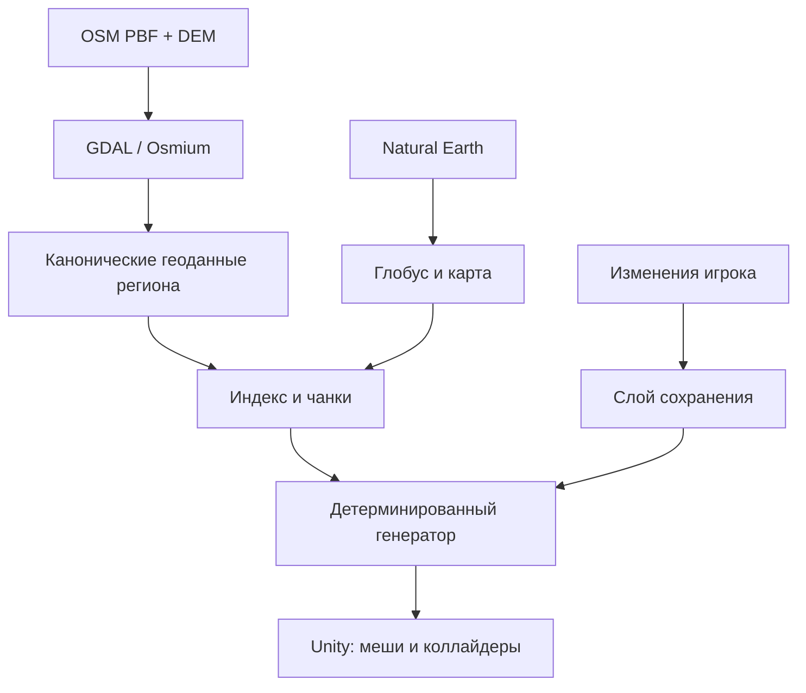
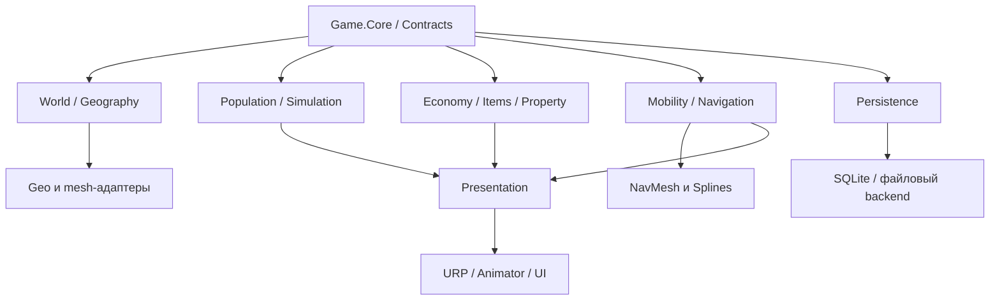

# 06 — Бесплатные ассеты, библиотеки, плагины и инструменты для симулятора жизни на Unity

**Дата исследования:** 25 ноября 2026 года  
**Назначение:** технический справочник и руководство по выбору зависимостей для разработки оригинального одиночного симулятора жизни на Unity/C#.  
**Целевая машина:** Intel Core i7-11850H, RTX A5000 Laptop GPU (16 ГБ VRAM), 128 ГБ RAM, Windows, SSD.  
**Условия:** автономный игровой процесс, процедурный открытый мир, самостоятельное население, сменяемые подсистемы, отсутствие обязательных платных плагинов и облачных API.

---

## 1. Резюме: что действительно брать

**Рекомендую не собирать игру из готовых «симуляторов жизни».** Готовые плагины хорошо решают локальные технические задачи — построение полигонов, рендеринг, навигацию, загрузку ресурсов, анимацию. Они почти никогда не умеют согласованно моделировать семью, недвижимость, расписание, деньги, профессии, общественный транспорт, сохранение состояния и переход между абстрактным NPC и видимым персонажем. Именно эти правила составляют собственное ядро игры.

Предлагаемый стек:

| Подсистема | Выбор |
|---|---|
| Движок | Unity 6.3 LTS, последний проверенный патч этой ветки; Windows x64; URP |
| География | Natural Earth для глобуса; OpenStreetMap/Geofabrik + Copernicus DEM для выбранных регионов; GDAL как внешняя обработка |
| Геометрия мира | Собственный детерминированный генератор; Clipper2 для операций над контурами; Blender для создания и нормализации моделей |
| Здания и интерьеры | Собственные семантические модули и планировки; бесплатные Kenney, Quaternius и CC0 PBR-материалы для наполнения |
| Дороги и транспорт | Свой граф дорог, полос и остановок; Unity Splines для геометрии; WheelCollider только для близких машин |
| Персонажи | MPFB/Blender, Humanoid Animator, Animation Rigging при необходимости; бесплатные анимации как исходная заготовка |
| NPC | Собственный Utility AI + расписания и планировщик событий; AI Navigation в локальной зоне; дальние NPC — записи данных, не GameObject |
| Интерфейсы | UI Toolkit + Input System; собственные модели представления, инвентарь и операции предметов |
| Атмосфера | URP + Shader Graph + штатные частицы; собственное игровое время и погода |
| Звук | Audio Mixer и AudioSource; Audacity, CC0-записи; Steam Audio только при реальной необходимости |
| Производительность | Addressables, Jobs/Burst/Collections, профилирование; ECS/Entities Graphics только адресно после измерений |
| Данные | Стабильные идентификаторы, собственные DTO и миграции; локальные файлы либо SQLite; MessagePack как опциональный кодек |

**Обязательная стоимость сторонних компонентов этого стека: 0 USD.** Это не означает нулевых затрат времени на создание контента, загрузку данных, собственное программирование или тестирование. Лицензия редактора Unity Personal бесплатна при соблюдении критерия допуска (см. ниже); это не бессрочная гарантия бесплатного использования Unity при любых будущих оборотах.

Не нужны: онлайн-сервер, подписка Cesium ion, платный GIS API, подписка на Unity Cloud, платный генератор городов, специализированные платные системы инвентаря, дорожного трафика, поведения NPC и сохранений.

### 1.1. Что исследовано и что НЕ подтверждено экспериментально

Проверены официальные списки пакетов Unity, документация, страницы лицензий, каталоги форматов, репозитории и опубликованные релизы. В документе ссылки ведут непосредственно к источникам или страницам скачивания; это не рекламная подборка по названиям.

Фактическое скачивание всех ресурсов, компиляция Unity-проекта, импорт ассетов, тесты Mono/IL2CPP и сравнение FPS на целевой машине в рамках исследования **не выполнялись**. Поэтому совместимость различается по доказательности.

- **LTS/6.6 — подтверждено:** пакет указан в официальном списке Released/Core соответствующего редактора либо это штатный компонент движка.
- **Заявлено:** автор поддерживает Unity 6 или соответствующий минимальный редактор. Это не обещание, что любая сборка работает с каждым патчем Unity.
- **API-совместимость:** библиотека поставляется с подходящим .NET Standard или доступным C#-кодом; необходим короткий автоматический импорт/сборка (особенно IL2CPP).
- **Формат:** независимые 3D-модели, текстуры, звуковые файлы, карты, шрифты. Импорт по стандартному формату, а не зависимость от версии Unity-плагина.
- **Внешний:** утилита сборочного конвейера, вообще не исполняемая внутри Unity. Совместимость с Unity определяется форматом результата, а не версией редактора.

Классификация решения: **О** — обязательное для предложенного стека (не обязательно устанавливать всё в первый день); **Д** — дополнительное, при наличии реальной задачи; **С** — собственная реализация предпочтительнее готовой зависимости. В реестр рекомендаций не включены заведомо несовместимые/архивированные пакеты и демо, для которых требуемая функциональность закрыта платной лицензией. Неясные варианты вынесены в раздел исключений, а не представлены как проверенные.

Для статического набора CC0-моделей давность выпуска не является признаком заброшенного программного обеспечения: FBX/OBJ и исходный Blender-файл не зависят от сервисов автора, движковых API и исправлений безопасности. В отличие от исполняемого плагина, такой набор может быть нормальным производственным сырьём много лет.

## 2. Версия Unity и лицензирование

### 2.1. Рекомендуемый редактор

На дату проверки Unity обозначает **Unity 6.6 (6000.6) как Current, Unity 6.3 (6000.3) как LTS**. Unity 6.7 LTS ещё находится на стадии Beta/ожидания выпуска; Unity 7 — Alpha. Не следует принимать рекламные обещания будущей версии за её стабильную доступность.

- [Политика релизов и поддержки Unity](https://unity.com/releases/unity-6/support) — 6.3 LTS поддерживается до декабря 2027 года.
- [Страница семейства Unity 6](https://unity.com/releases/unity-6) — статус будущей 6.7 LTS.
- [Архив редакторов](https://unity.com/releases/editor/archive).
- [Подтверждённый свежий патч 6000.3.29f1](https://unity.com/releases/editor/whats-new/6000.3.29f1).
- [Объявление стабильной Unity 6.6](https://discussions.unity.com/t/unity-6-6-is-now-available/1735357).
- [Пакеты Released 6.3](https://docs.unity.com/en-us/engine/6000.3/manual/packages-list/packages-all/pack-safe), [Core 6.3](https://docs.unity.com/en-us/engine/6000.3/manual/packages-list/packages-all/pack-core).
- [Пакеты Released 6.6](https://docs.unity.com/en-us/engine/6000.6/manual/packages-list/packages-all/pack-safe), [Core 6.6](https://docs.unity.com/en-us/engine/6000.6/manual/packages-list/packages-all/pack-core), [Built-in 6.6](https://docs.unity.com/en-us/engine/6000.6/manual/packages-list/packages-all/pack-build).

Выбор LTS — инженерное решение ради стабильной разработки; 6.6 является актуальной стабильной веткой для проверки переносимости. В таблицах ниже **LTS/6.6** указывает на обе ветки, а номер версии пакета относится к указанной рядом ветке редактора. Для ряда пакетов подтвердились разные версии в 6.3 и 6.6. Нельзя слепо переносить номера пакетов в 6.6: ряд пакетов переведён в Core или Built-in.

Особенно важно: [в Unity 6.6 Burst стал встроенным](https://discussions.unity.com/t/the-future-of-burst-in-unity-6-6/1712615), [официальная документация Burst 6.6](https://docs.unity.com/en-us/engine/6000.6/manual/programming-environment/script-compilation/burst/introduction-to-burst). Не добавлять старый Burst вручную к новой ветке.

**Не обновлять Unity автоматически посреди работы над отдельным игровым механизмом.** Зафиксировать ProjectVersion.txt, Packages/manifest.json и Packages/packages-lock.json. Переход на следующую LTS — отдельное техническое изменение после появления стабильного релиза.

### 2.2. Условия бесплатного использования и исходники

[Unity Personal](https://unity.com/products/unity-personal) — для соответствующих условиям физических лиц и небольших организаций, менее 200 000 USD за последние 12 месяцев по применимым правилам доходов/финансирования. [Отмена Runtime Fee](https://unity.com/blog/unity-is-canceling-the-runtime-fee). Проверять действующие условия тарифа перед коммерческим выпуском. Не требуется включать платные облачные услуги.

Обозначения в реестре официальных пакетов:

- **UCL:** [Unity Companion License](https://unity.com/legal/licenses/unity-companion-license) для компонентов, лицензируемых таким образом. Это не MIT и не право перенести код в независимый движок. Исходники C# пакетов зачастую доступны в самом UPM-пакете, даже если публичной разработки на GitHub нет. Для каждого закреплённого релиза проверять его LICENSE.md/Third Party Notices: могут быть дополнительные условия отдельных зависимостей.
- **Unity Terms:** условия закрытого редактора/рантайма и встроенного движка. Платные услуги не подразумеваются. [UnityCsReference](https://github.com/Unity-Technologies/UnityCsReference) — справочный исходник C# под Reference Only License, **не** исходный код всего движка и не свободная библиотека для копирования.
- Указание «UCL/условия пакета Unity» означает, что открытые управляемые части обычно лицензированы UCL, а нативные части и комплектные бинарники остаются движковыми. Если точная лицензия конкретного пакета не опубликована в исследованном первоисточнике, не считать её проверенной до чтения LICENSE установленной версии.
- **MIT, BSD-3-Clause, Apache-2.0, BSL-1.0:** разрешительные лицензии кода с условиями уведомлений; BSL здесь означает Boost Software License, не Business Source License.
- **CC0:** модели, материалы, звуки и изображения допускают свободное использование, включая коммерческую игру; источник всё равно сохраняем для происхождения. Проверяем сторонние торговые марки/логотипы и иные права, которые не передаёт CC0.
- **GPL/AGPL/EPL:** допустимы для самостоятельных редакторских программ, которые только производят данные, не встраиваются в закрытую игру. Лицензия программы не переносится автоматически на самостоятельно созданные изображения и меши, но копируемые библиотеки/шаблоны требуют отдельного внимания.
- **ODbL:** отдельная лицензия базы геоданных. Не путать с CC0 или лицензией кода. Учитывать атрибуцию и обязанности при распространении производной базы.
- **Специальная EULA:** бесплатное использование в конечной игре не всегда разрешает публикацию исходного ассета. [Условия Unity Asset Store](https://unity.com/legal/as-terms), включая правила доступа и распространения. Именно поэтому основной набор опирается на CC0 и открытые репозитории.

## 3. География и геоданные

Цель — бесшовный мир с вращаемым глобусом, картой, выбором района и переходом в интерактивные локальные чанки. Это три разных задачи: глобальное представление, обработка геоданных и игровая геометрия.

| Кандидат и прямая ссылка | Решение | Лицензия, исходники, состояние | Совместимость | Ограничения и реальная стоимость |
|---|---|---|---|---|
| **Natural Earth** — [скачать](https://www.naturalearthdata.com/downloads/), [лицензия](https://www.naturalearthdata.com/about/terms-of-use/), [репозиторий](https://github.com/nvkelso/natural-earth-vector) | О | Public Domain; исходные векторные/растровые данные, публичный репозиторий. Устоявшийся независимый картографический набор | Формат: экспорт GeoJSON/собственного формата через GIS | Масштаб 1:10 млн и грубее: границы, береговые линии, страны, реки и обзорная карта, но не улицы и здания. Плата не нужна |
| **OpenStreetMap / Geofabrik** — [лицензия OSM](https://www.openstreetmap.org/copyright), [экстракты](https://download.geofabrik.de/), [пример Молдовы](https://download.geofabrik.de/europe/moldova.html) | О | ODbL 1.0; данные открытые, регулярно публикуемые выгрузки PBF; Geofabrik — поставщик, не игровой плагин | Внешняя обработка PBF; Unity читает подготовленные чанки | Полнота тегов и этажности не гарантируется, возможны ошибки геометрии; крупные выгрузки занимают место и долго обрабатываются. Атрибуция и ODbL; нет тарифа за офлайн-чтение скачанного PBF |
| **Copernicus DEM GLO-30/GLO-90** — [данные и условия](https://dataspace.copernicus.eu/explore-data/data-collections/copernicus-contributing-missions/collections-description/COP-DEM), [текст лицензии](https://dataspace.copernicus.eu/sites/default/files/media/files/2025-06/copernicus_contributing_mission_data_access_v2_cop_dem_licenses.pdf) | О | Бесплатная специальная лицензия набора, открытые данные; действующий каталог ЕС. Исходник — растры высот, не код | Формат: GeoTIFF/DEM, преобразование GDAL в тайлы | GLO-30 порядка 30 м, GLO-90 порядка 90 м, это не сантиметровые карты; цифровая модель поверхности включает объекты, не исключительно голую землю. Регистрация/процедура доступа может потребоваться; уведомление об источнике по условиям лицензии. Кэш и предобработка свои |
| **GDAL/OGR** — [документация и загрузка](https://gdal.org/en/stable/), [код](https://github.com/OSGeo/gdal), [лицензия](https://gdal.org/en/stable/license.html) | О | MIT-style; C/C++ исходники; активно поддерживается OSGeo, зафиксирован релиз 3.13.3 в августе 2026 | Внешний CLI; никакого обязательного Unity-плагина | Перепроекция, растры, векторы, обрезка и пересэмплинг. Не тянуть GDAL с его нативными библиотеками в игрока без причины. Удобная сборка Windows требует зависимостей; место под временные файлы |
| **QGIS** — [загрузка](https://qgis.org/download/), [лицензия](https://qgis.org/license/), [код](https://github.com/qgis/QGIS) | Д | GPL v2 или новее (условия компонентов отдельно); открытый активно сопровождаемый настольный GIS; страница загрузки показывает 4.2.3 и будущую 4.4 | Внешнее приложение; редактирование и верификация GIS-данных | Хорош для проверки чанков, высот и геометрии. Для автоматизации использовать GDAL/командную строку; не встраивать QGIS в игру. Плата не нужна |
| **Osmium Tool** — [руководство](https://osmcode.org/osmium-tool/manual.html), [код и релизы](https://github.com/osmcode/osmium-tool/releases), [лицензия](https://github.com/osmcode/osmium-tool/blob/master/LICENSE.txt) | Д | GPL, исходники; опубликованные релизы, поддерживаемый специализированный CLI | Внешний; фильтрация и извлечение объектов OSM | PBF-фильтры, теги, региональные выборки. Поиск/сборка Windows или использование WSL; не требуется игроку. Не «восстанавливает» неизвестные OSM элементы |
| **NetTopologySuite 2.6.0** — [репозиторий](https://github.com/NetTopologySuite/NetTopologySuite), [пакет/лицензия](https://www.nuget.org/packages/NetTopologySuite/2.6.0) | Д | BSD-3-Clause; C#; стабильный опубликованный релиз от 12.03.2025, не обещает частые обновления | API: .NET Standard 2.0, совместим с .NET Standard 2.1 Unity; предпочтительно внешняя C#-утилита | Topology, пересечения, валидация и пространственные индексы. Не геодезический движок: метрические операции после правильной проекции. Не всегда Burst/AOT; выделения памяти, зависимые сборки |
| **Cesium for Unity** — [документация](https://cesium.com/learn/unity/), [код](https://github.com/CesiumGS/cesium-unity), [релизы](https://github.com/CesiumGS/cesium-unity/releases) | Д | Apache-2.0 для плагина, уведомления зависимостей отдельно; открытые C#/C++ исходники и активные релизы (в выдаче v1.25.0) | Заявлена Unity 2022.3 LTS и Unity 6+, Windows x86-64; конкретный 6.3/6.6 патч проверить | Геореференция, глобус и 3D Tiles, но не генерация квартир или игрового мира. Тяжёлая нативная зависимость. Cesium ion, глобальные terrain/OSM/фотореалистичные слои имеют отдельные тарифы и права; **не включать обязательный ion и платные наборы** |

### 3.1. Cesium: брать или нет?

Cesium — хороший кандидат на быстрое получение глобуса и проверки географической привязки. Сам плагин не требует покупки. Он умеет загружать свои наборы 3D Tiles по URL, в том числе локально или с собственного сервера без ion (см. [разъяснение разработчика об офлайн-наборах](https://community.cesium.com/t/can-you-cache-tiles/30847)). Но это не разрешение массово скачать предоставляемые облачные тайлы.

Предлагаю две архитектурно равноценные реализации интерфейса `IGlobeRenderer`:

1. **Собственный лёгкий глобус — по умолчанию:** сфера и глобальная CC0/Public Domain картография, выбор географической позиции, низкое разрешение.
2. **Cesium — опционально:** в отдельной сборке адаптера, если действительно необходимы 3D Tiles и высокодетализированный обзор. Для автономного режима готовить разрешённые собственные данные; исключить сетевые вызовы к ion из обязательного пути.

Проверить затраты на собственный локальный тайловый конвейер до решения о включении Cesium. Нет необходимости импортировать сразу весь глобус в виде Unity Terrain.

### 3.2. Лицензии данных и автономная схема

[Политика стандартных тайлов OSM](https://operations.osmfoundation.org/policies/tiles/) не разрешает offline-prefetch публичного tile.openstreetmap.org. Для полностью автономного мира скачивать **исходные выгрузки**, а не копировать карты с чужого тайлового сервера. OSM-атрибуция и условия производной базы разъясняются [OSMF Produced Work Guideline](https://osmfoundation.org/wiki/Licence/Community_Guidelines/Produced_Work_-_Guideline). Не считать визуальный результат и извлечённую базу одним и тем же объектом лицензии.

Пайплайн:



- Глобальная позиция — WGS84, double; локальные метры — система координат чанка/региона. Floating origin влияет на представление, а не на идентификаторы и глобальные данные.
- Для полигонов зданий и дорожной сети хранить оригинальные OSM ID, версию входных данных, правила преобразований, даты выгрузок и источники. Проекцию и datum высот выбирать явно.
- Чанк определяется стабильным идентификатором и версией генератора. Рисунок окон, пропущенная этажность и интерьер достраиваются воспроизводимо из seed и метаданных.
- Раздельно хранить исходную геобазу ODbL, производные геоартефакты, собственные сгенерированные правила, запись действий игрока и авторский контент. Само разделение не отменяет ODbL, но делает происхождение и обязанности управляемыми.
- Для первого района скачать не всю Землю, а локальную выгрузку. Отсутствие определённого тега трактовать как неизвестность, а не как факт реального мира. Игровые квартиры, жители и транспортные расписания синтетические.

## 4. Процедурная генерация

| Кандидат и прямая ссылка | Решение | Лицензия, исходники, поддержка | Совместимость | Ограничения и скрытая стоимость |
|---|---|---|---|---|
| **Unity Mesh / MeshData, Terrain API, Jobs** — [Mesh API](https://docs.unity3d.com/6000.0/Documentation/ScriptReference/Mesh.html), [документация Unity 6.3](https://docs.unity.com/en-us/engine/6000.3/manual/) | О | Unity Terms, управляемый справочный C# доступен отдельно; движковые нативные части закрыты, официальная поддержка | Штатный API LTS/6.6 | Не генерирует содержание мира сам. Собственный алгоритм и буферы, генерация вне главного потока там, где безопасно; создание/обновление Unity-объектов по правилам API |
| **Unity Mathematics** — [6.3, пакет 1.3.3](https://docs.unity.com/en-us/engine/6000.3/manual/packages-list/packages-all/pack-safe/com-unity-mathematics), [исходник и UCL](https://github.com/Unity-Technologies/Unity.Mathematics) | О | UCL, C# исходники; официальный пакет поддерживается в 6.3 | Подтверждено LTS; для 6.6 установить соответствующий вариант из зависимостей редактора/Collections, не переносить манифест 6.3 вслепую; отдельная фиксация в списке Released 6.6 не подтверждена | Структуры float/double, math, шумы, генератор случайных чисел. Для планетарных координат double; собственно процедурная логика остаётся своя |
| **Clipper2** — [код и релизы](https://github.com/AngusJohnson/Clipper2/releases), [лицензия](https://github.com/AngusJohnson/Clipper2/blob/main/CSharp/NuGet/License.txt), [NuGet 2.0.0](https://www.nuget.org/packages/Clipper2/2.0.0) | О | Boost Software License 1.0; есть C#/C++ исходники, стабильные версии 2.0.x | API: .NET Standard 2.0 подтверждён для 2.0.0, подходит обоим редакторам по профилю API; проверить IL2CPP | Объединение, разность, смещение контуров, триангуляция (в 2.x). Нужно правильно выбрать масштаб целочисленных координат и обработать отверстия; это не автоматическая строительная система |
| **Blender LTS** — [загрузка LTS](https://www.blender.org/download/lts/), [код](https://projects.blender.org/blender/blender), [лицензия](https://www.blender.org/about/license/) | О | GPL; исходники доступны, Blender 4.5 LTS обновлён до 4.5.17 24.11.2026. Собственные созданные меши не становятся автоматически GPL | Внешний генератор; FBX, glTF, OBJ, PNG и другие форматы | Geometry Nodes, Python, bake текстур, LOD, атласы. Требуется разработать воспроизводимый headless-пайплайн. .blend не использовать как обязательный формат Unity runtime |
| **Unity Terrain Tools** — [пакет LTS](https://docs.unity.com/en-us/engine/6000.3/manual/packages-list/packages-all/pack-safe/com-unity-terrain-tools), [пакеты 6.6](https://docs.unity.com/en-us/engine/6000.6/manual/packages-list/packages-all/pack-safe) | Д | Условия пакета Unity/UCL для управляемого кода согласно лицензии поставки; официальный UPM Released, редакторский код доступен в пакете | LTS/6.6 | Инструменты ручного terraforming и обработки высот, не универсальный планетарный генератор. Использовать для прототипов и авторской коррекции, не делать Terrain Tools зависимостью сохранений |
| **ProBuilder** — [официальная документация пакета](https://docs.unity3d.com/Packages/com.unity.probuilder@6.0/manual/index.html), [6.6 Released](https://docs.unity.com/en-us/engine/6000.6/manual/packages-list/packages-all/pack-safe) | Д | Условия пакета Unity/UCL согласно LICENSE; управляемые исходники в UPM, официальный сопровождаемый инструмент | Официальный пакет Unity 6; выбирать Released соответствующего редактора | Быстрые блок-ауты комнат и прототипы, не алгоритм автоматической генерации города. Конечную геометрию экспортировать/создавать независимо |
| **Unity glTFast** — [официальный код и установка](https://github.com/Unity-Technologies/com.unity.cloud.gltfast), [лицензия](https://github.com/Unity-Technologies/com.unity.cloud.gltfast/blob/main/LICENSE.md), [документация 6.x](https://docs.unity3d.com/Packages/com.unity.cloud.gltfast@6.0/manual/index.html) | Д | Apache-2.0; исходники открыты; официальный сопровождаемый проект Unity | Заявленный пакет Unity, UPM ID com.unity.cloud.gltfast; проверка выбранной 6.x версии в LTS/6.6 при импорте | Быстрый импорт/экспорт glTF, полезен для внешних mesh-пайплайнов и собственных модификаций. Не все расширения glTF равнозначно поддержаны; сжатие Draco/KTX требует дополнительных компонентов. Обычный FBX импорт в редакторе обходится без этого пакета |

**Решение для города:** процедурно генерировать меши из семантических данных, используя Clipper2 для операций 2D. Шум, рецепты фасадов, разбивка помещений и размещение предметов реализуются самостоятельно. Blender нужен как производственная фабрика ассетов, а не как внешний процесс для каждой комнаты во время игры.

Рекомендуемые независимые модули:

- `TerrainGenerator`: высоты, вода, растительность и поверхности; принимает геоданные и seed.
- `RoadGeometryGenerator`: строит меши дороги/тротуара по графу, не владеет транспортом.
- `BuildingLayoutGenerator`: из контура, типа здания и этажности создаёт топологический план.
- `InteriorLayoutGenerator`: помещения, двери, проходы, функциональные зоны, мебельные сокеты.
- `MeshFactory`: создаёт и объединяет геометрию по планам; не редактирует игровое состояние.
- `AssetCatalog`: описывает варианты мешей/материалов; не является владельцем NPC, предметов и недвижимости.

Внешний генератор должен выдавать промежуточную модель здания с комнатами и проёмами. Не передавать в экономику размеры Unity Mesh или индекс prefab как идентичность квартиры.

## 5. Здания, интерьеры и визуальные ресурсы

Главное различие: бесплатная модель дома — декор; функциональное здание симулятора — данные о секциях, этажах, квартирах, дверях, лестницах, помещениях, владельцах и доступе. Не пытаться извлекать логику квартиры из случайной сетки скачанного дома.

| Ресурс и прямые ссылки | Решение | Лицензия и исходники | Совместимость, состояние | Ограничения/скрытая стоимость |
|---|---|---|---|---|
| **Kenney City Kit (Suburban)** — [скачать](https://kenney.nl/assets/city-kit-suburban) | Д | CC0; полноценные модели в архиве, стандартные редактируемые форматы, программного кода нет | Формат 3D, независим от LTS/6.6; завершённый бесплатный набор, каталог поддерживается | Low-poly, внешний вид домов, не реалистичные проходимые квартиры; нужна унификация размеров, материалов и коллайдеров |
| **Kenney Furniture Kit** — [скачать](https://kenney.nl/assets/furniture-kit) | Д | CC0; 140 файлов по каталогу; исходные 3D-ресурсы | Формат: независимый от версии Unity; завершённый набор 2018 | Мебель для прототипов и стилизованного слоя. Требуются правила размещения, pivots, interaction sockets; бесплатно без покупки All-in-1 |
| **Quaternius Ultimate House Interior** — [скачать](https://quaternius.com/packs/ultimatehomeinterior.html) | Д | CC0; 123 модели, FBX/OBJ/Blend; исходные меши и .blend | Формат; законченный 2020 набор, действующая страница автора; импорт Unity 6 по FBX | Мебель, двери, окна, кухня, ванная. Умеренная детализация, нет семантики, функциональных компонентов или полноценных схем квартир |
| **Quaternius Ultimate Buildings** — [скачать](https://quaternius.com/packs/ultimatetexturedbuildings.html) | Д | CC0; 76 моделей, FBX/OBJ/Blend согласно странице | Формат; завершённый набор из действующего каталога | Модульные текстурированные постройки, палитры. Нужна собственная стыковка, масштаб, фасады, архитектурные зоны и проходимость |
| **Poly Haven** — [бесплатные модели](https://polyhaven.com/models), [текстуры](https://polyhaven.com/textures), [HDRI](https://polyhaven.com/hdris), [лицензия](https://polyhaven.com/license) | О | CC0 на ассеты; исходные модели/текстуры, часть моделей содержит Blender-источник; код сайта не нужен. Активный каталог | Формат; Blender/FBX/glTF, изображения PBR/HDRI. Не зависит от версии Unity | Качественные реалистичные материалы и реквизит. Высокополигональные модели и 4K–16K текстуры способны исчерпать VRAM. Готовить 1K/2K и LOD. Условия сайта отдельно ограничивают злоупотребление сервисом; не делать массовый downloader обязательным |
| **ambientCG** — [каталог](https://ambientcg.com/), [лицензия](https://docs.ambientcg.com/license/) | О | CC0 на скачиваемые материалы, модели и иные ресурсы; файлы доступны без обязательной подписки; поддерживаемый каталог | Формат: PBR-карты и 3D-ресурсы, URP Lit/Shader Graph | Нужна конвертация packing каналов под Unity: нормали, roughness/smoothness, AO, metallic. Много текстур требуют диска; выборочные скачивания по материалам, не скачивать весь каталог |
| **Blender Geometry Nodes / Python** — [документация](https://docs.blender.org/manual/en/latest/), [лицензия Blender](https://www.blender.org/about/license/) | О | GPL редактора, собственный созданный контент под выбранной лицензией; скрипты проекта — наши | Внешний конвейер Blender LTS | Не отдельный платный генератор; создать небольшую фабрику стен, фасадов, окон, дверей, крыши, LOD и вариантов окраски. Первоначальная работа окупается масштабом |

У Quaternius разные наборы могут иметь разные лицензии и уровни доступа ([FAQ автора](https://quaternius.com/faq.html)). Не считать весь каталог автоматически CC0 и не использовать в базовом контенте наборы, где необходимая часть или исходники доступны только подписчикам. Выше названы самостоятельные бесплатные архивы; перед импортом сохранить лицензию именно скачанного архива. Благодарность и добровольные пожертвования не являются обязательной покупкой.

### 5.1. Целостный графический стиль без платных ассетов

Kenney и Quaternius быстрее всего дадут играбельный прототип, но они не создают эффект фотореалистичной архитектурной визуализации. Смешивать их с детализированными фотограмметрическими объектами в исходном виде не следует.

Для стилизованного реализма:

1. Выработать одно правило масштаба: метр — одна локальная единица. Общая сетка модулей стен, допустимая высота этажа, pivot по полу или точке подключения.
2. В Blender подготовить несколько типовых фасадов, дверей, окон, лестниц, крыши; использовать повторно под разные формы.
3. Poly Haven / ambientCG применять преимущественно как источники PBR-поверхностей: бетон, кирпич, дерево, стекло, асфальт, плитка.
4. Объединять материал по семействам; использовать trim sheets, атласы и вариации цвета. Не покупать сотни разрозненных моделей.
5. У каждой модели хранить `AssetId`, габариты, точки подключения, поверхность крепления, доступные действия, приблизительную стоимость, LOD и лицензию.
6. Семантика дома, квартиры и мебели существует даже когда 3D-объект выгружен. Невидимый этаж не должен быть активной сценой.

Не имитировать конкретную существующую игру: собственные оригинальные архитектура, дизайн персонажей, интерфейс и игровые объекты.

## 6. Дороги, автомобильный и общественный транспорт

| Кандидат и прямая ссылка | Решение | Лицензия, исходники, поддержка | Совместимость | Ограничения и скрытая стоимость |
|---|---|---|---|---|
| **Unity Splines** — [2.9.2 в 6.3](https://docs.unity.com/en-us/engine/6000.3/manual/packages-list/packages-all/pack-safe/com-unity-splines), [2.9.2 в 6.6](https://docs.unity.com/en-us/engine/6000.6/manual/packages-list/packages-all/pack-safe/com-unity-splines) | О | Unity/UCL согласно LICENSE; управляемые исходники UPM, официальный сопровождаемый пакет | LTS/6.6 | Геометрия кривых и траекторий, не граф маршрутов, правила перекрёстков или трафика. Меши полос/тротуаров и пакетную работу реализуем сами |
| **Unity WheelCollider, Rigidbody** — [WheelCollider](https://docs.unity3d.com/6000.0/Documentation/ScriptReference/WheelCollider.html), [документация 6.6](https://docs.unity.com/en-us/engine/6000.6/manual/physics-section/physics-overview/collision-section/collider-shapes/wheel-colliders) | О | Unity Terms, встроенный физический движок, нативные реализации закрыты; поддерживается Unity | LTS/6.6 | Динамика колёс, подвеска, сцепление. Требуется настройка физики и управление; не применять 4 WheelCollider на каждую из тысяч фоновых машин. Локальная визуальная машина отделена от записи транспорта |
| **Kenney City Kit (Roads)** — [скачать](https://kenney-assets.itch.io/city-kit-roads) | Д | CC0 1.0; 65+ моделей, OBJ/FBX/DAE/STL/glTF; завершённый набор | Формат; автор указывает Unity, исходные меши, независим от патчей | Модульные детали, ограждения и фонари. Использовать для семантических декораций, а не как единственный способ строить произвольную OSM-дорогу. Донат опционален |
| **Quaternius Cars Pack** — [скачать](https://quaternius.com/packs/cars.html) | Д | CC0; 8 моделей, FBX/OBJ/Blend; завершённый набор | Формат, конвертируемые редактируемые меши | Не полноценные игровые автомобили. Выделить кузов/колёса, настроить pivot, коллайдеры и LOD, сделать собственные варианты грузовиков и автобусов |
| **Eclipse SUMO** — [скачать](https://eclipse.dev/sumo/docs/Downloads.html), [исходники](https://github.com/eclipse-sumo/sumo) | Д | EPL-2.0 с GPL v2+ вторичной опцией согласно документации; C++/Python, активно выпускается | Внешний симулятор; сеть/маршруты/статистика через файлы, при необходимости отдельный процесс | Полезен для офлайн-валидации алгоритмов трафика. Интеграция с TraCI усложняет время, синхронизацию и поддержку; не делать его обязательным рантаймом игры. Модель трафика не моделирует семейную жизнь NPC |
| **GTFS Schedule** — [стандарт](https://gtfs.org/documentation/schedule/reference/), [каталог Mobility Database](https://mobilitydatabase.org/faq) | Д | Открытый стандарт структуры; **лицензия конкретного расписания перевозчика индивидуальна**, нет единой лицензии всех фидов. Исходник — текстовые таблицы данных | Формат CSV/ZIP, независим от Unity | Использовать только полученные с явно разрешающей лицензией наборы. Нет GTFS для всех территорий; не гарантирует полноту/актуальность. Для автономной игры синтезировать расписание при отсутствии легальных данных. Сторонний API не обязателен |

### 6.1. Что реализовать самим

Не брать готовую торговую площадку «Traffic System Free» как владельца всех машин. Графическое движение и логистическое перемещение должны быть разделены.

- `RoadGraph`: узлы перекрёстков, рёбра направлений, полосы, ограничения скорости, топология. Идентичность ребра стабилизируется между сессиями.
- `RoutePlanner`: A*/Dijkstra поверх дорожного графа, интермодальное планирование поездки. Маршруты кешируются с версией графа.
- `TrafficSimulation`: фоновые машины двигаются по времени прохождения сегментов; очереди/пропускная способность моделируются агрегированно далеко от игрока.
- `LocalVehicleController`: физические машины в активных чанках, парковка, визуальное движение по полосам, доступ игрока к управлению.
- `TransitSimulation`: маршруты, остановки, расписания, вместимость транспорта, посадка/высадка/пересадка; дальние пассажиры остаются в модели.
- `MobilityPresentation`: создание и переработка 3D-представлений по стабильному VehicleId. Переход между уровнями детализации сохраняет пассажиров, груз, топливо и назначение.

SUMO уместен как эталон для сравнения на небольшой сети. Реальную необходимость платных дорожных систем после такой декомпозиции не вижу.

## 7. Персонажи и анимации

| Кандидат и прямые ссылки | Решение | Лицензия, исходники, состояние | Совместимость | Ограничения/скрытые расходы |
|---|---|---|---|---|
| **MPFB2 (MakeHuman Plugin for Blender)** — [Blender Extensions](https://extensions.blender.org/add-ons/mpfb/), [код и релизы](https://github.com/makehumancommunity/mpfb2/releases), [лицензии](https://www.makehumancommunity.org/about/license.html) | О | GPL для кода MPFB, CC0 для основных графических ресурсов; есть Python-исходники, обновляется в 2026 | Внешний Blender 4.2 LTS и новее согласно странице версий; экспорт FBX в Unity 6 | Вариации тел и лиц, риг и одежда — хороший базис стилизованного реализма. Сторонние community-ассеты могут иметь иную лицензию. Нужны уникальный набор одежды, прически, материалы, нормализация скелета и LOD |
| **Unity Animator / Humanoid / Avatar** — [анимация Unity](https://docs.unity3d.com/6000.0/Documentation/Manual/AnimationOverview.html) | О | Unity Terms, официальный штатный анимационный рантайм; полная нативная реализация закрыта | LTS/6.6 | Retargeting, параметры, blend trees, IK; не создаёт клипы автоматически, не умеет планировать поведение. Сотни Animator без LOD дороги |
| **Unity Animation Rigging** — [1.4.1 LTS](https://docs.unity.com/en-us/engine/6000.3/manual/packages-list/packages-all/pack-safe/com-unity-animation-rigging), [6.6 Core](https://docs.unity.com/en-us/engine/6000.6/manual/packages-list/packages-all/pack-core) | Д | UCL по управляемому пакету; C# исходники UPM; официальная поддержка. В 6.6 Core | LTS/6.6 | IK рук/ног, взгляд, цели взаимодействия, работа с предметами. Не применять полный риг без необходимости дальним NPC; взаимодействия задаются своей системой |
| **Adobe Mixamo** — [сервис](https://www.mixamo.com/), [официальный FAQ](https://helpx.adobe.com/creative-cloud/faq/mixamo-faq.html) | Д | Специальное разрешение Adobe на бесплатное royalty-free использование персонажей/анимаций в личных и коммерческих проектах; исходный код сервиса закрыт; действующий сервис, публичного релизного расписания нет | Внешний сервис экспорта FBX; затем Unity Humanoid, независим от версии редактора | Бесплатный Adobe ID, интернет, только подготовка в редакторском производстве. Бипедальные скелеты; нет гарантии работы услуги в будущем. Не распространять сырые ассеты как стороннюю библиотеку, соблюдать действующие условия Adobe. Игра работает без Adobe |
| **Quaternius Ultimate Animated Character Pack** — [скачать](https://quaternius.com/packs/ultimatedanimatedcharacter) | Д | CC0; FBX/OBJ/Blend, завершённые редактируемые модели и анимации | Формат; стандартные меши, проверка Avatar/клипов при импорте | Быстрая заготовка для первого играбельного населённого пункта, стиль заметно low-poly. Не подменяет фотореалистичный персонаж; нужен единый скелет и собственная модель внешности |

MPFB не нужно исполнять в игровом процессе: сгенерировать ограниченный атлас базовых тел, лицо, возрастные варианты, скелеты и наборы одежды в Blender. Функции создания произвольных жителей можно обеспечить сочетанием параметров и модульных частей.

**Важная архитектура персонажа:** `PersonId` → описание внешности → выбранные ресурсы → временный pooled Actor. Анимация получает состояние (идёт, сидит, работает, разговаривает), а не принимает решение о потребности или кошельке человека.

Библиотека клипов обеспечивает видимые движения при действиях; для каждого ActionDefinition определить длительность, режим прерывания, точку взаимодействия, стоимость времени/ресурсов и лишь затем назначить клип. Вне активной области действие завершается моделью, не ожиданием окончания Animator.

Первые заготовки: ходьба, бег, поворот, сидение, подъём, сон, работа за столом, открывание двери, перенос бытовых вещей, посадка в автомобиль. Специализированные сложные клипы создавать только при добавлении соответствующей игровой функции.

## 8. Навигация и искусственный интеллект

| Кандидат и прямая ссылка | Решение | Лицензия, исходники, поддержка | Совместимость | Ограничения/скрытые расходы |
|---|---|---|---|---|
| **Unity AI Navigation** — [6.3, версия 2.0.16](https://docs.unity.com/en-us/engine/6000.3/manual/packages-list/packages-all/pack-safe/com-unity-ai-navigation), [2.0.17 в 6.6](https://docs.unity.com/en-us/engine/6000.6/manual/packages-list/packages-all/pack-safe/com-unity-ai-navigation), [лицензия управляемых компонентов](https://docs.unity.cn/Packages/com.unity.ai.navigation@1.1/license/LICENSE.html) | О | UCL для управляемого кода; исходники компонентов пакета доступны, нативное NavMesh ядро Unity закрыто; официальный сопровождаемый пакет | LTS/6.6 | NavMeshSurface, NavMeshLink, obstacles, построение в редакторе/рантайме. Большой непрерывный navmesh всей планеты непрактичен. Нужны секторизация, бюджеты перестроений, переходы на граф помещений/улиц; не держать NavMeshAgent на каждом жителе |
| **DotRecast** — [код](https://github.com/ikpil/DotRecast), [релизы](https://github.com/ikpil/DotRecast/releases), [лицензия](https://github.com/ikpil/DotRecast/blob/main/LICENSE.txt), [DotRecast.Detour 2026.3.1](https://www.nuget.org/packages/DotRecast.Detour) | Д | zlib-стиля (см. файл лицензий проекта и отдельных компонентов); C# порт Recast/Detour, актуальные выпуски 2026 | API: Detour 2026.3.1 содержит .NET Standard 2.1, автор позиционирует проект для Unity; проверить сборку всех выбранных компонентов в LTS/6.6 | Хорош для прямого контроля над хранением навигации, офлайн-генерации, tiled navmesh. Сложнее AI Navigation; проектные адаптеры, бинарные тайлы, обновления препятствий и avoidance придётся интегрировать. Не устанавливать одновременно два движка навигации без доказанной причины |
| **CrashKonijn GOAP** — [код](https://github.com/crashkonijn/GOAP), [релизы](https://github.com/crashkonijn/GOAP/releases), [лицензия](https://github.com/crashkonijn/GOAP/blob/master/LICENSE), [метаданные пакета](https://github.com/crashkonijn/GOAP/blob/master/Package/package.json) | Д | Apache-2.0 (не MIT); C# открытый код, публичное развитие и релизы 3.1.x; UPM metadata указывает Unity 2022.3 | Заявлена поддержка Unity от 2022.3; проверка LTS/6.6, особенно Jobs/dependencies | Многопоточная реализация Goal-Oriented Action Planning для Unity. Полезна локальным сложным агентам. Не обеспечивает экономику, время, статистическую симуляцию, семейные связи, постоянство идентичности; цена — моделирование предусловий/эффектов, батчинг и отладка |
| **Unity Behavior** — [официальная документация](https://docs.unity3d.com/Packages/com.unity.behavior@1.0/manual/index.html), [списки Released Unity 6.3/6.6](https://docs.unity.com/en-us/engine/6000.6/manual/packages-list/packages-all/pack-safe) | Д | Условия пакета Unity/UCL для исходников согласно поставке, C# компоненты/графовый редактор доступны; официальный Released | Unity 6; выбирать Released соответствующей ветки | Графы поведения для отдельных сценариев, локального взаимодействия или небольшой группы видимых акторов. Не использовать предлагаемые облачные AI-инструменты как требование; не превращать весь симулятор в тысячи вручную нарисованных графов |

### 8.1. Что не покупать и что написать самим

Для игры с большим населением **собственный планировщик является обязательной частью продукта**, а не вспомогательной библиотекой.

| Уровень | Представление | Решение |
|---|---|---|
| 0 — видимый | 3D Actor, Animator, локальная навигация, реакции | AI Navigation и собственный исполнитель действия; GOAP, только если доказано нужен |
| 1 — рядом, не обязательно на экране | Записи маршрута и ограниченное движение, выборочная материализация | Собственный тайловый/иерархический граф и бюджет локальных запросов |
| 2 — внутри того же города | Местоположение как BuildingId/RoomId/GraphNodeId, активное расписание и потребности | Собственный Utility AI, события прибытия и окончания действий |
| 3 — далеко | Социальные и экономические события, периодические пересчёты, статистика | Собственная календарная симуляция, без NavMeshAgent, Animator, Rigidbody |

GOAP имеет смысл использовать для многошаговых локальных задач, например подготовиться к работе: найти нужные предметы, получить доступ в помещение, добраться до места. Но ежедневная рутина тысяч NPC эффективнее выражается как очереди событий с последовательностью запланированных активностей.

Выбор действия и выполнение действия разделить:

- `NeedsSystem` и `ScheduleSystem` определяют, чего хочет житель.
- `UtilityScorer` выбирает цель по потребностям, обязанностям, характеру и контексту.
- `IActivityPlanner` строит план; начальная реализация простой процедурой, адаптер GOAP можно заменить без изменения PersonState.
- `ITravelPlanner` занимается переходом между местами, не знает о голоде и семейных отношениях.
- `ActivityExecutor` фиксирует игровые эффекты единственным авторитетным путём.
- `Presentation` выполняет 3D-представление события. В отсутствие визуального персонажа результат действия рассчитывается календарной моделью.

Не нужен LLM для каждого NPC и не нужно обучать нейронную сеть для бытового распорядка. Без платных API и непредсказуемых ответов можно добиться различающегося поведения через параметры характера, память, изменяемые связи, цели и реакцию на события. Будущие диалоги можно интегрировать независимо.

## 9. Инвентарь, интерфейсы и ввод

| Кандидат и прямая ссылка | Решение | Лицензия, исходники, поддержка | Совместимость | Ограничения/скрытые расходы |
|---|---|---|---|---|
| **UI Toolkit** — [поддержка runtime UI в 6.3](https://docs.unity.com/en-us/engine/6000.3/manual/uitoolkits/uielements/uie-support-for-runtime-ui), [data binding](https://docs.unity.com/en-us/engine/6000.3/manual/best-practice-guides/bpg-uiad-index/data-binding) | О | Unity Terms, штатная UI-подсистема, часть справочного C# в UnityCsReference; официальная поддержка, полные исходники движка закрыты | LTS/6.6 | UXML/USS, списки, привязки и виртуализация. Отлично для табличных интерфейсов: инвентарь, имущество, семья, финансовые операции, профессии и журнал. Не городить сотни обновлений UI каждый кадр; 3D world-space панели оценивать отдельно |
| **Input System** — [6.3, версия 1.20.1](https://docs.unity.com/en-us/engine/6000.3/manual/packages-list/packages-all/pack-safe/com-unity-inputsystem), [исходники](https://github.com/Unity-Technologies/InputSystem), [1.20.1 в 6.6](https://docs.unity.com/en-us/engine/6000.6/manual/packages-list/packages-all/pack-safe/com-unity-inputsystem), [лицензия](https://github.com/Unity-Technologies/InputSystem/blob/develop/LICENSE.md) | О | UCL/условия пакета; C# исходники, официальный сопровождаемый пакет. Репозиторий сообщает о переходе разработки в внутренний репозиторий начиная с 6.7, это не прекращение поддержки | LTS/6.6 | Контексты Walk, Drive, UI, карта, переназначение управления. Это входные команды, а не игровой action executor; важен явный приоритет режимов ввода |
| **Unity uGUI** — [Core 6.3](https://docs.unity.com/en-us/engine/6000.3/manual/packages-list/packages-all/pack-core/com-unity-ugui), [Core 6.6](https://docs.unity.com/en-us/engine/6000.6/manual/packages-list/packages-all/pack-core), [репозиторий исходников](https://github.com/Unity-Technologies/uGUI) | Д | Unity/UCL согласно LICENSE поставки, C#-часть доступна; Core поддерживается Unity | LTS/6.6 | Canvas для HUD, world-space, отдельных мини-игр при необходимости. Не дублировать без причины весь UI Toolkit; Canvas rebuilds, текст и layout могут стать затратными |
| **Unity Localization** — [официальный пакет](https://docs.unity3d.com/Packages/com.unity.localization@1.5/manual/index.html), [список 6.6](https://docs.unity.com/en-us/engine/6000.6/manual/packages-list/packages-all/pack-safe) | Д | Условия пакета Unity/UCL согласно LICENSE; C# исходники, официальный Released | Unity 6, соответствующий стабильный UPM-релиз | Таблицы строк, plurals, локали и локализованные ассеты. Для одноязычного прототипа достаточно ключей строк с русским каталогом, но не жёстко зашивать текст в доменные классы |
| **Kenney UI Pack** — [скачать](https://kenney-assets.itch.io/ui-pack) | Д | CC0, готовые редактируемые 2D-графические файлы, законченный набор автора | Формат, независимый от редактора | Быстро сделать читаемые пиктограммы и прототип окон. Стиль упрощённый; нужен собственный дизайн, масштабирование и состояния фокуса/наведения |
| **Noto Sans** — [официальный репозиторий латиницы/греческого/кириллицы](https://github.com/notofonts/latin-greek-cyrillic), [набор Google Fonts](https://github.com/google/fonts/tree/main/ofl/notosans), [OFL](https://github.com/google/fonts/blob/main/ofl/notosans/OFL.txt) | О | SIL Open Font License 1.1; исходники шрифтов и готовые файлы; сопровождаемое семейство | Формат TTF/OTF в Unity, кириллица | Сохранить OFL notice, при изменении соблюдать Reserved Font Name. Настроить атлас, символы валют, цифры, разные веса; динамический атлас занимает память |

### 9.1. Инвентарь — только собственный

Не рекомендую готовые Inventory Pro/Free решения как основу. В нашем проекте один и тот же предмет существует в личных вещах, машине, квартире, магазине, складе и составе производственного процесса. Нужны стабильная идентичность, сохранение, экономика, имущество, резерв и транзакции перемещения.

- `ItemDefinition`: тип, масса, объём, базовая стоимость, теги, требования, визуальный ресурс.
- `ItemInstance`: уникальный ID, качество, состояние, количество или ссылка на партию.
- `ContainerId`: человек, комната, шкаф, магазин, автомобиль, склад.
- `InventoryService`: перемещение, разделение стека, объединение, проверки вместимости и прав, резервирование; единый авторитетный владелец.
- `EconomyService`: покупка, продажа, трансферы денег; согласованная транзакция с InventoryService.
- `InteractionDefinition`: возможные действия предмета, требования навыка, длительность, последствия, ссылки на презентацию.

UI Toolkit должен подписываться на сведения из read model и отправлять команды. Перетаскивание предмета — не прямое изменение списка GameObject. Такой подход позволит добавить произвольные профессии, рецепты, магические предметы, способности, долговечность и магазины без смены UI-плагина.

## 10. Погода, освещение, растительность и частицы

| Кандидат и прямая ссылка | Решение | Лицензия, исходники, состояние | Совместимость | Ограничения/скрытые расходы |
|---|---|---|---|---|
| **Universal Render Pipeline (URP)** — [Core-пакеты 6.3](https://docs.unity.com/en-us/engine/6000.3/manual/packages-list/packages-all/pack-core), [Core 6.6](https://docs.unity.com/en-us/engine/6000.6/manual/packages-list/packages-all/pack-core), [Unity Graphics](https://github.com/Unity-Technologies/Graphics) | О | UCL для доступных исходников SRP, движковые бинарники Unity Terms; официальный Core | LTS/6.6, версия связана с редактором | Подходящий баланс графики и масштабируемости мобильной RTX A5000. Рендеринг всё равно требует работы над материалами, тенью, светом, LOD, батчингом; нет готовой системы погоды |
| **Shader Graph** — [Core 6.3](https://docs.unity.com/en-us/engine/6000.3/manual/packages-list/packages-all/pack-core/com-unity-shadergraph), [Graphics source](https://github.com/Unity-Technologies/Graphics) | О | Unity/UCL для исходников, C#/шейдерные исходники UPM; Core | LTS/6.6 | Параметрические материалы, влажность, снег, эмиссия, цвет листвы. Контролировать варианты шейдера, не создавать уникальные материалы для каждого дома |
| **Unity Particle System (Shuriken)** — [документация](https://docs.unity3d.com/6000.0/Documentation/Manual/ParticleSystems.html) | О | Unity Terms; движковое встроенное решение, нативная часть закрытая; поддерживается Unity | LTS/6.6 | Дождь, снег, пыль, дым, туманная взвесь, эффекты игровых действий. Использовать объекты эффектов около камеры, pooling и ограничение количества частиц, а не частицы осадков на всей географической карте |
| **Visual Effect Graph** — [6.3 Core](https://docs.unity.com/en-us/engine/6000.3/manual/packages-list/packages-all/pack-core/com-unity-visualeffectgraph), [6.6 Core](https://docs.unity.com/en-us/engine/6000.6/manual/packages-list/packages-all/pack-core), [Graphics](https://github.com/Unity-Technologies/Graphics) | Д | UCL/условия пакета Unity; исходники C#/shader graph и графовые данные, официальный Core | LTS/6.6; проверять поддержку выбранных возможностей VFX в URP | GPU-эффекты больших частиц, эффектный дождь/магия. Зависимость от графических API и GPU, overdraw; не нужен для простого дождя. Не обещает полный набор HDRP-функций в URP |
| **Poly Haven HDRI / ambientCG** — [HDRI](https://polyhaven.com/hdris), [материалы](https://ambientcg.com/) | О | CC0, открытые исходные карты/изображения, актуальные каталоги (лицензии в разделе 5) | Формат, импорт в URP/HDRP | Пригодны для отражений, палитры неба и мокрых поверхностей. Одна фотография HDRI не даёт автоматически смену времени, облака и физическую погоду |
| **HDRP** — [Core Unity 6.3](https://docs.unity.com/en-us/engine/6000.3/manual/packages-list/packages-all/pack-core), [Core 6.6](https://docs.unity.com/en-us/engine/6000.6/manual/packages-list/packages-all/pack-core), [исходники](https://github.com/Unity-Technologies/Graphics) | Д — альтернатива, не устанавливать вместе с основным путём | Unity/UCL для SRP-кода, штатная нативная часть закрыта; официальный Core | LTS/6.6; другой render pipeline | Развитые эффекты света/атмосферы, но выше стоимость графики и миграции материалов/шейдеров; потенциально неоправданно на большом мире. Не переходить ради одной красивой облачной сцены |

Развивать собственные:

1. `WorldClock`: абсолютное игровое время, часовой пояс региона, календарь, масштаб времени.
2. `WeatherSimulation`: детерминированная последовательность состояний и переходов (сезон, температура, дождь, ветер, облачность). Состояние существует независимо от камеры.
3. `LightingPresentation`: солнце/луна, окружающий свет, отражения, Volume-профили. Запечённое освещение использовать только там, где оправдано заранее известной геометрией; процедурный мир нуждается в динамическом свете и тщательно настроенных тенях.
4. `WeatherPresentation`: частицы, мокрые поверхности, звук дождя, дальность видимости. Игра хранит осадки/температуру, а не ParticleSystem.
5. `VegetationGenerator`: биомы, данные почвы/климата, seed и правила плотности; батчинг инстансов деревьев, трава без индивидуального MonoBehaviour. Использовать бесплатно созданные Blender-модели и PBR-листву с подтверждённой лицензией.

Покупать полноценный плагин погоды не требуется. Красивые облака, волны воды и атмосферный туман могут быть отдельной задачей после прототипа и измерений GPU. Дорогой лучевой рендеринг и максимальные отражения не входят в базовый профиль.

## 11. Звук

| Кандидат и прямая ссылка | Решение | Лицензия, исходники, поддержка | Совместимость | Ограничения/скрытая стоимость |
|---|---|---|---|---|
| **AudioSource, AudioListener, Audio Mixer** — [Audio Mixer 6.3](https://docs.unity.com/en-us/engine/6000.3/manual/audio/mixer), [AudioSource API](https://docs.unity3d.com/6000.0/Documentation/ScriptReference/AudioSource.html) | О | Unity Terms, встроенный аудиодвижок, полный нативный код закрыт; официальная поддержка | LTS/6.6 | Пространственный 3D-звук, группы, эффекты и snapshots, музыка, голосовая приоритизация. Собственный лимит голосов, зоны и streaming длинных клипов; не один постоянно играющий источник на каждого NPC |
| **Audacity** — [загрузка](https://www.audacityteam.org/download/), [код и релизы](https://github.com/audacity/audacity/releases), [GPLv3](https://github.com/audacity/audacity/blob/master/LICENSE.txt) | О | GPLv3; открытые исходники, сопровождаемая настольная программа | Внешний WAV/OGG-редактор, без Unity-плагина | Нормализация, нарезка, удаление тишины, подготовка лупов, экспорт. Не нужен платный облачный сервис; требуются качество исходной записи и ручная/пакетная обработка |
| **Freesound** — [каталог](https://freesound.org/), [FAQ лицензий](https://freesound.org/help/faq/) | О — использовать прежде всего CC0 | Лицензия у каждой записи отдельно: CC0, CC BY, CC BY-NC и исторические варианты; аудиофайлы являются исходным ресурсом, действующее сообщество | Формат WAV/FLAC/OGG, экспортировать подходящий Unity формат | **CC BY-NC не брать для потенциально коммерческой игры**. CC BY требует учёта авторства. CC0 — предпочтение; проверять страницу каждого звука, не только лицензию сайта. Может понадобиться аккаунт/сеть при загрузке; runtime офлайн |
| **Steam Audio for Unity** — [исходники](https://github.com/ValveSoftware/steam-audio), [релизы](https://github.com/ValveSoftware/steam-audio/releases), [Unity-интеграция](https://valvesoftware.github.io/steam-audio/doc/unity/getting-started.html) | Д | Apache-2.0, C/C++/C# исходники, релиз Unity Plugin 4.8.1 присутствует; сопровождается Valve | Заявлено Unity 2017.3+, есть Windows сборка; проверить выбранный патч Unity 6 и DSP | HRTF, окклюзия, отражения и распространение. Не требует Steam как обязательного магазина или FMOD/Wwise для Unity Audio варианта. Запекание акустики и CPU-нагрузка; применять для отдельных помещений и важных источников после измерений |
| **Sonniss GameAudioGDC** — [бесплатный архив](https://sonniss.com/gameaudiogdc/), [акция 2026](https://gdc.sonniss.com/), [EULA v2.0](https://sonniss.com/gdc-bundle-license/) | Д — только для вручную выбранных звуков в конечной игре | Специальная royalty-free EULA, с 27.08.2026 действует v2.0 для новых загрузок; не CC0. Исходные записи, нет кода. Действующий ежегодный архив | Формат, не Unity-плагин | Бесплатно использовать синхронизированные звуки в законченной игре, включая коммерческую; нельзя распространять их как библиотеку или шаблон. **EULA запрещает использование для разработки/обучения/улучшения AI**, поэтому держать файлы вне обучающих и AI-обрабатывающих конвейеров, не предоставлять исходные записи AI-инструментам. Для проекта, где всё обрабатывается Codex, разумнее обойтись CC0. Размер архива и сортировка — реальные затраты |

Необходимый минимум звуковых событий: шаги разных поверхностей, двери, транспорт, ветер/осадки, окружение города/квартиры, бытовые действия, UI, интерактивные звуки профессий. Сделать собственный `SoundEventCatalog` и правила приоритета/вариации. Позиционные звуки привязываются к локальным видимым актёрам, а среда — к активной зоне.

Заготовки окружения можно смешивать из законно полученных CC0-клипов. Не копировать музыку или знакомые звуки из коммерческих игр. Для собственных музыкальных тем использовать оригинальные композиции или проверенные свободные записи с ясными правами.

## 12. Оптимизация и диагностика

| Кандидат и прямая ссылка | Решение | Лицензия, исходники, поддержка | Совместимость | Ограничения/скрытые расходы |
|---|---|---|---|---|
| **Addressables** — [2.10.3 LTS](https://docs.unity.com/en-us/engine/6000.3/manual/packages-list/packages-all/pack-safe/com-unity-addressables), [2.11.2 в 6.6](https://docs.unity.com/en-us/engine/6000.6/manual/packages-list/packages-all/pack-safe/com-unity-addressables) | О | Unity/UCL для управляемых исходников согласно LICENSE; официальный сопровождаемый UPM-пакет | LTS/6.6 | Асинхронная загрузка и выгрузка контента, refcount, AssetBundles. Локальные группы работают без CDN/Unity Cloud Content Delivery. Нужны управление lifetime, build content и проверка освобождения handle; процедурные меши требуют отдельного менеджера жизненного цикла |
| **Burst + Jobs** — [Burst 1.8.31 в 6.3](https://docs.unity.com/en-us/engine/6000.3/manual/packages-list/packages-all/pack-safe/com-unity-burst), [Burst 6.6 встроен](https://docs.unity.com/en-us/engine/6000.6/manual/programming-environment/script-compilation/burst/introduction-to-burst) | О | Unity/UCL для доступных частей пакета; сам компилятор и нативный job scheduler не полностью open source; официальная поддержка | LTS/6.6, в 6.6 встроенный вариант | SIMD/оптимизация вычислений, параллельная обработка. Managed-ссылки и многие Unity API нельзя использовать в Burst-коде. Нужны blittable/Native структуры, безопасная синхронизация и контроль детерминизма. Результат не гарантирован без профилирования |
| **Unity Collections** — [2.7.1 LTS](https://docs.unity.com/en-us/engine/6000.3/manual/packages-list/packages-all/pack-safe/com-unity-collections), [Core 6.6](https://docs.unity.com/en-us/engine/6000.6/manual/packages-list/packages-all/pack-core) | О | Unity/UCL согласно LICENSE пакета; доступен управляемый исходный код, официальное сопровождение | LTS/6.6; в 6.6 Core | NativeArray, NativeList, hash maps для Jobs. Управление lifetime, allocator и потоко-безопасностью, риск утечек при ошибках. Не все игровые данные обязаны храниться в NativeArray |
| **Entities** — [1.5.0 в LTS](https://docs.unity.com/en-us/engine/6000.3/manual/packages-list/packages-all/pack-safe), [Core 6.6](https://docs.unity.com/en-us/engine/6000.6/manual/packages-list/packages-all/pack-core), [UCL, пример лицензии](https://docs.unity.cn/Packages/com.unity.entities@0.0/license/LICENSE.html) | Д | Unity/UCL; пакет содержит C#-код, официальная поддержка в Released/Core | LTS/6.6 | ECS для однородных массовых вычислений. Усложняет связи, редакторскую работу и представление богатого NPC; не использовать сущность как долговечный идентификатор жителя. Переносить только горячие циклы, где обычные C#-структуры/Jobs недостаточны |
| **Entities Graphics** — [документация пакета](https://docs.unity3d.com/Packages/com.unity.entities.graphics@1.4/manual/index.html), [Core 6.6](https://docs.unity.com/en-us/engine/6000.6/manual/packages-list/packages-all/pack-core) | Д | Unity/UCL согласно LICENSE; доступные C#-части, официальный пакет | Unity 6, для 6.6 Core; версию подбирать вместе с Entities/URP | Массовая отрисовка однотипных объектов, vegetation/prop instances. Не готовая система GPU-скиннинга всего населения. Нужно строго согласовать версии DOTS и Render Pipeline |
| **LODGroup, SRP Batcher, GPU Resident Drawer, culling** — [сравнение возможностей рендеринга](https://docs.unity3d.com/6000.0/Documentation/Manual/render-pipelines-feature-comparison.html), [URP Core](https://docs.unity.com/en-us/engine/6000.3/manual/packages-list/packages-all/pack-core) | О | Unity Terms/UCL соответствующих SRP-компонентов; часть исходников в Graphics, нативные части закрыты; штатные механизмы Unity | LTS/6.6 (проверять конкретные требования URP-feature) | LOD, объединение совместимых отрисовок, GPU culling. Не включать всё автоматически: shader/material compatibility, разрешение, Dynamic/Static объектов. В пределе VRAM/CPU/GPU важны фактические показатели |
| **Unity Profiler / Frame Debugger / Memory Profiler** — [Memory Profiler 1.1.12 LTS](https://docs.unity.com/en-us/engine/6000.3/manual/packages-list/packages-all/pack-safe/com-unity-memoryprofiler), [1.2.1 в 6.6](https://docs.unity.com/en-us/engine/6000.6/manual/packages-list/packages-all/pack-safe/com-unity-memoryprofiler) | О | Unity Terms для штатных инструментов; управляемый UPM Memory Profiler доступен в пакете по его лицензии; официальный сопровождаемый инструмент | LTS/6.6 | Показывает память, CPU/GPU, кадры и объекты. Съём профиля сам создаёт нагрузку; измерять Player build, не только редактор; хранение снапшотов занимает диск. Без подписки облачных отчётов |
| **Unity Test Framework** — [Core 6.3](https://docs.unity.com/en-us/engine/6000.3/manual/packages-list/packages-all/pack-core), [Core 6.6](https://docs.unity.com/en-us/engine/6000.6/manual/packages-list/packages-all/pack-core) | О | Условия пакета Unity/UCL, исходники C# пакета и отдельные notices NUnit; официальный Core | LTS/6.6 | EditMode/PlayMode и batchmode-прогоны. Не заменяет игровые измерения, но позволяет Codex автоматически подтвердить работу генератора, сохранений и контрактов. Не требует покупки CI |

### 12.1. Стратегия для конкретного оборудования

64-битная Windows, много оперативной памяти, но ограниченная физическая пропускная способность CPU и 16 ГБ видеопамяти. 128 ГБ системной RAM не заменяют VRAM и не делают разумным миллион активных GameObject. Предварительные цели, а не заявленные измерения:

| Метрика | Начальная инженерная цель |
|---|---|
| Частота кадров | 60 FPS при 1920×1080, затем оценка более высокого разрешения |
| Бюджет кадра | 16,67 мс; контролировать CPU main thread и GPU отдельно |
| VRAM | Ориентир 8–12 ГБ в сложной сцене, оставлять резерв под временные ресурсы, драйвер и подгрузку; по факту измерять |
| Локальные видимые NPC и машины | Начальный репрезентативный сценарий: десятки активных акторов, затем повышать лимит по профилю |
| Фоновое население | Начать с 10 тыс. записей NPC, проверить 50 тыс. и 100 тыс. с event-driven моделью; не утверждать FPS заранее |
| Загрузка чанка | Асинхронная подготовка данных, ограниченная работа на main thread за кадр, отсутствие длинного синхронного Instantiate-шторма |
| Сохранение | Инкрементальные операции, снимки отдельно от активной симуляции; никаких многосекундных стопов как нормального режима |

Расстояния LOD, частоты тиков и размер чанка задаются конфигом/бюджетом, а не жёсткими значениями в десятках компонентов. Система должна корректно работать и с выключенным 3D-рендерером при автоматической проверке симуляции.

Пример уровней геометрии: здания вдалеке — объединённые упрощённые оболочки и материалы, рядом — отдельные фасады и проёмы, доступный этаж — интерактивный интерьер; остальные этажи — записи данных. Аналогичные уровни для машин, NPC и растительности.

## 13. Хранение данных и сохранений

| Кандидат и прямая ссылка | Решение | Лицензия, исходники, состояние | Совместимость | Ограничения/скрытая стоимость |
|---|---|---|---|---|
| **Локальные файлы System.IO + Unity JsonUtility** — [JsonUtility](https://docs.unity3d.com/6000.0/Documentation/ScriptReference/JsonUtility.html), [API Unity](https://docs.unity3d.com/6000.0/Documentation/ScriptReference/) | О — базовый механизм | Unity Terms для JsonUtility; .NET/System.IO — стандартный компонент среды с собственными лицензиями; Unity и .NET API не требуют отдельной платы | Штатный LTS/6.6 | JSON манифест, настройки, простые DTO. JsonUtility имеет ограничения на словари, полиморфизм и правила сериализации Unity; не сериализовать весь граф MonoBehaviour. Большие данные — отдельные чанки, кодек и миграции |
| **SQLite (официальный движок)** — [скачать, DLL и amalgamation](https://www.sqlite.org/download.html), [лицензия Public Domain](https://www.sqlite.org/copyright.html), [история релизов](https://www.sqlite.org/chronology.html) | О — рекомендуемое зрелое хранилище после первого прототипа | Public Domain; полный C-код, активно сопровождается SQLite team. Никакой серверной подписки | Внешняя подготовка или Windows x64 native plugin + минимальный C# adapter/PInvoke; Unity Mono/IL2CPP проверять самим | Транзакции, связи, выборки, индексы, WAL, целостность. Нужен корректный native DLL import, единый поток/очередь писателя, миграции. Для Windows доступен бесплатный официальный бинарник или собственная компиляция. Не запускать SQL-запросы при каждом Update всех NPC |
| **MessagePack-CSharp** — [репозиторий, установка Unity](https://github.com/MessagePack-CSharp/MessagePack-CSharp), [релизы](https://github.com/MessagePack-CSharp/MessagePack-CSharp/releases), [MIT](https://github.com/MessagePack-CSharp/MessagePack-CSharp/blob/master/LICENSE) | Д | MIT, исходники, поддерживаемая ветка 3.x, релизы 2026 | Заявлена поддержка Unity, AOT/source-generated formatters; проверить конкретную интеграцию UPM и генераторов в обеих ветках редактора | Компактный бинарный формат и быстрый кодек чанков. Нужна стабильная нумерация полей, сохранение обратной совместимости, тесты IL2CPP. Не использовать typeless-десериализацию произвольных данных; не обновлять формат одновременно с изменением бизнес-модели |
| **SQLitePCLRaw** — [код и документация](https://github.com/ericsink/SQLitePCL.raw), [релизы](https://github.com/ericsink/SQLitePCL.raw/releases), [лицензия](https://github.com/ericsink/SQLitePCL.raw/blob/main/LICENSE.TXT) | Д — не стартовая зависимость | Apache-2.0 для управляемого кода; открытые исходники, сопровождаемый проект; нативные сборки имеют отдельные условия распространения | .NET adapter; Unity-специфичная совместимость не сертифицирована, требуется проверка профиля и P/Invoke | Для проекта допустим только путь без оплаты: использовать собственную сборку/официальную SQLite DLL и совместимый provider, не платную услугу SourceGear. На странице проекта упоминаются платные оперативные сборки SQLite; не принимать их за необходимое условие использования управляемой библиотеки. Если путь через provider сложнее маленькой обёртки — обёртка предпочтительнее |

### 13.1. Почему не брать готовый Save System

Единый Save Manager, сериализующий сцены и GameObject, не соответствует архитектуре мира. Дальний житель существует, даже если его сцена никогда не открывалась.

Два класса данных должны быть независимы:

- **Базовые неизменяемые данные:** версия мира, входной снимок OSM/DEM, seed, версия генератора, каталог типов, координатный индекс, исходные или предгенерированные чанки.
- **Изменяемое игровое состояние:** люди, имущество, отношения, навыки, работа, запасы, деньги, совершённые действия, разрушенные/построенные объекты и пользовательские изменения.

Собственные интерфейсы: `IWorldChunkStore`, `IPersonStore`, `IWorldDeltaStore`, `ISaveSlotStore`, `IContentCatalog`. Не использовать ссылку на Unity Object или Entity как первичный ключ записи.

Предложение по структуре сохранения:

```text
SaveSlot/
  manifest.json          # версия формата, seed, версии входных данных/генератора
  simulation.sqlite      # жители, домохозяйства, экономика, имущество, события
  chunks/
    region-id/
      tile-id.delta      # только изменения базовой геометрии/объектов
  backups/
```

Для первых игровых механик разрешён файловый backend с отдельными DTO и атомарной записью временного файла/снимка, после чего — SQLite при необходимости запросов и транзакций. Хранение исходных геоданных не должно быть частью заново записываемого слота.

Для SQLite использовать штатные транзакции, контролируемый writer, версионирование схемы и согласованные резервные копии; при WAL учитывать сопутствующие файлы. Хранить ID, фиксированный масштаб чисел для денег, UTC/игровые тики. Состояние в памяти может быть SoA или managed-структурами, база — механизм долговременного хранения, не механизм каждокадрового вычисления.

## 14. Что специально не включено в рекомендуемый стек

Это не утверждение, что перечисленные коммерческие продукты плохи. Они не удовлетворяют конкретному условию проекта либо не прошли проверку целевого сценария. В отличие от кандидатов разделов 3–13, ниже нет предложения устанавливать их сейчас.

| Вариант | Почему не использовать как обязательную зависимость | Замена |
|---|---|---|
| Cesium ion и сторонние коммерческие глобальные тайлы | Плагин бесплатный, сервис, трафик и лицензируемый контент — отдельные условия/квоты; автономное копирование чужих тайлов не предполагается | Natural Earth, OSM PBF, DEM и собственные тайлы |
| Google Maps/Photorealistic 3D Tiles, Mapbox API | Сетевая и лицензионная привязка, возможная плата за использование/лимиты; не подходят как обязательная офлайн-база | Открытые региональные данные |
| Бесплатные демо коммерческих генераторов мира, дорожных и транспортных систем | Предлагаемый продукт полноценен только с Pro/расширениями; дополнительная работа может стать зависимостью от версии вендора | Собственные алгоритмы поверх Clipper2/Splines |
| Asset Store пакеты с названием Free, Lite, Starter или Trial без ясно закреплённых прав и свежей версии | Название не доказывает право использования, переносимость, полноту функции и отсутствие платной зависимости. Не включать непроверенные предложения | Официальные UPM и CC0 |
| Старые NavMeshComponents, deprecated input/demo assets | Не использовать устаревшие репозитории как базу, если есть официально поддерживаемый встроенный/Released аналог | AI Navigation / Input System |
| FastNoiseLite как новая обязательная зависимость | MIT и доступный C# код, но в исследованной выдаче последний тег 1.1.1 и открытые запросы изменений не доказывают актуальное сопровождение именно Unity-интеграции; нет потребности добавлять ещё один пакет | Unity Mathematics и небольшой собственный seed/noise слой |
| Непроверенные сторонние планировщики, пакеты движения и системы сохранений | Без подтверждения полной бесплатности, текущих зависимостей, конкретного режима AOT и сопровождаемости нельзя рекомендовать их как production-ready | Собственные алгоритмы и отдельно проверяемые адаптеры |
| Freesound записи с CC BY-NC или неясным авторством; непроверенные коллекции OpenGameArt | Лицензии различаются по файлам; нельзя автоматически разрешить коммерческое использование всей площадки | CC0, CC BY с учётом атрибуции, оригинальные записи |
| Частично бесплатные премиум-коллекции Quaternius | У современных наборов может быть 60–70% free, а дополнительные модели, исходники Blend/интеграционные проекты — платные. Не строить функцию на скрытой платной части | Полностью доступные старые CC0-наборы и собственные меши |
| Платное облачное сохранение, экономические сервисы, Cloud Build, внешние AI API | Одиночная игра и разработка через Codex не требуют постоянного сетевого сервиса, аккаунта игроков или операционного бюджета | Локальные данные, штатный редактор, локальные тесты |
| SQLite нативные бинарники из подписочного канала | Обновлённые готовые бинарники могут быть платной услугой третьей стороны, а не SQLite-лицензией | Официальные бесплатные SQLite DLL/amalgamation |

## 15. Три уровня рекомендаций

### 15.1. Обязательная основа (этапы включения)

**Первый запуск игры:**

- Unity 6.3 LTS + URP.
- Input System + UI Toolkit.
- AI Navigation (сначала локальная небольшая сцена).
- Addressables — заранее для каталога и потоковой загрузки контента.
- Штатная физика, анимация, аудиомикшер.
- Unity Test Framework и профилировщики.
- Blender LTS и источники CC0, ограниченное число собственных и скачанных мешей.
- Собственные ID, контракты игровых модулей, базовые сохранения.

**После работающего первого района:**

- Clipper2, собственный генератор, Natural Earth/OSM/DEM, GDAL. Для мира на реальной Земле это обязательная часть, но первый прототип может работать на небольшой синтетической карте.
- Splines, дорожный граф и локальный автомобиль.
- Collections/Burst/Jobs — после определения формата горячих данных; не переводить все классы в native-примитивы.
- MPFB для банка персонажей, Unity Animator, общие профили персонажей.
- SQLite для долговременного состояния, если функциональность/объём оправдывают этот backend.

### 15.2. Опциональные и заменяемые

Cesium, QGIS, Osmium Tool, NetTopologySuite, Terrain Tools, ProBuilder, glTFast, Kenney, Quaternius, SUMO, разрешённые GTFS-фиды, Mixamo (только offline-экспорт), Animation Rigging, DotRecast, CrashKonijn GOAP, Unity Behavior, uGUI, Localization, VFX Graph, Steam Audio, Entities, Entities Graphics, MessagePack, SQLitePCLRaw.

Они не должны автоматически устанавливаться «про запас». Принцип включения: один модуль, измеримая цель, прямая польза, замена возможна без миграции сохранений.

### 15.3. Реализовать самостоятельно

| Механизм | Почему собственный |
|---|---|
| Глобальные координаты, ChunkId, floating origin, генерация чанков и дельты | Единство идентичности, детерминизм, сохранения, бесшовная подгрузка |
| Семантическая генерация этажей, квартир, комнат и мебели | Функциональные помещения связаны со всеми игровыми механизмами |
| Непрерывность населения, уровни детализации, расписания, потребности, память и характер | NPC не должен исчезать из симуляции при выгрузке визуального объекта |
| Дорожный граф, общественный транспорт, парковка, владение машинами | Модель должна связать движение с деятельностью жителей и экономикой |
| Utility AI, планирование бытовых действий и доменные эффекты | Разнообразие деятельности, стабильные правила времени, навыков и ресурсов |
| Экономика, имущество, деньги, инвентарь, профессии, умения, магия | Именно эти механизмы определяют игру, они независимы от ассетов и внешних систем |
| Время, погода, календарь событий | Одно авторитетное состояние для всех удалённых населённых пунктов |
| Версионирование сохранений, миграции, транзакции, реестр контента | Ни одна замена движка визуализации/планировщика не должна разрушить существующий мир |

## 16. Архитектура интеграции: как не получить «ком зависимостей»



Стрелки в этой концептуальной схеме показывают распространение контрактов и поток представления, а не разрешение Core ссылаться на Unity-адаптеры. **Зависимости C# сборок направлять внутрь: адаптеры и presentation зависят от контрактов; контракты не зависят от плагинов.**

Предлагаемая структура:

```text
Assets/
  Game/
    Core/                  # чистый C#, ID, команды, события, время, контракты
    World/
    Buildings/
    Population/
    Mobility/
    Economy/
    Items/
    Abilities/
    Weather/
    Persistence/
    Presentation.Unity/   # сцены, камеры, визуализация, Animator, UI
    Adapters/
      Geo/
      Geometry.Clipper/
      Navigation.Unity/
      Storage.SQLite/
      Assets.Addressables/
    Editor/                # импорт, Blender/GDAL конвейер, генераторы редактора
    Tests/
  ThirdParty/
    <provider>/<version>/  # только совместимые разрешённые файлы
Data/
  Geography/               # локальные входные данные / build manifests
  AssetSources/            # источник и лицензия, не обязательно в Player
docs/
  THIRD-PARTY-NOTICES.md
  DEPENDENCIES.md
  ASSET-CATALOG.md
```

Крупные исходные наборы геоданных, исходные Blender-файлы, WAV-записи, кэш и сборочные файлы лучше хранить вне постоянно импортируемой Assets и вне обычной истории Git. В Unity импортировать подготовленный производственный набор. При необходимости Git LFS или локальные неизменяемые архивы/манифесты, не обязательный облачный сервис.

### 16.1. Правила контрактов

- Все внешние типы (GameObject, NavMeshAgent, Entity, CesiumGeoreference, Clipper Paths, SQLite handle и т. п.) находятся в реализации адаптера. Бизнес-система не знает о типе внешнего плагина.
- Домен использует собственные стабильные Id, DTO и результат операции; запуск внешней команды никогда не является подтверждением изменения игрового состояния сам по себе.
- Изменение численности NPC, игровой баланс или экономика не требуют переимпорта всех ассетов.
- Визуальный материал не определяет физический тип дорожного ребра, а Animator не решает, успешна ли покупка.
- Художественный каталог и правила игры обновляются раздельно. AssetId — стабильный ключ, адрес Addressables — заменяемая привязка.
- Форматы сохранений и региональных чанков не содержат сериализованные структуры сторонних плагинов.
- Подменяемые интерфейсы в минимальном объёме: например INavigationService, IAssetResolver, IGeometryKernel, ISaveStore. Не создавать универсальную абстракцию для каждой функции пакета.

### 16.2. Формат реестра стороннего контента

Для каждого реально импортируемого элемента Codex фиксирует запись (пример схемы, не фактически установленный пакет):

```yaml
id: geometry.clipper2
kind: library
source: https://github.com/AngusJohnson/Clipper2
version: "<зафиксированный стабильный релиз>"
license: BSL-1.0
license_file: "<локальный путь к копии лицензии>"
sha256: "<неизменяемый hash загруженного артефакта>"
compatibility:
  editor: "6000.3.<проверенный патч>"
  platform: "Windows-x64"
  scripting_backend: ["Mono", "IL2CPP — если проверено"]
role: GeometryAdapter
paid_runtime_dependency: false
runtime_network_dependency: false
```

Для 3D: источник, автор, лицензия конкретного файла, mesh/texture format, исходная версия, внесённые преобразования, стабильный AssetId. Для данных: дата снимка, территория, CRS/datum, условия использования, атрибуция. Не распространять исходные облачные/магазинные ресурсы, права на которые ограничены лицензией.

## 17. Практический план внедрения через Codex

Ниже не многомесячная серия «доказательств», а короткий путь к играбельному вертикальному срезу. Проверки должны быть преимущественно автоматическими и поддерживать скорость разработки.

| Шаг | Играбельный результат | Достаточная автоматическая проверка |
|---|---|---|
| 1. Каркас | Персонаж ходит в маленькой сцене; UI и время | Импорт официальных UPM, сборка, простой PlayMode smoke |
| 2. Район | Генерируются улица, несколько домов, квартиры и мебель | Seed воспроизводит одинаковые IDs, геометрию/семантические связи в заданных пределах; основные двери и проходы |
| 3. Жители | NPC встают, идут на работу, возвращаются, общаются, меняют потребности | Headless симуляция суток, отсутствие потерянных ID и отрицательных запасов, корректная материализация |
| 4. Транспорт | Поездка игрока, фоновые машины и автобус | Маршрут валиден, пассажиры/привязки транспорта сохраняются в смене уровней |
| 5. Геоданные | Вращаемый глобус, выбор региона, потоковая генерация и локальная карта | Офлайн-загрузка заранее полученных данных, сшивка соседей, геореференция и сохранение изменений |
| 6. Атмосфера | Смена суток, дождь/снег, интерьерные звуки, видимый город | Состояние погоды не зависит от графической сцены, отсутствуют утечки при загрузке/выгрузке |
| 7. Масштаб | Более крупный район и больше NPC | Два повторяемых сценария Player: плотная улица и фоновая симуляция; время кадра, память, ошибки |
| 8. Расширение | Первая профессия, деньги, торговля, новые навыки/способности | Тесты только затронутых контрактов плюс общий короткий smoke; сохранение совместимо |

### 17.1. Минимальный контроль новой зависимости

Codex самостоятельно проверяет до интеграции:

1. Нужна ли библиотека для текущей игровой функции? Если функцию покрывает штатный Unity или небольшой самостоятельный код, не добавлять крупную зависимость.
2. Скачивается ли конкретная стабильная версия бесплатно, всё необходимое входит в неё? Есть ли лицензия и версия в артефакте.
3. Для Unity-плагина — импорт в небольшой временный проект/сцену и сборка целевого Windows Player. Для C#-библиотеки — целевой .NET-профиль, необходимые зависимости и AOT, если выбран IL2CPP. Для 3D — один автоматизированный импорт, проверка scale, материала, скелета/клипа и отсутствия ошибок.
4. Для обязательного пути проверить запуск без сети после импорта/сборки. Внешние инструменты, используемые только для подготовки контента, не запускаются в готовой игре.
5. Если кандидат не подходит, удалить его и применить рассмотренную замену; не останавливать разработку ради исправления чужого демо.

Проверки выполняются автоматизированно. Вручную достаточно посмотреть короткий играбельный срез в важных точках, а не подтверждать по десятку сценариев для каждой новой мебели.

## 18. Финансовый и эксплуатационный итог

| Статья | Обязательная покупка? | Что фактически требует ресурсов |
|---|---|---|
| Unity Personal при соблюдении условий | Нет | Оборудование, время установки/компиляции; изменение тарифа при выходе за условия |
| Официальные UPM, URP, навигация, UI, локальные Addressables | Нет | CPU/GPU, дисковые кэши, согласованность версий |
| Географические данные для офлайн-региона | Нет для выбранных OSM/DEM/Natural Earth | Загрузка больших PBF/DEM, обработка, атрибуция и соблюдение лицензий |
| Blender/QGIS/GDAL/Clipper2/SQLite и свободный контент | Нет | Подготовка, редакторский конвейер, тестирование интеграций |
| Готовые CC0-модели и материалы | Нет | Унификация стиля, пересоздание LOD, коллайдеров, атласов и метаданных |
| Платные облачные геоданные, генерация и AI | Нет, исключены | Собственная детерминированная генерация и локальная симуляция |
| Отдельные коммерческие ассеты и премиальные пакеты | Нет, исключены | Возможность добровольно приобрести в будущем не является архитектурной предпосылкой |

**Оценка:** для первого играбельного города не требуется ни один платный плагин. Реальная сложность лежит не в доступности бесплатных инструментов, а в согласованном генераторе контента и состоянии мира. Максимальную экономию времени даст не установка десятков зависимостей, а создание небольшого стабильного ядра и повторно используемого автоматизированного конвейера ассетов.

## 19. Ключевые первоисточники и способ перепроверки

Все прямые ссылки в таблицах являются частью реестра источников. Для дальнейшего использования Codex наиболее важны следующие страницы:

- Unity: [релизы и поддержка](https://unity.com/releases/unity-6/support), [действующая ветка](https://unity.com/releases/unity-6), [6.3 Released](https://docs.unity.com/en-us/engine/6000.3/manual/packages-list/packages-all/pack-safe), [6.6 Released](https://docs.unity.com/en-us/engine/6000.6/manual/packages-list/packages-all/pack-safe), [6.6 Core](https://docs.unity.com/en-us/engine/6000.6/manual/packages-list/packages-all/pack-core), [Unity Personal](https://unity.com/products/unity-personal), [Unity Companion License](https://unity.com/legal/licenses/unity-companion-license).
- Геоданные: [OSM copyright](https://www.openstreetmap.org/copyright), [Geofabrik](https://download.geofabrik.de/), [OSMF tile policy](https://operations.osmfoundation.org/policies/tiles/), [Copernicus DEM](https://dataspace.copernicus.eu/explore-data/data-collections/copernicus-contributing-missions/collections-description/COP-DEM), [Natural Earth terms](https://www.naturalearthdata.com/about/terms-of-use/), [Cesium for Unity](https://github.com/CesiumGS/cesium-unity).
- Открытые ресурсы: [Blender GPL](https://www.blender.org/about/license/), [Poly Haven CC0](https://polyhaven.com/license), [ambientCG CC0](https://docs.ambientcg.com/license/), [Quaternius FAQ](https://quaternius.com/faq.html), [MakeHuman/MPFB licenses](https://www.makehumancommunity.org/about/license.html), [Mixamo FAQ](https://helpx.adobe.com/creative-cloud/faq/mixamo-faq.html).
- Библиотеки и данные: [Clipper2 releases](https://github.com/AngusJohnson/Clipper2/releases), [DotRecast releases](https://github.com/ikpil/DotRecast/releases), [GOAP releases](https://github.com/crashkonijn/GOAP/releases), [Steam Audio releases](https://github.com/ValveSoftware/steam-audio/releases), [SQLite copyright](https://www.sqlite.org/copyright.html), [MessagePack-CSharp](https://github.com/MessagePack-CSharp/MessagePack-CSharp).
- Звук: [Freesound FAQ](https://freesound.org/help/faq/), [Sonniss EULA 2.0](https://sonniss.com/gdc-bundle-license/).

Состояние веб-документации и лицензий зафиксировано на дату исследования. Номера версий из документации могут измениться. При фактической установке проверять доступность конкретного релиза и сохранять лицензию именно полученного артефакта. Не считать рекомендации достигнутыми производительными результатами до запуска прототипа.

**Окончательное решение:** выбрать URP и поддерживаемую LTS-ветку, собрать несколько модулей вокруг открытых данных и бесплатных штатных инструментов, а не готового фреймворка жизни. Внешние библиотеки использовать как взаимозаменяемые реализации технических функций. Собственное ядро симуляции, содержание мира и сохранения контролировать полностью.
