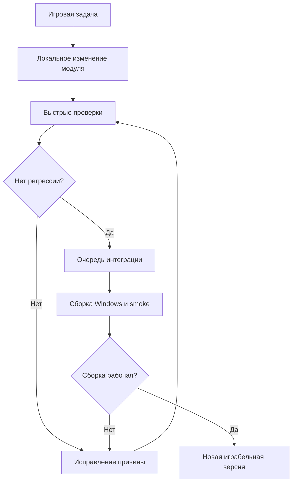
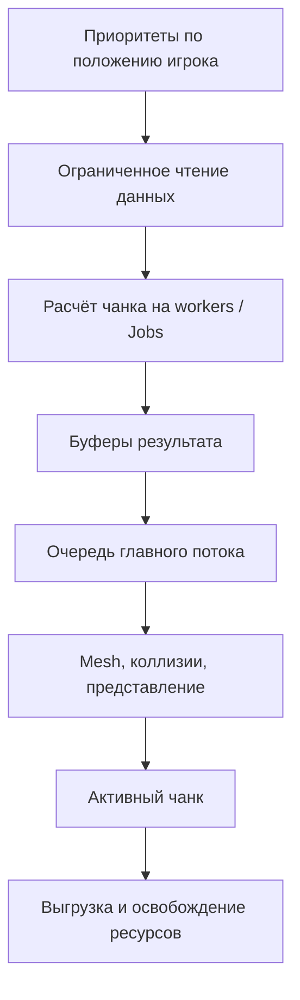

# 07 — Организация разработки и производительность

## Масштабируемый одиночный симулятор жизни на Unity, C# и Codex

**Дата исследования:** 25 ноября 2026 г.  
**Целевая платформа:** Windows x64, HP ZBook Fury 17 G8, Intel Core i7-11850H, NVIDIA RTX A5000 Laptop 16 ГБ VRAM, 128 ГБ RAM, SSD.  
**Назначение:** технический регламент для будущего проекта и AI coding agent Codex. Документ № 07 в серии исследований по архитектуре, планетарному миру, процедурной графике, населению, игровым механикам и бесплатным инструментам.

**Принцип:** владелец должен играть и определять направление развития игры, а не исполнять роль тестировщика, сборщика и секретаря отчётов.

> Версии, интерфейсы и возможности инструментов сверены с официальной документацией. Приведённые бюджеты, размеры тестовых сцен и сроки являются рекомендуемыми начальными целями, а не результатами замеров на реальном ноутбуке. Реального Unity-проекта для запуска и проверки в рамках исследования ещё нет; примеры команд и кода — шаблоны будущей реализации.

---

## 1. Итоговая рекомендация

Для этого проекта оптимальная стратегия — **итеративный модульный монолит с локальным автоматизированным конвейером поставки Windows-игры, генерацией контента через код и несколькими уровнями проверки**.

| Решение | Рекомендация |
|---|---|
| Движок | Unity 6.3 LTS (6000.3), конкретный стабильный patch зафиксировать в репозитории |
| Графика | URP, один основной пресет качества и дополнительные Low/High по мере необходимости |
| Архитектура | Независимые функциональные модули C#, Assembly Definitions, стабильные контракты |
| Симуляция | Обычный C# как основа; Jobs/Burst/Native Containers для измеренных горячих участков |
| ECS/DOTS | Опционально, локально, когда доказана выгода на масштабе; не фундамент всего проекта |
| Windows-сборки | Mono для быстрых итераций; IL2CPP сравнить на позднем этапе, а не включать автоматически |
| Игровой контент | Описания в данных + детерминированные генераторы сцен, Prefab и мира |
| Тесты | Небольшой набор быстрых EditMode-проверок, адресные PlayMode-тесты, игровой smoke-сценарий |
| Автоматизация | PowerShell + Unity CLI + Editor API, локальный runner; без обязательного платного облака |
| Сохранения | Версионированный формат состояния, неизменяемая основа мира + изменения; адаптер хранилища |
| Профилирование | Реальные Windows-сборки с инструментами Unity, один повторяемый маршрут |
| Выпуски | Последняя рабочая сборка всегда доступна; новая сборка-кандидат заменяет её только после проверки |
| Участие владельца | Один раз настроить окружение; далее запускать игру и давать продуктовую обратную связь |

Unity 6.3 LTS — консервативная база: официальная страница Unity указывает поддержку до декабря 2027 года. В момент исследования существует более свежая линия Update Unity 6, но переход на неё оправдан конкретной функцией или исправлением, а не фактом появления новой версии. Выбор LTS уменьшает число переменных в агентной разработке. [S01]

**Важно:** не начинать с генерации всей Земли, миллионов персонажей, полной экономики или универсального редактора игры. Начать с маленькой, но настоящей игровой петли, которая проходит через будущую архитектуру: перемещение → вход в помещение → взаимодействие → изменение состояния → сохранение → загрузка.

### 1.1. Что не делать

- Не строить микросервисы, распределённую инфраструктуру, серверную БД и сетевой протокол для единственного локального игрока.
- Не назначать собственную тяжёлую систему тестовых доказательств каждой мелкой правке.
- Не требовать от владельца запуска Unity Editor для настройки обычных сцен, компонентов, ссылок или сборок.
- Не заменять игровые механики моками только ради прохождения теста.
- Не создавать архитектуру для гипотетического миллиона одновременно видимых NPC.
- Не копировать большой Unity-проект в отдельный checkout для каждой мелкой задачи.
- Не обещать полностью безошибочную разработку: автоматическая проверка снижает риск, но не оценивает удовольствие от игры и все визуальные нюансы.

---

## 2. Рабочее окружение и воспроизводимость

### 2.1. Однократная установка

1. Unity Hub и Unity 6.3 LTS с Windows Build Support; Windows IL2CPP Build Support и подходящий нативный toolchain ставить, когда нужен IL2CPP.
2. Активированная применимая лицензия Unity. Unity Personal бесплатна при соблюдении условий программы, в том числе финансового порога; для личного проекта проверяется настраиваемость без покупки Unity Pro. На автоматизированном хосте также должна быть действительная лицензия. [S02]
3. Git, PowerShell 7 (рекомендуется), Codex с доступом к рабочему каталогу.
4. Unity-пакеты, выбранные через Package Manager для установленной версии: URP, Input System, Unity Test Framework; Burst/Collections/Mathematics, AI Navigation, Addressables — по мере появления соответствующих задач.
5. Проверка: импорт минимального проекта, один EditMode-тест, сборка Windows, запуск EXE.

Рабочий путь предложительно **D:\LifeSim\**. Конвейер и логи размещать на SSD, не на сетевом диске. Если системный диск нежелательно забивать, отдельные рабочие каталоги и маршрутизация артефактов на D: решают большую часть проблемы. Системные каталоги, установку Unity и её лицензирование не перенастраивать автоматически без необходимости.

### 2.2. Что фиксировать в Git

- Assets/ и соседние .meta-файлы.
- Packages/manifest.json, Packages/packages-lock.json.
- ProjectSettings/, в частности ProjectVersion.txt.
- Все asmdef, генераторы, исходные описания контента, маленькие эталонные геоданные и фикстуры сохранений.
- Скрипты автоматизированной сборки, AGENTS.md и краткое описание архитектурных контрактов.
- Версию схемы сохранений и алгоритма генерации.

Не включать в Git Library/, Temp/, Obj/, Logs/, локальные пользовательские настройки, временные и тяжёлые выходные сборки. .meta-файлы — обязательные части ассетов: их потеря приводит к изменению идентичности и поломке ссылок. Перемещать ассеты через Unity API либо вместе с их .meta. [S03]

Для сцен, Prefab и ScriptableObject включить текстовую сериализацию там, где это поддержано. Не путать читаемый YAML с ручным редактированием сложных связей Unity: более надёжно генерировать через Editor API.

Крупные законно полученные ассеты: Git LFS или отдельное версионированное хранилище с хешами и локальным кэшем. Не загружать автоматически весь мир в Git. Список источников, лицензии и атрибуция должны находиться рядом с описанием ресурсов.

### 2.3. Предлагаемая структура

```text
LifeSim/
  AGENTS.md
  Assets/
    Game/
      Bootstrap/
      Contracts/
      Core/
      World/
      Population/
      Navigation/
      Economy/
      Inventory/
      Gameplay/
      Persistence/
      Presentation/
      EditorTools/
      Tests/
      Content/
        Source/
        Generated/
        Authored/
  Packages/
  ProjectSettings/
  docs/
    architecture/
    development/
    CURRENT.md
  tools/
    dev.ps1
    Run-Unity.ps1
    scripts/
    scenarios/
  .gitignore

D:\LifeSimData\
  geo-cache/
  import-cache/          # только если реально нужен отдельный кэш
  test-saves/
  artifacts/
    runs/<run-id>/
    builds/<version>/
    last-good.json
```

Каждый крупный модуль имеет собственную сборку asmdef; зависимости направлены к общим контрактам, а не циклически между модулями. EditorTools — editor-only assembly. Pure C#-логика не зависит от сцены и MonoBehaviour, благодаря чему проверяется без загрузки богатой 3D-сцены.

Соглашение: репозиторий — источник истины, артефакты — результат. Контент либо хранится готовым, либо воспроизводимо генерируется. Для каждого generated asset выбрать одну стратегию; не получать шумные потенциально конфликтующие изменения при каждом импорте.

### 2.4. Кэширование и параллельные рабочие копии

Выполнять большинство итераций в одном локальном Unity-проекте с сохранённым Library. Большие импорты и смена веток дороже обычного C#-теста. Unity Accelerator полезен, когда есть несколько рабочих копий или машин, но на старте необязателен. [S04]

Unity Editor и batchmode не должны одновременно открывать один projectPath. Блокировка должна принадлежать runner, а не быть ручным ритуалом. Для ночной сборки во время работы в Editor допустим отдельный постоянный checkout с собственным Library и фиксированным commit. Не шарить одну изменяемую папку Library между активными процессами Unity.

---

## 3. Как Codex должен вести разработку

### 3.1. Формат задач: результат вместо бюрократии

Задача описывает **что игрок сможет сделать** и какие инварианты сохраняются.

Пример:

> Реализуй открываемую дверь с взаимодействием. Игрок может приблизиться, открыть и закрыть её; коллизия соответствует состоянию. Положение двери сохраняется после перезахода в чанк и загрузки сохранения. Используй существующие контракты мира и взаимодействий. Сам запусти релевантные автоматические проверки и обнови играбельную сборку при успехе. Не переписывай соседние системы и не требуй ручного подтверждения каждого шага.

Это лучше, чем задача с десятками процедурных этапов, формальных отчётов и отдельных обязательных подтверждений. Единый скрипт проверяет количество тестов, ошибки и статус сборки, а не агентские заявления.

### 3.2. Цикл работы



Codex должен:

1. Прочитать корневые инструкции и существующий модуль, понять контракт и границы задачи.
2. Выбрать минимальный набор проверок по риску изменения.
3. Внести изменения, включая нужные данные, тесты и генератор, если затронуты обязательные инварианты.
4. Выполнить команды самостоятельно; в случае ошибок исследовать лог и исправлять первопричину.
5. Обновить одну строку/секцию CURRENT.md или краткий changelog.
6. Подготовить коммит в принятых правилах проекта; запуск сборки и публикация последней рабочей версии автоматизированы.

Не требовать от владельца повторного перечисления уже согласованных правил, ассетов и настроек. AGENTS.md поддерживает хранение проектных инструкций и локальных уточнений. Для автоматизации, когда она нужна, официальный Codex CLI предоставляет неинтерактивный режим codex exec и структурированный вывод. [S05], [S06]

### 3.3. Параллельность без хаоса

Параллельные задачи разрешены по независимым модулям: например, оформление интерфейса инвентаря и формула потребностей NPC, если обе стороны не меняют один контракт.

- Один владелец правки общего контракта / формата сохранений / ProjectSettings.
- Отдельные ветки для параллельных изменений, предсказуемая интеграция.
- У общего Unity-проекта не более одного процесса, выполняющего импорт или сборку.
- Не запускать десятки конкурирующих агентов, которые одновременно перерабатывают одну систему.
- Длинную очередь задач разбивать на маленькие вертикальные срезы; план — при архитектурной сложности, не отдельный многодневный цикл согласований.

Если Codex работает в удалённом Linux-окружении без установленного Unity, он может реализовывать чистую логику, но не вправе объявлять Windows-сборку проверенной. Для реальных испытаний нужен локальный Windows runner, выполняющий команды из данного репозитория. На раннем этапе проще использовать Codex непосредственно на Windows-машине.

### 3.4. Готовый фрагмент будущего AGENTS.md

```markdown
# LifeSim — правила разработки

- Пользователь определяет игровой опыт; агент выполняет разработку, сборку и проверки.
- Сохраняй границы asmdef и владение состоянием. Не реорганизуй незатронутые модули.
- Не храни долговременное игровое состояние только в GameObject/MonoBehaviour.
- Сцены и Prefab создавай через Editor API, сохраняй идентичность .meta.
- Изменения контента делай data-driven, если существующий контракт это позволяет.
- Не требуй ручного теста обычной задачи: самостоятельно запускай tools/dev.ps1.
- Проверяй затронутый код; полный набор — при интеграции и по расписанию.
- Не выключай тесты, не меняй ожидаемые результаты и бюджеты ради зелёного статуса.
- После изменения схемы сохранения добавь миграцию и регрессионную фикстуру.
- Не удаляй сохранения игрока, не используй их в тестах.
- Не останавливайся на первой ошибке сборки: диагностируй и исправляй.
- Проверка должна быть фактически выполнена. Не объявляй успех без результата runner.
- Не запрашивай согласование мелких обратимых решений.
- Отчёт: что стало доступно игроку, статус сборки и известные ограничения.
```

Рекомендуется держать файл коротким. Подробные архитектурные соглашения — в нескольких тематических документах, на которые он ссылается. Не переносить сюда всю многотомную документацию и логи прошлых задач.

---

## 4. Автоматизация Unity: сборка, batchmode, Editor API

### 4.1. Точки входа

Рекомендуется сделать один пользовательский интерфейс конвейера:

```powershell
.\tools\dev.ps1 -Mode Check -Module Inventory
.\tools\dev.ps1 -Mode Check -Module Population
.\tools\dev.ps1 -Mode Build
.\tools\dev.ps1 -Mode Nightly
.\tools\dev.ps1 -Mode Play
```

Это будущий контракт, а не существующий скрипт.

| Режим | Назначение |
|---|---|
| Check | Проверка конфигурации, импорт/компиляция, быстрые тесты изменённого модуля |
| Build | Проверки интеграции, генерация, сборка Windows, игровой smoke, публикация кандидата |
| Nightly | Многосценарные прогоны, больше seed, длинная симуляция, память/производительность |
| Play | Открывает последнюю успешную сборку без обращения к Editor |
| Diagnose (при необходимости) | Сбор диагностических данных по конкретной ошибке или профилю |

Вся автоматика локальная; Windows Task Scheduler или локальный CI-runner — способ запуска Nightly. Платное Unity Build Automation не нужно.

### 4.2. Unity CLI

Unity имеет официальный командный интерфейс для пакетного режима и сборки. Статический Editor-метод вызывается через executeMethod; target или Build Profile указывают конфигурацию сборки. [S07], [S08]

Пример команд PowerShell с предварительно определёнными абсолютными путями. Переменная UnityExe должна вычисляться из ProjectVersion.txt либо конфигурации локального runner.

```powershell
# EditMode: быстрые логические проверки. Параметр -quit намеренно отсутствует.
& $UnityExe -batchmode -nographics -projectPath $ProjectPath `
    -runTests -testPlatform EditMode -testCategory Fast `
    -testResults "$RunDir\editmode.xml" -logFile "$RunDir\editmode.log"
# Runner дожидается завершения и читает exit code + XML.

# PlayMode: интеграционные проверки с работающим игровым циклом.
& $UnityExe -batchmode -projectPath $ProjectPath `
    -runTests -testPlatform PlayMode -testCategory Smoke `
    -testResults "$RunDir\playmode.xml" -logFile "$RunDir\playmode.log"

# Генерация статических сцен/Prefab и сборка Windows.
& $UnityExe -batchmode -nographics -quit -projectPath $ProjectPath `
    -buildTarget win64 `
    -executeMethod LifeSim.Editor.BuildEntry.BuildWindows `
    -logFile "$RunDir\build.log" -lifeSimOutput "$BuildDir\LifeSim.exe"
```

В production-реализации runner должен использовать надёжное ожидание процесса (например, Start-Process с корректно экранированными аргументами и -PassThru/-Wait либо управляемый Process с тайм-аутом). Непосредственный вызов в примере иллюстрирует аргументы Unity. Не полагаться только на визуальное появление процесса и не читать старый файл результата.

Особенности:

- -batchmode устраняет ручные диалоги и подходит для автоматизации.
- -nographics не создаёт графическое устройство. Хорош для чистой логики, но не для оценки рендера, GPU-производительности, некоторых графических операций и визуального smoke-теста. При необходимости запускать генерацию/сборку с графикой.
- Для Unity Test Framework использовать его жизненный цикл запуска тестов, не добавлять общий -quit, который способен завершить редактор до окончания асинхронных тестов.
- -testCategory / -testFilter позволяют адресно запускать проверки. [S09]
- Для Editor-сборок задать явную версию, платформу и путь лога. Если используем кастомный Build Profile, указать проверенный путь через -activeBuildProfile и согласовать его с методом сборки.
- Не автоматически запускать API Updater при каждой задаче: обновление API — отдельная контролируемая операция.
- Не считать отсутствие файла логов или результатов успешным запуском.

### 4.3. Минимальный BuildEntry

Иллюстративный исходник для редакторской сборки. Генератор и валидатор в примере предполагаются отдельными методами будущего проекта.

```csharp
using System;
using System.IO;
using System.Linq;
using UnityEditor;
using UnityEditor.Build.Reporting;

namespace LifeSim.Editor
{
    public static class BuildEntry
    {
        public static void BuildWindows()
        {
            var output = GetRequiredArg("-lifeSimOutput");
            Directory.CreateDirectory(Path.GetDirectoryName(
                Path.GetFullPath(output)));

            // Проектный Editor API: генерация при изменении источника,
            // затем проверка конфигурации и ссылок.
            // GeneratedContent.Reconcile();
            // ProjectValidator.ValidateOrThrow();

            string[] scenes = EditorBuildSettings.scenes
                .Where(s => s.enabled)
                .Select(s => s.path)
                .ToArray();

            if (scenes.Length == 0)
                throw new InvalidOperationException("Build has no scenes.");

            var options = new BuildPlayerOptions
            {
                scenes = scenes,
                target = BuildTarget.StandaloneWindows64,
                locationPathName = output,
                options = BuildOptions.None
            };

            BuildReport report = BuildPipeline.BuildPlayer(options);
            if (report.summary.result != BuildResult.Succeeded)
                throw new InvalidOperationException(
                    $"Build failed: {report.summary.result}");
        }

        private static string GetRequiredArg(string name)
        {
            var args = Environment.GetCommandLineArgs();
            var index = Array.IndexOf(args, name);
            if (index < 0 || index + 1 >= args.Length)
                throw new ArgumentException("Missing arg: " + name);
            return args[index + 1];
        }
    }
}
```

BuildPipeline.BuildPlayer возвращает BuildReport, который позволяет рассматривать сборку как измеряемую операцию, а не текст в диалоге Codex. [S10] Если сцены управляются отдельным Build Profile, не смешивать неявно его список сцен с глобальным EditorBuildSettings: выбрать один подход и сделать валидатор.

Расширение: два профиля — стабильная сборка без Development Build и диагностика с Development Build/Profiler. На старте Mono уменьшает цену экспериментов; IL2CPP сначала транслирует IL в C++ и далее компилирует нативный код, что обычно увеличивает длительность сборки. [S28] IL2CPP требует отдельной проверки на совместимость AOT, stripping, reflection и нативных расширений. Скорость и время сборки сравнивать фактически, а не предполагать, что один backend всегда лучше.

### 4.4. Надёжность runner

Каждому запуску — отдельная папка с идентификатором, временем и commit SHA. Перед работой:

- Вычислить полную версию Unity и проверить наличие установленных модулей;
- Получить эксклюзивную локальную блокировку;
- Использовать только новый путь для результатов и копию тестового сохранения;
- Установить раздельные тайм-ауты для импорта, тестов, сборки и запуска;
- Контролировать exit code, результат XML (executed > 0 для ожидаемых тестов, ошибок нет), BuildReport и свежий JSON smoke-теста;
- При зависании остановить только процесс данного запуска, сохранить причины;
- Освободить блокировку в finally;
- Оставить последнюю рабочую сборку нетронутой.

Начальные тайм-ауты: 5 минут для тёплого Check, 15 минут для PlayMode и 30 минут для Build; первый импорт большого набора ассетов может занимать значительно дольше. Настроить по измеренным длительностям, с выделенным холодным импортом. Не превращать эти числа в искусственные запреты.

Ошибка лицензирования, отсутствие пакета и краш Unity — ошибки окружения, а не провал игровой механики. Runner должен диагностировать их отдельно и не бесконечно запускать неизменённый проект.

---

## 5. Сцены, Prefab и данные: Codex работает без мыши

### 5.1. Разграничение

| Тип контента | Способ создания |
|---|---|
| Bootstrap-сцена, камера, корневой интерфейс | Editor-генератор, небольшой объём ручного художественного контента при необходимости |
| Игровой персонаж, двери, кровати, предметы | Prefab-фабрики по декларативным описаниям |
| Обычные параметры, рецепты, навыки | Конфигурация/ScriptableObject с проверяемыми ID |
| Большой открытый мир | Runtime-генератор чанков, кэш и сохранённые изменения |
| Эталонный район | Зафиксированный seed и маленький набор исходных геоданных |
| Тестовые сцены | Автоматические генераторы минимальных сценариев |

Нельзя создавать отдельные тысячи постоянных Unity-сцен для каждого здания всего мира, если они предназначены для потоковой процедурной генерации. Сцена служит контейнером представления. Долговечные сущности размещаются в данных.

### 5.2. Editor API, необходимый с начала проекта

- EditorSceneManager.NewScene / SaveScene — создание и сохранение сцен.
- PrefabUtility.SaveAsPrefabAsset / LoadPrefabContents / SaveAsPrefabAssetAndConnect — работа с Prefab.
- AssetDatabase.CreateAsset / LoadAssetAtPath / MoveAsset / SaveAssets — создание и сопровождение ассетов.
- SerializedObject и SerializedProperty — настройка сериализованных свойств, когда обычного присваивания недостаточно.
- ScriptableObject.CreateInstance — создание конфигурационных объектов.
- AssetPostprocessor и ScriptedImporter — только для действительно полезных конвейеров импорта.
- MenuItem — дополнительное удобство, но не единственный способ вызвать инструмент.

Unity предоставляет официальные Editor API для сцен, Prefab и пакетных операций с ассетами. [S11], [S12], [S13]

### 5.3. Идемпотентный генератор

Один и тот же вход должен приводить к одному и тому же логическому контенту независимо от числа запусков.

1. Определить стабильные ID и пути generated asset (например, Assets/Game/Content/Generated/Doors/door_wood_01.prefab).
2. Прочитать исходный файл описания, проверить схему и ссылки.
3. Рассчитать хеш содержимого, версию генератора и зависимостей.
4. Если не изменились — пропустить.
5. Если изменились — обновить по стабильному пути через Editor API, а не удалить и создать заново.
6. Верифицировать компонент, коллизию, обязательные ссылки и отсутствие Missing Script.
7. Сформировать маленький индекс generated asset → source ID → version/hash.

При перезаписи Prefab важно сохранять идентичность дочерних объектов и компонентов. Unity сопоставляет дочерние объекты по именам, поэтому повторяющиеся имена и однотипные компоненты могут нарушать ссылки. Использовать стабильные уникальные имена, по возможности править существующее содержимое. [S12]

Пример описания:

```json
{
  "id": "furniture.door.wood01",
  "kind": "interactiveDoor",
  "mesh": "mesh.door.wood01",
  "material": "mat.wood.oak",
  "dimensionsM": [0.9, 2.1, 0.1],
  "interaction": "door.toggle",
  "collider": "box",
  "generatorVersion": 2
}
```

Генератор строит объект, назначает MeshFilter/MeshRenderer, collider и компонент представления DoorView, связывая его с ID логического действия. Игровое состояние двери хранится в модуле мира, не только в угле Transform.

Пакетные операции AssetDatabase.StartAssetEditing / StopAssetEditing применять аккуратно через try/finally, и лишь для операций, допустимых без завершённого импорта. Не рассчитывать, что созданный в таком режиме ассет немедленно доступен для всех API. [S13]

### 5.4. Валидация без постоянного визуального контроля

Проверять автоматически:

- отсутствующие ссылки, скрипты, материалы/шейдеры, неверные адреса контента;
- дубли ID, ошибочные единицы измерения, выход размеров за допустимые границы;
- отсутствие входа в комнату, невозможность достичь обязательной точки;
- невидимую/неподходящую коллизию на ключевых интерактивных объектах;
- неверные пространства имён, запрещённые зависимости asmdef;
- контент, у которого нет определённого источника или схемы данных.

Скриншот эталонной сцены полезен для диагностики крупных визуальных изменений, но не надо делать пиксельное сравнение каждой комнаты при каждом коммите: смена света и драйвера может вызвать ложную тревогу. Если предусмотрено сравнение изображений, использовать фиксированную камеру, разрешение, время, погоду и толерантный критерий, а не требование полного побитового совпадения.

---

## 6. Короткие автоматические проверки вместо ручного тестирования

### 6.1. Что проверять и когда

| Уровень | Частота | Рекомендуемый бюджет (тёплый запуск) | Пример |
|---|---|---:|---|
| P0: статическая проверка данных | После правки данных | 1–10 с | Уникальность ID, совместимость схем |
| P1: EditMode / pure C# | Каждая разрабатываемая логическая задача | 5–60 с самих тестов | Инвентарь, баланс, состояния NPC |
| P2: PlayMode Smoke | Затронутая интеграция, интеграционный коммит | 30–120 с | Сцена стартует, дверь открывается, предмет берётся |
| P3: Windows Build + smoke | Поставка играбельной версии, существенные интеграции | 2–15 мин после прогрева | Сборка и реальные игровые переходы |
| P4: Nightly | Раз в сутки при изменениях | 15–60 мин | Длинная симуляция, seeds, migration, stress |

Импорт Unity и компиляция добавляют отдельные накладные расходы. При большом проекте эти сроки могут оказаться выше. Главное: отделять быстрые проверки от ночных, не ожидать полный ночной набор после изменения одной строки интерфейса.

Unity Test Framework разделяет EditMode и PlayMode; поддерживает командный запуск по категориям. Для измерений есть официальный пакет Performance Testing API, версия 3.7.0 указана для Unity 6000.3 на дату исследования. [S09], [S14]

### 6.2. Минимальный набор критических инвариантов

Не проверять всякую реализацию ради покрытия строк. Проверять, что ломается для игрока.

| Подсистема | Короткое автоматическое испытание |
|---|---|
| Bootstrap | Старт новой игры, зарегистрированы обязательные сервисы |
| Мир | Один seed даёт одинаковый логический чанк; границы соседних чанков согласованы |
| Streaming | Загрузить соседний чанк, вернуться, нет дублей и утраченного состояния |
| Действия | Успех/отказ валидного и недопустимого вымышленного действия |
| Инвентарь | Перемещение предмета не создаёт копию; вместимость соблюдена |
| Экономика | Деньги/предмет передаются атомарно, остаток не отрицательный без соответствующего игрового правила |
| Навигация | Из известной точки есть путь к входу заданного здания |
| Население | NPC сменил занятие, уйдя на работу/домой; ID остаётся постоянным |
| Сохранение | Дверь, инвентарь, время, местоположение и NPC переживают save/load |
| Миграция | Маленькая фикстура прежнего формата загружается в новый формат |

Для новых взаимодействий предпочтителен один тест обычного успеха и тест границы риска, а не десятки однотипных тестов с заученными названиями. В случае найденной ошибки добавлять короткий регрессионный тест, воспроизводящий именно её. Для поддерживаемых переходов и детерминированности использовать параметризованные тесты, а не копии одинакового кода.

### 6.3. Вертикальный сценарий настоящей Windows-сборки

Встроить диагностический GameScenarioRunner, доступный в проверяемой локальной сборке при явном аргументе запуска (в обычной игре неактивен), который управляет теми же игровыми командами, что игрок, а не выставляет вручную успешное состояние.

Сценарий `city_walk_save_v1`:

1. Открыть новую тестовую игру с фиксированным seed.
2. Дождаться готовности ближайшего чанка и персонажа.
3. Пройти по улице, перейти границу чанка, возвращать/высвобождать объекты.
4. Войти в тестовый магазин, выполнить обычное взаимодействие и перемещение предмета.
5. Дождаться смены занятия хотя бы одного NPC в симулируемом времени.
6. Сохранить игру в специальный временный каталог.
7. Перезагрузить сцену или запустить новый процесс с этим сохранением.
8. Сравнить логические состояние, ID, игровые часы и результаты действий.
9. Записать JSON и завершиться с явным кодом результата.

Этот сценарий развивается вместе с реальными возможностями игры. Первые версии не обязаны имитировать ещё несуществующую экономику или планету.

Пример аргументов будущего Player:

```powershell
# Реальная графика и устройство — для игрового smoke.
& "$BuildDir\LifeSim.exe" -logFile "$RunDir\player.log" `
  --scenario city_walk_save_v1 --seed 18291 `
  --save-root "$RunDir\save" --result "$RunDir\scenario.json"
```

`--scenario`, `--seed`, `--save-root`, `--result` — проектные аргументы, которые нужно реализовать. Unity-аргумент -logFile документирован. Второй тип прогона: -batchmode -nographics для чистой фоновой симуляции без GPU, если он поддержан выбранными подсистемами. [S15]

Пример результата:

```json
{
  "scenario": "city_walk_save_v1",
  "status": "passed",
  "seed": 18291,
  "commit": "<git-sha>",
  "checks": {
    "spawn": true,
    "chunkRoundTrip": true,
    "interaction": true,
    "saveLoad": true
  },
  "durationSec": 83,
  "exceptions": 0
}
```

Это образец формата, не фактический результат.

### 6.4. Визуальное качество и ручная игра

Полностью автоматическая проверка не может решить, красиво ли освещение, приятно ли ходить по улице и интересно ли развитие персонажа. Ручная проверка по желанию владельца: обычная игра и короткая обратная связь. Ручные тестовые сценарии требуются только при конкретном неустранимом автоматикой вопросе (например, почувствовать управление транспортом), а не на каждом этапе.

---

## 7. Регулярная поставка играбельных версий

### 7.1. Каналы сборок

| Канал | Назначение |
|---|---|
| Last good | Последняя реально запускаемая сборка, максимально пригодная для игры |
| Candidate | Новая сборка, ещё проходит smoke/проверки |
| Development | Локальная диагностика и профилирование, может иметь инструменты разработчика |

Новая сборка получает неизменяемую папку с идентификатором коммита/версии. После прохождения проверок обновляется last-good.json и ярлык Play. Не перезаписывать запущенный EXE и не удалять предыдущую сборку до завершения публикации.

На старте хранить последние 2–3 хорошие сборки и несколько последних неуспешных логов; большие trace и memory snapshots только по необходимости. Автоматическая очистка не должна трогать сейвы владельца и активные сборки.

### 7.2. Когда собирать

- На каждую маленькую правку — адресный Check, без обязательного полного Windows Build.
- После завершения игрового среза — Build и smoke.
- Ежедневно, если появились прошедшие интеграцию изменения, — Candidate → Last good.
- Ночью — долгие проверки; не блокировать весь день ожиданием ночного прогона, если изменение локальное и прошло нужные короткие проверки.
- При ошибке новой сборки владелец продолжает играть в Last good.

Сами сохранения должны быть версионированы. Откат EXE не гарантирует откат сейва: новый формат загруженной и сохранённой игры может не читаться старой версией. Перед миграцией сохранять копию прошлого формата; отдельно отмечать доступные сохранения.

### 7.3. Отчёт человеку

Достаточно:

```text
Версия: 0.2.14 — рабочая сборка
Новое: вход в здания, покупка предмета, сохранение двери.
Проверки: 18 быстрых, 3 интеграционных, Windows smoke — прошли.
Ограничения: NPC пока работают в пределах тестового района.
Запуск: Play.cmd
```

Никаких ежедневных многотомных «доказательств» и ручных таблиц соответствия. Машинные артефакты создаются один раз единым runner и доступны при сбое. Успех должен определяться результатами программ, а не формулировками отчёта агента.

---

## 8. Производительность на HP ZBook Fury 17 G8

### 8.1. Что важно именно для данной машины

RTX A5000 Laptop с 16 ГБ видеопамяти позволяет использовать качественные материалы, освещение и приличную дальность, но это не настольная видеокарта с гарантированной частотой и энергопотреблением. Ноутбук ограничен тепловым и энергетическим бюджетом. Для симулятора жизни вероятнее всего критичны будут также главный CPU thread, задачи навигации, генерация чанков и создание объектов.

Intel Core i7-11850H имеет 8 ядер / 16 потоков. [S29] Фоновые импорты, IDE, генерация мира, Codex и игра могут конкурировать за CPU. 128 ГБ RAM позволяют держать полезный кэш и данные, но не оправдывают утечки и одновременную загрузку планетарного мира.

Если локальная LLM занимает почти все 16 ГБ VRAM, замер игровой производительности будет некорректен. Измерять игру при освобождённом GPU. При использовании LM Studio и других тяжёлых программ одновременно отслеживать суммарную VRAM и RAM.

### 8.2. Начальные бюджеты для эталонного района

**60 FPS = 16,67 мс на кадр; 30 FPS = 33,33 мс.** Главный поток и GPU могут работать параллельно, их времена нельзя механически складывать. Цели ниже — рабочие ориентиры для 1080p, питание от сети, фиксированный пресет URP.

| Метрика | Начальная цель | Реакция |
|---|---:|---|
| Frame time P50 | ≤ 16,7 мс | Определять ограничение CPU/GPU |
| Frame time P95 | ≤ 20 мс | Проверять тяжёлые группы кадров |
| Frame time P99 | ≤ 33,3 мс | Искать фризы/подгрузки |
| Главный поток CPU P95 | ≤ 10–12 мс | Снижать представление, частоту AI, переносить расчёты |
| GPU P95 | ≤ 13–14 мс | Снижать тени, разрешение, overdraw, сложность материалов |
| Время интеграции streaming на main thread | около 1–2 мс/кадр при обычной подгрузке | Дозировать создание объектов |
| Игра — process private memory | целевой 8–16 ГБ в стандартном районе | Измерять loaded content и пиковые значения |
| Игра — dedicated VRAM | целевой 8–12 ГБ, если доступный бюджет позволяет | Запас для ОС, драйвера и всплесков |
| GC alloc в горячих циклах | стремиться к 0 B/кадр в собственных системах | Убрать повторные выделения |
| Длинные зависания | фиксировать кадры > 50/100/250 мс | Локализовать streaming, GC, shader compilation |
| Save | не блокировать main thread на тяжёлой сериализации | Снимок → фоновая запись |
| Стабильность памяти | выход на плато при повторных маршрутах | Искать невысвобождённые ассеты и объекты |

P95 означает, что 95% измеренных кадров не медленнее данного времени; P99 лучше среднего FPS обнаруживает редкие фризы. Не использовать эти ориентиры как жёсткие условия любой ранней сборки: сначала снять реальную baseline для конкретного района и постепенно закрепить разумные пределы.

Начальный нагрузочный район:

- 8–16 активных соседних чанков; размеры выбрать измерениями и масштабом географии.
- 20–50 видимых NPC для первого эталона, позже 100–200.
- 1 000–10 000 логических NPC в дополнительном прогоне без 3D-представления.
- Смешанная улица, открываемые интерьеры, несколько транспортных объектов.
- Отдельные наборы low/medium/high нагрузки, фиксированные seeds и маршруты.

Эти числа — сценарии измерения и постепенного масштабирования, не обещанная вместимость ноутбука.

### 8.3. Протокол измерения

1. Один commit, один Windows Player, одна дистанция LOD, выбранный пресет, разрешение и графический API.
2. Зафиксировать версию Unity, настройки, версию драйвера, режим питания, температуры/частоты при диагностике.
3. Отключить приложения, конкурирующие за GPU; для теста максимальной производительности выключить лимит FPS/VSync, если измеряем пропускную способность; отдельно оценить обычный игровой режим с лимитом.
4. Прогреть сцену и шейдеры 20–60 секунд, затем пройти одинаковый маршрут 60–180 секунд.
5. Сохранить median/P95/P99 времени кадра, CPU/GPU, память, GC, число NPC/мешей/чанков, время загрузки чанка.
6. Выполнить 3 прогона подозрительной регрессии. Сравнивать медиану результатов, а также разницу абсолютных миллисекунд. Не сравнивать Editor FPS с Player FPS.
7. Сохранять baseline отдельно от результатов текущего изменения. Менять baseline только осознанно при изменении контента или оборудования.

Влияние шума учитывать. Начальный механизм предупреждения о регрессии: ухудшение выбранной метрики более 10% при абсолютной разнице выше измеренного шума; жёсткий отказ только для воспроизводимой существенной деградации, например > 20% и > 2 мс времени кадра либо очевидной утечки / выхода за рабочий бюджет памяти. Порог не универсален, калибровать после нескольких серий.

Фоновые CPU-only тесты допустимы во время обычной разработки, но GPU-замеры желательно планировать на периоды без игры и тяжёлых локальных LLM. Не запускать benchmark двух сборок одновременно.

### 8.4. Инструменты

| Средство | Применение |
|---|---|
| Unity Profiler | CPU Timeline, Rendering, GC, Memory, Physics, GPU, где поддержано |
| ProfilerMarker | Именованные замеры модулей/фаз |
| ProfilerRecorder | Автоматизированные счётчики и временные ряды; проверять доступность конкретной метрики |
| Memory Profiler | Снимки управляемой и нативной памяти, удерживающие ссылки |
| Frame Debugger / Render Pipeline tools | Диагностика ненужных проходов, материалов и вызовов рендера |
| Performance Testing API | Микробенчмарки и повторяемые тесты производительности |
| Windows Task Manager / Performance Monitor | Нагрузка процесса, память и GPU на уровне ОС |

Unity Profiler и ProfilerRecorder позволяют исследовать приложение в Player, включая доступные в Release счётчики. Не все измерения доступны в каждом backend/режиме; диагностика в Development Build имеет накладные расходы, поэтому итоговый FPS проверять также в обычной сборке. [S14], [S16], [S17]

Создать именованные маркеры:

```text
LifeSim.World.PlanChunks
LifeSim.World.ReadGeoData
LifeSim.World.GenerateGeometry
LifeSim.World.ApplyChunk
LifeSim.Population.Tick
LifeSim.Navigation.ProcessQueue
LifeSim.Presentation.Materialize
LifeSim.Persistence.CaptureSnapshot
LifeSim.Persistence.Write
```

Результат nightly: компактный perf.json и при регрессии подробный профиль. В обычном gameplay не оставлять постоянный Deep Profile, подробные логи каждого NPC или большие накопительные коллекции статистики.

---

## 9. Многопоточность и масштабирование симуляции

### 9.1. Выбор технологии по задаче

| Сценарий | Первый выбор | Причина |
|---|---|---|
| Открытие файла, загрузка геоданных | Async / фоновые операции I/O | Не тормозит кадр ожиданием диска |
| Парсинг/декомпрессия и подготовка больших буферов | Ограниченная очередь worker/Task | Управляемая нагрузка |
| Массовые числовые вычисления и SIMD | C# Job System + Burst | Пакетный параллелизм и векторизация |
| Состояние большого населения | Массивы, компактные структуры, планировщик тиков | Высокая локальность данных и отсутствие отдельного GameObject для каждого логического NPC |
| Отрисовка и Unity-объекты | Main thread, поддержанные Unity API | Безопасный доступ к большинству Unity объектов |
| Высокоплотные специальные подсистемы | Entities/DOTS по результату профиля | Только при измеренной необходимости |

Unity Job System предназначен для расчётов, разбиваемых на задачи. Mesh API предоставляет доступ к буферам, которые можно заполнять через Jobs. Awaitable поддерживает переключение между фоновым и главным потоком. [S18], [S19], [S20]

### 9.2. Предлагаемый pipeline чанков



Фазы:

- I/O читает геоданные, кэш и сохранённые дельты.
- Worker выполняет расчёт плана города, построение графа дорог, подготовку геометрии и размещение объектов.
- Job может заполнять MeshData/NativeArray. Большинство UnityEngine.Object нельзя создавать/изменять произвольно вне main thread.
- Главный поток дозированно создаёт представление, назначает Mesh, материалы, коллайдеры и запускает необходимые Unity-операции.
- Устаревшие задания отменяются логически: результат со старым поколением запроса не применяется после перемещения игрока или смены мира. Освобождение Native Container должно учитывать завершение job.
- Приоритет: ближний чанк, направление движения, обязательные соседние коллизии; фоновые задачи — после.

Не запускать Task.Run на каждой травинке или каждом NPC. Ограничить число одновременно планируемых чанков (например, 2–4), размер очереди результатов, пул временных буферов. Измерять очередь и задержку выполнения. Jobs должны быть достаточно крупными для окупаемости overhead планирования.

Не вызывать Complete сразу после Schedule, если можно выполнять остальную работу кадра. Учитывать зависимости JobHandle, синхронизироваться непосредственно перед потреблением результатов. Обновлять буферы только владельцем; рабочие потоки пишут в независимые области или производят командный буфер для применения в определённом порядке.

### 9.3. Население: время симуляции независимо от кадров

Видимый NPC не равен логическому NPC. Один стабильный EntityId связывает модель состояния, распорядок, имущество и временное 3D-представление.

| Уровень | Представление | Начальная частота вычисления |
|---|---|---|
| L0: вокруг игрока | Полная анимация, коллизии, движение, интерактивность | Движение по кадрам/физике; принятие решения 2–10 Гц |
| L1: район | Упрощённая модель передвижения, ограниченные представления | 1–2 Гц либо по событиям |
| L2: город вдали | Логические перемещения, граф маршрутов, события жизни | Раз в несколько игровых минут |
| L3: дальние регионы | Агрегированная экономика/сводные события | По игровым часам/суткам |

Герои одной семьи, собственные предметы и планы должны сохранять ID независимо от уровня. При материализации не создавать второго NPC и не заново генерировать имущество. При дематериализации записывать/применять состояние и возвращать объект в пул.

Планировщик работает по игровому времени и стабильному порядку. Не пропускать событийные результаты при ускорении времени; там, где возможно, свертывать интервалы математически. Если очередь перегружена, ограничивать дорогую детализацию, а не бесконтрольно замораживать весь кадр. Обычная частота FixedUpdate физики не обязана быть частотой принятия решений всего мира.

Чистые вычисления потребностей и оценка вариантов группами — возможная первая область для Burst. Обработка сложных социальных транзакций и владения лучше сначала последовательно и надёжно.

### 9.4. Когда действительно понадобится ECS

Сначала устранить очевидные проблемы алгоритма, аллокаций и лишних обновлений. Если профилирование показывает, что обновление десятков тысяч однотипных объектов упирается в представление/память/CPU, создать узкий эксперимент на ECS с тем же набором данных.

Условие перехода: существенное измеренное улучшение на эталонной нагрузке без разрушения контрактов и существенного увеличения стоимости разработки. Мигрировать подсистему через существующий интерфейс, а не переписывать саму игру.

---

## 10. Память, графика и работа с ресурсами

### 10.1. Разделение памяти

Управляемая куча C#, нативные объекты Unity (Mesh, Texture, Animation), Native Containers и GPU-память имеют разный жизненный цикл. Отсутствие заметного роста managed heap не означает отсутствия утечки текстур или мешей.

Рекомендованная политика:

- Reuse коллекции, не создавать новые списки и LINQ-цепочки на каждом кадре горячей подсистемы.
- Использовать массивы/структуры для однотипных данных, избегать множества малых объектов в населении.
- Инкрементальную GC оставить включённой, если замеры не доказывают обратное. Снижение паузы не устраняет стоимость выделений. [S21]
- NativeArray/NativeList и прочие контейнеры освобождать согласно выбранному аллокатору и JobHandle; не хранить короткоживущие данные постоянно.
- Пулы GameObject нужны ограниченного размера, с явным сбросом событий, ссылок и компонентов, а не бесконечные.
- При выгрузке чанка освобождать его нативные Mesh/Texture/другие runtime-объекты, отписывать обработчики и забытые задачи.
- Не вызывать Resources.UnloadUnusedAssets при каждом пересечении границы чанка; выполнять в подходящий момент, измерив задержку.

### 10.2. Addressables и кэш чанков

Addressables полезен для повторно используемых моделей, материалов и локальных больших наборов контента. Не использовать его как хранилище игрового состояния. Отсутствие подписки или удалённого CDN не мешает применять локальную конфигурацию.

Каждый load имеет соответствующий release; владение handle документировано. Если объект создан обычным Instantiate из загруженного asset, handle удерживают, пока нужны экземпляры. Для InstantiateAsync — соответствующий ReleaseInstance. Освобождение логической ссылки не гарантирует немедленную выгрузку всего bundle. [S22]

Дополнительные кэши:

| Кэш | Содержимое | Жизненный цикл |
|---|---|---|
| Source geo | Версионированные исходные геоданные | Диск, долгосрочно |
| Chunk logical | Геометрическое/семантическое описание | RAM LRU + диск при необходимости |
| Render assets | Unity-объекты/handles | Только активные и соседние области |
| Reusable shared assets | Модели, материалы и текстуры повторного использования | Shared LRU/учёт ссылок |
| Save deltas | Достоверные изменения мира | Не является удаляемым кэшем |

Ключ кэша включает регион, координаты, версию генератора, версию исходных геоданных, применимые параметры качества и seed. Устаревший кэш безопасно перестроить. Изменённое имущество игрока и NPC никогда не удалять по правилам кэша.

Ввести гистерезис загрузки и выгрузки: не перегружать один и тот же чанк при ходьбе около границы. Ограничивать LRU не просто числом чанков, а оценкой занимаемой памяти.

### 10.3. Графический бюджет

- URP + SRP Batcher как основа; возможный GPU Resident Drawer для множества совместимых MeshRenderer после проверки требований и влияния на проект.
- LOD и impostors для дальнего мира; упрощённые коллизии, полные интерьеры только рядом с игроком.
- Общие материалы, атласы/текстурные массивы там, где это действительно сокращает расходы.
- GPU instancing/BRG/GPU Resident Drawer оценивать по реальным сценам, не включать несовместимые методы одновременно в надежде получить суммарный выигрыш.
- Ограничить число динамических источников света и дальность теней.
- Выполнять тяжёлую генерацию геометрии не в момент, когда игрок пересекает границу, а упреждающе с очередью.
- Использовать mipmaps и texture streaming при наличии применимости; фиксировать фактическое качество.
- Для процедурных интерьеров предпочитать динамическое разумное освещение и законченное решение для близкой зоны, а не предварительное запекание всех помещений планеты.

Unity описывает различные механизмы оптимизации вызовов рендера и GPU Resident Drawer; они имеют ограничения по совместимости и различаются по целевому эффекту. [S23]

Важно диагностировать причину, а не уменьшать графику при CPU-bound симуляции. Если GPU свободен, а главный поток загружен NavMesh и материализацией, замена текстур не решит проблему.

---

## 11. Сохранения мира и миграции

### 11.1. Что является истинным состоянием

Мир делится на три слоя:

1. **Неизменяемая основа**: seed, версия алгоритма, версия исходных геоданных, правила генерации территории.
2. **Изменения и симуляция**: сущности с постоянными ID, предметы, инвентари, владельцы, деньги, NPC, часы, квесты, сломанные/открытые объекты и другие фактические изменения.
3. **Производное представление**: Mesh, Transform визуализации, NavMesh-кэш, LOD, загруженные Prefab, эффекты — регенерируемое, как правило не сохраняется целиком.

Оригинальный город после загрузки не должен заново случайно выдать имущество и удалить созданный игроком интерьер.

### 11.2. Формат

Пример manifest сохранения:

```json
{
  "saveFormatVersion": 4,
  "gameVersion": "0.3.0",
  "worldId": "world-6ec7",
  "worldSeed": 18291,
  "generatorVersion": "worldgen-3",
  "sourceDataset": "region-snapshot-2026-11",
  "contentManifestHash": "sha256:<hash>",
  "snapshotTick": 682900,
  "snapshotId": "snap-000042",
  "modules": {
    "player": 2,
    "population": 3,
    "inventory": 1,
    "world": 4,
    "economy": 2
  }
}
```

Состояние должно быть DTO/контрактами игровых данных, а не сериализацией сцены Unity, ссылок на Component или произвольного runtime-графа.

Интерфейс хранилища может быть простым: прочитать регион, записать транзакцию/снимок, перечислить версии, создать резервную копию. Не связывать остальные игровые модули с конкретной БД.

### 11.3. Выбор технологии хранения

| Вариант | Плюсы | Минусы | Вердикт |
|---|---|---|---|
| JSON-описания + файлы регионов | Простая отладка Codex, читаемость, быстрый старт | Большие файлы, стоимость парсинга, протокол согласованности | Старт для маленького мира |
| Бинарный формат с версионированием | Размер и скорость | Сложнее диагностика и ручное восстановление | Опционально после измерений |
| SQLite c транзакциями | Индексы, выборочное чтение, целостность, локальный файл, большая база | Нативная библиотека и Unity-compatible provider требуют испытания | Вероятный этап масштабирования |
| Серверный Firebird/PostgreSQL | Знакомые SQL, зрелые транзакции | Служба, настройка пользователей, внешняя зависимость | Не требуется для одиночной игры |

Для разработчика, знакомого с C# и SQL, SQL-подход будет понятен, но не стоит тащить серверную БД в установку локальной игры. SQLite — кандидат, когда нужны миллионы записей и выборка по региону. Сначала проверить конкретный C#-провайдер, нативную x64 DLL, лицензию, Mono и при необходимости IL2CPP, транзакции и нагрузку на целевой платформе. Не обещать совместимость любого NuGet-пакета с Unity.

SQLite поддерживает транзакции и WAL; WAL полезен для одновременного чтения при записи, но подразумевает локальную файловую систему, дополнительные WAL/SHM-файлы и управление checkpoint. [S24] Для сохранений, важных при сбое питания, выбирать параметры долговечности осознанно, измерять latency, не отключать синхронизацию ради скорости. Резервную копию активной БД создавать корректным механизмом backup или после завершения записи/подходящего checkpoint, а не копировать только основной файл работающей WAL-БД.

### 11.4. Консистентность и запись

Минимальный файловый протокол для первого этапа:

- На безопасной границе игрового тика получить согласованный неизменяемый снимок (при больших данных — copy-on-write/порции изменений с общей точкой отсечения).
- Не сериализовать большой меняющийся словарь, пока другой поток изменяет его.
- Отправить snapshots/deltas одному writer, сериализовать вне критического игрового пути.
- Сначала писать в новое поколение сохранения: временные файлы, контрольные суммы, обязательные записи.
- Завершить и flush необходимые записи. После готовности всех файлов опубликовать manifest/указатель нового поколения через проверенный механизм замены файла на том же диске.
- Предыдущее полное поколение сохранить на случай аварии. При старте проверять manifest, контрольные суммы и полноту; восстановиться с предыдущего согласованного поколения, если новое повреждено.

File.Replace предоставляет замену содержимого файла с созданием резервной копии. [S25] Однако корректность многокомпонентного сохранения зависит от собственного протокола, файловой системы и режима flush, а не от одной функции. Не обещать абсолютную устойчивость к сбоям дисков/питания. Для SQLite использовать согласованные транзакции, а не отдельный самодельный файл manifest с изменяемыми таблицами без координации.

Путь сейва: Application.persistentDataPath с постоянной идентичностью компании/продукта либо явно выбранная папка данных, чтобы обновления игры продолжали открывать тот же профиль. [S26] У тестового сценария обязателен отдельный save-root. Тесты не должны использовать единственное сохранение владельца.

### 11.5. Миграции

Правила:

- Версия формата сейва и версии модулей отделены от версии игры.
- Миграции последовательные: V1→V2→V3, а не N×N конвертеров.
- Каждая миграция работает на копии, проверяет ссылки/поля и только после успеха публикует новое поколение.
- Старый оригинал не перезаписывается до валидации.
- Неизвестная будущая версия сохранения не должна открываться с молчаливой потерей данных; вывести понятное сообщение.
- При смене ID игровых справочников хранить явные правила соответствия. Не заменять старые предметы случайными новыми.
- Версия игры в заголовке хранится для диагностики, но совместимость определяет формат и миграции.

Сохранять компактные реальные фикстуры важных прежних форматов, а не генерировать «старую» фикстуру текущим serializer. Тест: загрузка → миграция → сохранение → повторная загрузка → сравнение ожидаемого логического состояния.

Проверка прерванной записи: в тестовом каталоге симулировать сбой между подготовкой нового поколения и публикацией указателя, убедиться, что прежнее сохранение доступно. Это один небольшой автоматический сценарий, а не длинная серия обязательной ручной работы.

---

## 12. Воспроизводимая процедурная генерация

### 12.1. Почему одного seed недостаточно

Мир зависит от версии генератора, источника геоданных, параметров, порядка обработки, алгоритма случайных чисел и вычислений с плавающей точкой. Один и тот же seed не гарантирует идентичность при изменении алгоритма.

Unity Random.InitState подходит для воспроизводимых последовательностей в оговорённых условиях. Но для независимых параллельных генераторов предпочтительнее собственный явно зафиксированный PRNG и независимые потоки случайных чисел; не раздавать всему миру общий изменяемый Random. [S27]

### 12.2. Рекомендуемые правила

- Стабильный seed подсистемы = хеш worldSeed, version, regionId, chunkId, stageId.
- Определить и документировать конкретный алгоритм хеша и PRNG; не использовать string.GetHashCode как стабильный межпроцессный seed.
- Разделять потоки для рельефа, дорог, зданий, комнат, мебели, населения.
- Использовать стабильные ID геообъектов и логически устойчивые ключи элементов, а не Unity GetInstanceID и не только индекс в случайно переупорядоченном списке.
- Входы сортировать по каноническим ключам перед алгоритмами, чувствительными к порядку.
- Все вычисления смежных границ должны исходить из глобального адреса/контекста, а не из случайного положения относительно игрока.
- Генератор должен принимать неизменяемый input и возвращать DTO/буферы, независимо от порядка выполнения jobs.
- Применять результаты параллельного расчёта в детерминированном порядке, если операции некоммутативны.
- Разделять семантическую детерминированность (ID, координаты, план) и графический/физический результат. Не обещать побитовую идентичность физических симуляций между разными GPU, backend и версиями движка.

### 12.3. Мир разных версий

Если изменился алгоритм зданий, сохранить старый план уже изменённых/посещённых территорий или поддержать прежний генератор для данного save. Иначе ID двери, комнаты и её содержимое могут исчезнуть. Для новых, ещё не созданных территорий возможна новая версия генерации при явно продуманной стыковке.

Простая стратегия первой версии: каждый сейв фиксирует generatorVersion и datasetHash; существующая версия генератора остаётся читаемой. Дельты привязываются к стабильным логическим ID. По мере развития можно замораживать семантические планы интересующих регионов и мигрировать их выборочно.

### 12.4. Тесты детерминированности

Минимальный набор:

- Чанк A, затем B; после очистки B, затем A — одинаковые логические хеши.
- Однопоточная и многопоточная генерация одного входа — одинаковые нормализованные результаты.
- Соседние чанки совпадают по линии рельефа и дорожным связям.
- Сериализация → загрузка — логические ID и изменения не теряются.
- 10 фиксированных разных seed в ночной проверке на отсутствие невалидных зданий и сломанных маршрутов.

Хешировать канонический логический результат, а не YAML сцен, порядок Unity instance ID, неинициализированную память или побитовый шум в плавающих числах. Для координат в метрах и допустимой погрешности заранее определить нормализацию. Golden datasets менять только при осознанном изменении ожидаемого результата.

---

## 13. Контроль регрессий производительности и стабильности

### 13.1. Атрибуция результатов

Минимальный состав артефактов:

```text
runs/<run-id>/
  summary.json
  editmode.xml
  playmode.xml
  build.log
  player.log
  scenario.json
  perf.json                # если запускался benchmark
  profiling/               # только по необходимости
  screenshots/             # только для визуального smoke
```

summary.json формируется скриптом из фактических результатов и содержит commit, версию движка, timestamp, список стадий, exit code, длительность, статус и ссылку на директорию сборки. Отсутствующий этап получает статус not_run, а не passed.

### 13.2. Уровни реакции

| Ситуация | Действие |
|---|---|
| Ошибка компиляции | Исправить до интеграции |
| Сломан сценарий или инвариант | Найти причину и коротко закрепить регрессию тестом |
| Windows-процесс не стартует | Не публиковать кандидата; диагностировать лог и зависимости |
| Некорректный seed | Сохранить seed, входы и лог, воспроизвести сцену |
| Ухудшился FPS | Повторить benchmark на тех же условиях, отделить CPU/GPU/температуру |
| Переполнена память | Снять snapshot, определить владельца ресурса |
| Не прошла миграция | Не трогать сейв игрока, исправлять на фикстуре |
| Ошибка среды | Отдельный статус; исправить путь/версию/лицензию, повторить только нужные этапы |

Автоматический повтор допустим для явно нестабильной операции среды. Не повторять без изменений тесты до случайного прохождения. При реальной регрессии не менять порог, snapshot или ожидание теста для маскировки.

Ключевой принцип: **baseline защищает игровой опыт, но не мешает разработке.** Усложнение эталонного мира закономерно меняет нагрузку; при таких изменениях сравнивать старый сценарий на сопоставимой конфигурации и отдельно вводить новый baseline.

### 13.3. Ночной стресс-прогон

По мере развития:

- Игровая симуляция 24–72 игровых часов в ускоренном режиме без полной графики.
- Несколько циклов возвращения в один район после посещения соседних.
- Повторные входы в интерьеры, смены NPC-уровней детализации.
- 10+ seed, выборка крайних случаев генерации.
- Миграции предыдущих поддерживаемых форматов.
- Отдельный 3D-маршрут для GPU/CPU и проверка плато памяти.

Не симулировать 24 реальных часа, если можно прогнать 24 игровых часа за минуты. Для поиска конкретных долгих зависаний добавлять отдельный endurance-run с реальным временем. Длительность настраивается по цене найденных ошибок.

### 13.4. Диагностическое меню игры

Уменьшит число диалогов «что сломалось»:

- текущий seed и ID чанка, число логических/видимых NPC;
- frame time, RAM/VRAM (если доступно), очереди streaming;
- перейти к тестовой точке, изменить игровое время, создать тестовый сценарий;
- кнопка «Скопировать диагностику» с версиями и недавними ошибками;
- открыть папку логов;
- переключение между реальным игровым профилем и изолированным тестовым.

Это необязательный пользовательский интерфейс, но дешёвый внутренний инструмент для разработки. Не выводить постоянный шум на игровой экран.

---

## 14. План первых играбельных выпусков

Ниже порядок работ, а не гарантированный календарь. Каждый этап должен давать полезную игровую версию, а не только инфраструктуру.

| Выпуск | Игровой результат | Нужно для разработки |
|---|---|---|
| 0.0 | EXE запускается, окно и управляемый персонаж в тестовом дворе | Репозиторий, Unity, runner, Bootstrap, EditMode smoke |
| 0.1 | Прогулка по маленькому району, камера, вход в помещение | Генерация улицы, двери, стабильные ID, первый prefab generator |
| 0.2 | Поднять предмет, положить в инвентарь, открыть дверь, сохраниться | Универсальное взаимодействие, состояние/сейв, save/load smoke |
| 0.3 | NPC с потребностями и распорядком, покупка вещи | Логическое население, простая экономика, адресные регрессии |
| 0.4 | Выход за пределы района и непрерывное перемещение | Streaming, геоданные, кэш, LOD, тесты швов, benchmark |
| 0.5 | Ездить по миру, больше профессий, жилья и занятий | Транспорт, фоновые задачи, расширение форматов |
| 0.6+ | Новые регионы, способности, магия, крафт, расширение жизни | Data-driven эффекты, расширение контента, локальная оптимизация |

При наличии архитектурного исследования № 01–06 этот порядок согласовать с его контрактами и выбранными инструментами. Не готовить большую системную архитектуру заранее в пустоте.

**Самый важный этап — выпуск 0.1–0.2.** После него владелец должен получить игру, которую можно открыть и действительно пройти, пусть в маленьком районе. Не ждать полной карты Земли. Позднее большая планета будет использовать тот же интерфейс загрузки сегментов мира.

### 14.1. Первая самостоятельная задача для Codex

```text
Создай начальную основу одиночного LifeSim на Unity 6.3 LTS (C#, URP)
под Windows x64. Используй зафиксированный patch редактора и небольшой
модульный монолит, не вводи ECS или серверную БД без необходимости.

Игровой результат: из готовой Windows-сборки открыть тестовый двор,
управлять персонажем, перемещаться и взаимодействовать с одной дверью.

Технический результат: генерация bootstrap-сцены и Prefab через Editor
API, стабильные .meta, PowerShell runner для Check и Build, реальные
EditMode/PlayMode проверки минимального поведения, Windows smoke
и ярлык запуска последней рабочей сборки.

Работай самостоятельно, исправляй ошибки до завершения.
Не запрашивай ручные проверки, если их можно выполнить автоматически.
Не создавай большие отчёты и скриншоты для каждого шага. Достаточно
фактических артефактов команд и короткого итогового отчёта.
Не проектируй целую планету вместо первого играбельного двора.
```

После первого запуска лучше сразу добавить сохранение примитивного состояния, чтобы инвентарь и население не выросли вокруг несовместимого временного формата.

---

## 15. Минимальный стартовый набор инструментов и стоимость

| Инструмент | Статус | Назначение |
|---|---|---|
| Unity Hub + подходящая Unity Personal | Обязателен при соблюдении условий лицензии | Editor, Player, build |
| Unity Test Framework | Обязателен | EditMode/PlayMode |
| PowerShell, Git | Обязательны | Локальный конвейер и версии |
| Codex | Обязателен по выбранному способу разработки | Агент; использование зависит от доступного плана/лимитов |
| Unity Profiler, Recorder | Обязательны по мере начала игровых замеров | CPU/GPU/память |
| Performance Testing API | Опционален | Повторяемые микробенчмарки |
| Memory Profiler | Опционален | Диагностика утечек и фрагментации |
| Burst/Collections/Mathematics | Опциональны, затем рекомендованы для горячих пакетных расчётов | Числовая оптимизация |
| Addressables | Опционален, нужен с ростом контента | Асинхронная загрузка общих ассетов |
| Unity Accelerator | Опционален | Несколько checkout/машин, затраты на импорт |
| Windows Task Scheduler | Опционален на старте | Ночные проверки |
| SQLite и подходящий провайдер | Опционален, когда выросло состояние | Локальное хранилище |
| GameScenarioRunner, профили бюджета, генератор контента | Реализовать в проекте | Специфические игровые проверки и автоматизация |

Обязательных покупок плагинов для описанного конвейера нет. Возможные расходы: тариф Codex, лицензия Unity при выходе за условия бесплатного уровня, дисковое место для ассетов/сборок, время вычислений и электроэнергия. Облачный CI, удалённый CDN и платная система управления тестами не нужны для первой версии.

---

## 16. Заключение

Рекомендуемый путь — относиться к автоматизации как к части игры, а не как к отдельному проекту доказательств. Единожды создать базовые команды, надёжный сценарий запуска и механизм выпуска; затем Codex использует их из задачи в задачу.

**Три фундаментальных правила:**

1. **Непрерывная играбельность.** Сначала работающий небольшой район, затем рост механик и мира. Всегда есть последняя годная сборка.
2. **Дешёвая обратная связь.** Короткие адресные проверки после изменений; реальные интеграционные, длительные и нагрузочные проверки автоматически запускать в подходящий момент.
3. **Независимость подсистем.** Долгоживущее состояние и стабильные данные отделены от Unity-представления. Процедурная генерация воспроизводима; сохранения мигрируются; оптимизация локальна и измерима.

Владелец проекта выбирает, что должно появиться в игре дальше, и играет. Роль Codex — самостоятельно реализовать, проверить, исправить и подготовить рабочую версию, сообщив лишь о реальных блокерах и существенных ограничениях.

---

## 17. Источники и документация

Все ссылки официальные (Unity, OpenAI, Microsoft, SQLite, Intel), проверены при подготовке исследования 25.11.2026. Ссылки на отдельные API/пакеты могут переадресовываться на обновлённую систему документации. Для реализации использовать документацию **фактически закреплённой** версии редактора и пакетов.

| ID | Документ / ссылка | Что подтверждает |
|---|---|---|
| S01 | [Unity 6 release support](https://unity.com/releases/unity-6/support), [Unity 6.3 LTS](https://unity.com/blog/unity-6-3-lts-is-now-available) | Политика LTS и поддержки |
| S02 | [Unity Personal](https://unity.com/products/unity-personal), [Unity license compliance](https://unity.com/pages/license-compliance) | Бесплатный уровень и условия применимости |
| S03 | [Unity — Asset metadata](https://docs.unity.com/en-us/engine/6000.0/manual/assets-and-media/import-assets/asset-metadata) | .meta, ссылки, импорт |
| S04 | [Unity — Caching assets](https://docs.unity.com/en-us/engine/6000.6/manual/assets-and-media/importing-caching-assets) | Кэш импорта Unity Accelerator; см. описание для фактической установленной версии |
| S05 | [OpenAI — Custom instructions with AGENTS.md](https://developers.openai.com/codex/guides/agents-md) | Проектные и локальные инструкции Codex |
| S06 | [OpenAI — Non-interactive mode](https://developers.openai.com/codex/noninteractive) | codex exec и структурированный вывод |
| S07 | [Unity 6.3 — Editor command line arguments](https://docs.unity3d.com/6000.3/Documentation/Manual/EditorCommandLineArguments.html) | batchmode, nographics, executeMethod, логи |
| S08 | [Unity 6.3 — Build from command line](https://docs.unity3d.com/6000.3/Documentation/Manual/build-command-line.html) | Build Profile и CLI-сборка |
| S09 | [Unity 6.3 — run tests from command line](https://docs.unity.com/en-us/engine/6000.3/manual/programming-environment/test-framework-introduction/running-tests/run-tests-from-command-line), [Unity 6.3 — command-line reference](https://docs.unity.com/en-us/engine/6000.3/manual/programming-environment/test-framework-introduction/reference-command-line) | Фильтры тестов и командный запуск; точную версию установленного пакета проверять отдельно |
| S10 | [Unity 6.3 — BuildPipeline.BuildPlayer](https://docs.unity3d.com/6000.3/Documentation/ScriptReference/BuildPipeline.BuildPlayer.html) | BuildReport, варианты BuildPlayer |
| S11 | [Unity 6.3 — EditorSceneManager](https://docs.unity3d.com/6000.3/Documentation/ScriptReference/SceneManagement.EditorSceneManager.html) | Создание и редактирование сцен |
| S12 | [Unity 6.3 — PrefabUtility.SaveAsPrefabAsset](https://docs.unity3d.com/6000.3/Documentation/ScriptReference/PrefabUtility.SaveAsPrefabAsset.html) | Сохранение Prefab и сопоставление объектов |
| S13 | [Unity 6.3 — AssetDatabase.StartAssetEditing](https://docs.unity3d.com/6000.3/Documentation/ScriptReference/AssetDatabase.StartAssetEditing.html) | Пакетные операции и try/finally |
| S14 | [Unity 6.3 — Performance Testing API](https://docs.unity.com/en-us/engine/6000.3/manual/packages-list/packages-all/pack-safe/com-unity-test-framework-performance) | Официальное расширение Test Framework |
| S15 | [Unity — Standalone Player CLI](https://docs.unity.cn/6000.0/Documentation/Manual/PlayerCommandLineArguments.html) | Аргументы запуска Player |
| S16 | [Unity 6.3 — Profiler introduction](https://docs.unity.com/en-us/engine/6000.3/manual/analysis/profiler/introduction), [Profiling tools](https://docs.unity.com/en-us/engine/6000.3/manual/analysis/performance-profiling-tools) | Профилирование и инструменты |
| S17 | [Unity 6.3 — ProfilerRecorder](https://docs.unity3d.com/6000.3/Documentation/ScriptReference/Unity.Profiling.ProfilerRecorder.html) | Доступные счётчики Editor/Player |
| S18 | [Unity 6.3 — Job System](https://docs.unity3d.com/6000.3/Documentation/Manual/job-system.html) | Многопоточная обработка |
| S19 | [Unity 6.3 — AllocateWritableMeshData](https://docs.unity3d.com/6000.3/Documentation/ScriptReference/Mesh.AllocateWritableMeshData.html) | Подготовка геометрии через jobs |
| S20 | [Unity — Awaitable](https://docs.unity3d.com/ja/6000.0/ScriptReference/Awaitable.html) | Асинхронность и переключение потоков |
| S21 | [Unity 6.3 — Garbage collector](https://docs.unity.com/en-us/engine/6000.3/manual/analysis/performance-memory/managed-memory/garbage-collector), [Configuring GC](https://docs.unity.com/en-us/engine/6000.3/manual/analysis/performance-memory/managed-memory/disabling-garbage-collection) | Управляемая память, инкрементальная GC |
| S22 | [Addressables — Memory management 2.3](https://docs.unity.cn/Packages/com.unity.addressables@2.3/manual/MemoryManagement.html) | Reference counting, освобождение ассетов и bundle; сверять с выбранной версией пакета |
| S23 | [Unity 6.3 — Optimizing draw calls](https://docs.unity.com/en-us/engine/6000.3/manual/analysis/graphics-performance-profiling/reduce-draw-calls/optimizing-draw-calls-choose-method), [URP asset reference](https://docs.unity.com/en-us/engine/6000.3/manual/render-pipelines/universal-render-pipeline/urp-reference/universalrp-asset) | Методы оптимизации рендера и GPU Resident Drawer |
| S24 | [SQLite — WAL](https://www.sqlite.org/wal.html), [SQLite — PRAGMA](https://sqlite.org/pragma.html), [Microsoft — SQLite transactions](https://learn.microsoft.com/en-us/dotnet/standard/data/sqlite/transactions) | Транзакции, журналы и долговечность записи |
| S25 | [Microsoft — File.Replace](https://learn.microsoft.com/en-us/dotnet/api/system.io.file.replace?view=net-7.0) | Замена файла с резервной копией |
| S26 | [Unity — Application.persistentDataPath](https://docs.unity3d.com/kr/current/ScriptReference/Application-persistentDataPath.html) | Долговременный каталог данных игры |
| S27 | [Unity — Random.InitState](https://docs.unity3d.com/ja/current/ScriptReference/Random.InitState.html) | Seed псевдослучайного генератора |
| S28 | [Unity 6.3 — Scripting back ends](https://docs.unity.com/en-us/engine/6000.3/manual/programming-environment/scripting-backends), [Introduction to IL2CPP](https://docs.unity.com/en-us/engine/6000.3/manual/programming-environment/scripting-backends/il2cpp/il2cpp-introduction) | JIT/AOT и стоимость сборки |
| S29 | [Intel — Core i7-11850H](https://www.intel.com/content/www/us/en/products/sku/213799/intel-core-i711850h-processor-24m-cache-up-to-4-80-ghz/specifications.html) | Спецификация CPU |

**Ограничение исследования:** данный документ — архитектурно-техническая стратегия и набор шаблонов; команды, совместимость конкретных внешних пакетов, замеры производительности, игровая сцена и выпуск Windows должны быть фактически проверены в первом репозитории проекта. Производительность установит baseline, а не предположение о мощности железа.
